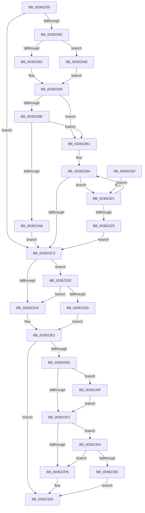

# MiUpdateWorkingSetPrivateSize

- RVA: `0x00362250`–`0x0036236D` (길이 `285` bytes)
- VA: `0x0000000140362250`
- 실행 섹션: `.text`
- PDB 이름 있음: `예`; PDB Function 태그: `아니요`
- unwind 정보 RVA: `0x00079DC0`
- 디코드: `75`개 명령, `285/285` bytes 표시
- 미해석 바이트: `0` (있으면 어셈블리에 `.byte`로 보존)

> 이 문서는 커널 이미지의 기계어와 PDB 기호를 분석해 생성했습니다. 4번과 5번은 함수 원형과 자료형을 바이너리 사용 방식에서 추정한 C 해석이며 원본 소스 복구 결과는 아닙니다.

## 1. Dependencies

- 직접 호출 지점: **3**; 고유 호출 대상: **3**
- 직접 호출자로 확인된 함수: **4**
- RIP 상대 이미지 참조: **3**

### Outgoing calls
- `0x003622AA` → [ExpAcquireSpinLockSharedAtDpcLevelInstrumented](../27/ExpAcquireSpinLockSharedAtDpcLevelInstrumented_function_0027CD20.md) (function, `0x0027CD20`)
- `0x00362327` → [ExpWaitForSpinLockSharedAndAcquire](ExpWaitForSpinLockSharedAndAcquire_function_00362380.md) (function, `0x00362380`)
- `0x00362366` → [ExpReleaseSpinLockSharedFromDpcLevelInstrumented](../2F/ExpReleaseSpinLockSharedFromDpcLevelInstrumented_function_002F0F48.md) (function, `0x002F0F48`)

### Direct callers
- [MiDemoteCombinedPte](../22/MiDemoteCombinedPte_function_0022ABAC.md) at `0x0022AEB4`
- [MiCombineInitialInstance](../22/MiCombineInitialInstance_function_0022BC0C.md) at `0x0022C33D`
- [MiBuildForkPte](../22/MiBuildForkPte_function_0022E32C.md) at `0x0022E769`
- [MiCopyOnWrite](MiCopyOnWrite_function_00362A0C.md) at `0x00362D6C`

### Static image references
- `0x0036226A` → RVA `0x00E38880` (`.data`; read)
- `0x00362295` → RVA `0x00FC6B06` (`ALMOSTRO`; read)
- `0x0036229E` → RVA `0x00F0DE58` (`.data`; read)

## 2. Other-region calls and transfers

- 다른 실행 섹션으로 향하는 call: **0**
- 별도 외부 분기/꼬리 이동을 확인하지 못했습니다.

## 3. Assembly (complete function range)

```asm
00362250  48 89 5C 24 08                  mov qword ptr [rsp + 8], rbx
00362255  48 89 6C 24 10                  mov qword ptr [rsp + 0x10], rbp
0036225A  48 89 74 24 18                  mov qword ptr [rsp + 0x18], rsi
0036225F  48 89 7C 24 20                  mov qword ptr [rsp + 0x20], rdi
00362264  41 56                           push r14
00362266  48 83 EC 20                     sub rsp, 0x20
0036226A  48 8D 3D 0F 66 AD 00            lea rdi, [rip + 0xad660f]
00362271  41 8B E9                        mov ebp, r9d
00362274  49 8B F0                        mov rsi, r8
00362277  4C 8B F2                        mov r14, rdx
0036227A  48 8B D9                        mov rbx, rcx
0036227D  45 85 C9                        test r9d, r9d
00362280  75 41                           jne 0x1403622c3
00362282  8B 81 B8 00 00 00               mov eax, dword ptr [rcx + 0xb8]
00362288  24 0F                           and al, 0xf
0036228A  3C 01                           cmp al, 1
0036228C  0F 85 B6 00 00 00               jne 0x140362348
00362292  48 8B CF                        mov rcx, rdi
00362295  F6 05 6A 48 C6 00 21            test byte ptr [rip + 0xc6486a], 0x21
0036229C  74 13                           je 0x1403622b1
0036229E  8B 05 B4 BB BA 00               mov eax, dword ptr [rip + 0xbabbb4]
003622A4  85 C0                           test eax, eax
003622A6  75 09                           jne 0x1403622b1
003622A8  B2 FF                           mov dl, 0xff
003622AA  E8 71 AA F1 FF                  call 0x14027cd20
003622AF  EB 12                           jmp 0x1403622c3
003622B1  0F 0D 09                        prefetchw byte ptr [rcx]
003622B4  8B 01                           mov eax, dword ptr [rcx]
003622B6  0F BA F0 1F                     btr eax, 0x1f
003622BA  8D 50 01                        lea edx, [rax + 1]
003622BD  F0 0F B1 11                     lock cmpxchg dword ptr [rcx], edx
003622C1  75 5E                           jne 0x140362321
003622C3  F0 48 01 B3 98 00 00 00         lock add qword ptr [rbx + 0x98], rsi
003622CB  48 B8 00 00 00 00 80 F6 FF FF   movabs rax, 0xfffff68000000000
003622D5  4C 3B F0                        cmp r14, rax
003622D8  73 54                           jae 0x14036232e
003622DA  F0 48 01 B3 88 00 00 00         lock add qword ptr [rbx + 0x88], rsi
003622E2  85 ED                           test ebp, ebp
003622E4  75 1F                           jne 0x140362305
003622E6  8B 83 B8 00 00 00               mov eax, dword ptr [rbx + 0xb8]
003622EC  24 0F                           and al, 0xf
003622EE  3C 01                           cmp al, 1
003622F0  75 4D                           jne 0x14036233f
003622F2  F6 05 0D 48 C6 00 01            test byte ptr [rip + 0xc6480d], 1
003622F9  75 59                           jne 0x140362354
003622FB  F0 81 27 FF FF FF BF            lock and dword ptr [rdi], 0xbfffffff
00362302  F0 FF 0F                        lock dec dword ptr [rdi]
00362305  48 8B 5C 24 30                  mov rbx, qword ptr [rsp + 0x30]
0036230A  48 8B 6C 24 38                  mov rbp, qword ptr [rsp + 0x38]
0036230F  48 8B 74 24 40                  mov rsi, qword ptr [rsp + 0x40]
00362314  48 8B 7C 24 48                  mov rdi, qword ptr [rsp + 0x48]
00362319  48 83 C4 20                     add rsp, 0x20
0036231D  41 5E                           pop r14
0036231F  C3                              ret
00362320  CC                              int3
00362321  85 C0                           test eax, eax
00362323  79 95                           jns 0x1403622ba
00362325  B2 FF                           mov dl, 0xff
00362327  E8 54 00 00 00                  call 0x140362380
0036232C  EB 95                           jmp 0x1403622c3
0036232E  48 B8 FF FF FF FF FF F6 FF FF   movabs rax, 0xfffff6ffffffffff
00362338  4C 3B F0                        cmp r14, rax
0036233B  77 9D                           ja 0x1403622da
0036233D  EB A3                           jmp 0x1403622e2
0036233F  48 8D BB 00 01 00 00            lea rdi, [rbx + 0x100]
00362346  EB AA                           jmp 0x1403622f2
00362348  48 81 C1 00 01 00 00            add rcx, 0x100
0036234F  E9 41 FF FF FF                  jmp 0x140362295
00362354  8B 05 FE BA BA 00               mov eax, dword ptr [rip + 0xbabafe]
0036235A  85 C0                           test eax, eax
0036235C  75 9D                           jne 0x1403622fb
0036235E  48 8B 54 24 28                  mov rdx, qword ptr [rsp + 0x28]
00362363  48 8B CF                        mov rcx, rdi
00362366  E8 DD EB F8 FF                  call 0x1402f0f48
0036236B  EB 98                           jmp 0x140362305
```

## 4. C-style interpretation (structured pseudocode)

```c
__int64 __fastcall MiUpdateWorkingSetPrivateSize(__int64 a1, __int64 a2, __int64 a3, int a4)
{
    __int64 result;
    __int64 v_rsp;
    unsigned __int64 v_stack_p10;
    unsigned __int64 v_stack_p18;
    unsigned __int64 v_stack_p20;
    unsigned __int64 v_stack_p28;
    unsigned __int64 v_stack_p8;

    v_stack_p8 = v_rbx;
    v_stack_p10 = v_rbp;
    v_stack_p18 = v_rsi;
    v_stack_p20 = v_rdi;
    v_rsp = (v_rsp) - (32);
    if (a4 != 0) goto loc_003622C3;
    result = (unsigned __int8)(((unsigned int)(*(unsigned int *)(a1 + 184))) & (15));
    if (((unsigned __int8)(result)) != 1) goto loc_00362348;
loc_00362295:
    if (((*(unsigned __int8 *)(v_rip + 12994666)) & (33)) == 0) goto loc_003622B1;
    if ((unsigned int)((unsigned int)(*(unsigned int *)(v_rip + 12237748))) != 0) goto loc_003622B1;
    result = ExpAcquireSpinLockSharedAtDpcLevelInstrumented(v_rip + 11363855, 255, a3, a4);
    goto loc_003622C3;
loc_003622B1:
loc_003622BA:
    if ((unsigned int)((unsigned int)(*(unsigned int *)(v_rip + 12237748))) != 0) goto loc_00362321;
loc_003622C3:
    if (a2 >= ((unsigned int)(*(unsigned int *)(v_rip + 11363855)))) goto loc_0036232E;
loc_003622DA:
loc_003622E2:
    if ((unsigned int)((unsigned int)(a4)) != 0) goto loc_00362305;
    result = (unsigned __int8)(((unsigned int)(*(unsigned int *)(a1 + 184))) & (15));
    if (((unsigned __int8)(result)) != 1) goto loc_0036233F;
loc_003622F2:
    if (((*(unsigned __int8 *)(v_rip + 12994573)) & (1)) != 0) goto loc_00362354;
loc_003622FB:
loc_00362305:
    v_rsp = (v_rsp) + (32);
    return result;
loc_00362321:
    if (!sign_flag) goto loc_003622BA;
    result = ExpWaitForSpinLockSharedAndAcquire(v_rip + 11363855, 255, a3, a4);
    goto loc_003622C3;
loc_0036232E:
    if (a2 > result) goto loc_003622DA;
    goto loc_003622E2;
loc_0036233F:
    goto loc_003622F2;
loc_00362348:
    a1 = (v_rip + 11363855) + (256);
    goto loc_00362295;
loc_00362354:
    if ((unsigned int)((unsigned int)(*(unsigned int *)(v_rip + 12237566))) != 0) goto loc_003622FB;
    result = ExpReleaseSpinLockSharedFromDpcLevelInstrumented(v_stack_p8 + 256, v_stack_p28, a3, a4);
    goto loc_00362305;
}
```

## 5. (Beta) C Style

```c
int64_t MiUpdateWorkingSetPrivateSize(void *Arg1, int64_t Arg2, int64_t Arg3, int32_t Arg4)
{
    uint8_t *arg1 = (uint8_t *)Arg1;

    int64_t result;
    int64_t local_rsp;
    uint64_t v_stack_p10;
    uint64_t v_stack_p18;
    uint64_t v_stack_p20;
    uint64_t v_stack_p28;
    uint64_t v_stack_p8;

    v_stack_p8 = local_rbx;
    v_stack_p10 = local_rbp;
    v_stack_p18 = local_rsi;
    v_stack_p20 = local_rdi;
    local_rsp = (local_rsp) - (32);
    if (Arg4 != 0) goto loc_003622C3;
    result = (uint8_t)(((uint32_t)(*(uint32_t *)(arg1 + 0xB8))) & (15));
    if (((uint8_t)(result)) != 1) goto loc_00362348;
loc_00362295:
    if (((*(uint8_t *)(v_rip + 0xC6486A)) & (33)) == 0) goto loc_003622B1;
    if ((uint32_t)((uint32_t)(*(uint32_t *)(v_rip + 0xBABBB4))) != 0) goto loc_003622B1;
    result = ExpAcquireSpinLockSharedAtDpcLevelInstrumented(v_rip + 11363855, 255, Arg3, Arg4);
    goto loc_003622C3;
loc_003622B1:
loc_003622BA:
    if ((uint32_t)((uint32_t)(*(uint32_t *)(v_rip + 0xBABBB4))) != 0) goto loc_00362321;
loc_003622C3:
    if (Arg2 >= ((uint32_t)(*(uint32_t *)(v_rip + 0xAD660F)))) goto loc_0036232E;
loc_003622DA:
loc_003622E2:
    if ((uint32_t)((uint32_t)(Arg4)) != 0) goto loc_00362305;
    result = (uint8_t)(((uint32_t)(*(uint32_t *)(arg1 + 0xB8))) & (15));
    if (((uint8_t)(result)) != 1) goto loc_0036233F;
loc_003622F2:
    if (((*(uint8_t *)(v_rip + 0xC6480D)) & (1)) != 0) goto loc_00362354;
loc_003622FB:
loc_00362305:
    local_rsp = (local_rsp) + (32);
    return result;
loc_00362321:
    if (!sign_flag) goto loc_003622BA;
    result = ExpWaitForSpinLockSharedAndAcquire(v_rip + 11363855, 255, Arg3, Arg4);
    goto loc_003622C3;
loc_0036232E:
    if (Arg2 > result) goto loc_003622DA;
    goto loc_003622E2;
loc_0036233F:
    goto loc_003622F2;
loc_00362348:
    Arg1 = (v_rip + 11363855) + (256);
    goto loc_00362295;
loc_00362354:
    if ((uint32_t)((uint32_t)(*(uint32_t *)(v_rip + 0xBABAFE))) != 0) goto loc_003622FB;
    result = ExpReleaseSpinLockSharedFromDpcLevelInstrumented(v_stack_p8 + 256, v_stack_p28, Arg3, Arg4);
    goto loc_00362305;
}
```

### 관측된 메모리 오프셋

구조체 형식이 확인되지 않은 접근은 인자 기준의 오프셋으로만 기록했습니다.

| 기준 인자 | 오프셋 표현 | 폭 (bit) | 접근 |
|---|---:|---:|---|
| `Arg1` | `+ 0x88` | `64` | `R/W` |
| `Arg1` | `+ 0x98` | `64` | `R/W` |
| `Arg1` | `+ 0xB8` | `32` | `R` |
| `Arg1` | `+ 0x100` | `64` | `R` |

## 6. Execution-region graph

[열기: 2D/3D 그래프와 함수 탐색 컨트롤 패널](../../../control-panel.html?section=text&rva=0x00362250&view=graph)

- 2D 그래프는 위에서 아래로 흐르고, 3D 그래프는 빈 공간을 드래그해 회전합니다. Shift+드래그는 이동, 휠은 확대·축소, 함수 노드 선택은 대상 보고서 이동입니다.

### Static fallback


