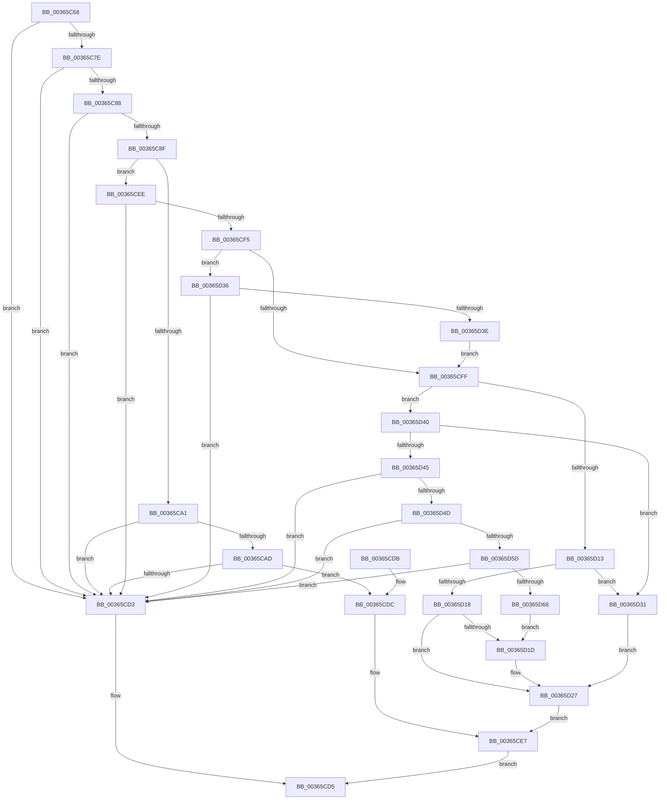

# MiUseSlabAllocator

- RVA: `0x00365C68`–`0x00365D68` (길이 `256` bytes)
- VA: `0x0000000140365C68`
- 실행 섹션: `.text`
- PDB 이름 있음: `예`; PDB Function 태그: `아니요`
- unwind 정보 RVA: `0x00079F7C`
- 디코드: `74`개 명령, `256/256` bytes 표시
- 미해석 바이트: `0` (있으면 어셈블리에 `.byte`로 보존)

> 이 문서는 커널 이미지의 기계어와 PDB 기호를 분석해 생성했습니다. 4번과 5번은 함수 원형과 자료형을 바이너리 사용 방식에서 추정한 C 해석이며 원본 소스 복구 결과는 아닙니다.

## 1. Dependencies

- 직접 호출 지점: **0**; 고유 호출 대상: **0**
- 직접 호출자로 확인된 함수: **7**
- RIP 상대 이미지 참조: **2**

### Outgoing calls
- 직접 디코드된 call 명령이 없습니다.

### Direct callers
- [MiGetHardFaultPages](MiGetHardFaultPages_function_0036200C.md) at `0x00362087`
- [MiPfPutPagesInTransition](MiPfPutPagesInTransition_function_003640EC.md) at `0x00364470`
- [MiWalkEntireImage](MiWalkEntireImage_function_00365D70.md) at `0x00366A5E`
- [MiResolveMappedFileFault](MiResolveMappedFileFault_function_0036B640.md) at `0x0036B9C4`
- [MiFinalizeImageHeaderPage](../4A/MiFinalizeImageHeaderPage_function_004A89A8.md) at `0x004A8A25`
- [MiPfPrepareReadList](../../page/93/MiPfPrepareReadList_function_0093CD5C.md) at `0x0093D1F6`
- [MiPfPrepareSequentialReadList](../../page/93/MiPfPrepareSequentialReadList_function_0093D8E8.md) at `0x0093DD85`

### Static image references
- `0x00365CA4` → RVA `0x00E2D92D` (`.data`; read)
- `0x00365CFF` → RVA `0x00FC6A88` (`ALMOSTRO`; read)

## 2. Other-region calls and transfers

- 다른 실행 섹션으로 향하는 call: **0**
- 별도 외부 분기/꼬리 이동을 확인하지 못했습니다.

## 3. Assembly (complete function range)

```asm
00365C68  48 89 5C 24 08                  mov qword ptr [rsp + 8], rbx
00365C6D  4C 8B 12                        mov r10, qword ptr [rdx]
00365C70  4C 8B DA                        mov r11, rdx
00365C73  48 8B D9                        mov rbx, rcx
00365C76  41 8B 42 38                     mov eax, dword ptr [r10 + 0x38]
00365C7A  A8 20                           test al, 0x20
00365C7C  74 55                           je 0x140365cd3
00365C7E  41 8A 42 3E                     mov al, byte ptr [r10 + 0x3e]
00365C82  24 0C                           and al, 0xc
00365C84  3C 04                           cmp al, 4
00365C86  74 4B                           je 0x140365cd3
00365C88  49 0F BA E0 0A                  bt r8, 0xa
00365C8D  73 44                           jae 0x140365cd3
00365C8F  8B 52 20                        mov edx, dword ptr [rdx + 0x20]
00365C92  D1 EA                           shr edx, 1
00365C94  83 E2 1F                        and edx, 0x1f
00365C97  41 F7 42 5C 00 00 0C 00         test dword ptr [r10 + 0x5c], 0xc0000
00365C9F  75 4D                           jne 0x140365cee
00365CA1  45 33 C0                        xor r8d, r8d
00365CA4  44 38 05 82 7C AC 00            cmp byte ptr [rip + 0xac7c82], r8b
00365CAB  74 26                           je 0x140365cd3
00365CAD  41 8B C1                        mov eax, r9d
00365CB0  48 69 C8 80 DF 00 00            imul rcx, rax, 0xdf80
00365CB7  48 8B 43 10                     mov rax, qword ptr [rbx + 0x10]
00365CBB  48 8B 94 01 38 42 00 00         mov rdx, qword ptr [rcx + rax + 0x4238]
00365CC3  48 8B 84 01 28 42 00 00         mov rax, qword ptr [rcx + rax + 0x4228]
00365CCB  48 8B 00                        mov rax, qword ptr [rax]
00365CCE  48 03 C2                        add rax, rdx
00365CD1  75 09                           jne 0x140365cdc
00365CD3  33 C0                           xor eax, eax
00365CD5  48 8B 5C 24 08                  mov rbx, qword ptr [rsp + 8]
00365CDA  C3                              ret
00365CDB  CC                              int3
00365CDC  48 8B 44 24 28                  mov rax, qword ptr [rsp + 0x28]
00365CE1  C7 00 05 00 00 00               mov dword ptr [rax], 5
00365CE7  B8 01 00 00 00                  mov eax, 1
00365CEC  EB E7                           jmp 0x140365cd5
00365CEE  8B 41 04                        mov eax, dword ptr [rcx + 4]
00365CF1  A8 08                           test al, 8
00365CF3  74 DE                           je 0x140365cd3
00365CF5  41 8B 43 20                     mov eax, dword ptr [r11 + 0x20]
00365CF9  0F BA E0 11                     bt eax, 0x11
00365CFD  72 37                           jb 0x140365d36
00365CFF  48 8B 05 82 0D C6 00            mov rax, qword ptr [rip + 0xc60d82]
00365D06  41 B8 02 00 00 00               mov r8d, 2
00365D0C  48 0F BA E0 20                  bt rax, 0x20
00365D11  72 2D                           jb 0x140365d40
00365D13  41 84 D0                        test r8b, dl
00365D16  75 19                           jne 0x140365d31
00365D18  F6 C2 01                        test dl, 1
00365D1B  74 0A                           je 0x140365d27
00365D1D  48 C1 E8 0F                     shr rax, 0xf
00365D21  83 E0 01                        and eax, 1
00365D24  44 8B C0                        mov r8d, eax
00365D27  48 8B 4C 24 28                  mov rcx, qword ptr [rsp + 0x28]
00365D2C  44 89 01                        mov dword ptr [rcx], r8d
00365D2F  EB B6                           jmp 0x140365ce7
00365D31  45 33 C0                        xor r8d, r8d
00365D34  EB F1                           jmp 0x140365d27
00365D36  8B C2                           mov eax, edx
00365D38  24 05                           and al, 5
00365D3A  3C 04                           cmp al, 4
00365D3C  74 95                           je 0x140365cd3
00365D3E  EB BF                           jmp 0x140365cff
00365D40  41 84 D0                        test r8b, dl
00365D43  75 EC                           jne 0x140365d31
00365D45  41 0F BA 62 5C 11               bt dword ptr [r10 + 0x5c], 0x11
00365D4B  73 86                           jae 0x140365cd3
00365D4D  49 8D 8A 80 00 00 00            lea rcx, [r10 + 0x80]
00365D54  4C 3B D9                        cmp r11, rcx
00365D57  0F 84 76 FF FF FF               je 0x140365cd3
00365D5D  83 FA 01                        cmp edx, 1
00365D60  0F 85 6D FF FF FF               jne 0x140365cd3
00365D66  EB B5                           jmp 0x140365d1d
```

## 4. C-style interpretation (structured pseudocode)

```c
__int64 __fastcall MiUseSlabAllocator(__int64 a1, __int64 a2, __int64 a3, int a4, __int64 a5)
{
    __int64 result;
    unsigned __int64 v_stack_p8;

    v_stack_p8 = v_rbx;
    if ((((unsigned __int8)((unsigned int)(*(unsigned int *)(*(unsigned __int64 *)(a2) + 56)))) & (32)) == 0) goto loc_00365CD3;
    result = (unsigned __int8)((*(unsigned __int8 *)(*(unsigned __int64 *)(a2) + 62)) & (12));
    if (((unsigned __int8)(result)) == 4) goto loc_00365CD3;
    if (((unsigned __int8)(result)) >= 4) goto loc_00365CD3;
    a2 = (unsigned int)(((unsigned int)(*(unsigned int *)(a2 + 32))) >> (1));
    a2 = (unsigned int)((a2) & (31));
    if (((*(unsigned int *)(*(unsigned __int64 *)(a2) + 92)) & (0xC0000ULL)) != 0) goto loc_00365CEE;
    a3 = 0;
    if ((*(unsigned __int8 *)(v_rip + 11304066)) == 0) goto loc_00365CD3;
    a1 = (a1) * ((unsigned int)(a4));
    result = (*(unsigned __int64 *)(*(unsigned __int64 *)(a1 + *(unsigned __int64 *)(a1 + 16) * 1 + 16936))) + (*(unsigned __int64 *)(a1 + *(unsigned __int64 *)(a1 + 16) * 1 + 16952));
    if (condition_is_not_equal) goto loc_00365CDC;
loc_00365CD3:
    result = 0;
loc_00365CD5:
    return result;
loc_00365CDC:
    *(unsigned int *)(a5) = 5;
loc_00365CE7:
    goto loc_00365CD5;
loc_00365CEE:
    if ((((unsigned __int8)((unsigned int)(*(unsigned int *)(a1 + 4)))) & (8)) == 0) goto loc_00365CD3;
    if (condition_is_below) goto loc_00365D36;
loc_00365CFF:
    if (condition_is_below) goto loc_00365D40;
    if (((2) & ((unsigned __int8)(*(unsigned __int64 *)(a1 + *(unsigned __int64 *)(a1 + 16) * 1 + 16952)))) != 0) goto loc_00365D31;
    result = *(unsigned __int64 *)(v_rip + 12979586);
    if ((((unsigned __int8)(*(unsigned __int64 *)(a1 + *(unsigned __int64 *)(a1 + 16) * 1 + 16952))) & (1)) != 0) {
        result = (*(unsigned __int64 *)(v_rip + 12979586)) >> (15);
        result = (unsigned int)((result) & (1));
        a3 = (unsigned int)(result);
    }
    *(unsigned int *)(a5) = (unsigned int)(a3);
    goto loc_00365CE7;
loc_00365D31:
    a3 = 0;
    goto loc_00365D27;
loc_00365D36:
    result = (unsigned __int8)(((unsigned int)((unsigned int)(*(unsigned __int64 *)(a1 + *(unsigned __int64 *)(a1 + 16) * 1 + 16952)))) & (5));
    if (((unsigned __int8)(result)) == 4) goto loc_00365CD3;
    goto loc_00365CFF;
loc_00365D40:
    if (((0) & ((unsigned __int8)(*(unsigned __int64 *)(a1 + *(unsigned __int64 *)(a1 + 16) * 1 + 16952)))) != 0) goto loc_00365D31;
    if (condition_is_above_or_equal) goto loc_00365CD3;
    if (a2 == (*(unsigned __int64 *)(a2) + 128)) goto loc_00365CD3;
    if (((unsigned int)(*(unsigned __int64 *)(a1 + *(unsigned __int64 *)(a1 + 16) * 1 + 16952))) != 1) goto loc_00365CD3;
    goto loc_00365D1D;
}
```

## 5. (Beta) C Style

```c
int64_t MiUseSlabAllocator(void *Arg1, void *Arg2, int64_t Arg3, int32_t Arg4, void *Arg5)
{
    uint8_t *arg1 = (uint8_t *)Arg1;
    uint8_t *arg2 = (uint8_t *)Arg2;
    uint8_t *arg5 = (uint8_t *)Arg5;

    int64_t result;
    uint64_t v_stack_p8;

    v_stack_p8 = local_rbx;
    if ((((uint8_t)((uint32_t)(*(uint32_t *)(*(uint64_t *)(arg2) + 0x38)))) & (32)) == 0) goto loc_00365CD3;
    result = (uint8_t)((*(uint8_t *)(*(uint64_t *)(arg2) + 0x3E)) & (12));
    if (((uint8_t)(result)) == 4) goto loc_00365CD3;
    if (((uint8_t)(result)) >= 4) goto loc_00365CD3;
    Arg2 = (uint32_t)(((uint32_t)(*(uint32_t *)(arg2 + 0x20))) >> (1));
    Arg2 = (uint32_t)((Arg2) & (31));
    if (((*(uint32_t *)(*(uint64_t *)(arg2) + 0x5C)) & (0xC0000ULL)) != 0) goto loc_00365CEE;
    Arg3 = 0;
    if ((*(uint8_t *)(v_rip + 0xAC7C82)) == 0) goto loc_00365CD3;
    Arg1 = (Arg1) * ((uint32_t)(Arg4));
    result = (*(uint64_t *)(*(uint64_t *)(arg1 + *(uint64_t *)(arg1 + 0x10) * 1 + 0x4228))) + (*(uint64_t *)(arg1 + *(uint64_t *)(arg1 + 0x10) * 1 + 0x4238));
    if (condition_is_not_equal) goto loc_00365CDC;
loc_00365CD3:
    result = 0;
loc_00365CD5:
    return result;
loc_00365CDC:
    *(uint32_t *)(arg5) = 5;
loc_00365CE7:
    goto loc_00365CD5;
loc_00365CEE:
    if ((((uint8_t)((uint32_t)(*(uint32_t *)(arg1 + 0x4)))) & (8)) == 0) goto loc_00365CD3;
    if (condition_is_below) goto loc_00365D36;
loc_00365CFF:
    if (condition_is_below) goto loc_00365D40;
    if (((2) & ((uint8_t)(*(uint64_t *)(arg1 + *(uint64_t *)(arg1 + 0x10) * 1 + 0x4238)))) != 0) goto loc_00365D31;
    result = *(uint64_t *)(v_rip + 0xC60D82);
    if ((((uint8_t)(*(uint64_t *)(arg1 + *(uint64_t *)(arg1 + 0x10) * 1 + 0x4238))) & (1)) != 0) {
        result = (*(uint64_t *)(v_rip + 0xC60D82)) >> (15);
        result = (uint32_t)((result) & (1));
        Arg3 = (uint32_t)(result);
    }
    *(uint32_t *)(arg5) = (uint32_t)(Arg3);
    goto loc_00365CE7;
loc_00365D31:
    Arg3 = 0;
    goto loc_00365D27;
loc_00365D36:
    result = (uint8_t)(((uint32_t)((uint32_t)(*(uint64_t *)(arg1 + *(uint64_t *)(arg1 + 0x10) * 1 + 0x4238)))) & (5));
    if (((uint8_t)(result)) == 4) goto loc_00365CD3;
    goto loc_00365CFF;
loc_00365D40:
    if (((0) & ((uint8_t)(*(uint64_t *)(arg1 + *(uint64_t *)(arg1 + 0x10) * 1 + 0x4238)))) != 0) goto loc_00365D31;
    if (condition_is_above_or_equal) goto loc_00365CD3;
    if (Arg2 == (*(uint64_t *)(arg2) + 128)) goto loc_00365CD3;
    if (((uint32_t)(*(uint64_t *)(arg1 + *(uint64_t *)(arg1 + 0x10) * 1 + 0x4238))) != 1) goto loc_00365CD3;
    goto loc_00365D1D;
}
```

### 관측된 메모리 오프셋

구조체 형식이 확인되지 않은 접근은 인자 기준의 오프셋으로만 기록했습니다.

| 기준 인자 | 오프셋 표현 | 폭 (bit) | 접근 |
|---|---:|---:|---|
| `Arg1` | `+ 0x4` | `32` | `R` |
| `Arg1` | `+ 0x10` | `64` | `R` |
| `Arg1` | `+ 0x4228 + rax*1` | `64` | `R` |
| `Arg1` | `+ 0x4238 + rax*1` | `64` | `R` |
| `Arg2` | `+ 0x0` | `64` | `R` |
| `Arg2` | `+ 0x20` | `32` | `R` |
| `Arg5` | `+ 0x0` | `32` | `W` |

## 6. Execution-region graph

[열기: 2D/3D 그래프와 함수 탐색 컨트롤 패널](../../../control-panel.html?section=text&rva=0x00365C68&view=graph)

- 2D 그래프는 위에서 아래로 흐르고, 3D 그래프는 빈 공간을 드래그해 회전합니다. Shift+드래그는 이동, 휠은 확대·축소, 함수 노드 선택은 대상 보고서 이동입니다.

### Static fallback


