# MiWaitForCollidedFaultComplete

- RVA: `0x00369EDC`–`0x0036A221` (길이 `837` bytes)
- VA: `0x0000000140369EDC`
- 실행 섹션: `.text`
- PDB 이름 있음: `예`; PDB Function 태그: `예`
- unwind 정보 RVA: `0x0007A24C`
- 디코드: `214`개 명령, `837/837` bytes 표시
- 미해석 바이트: `0` (있으면 어셈블리에 `.byte`로 보존)

> 이 문서는 커널 이미지의 기계어와 PDB 기호를 분석해 생성했습니다. 4번과 5번은 함수 원형과 자료형을 바이너리 사용 방식에서 추정한 C 해석이며 원본 소스 복구 결과는 아닙니다.

## 1. Dependencies

- 직접 호출 지점: **23**; 고유 호출 대상: **18**
- 직접 호출자로 확인된 함수: **4**
- RIP 상대 이미지 참조: **2**

### Outgoing calls
- `0x00369F18` → [MI_READ_PTE_LOCK_FREE](../28/MI_READ_PTE_LOCK_FREE_function_002828A0.md) (function, `0x002828A0`)
- `0x00369F4F` → [MiAddLockedPageCharge](../28/MiAddLockedPageCharge_function_0028B550.md) (function, `0x0028B550`)
- `0x00369FA8` → [MiUnlockProtoPoolPage](../24/MiUnlockProtoPoolPage_function_00246090.md) (function, `0x00246090`)
- `0x00369FC6` → [MiReleaseFaultState](../27/MiReleaseFaultState_function_0027D290.md) (function, `0x0027D290`)
- `0x00369FFA` → [KeWaitForSingleObject](../20/KeWaitForSingleObject_function_0020E6B0.md) (function, `0x0020E6B0`)
- `0x0036A011` → [KeAbPreAcquire](../21/KeAbPreAcquire_function_00210230.md) (function, `0x00210230`)
- `0x0036A020` → [KeAbPostReleaseEx](../26/KeAbPostReleaseEx_function_00262210.md) (function, `0x00262210`)
- `0x0036A029` → [MiFreeInPageSupportBlock](../2B/MiFreeInPageSupportBlock_function_002B5900.md) (function, `0x002B5900`)
- `0x0036A049` → [MiRelockFaultState](MiRelockFaultState_function_0036A230.md) (function, `0x0036A230`)
- `0x0036A078` → [MiUnlockPage](../31/MiUnlockPage_function_0031A3E0.md) (function, `0x0031A3E0`)
- `0x0036A09D` → [MiRelockProtoPoolPage](../31/MiRelockProtoPoolPage_function_0031826C.md) (function, `0x0031826C`)
- `0x0036A0DC` → [MiIsFaultPteIntact](../32/MiIsFaultPteIntact_function_003288A0.md) (function, `0x003288A0`)
- `0x0036A0E8` → [MiRemoveLockedPageChargeAndDecRef](../24/MiRemoveLockedPageChargeAndDecRef_function_002459D0.md) (function, `0x002459D0`)
- `0x0036A0FB` → [MiImagePageOk](MiImagePageOk_function_00365AE0.md) (function, `0x00365AE0`)
- `0x0036A110` → [KeAbPreAcquire](../21/KeAbPreAcquire_function_00210230.md) (function, `0x00210230`)
- `0x0036A127` → [KeAbPreWait](../20/KeAbPreWait_function_0020E560.md) (function, `0x0020E560`)
- `0x0036A197` → [KiCheckVpBackingLongSpinWaitHypercall](../30/KiCheckVpBackingLongSpinWaitHypercall_function_0030F490.md) (function, `0x0030F490`)
- `0x0036A1A2` → [HvlNotifyLongSpinWait](../30/HvlNotifyLongSpinWait_function_0030F460.md) (function, `0x0030F460`)
- `0x0036A1AC` → [MiLockPageInline](../31/MiLockPageInline_function_0031A340.md) (function, `0x0031A340`)
- `0x0036A1C0` → [KiCheckVpBackingLongSpinWaitHypercall](../30/KiCheckVpBackingLongSpinWaitHypercall_function_0030F490.md) (function, `0x0030F490`)
- `0x0036A1CB` → [HvlNotifyLongSpinWait](../30/HvlNotifyLongSpinWait_function_0030F460.md) (function, `0x0030F460`)
- `0x0036A1E4` → [MiRemoveLockedPageChargeAndDecRef](../24/MiRemoveLockedPageChargeAndDecRef_function_002459D0.md) (function, `0x002459D0`)
- `0x0036A202` → [MiRemoveLockedPageChargeAndDecRef](../24/MiRemoveLockedPageChargeAndDecRef_function_002459D0.md) (function, `0x002459D0`)

### Direct callers
- [MiWalkEntireImage](MiWalkEntireImage_function_00365D70.md) at `0x00366C97`
- [MiHandleCollidedFault](MiHandleCollidedFault_function_00369B48.md) at `0x00369BE7`
- [MiFlushWaitForReadInProgress](../40/MiFlushWaitForReadInProgress_function_004032E0.md) at `0x00403363`
- [sub_006D6E94](../6D/Unknown_function_006D6E94.md) at `0x006D6F57`

### Static image references
- `0x0036A155` → RVA `0x00FC52AC` (`ALMOSTRO`; reference)
- `0x0036A18D` → RVA `0x00FC6AB8` (`ALMOSTRO`; read)

## 2. Other-region calls and transfers

- 다른 실행 섹션으로 향하는 call: **0**
- call이 아닌 외부 분기/꼬리 이동: **1**
  - `0x0036A21C` → [sub_006E3B88](../6E/Unknown_function_006E3B88.md) (`tail-transfer`)

## 3. Assembly (complete function range)

```asm
00369EDC  44 88 4C 24 20                  mov byte ptr [rsp + 0x20], r9b
00369EE1  48 89 4C 24 08                  mov qword ptr [rsp + 8], rcx
00369EE6  53                              push rbx
00369EE7  55                              push rbp
00369EE8  56                              push rsi
00369EE9  57                              push rdi
00369EEA  41 54                           push r12
00369EEC  41 55                           push r13
00369EEE  41 56                           push r14
00369EF0  41 57                           push r15
00369EF2  48 83 EC 48                     sub rsp, 0x48
00369EF6  48 8B 42 08                     mov rax, qword ptr [rdx + 8]
00369EFA  48 8B F1                        mov rsi, rcx
00369EFD  48 B9 00 00 00 00 00 00 00 80   movabs rcx, 0x8000000000000000
00369F07  49 8B D8                        mov rbx, r8
00369F0A  48 0B C1                        or rax, rcx
00369F0D  48 8B FA                        mov rdi, rdx
00369F10  48 8B C8                        mov rcx, rax
00369F13  48 89 44 24 30                  mov qword ptr [rsp + 0x30], rax
00369F18  E8 83 89 F1 FF                  call 0x1402828a0
00369F1D  4C 8B 2F                        mov r13, qword ptr [rdi]
00369F20  33 ED                           xor ebp, ebp
00369F22  4C 8B BC 24 B0 00 00 00         mov r15, qword ptr [rsp + 0xb0]
00369F2A  49 BC FF FF FF FF FF FF FF 7F   movabs r12, 0x7fffffffffffffff
00369F34  48 89 84 24 A0 00 00 00         mov qword ptr [rsp + 0xa0], rax
00369F3C  44 8D 75 01                     lea r14d, [rbp + 1]
00369F40  41 39 2F                        cmp dword ptr [r15], ebp
00369F43  0F 85 C3 02 00 00               jne 0x14036a20c
00369F49  8D 55 02                        lea edx, [rbp + 2]
00369F4C  48 8B CF                        mov rcx, rdi
00369F4F  E8 FC 15 F2 FF                  call 0x14028b550
00369F54  85 C0                           test eax, eax
00369F56  0F 84 98 02 00 00               je 0x14036a1f4
00369F5C  41 39 2F                        cmp dword ptr [r15], ebp
00369F5F  0F 85 A7 02 00 00               jne 0x14036a20c
00369F65  48 85 DB                        test rbx, rbx
00369F68  74 11                           je 0x140369f7b
00369F6A  8B 43 20                        mov eax, dword ptr [rbx + 0x20]
00369F6D  B9 FF 7F 00 00                  mov ecx, 0x7fff
00369F72  66 3B C1                        cmp ax, cx
00369F75  0F 83 81 02 00 00               jae 0x14036a1fc
00369F7B  41 39 2F                        cmp dword ptr [r15], ebp
00369F7E  0F 85 88 02 00 00               jne 0x14036a20c
00369F84  F0 45 01 B5 90 00 00 00         lock add dword ptr [r13 + 0x90], r14d
00369F8C  48 85 DB                        test rbx, rbx
00369F8F  0F 84 D5 00 00 00               je 0x14036a06a
00369F95  F0 4C 21 67 18                  lock and qword ptr [rdi + 0x18], r12
00369F9A  44 8A B4 24 A8 00 00 00         mov r14b, byte ptr [rsp + 0xa8]
00369FA2  48 8B CB                        mov rcx, rbx
00369FA5  41 8A D6                        mov dl, r14b
00369FA8  E8 E3 C0 ED FF                  call 0x140246090
00369FAD  48 83 C6 38                     add rsi, 0x38
00369FB1  48 89 AC 24 98 00 00 00         mov qword ptr [rsp + 0x98], rbp
00369FB9  48 39 2E                        cmp qword ptr [rsi], rbp
00369FBC  74 15                           je 0x140369fd3
00369FBE  45 33 C0                        xor r8d, r8d
00369FC1  B2 11                           mov dl, 0x11
00369FC3  48 8B CE                        mov rcx, rsi
00369FC6  E8 C5 32 F1 FF                  call 0x14027d290
00369FCB  48 89 84 24 98 00 00 00         mov qword ptr [rsp + 0x98], rax
00369FD3  49 8B 8D B8 00 00 00            mov rcx, qword ptr [r13 + 0xb8]
00369FDA  48 85 C9                        test rcx, rcx
00369FDD  0F 85 28 01 00 00               jne 0x14036a10b
00369FE3  4C 8B E6                        mov r12, rsi
00369FE6  48 83 64 24 20 00               and qword ptr [rsp + 0x20], 0
00369FEC  49 8D 4D 18                     lea rcx, [r13 + 0x18]
00369FF0  45 33 C9                        xor r9d, r9d
00369FF3  45 33 C0                        xor r8d, r8d
00369FF6  41 8D 51 09                     lea edx, [r9 + 9]
00369FFA  E8 B1 46 EA FF                  call 0x14020e6b0
00369FFF  48 85 ED                        test rbp, rbp
0036A002  74 21                           je 0x14036a025
0036A004  49 8B 8D B8 00 00 00            mov rcx, qword ptr [r13 + 0xb8]
0036A00B  45 33 C0                        xor r8d, r8d
0036A00E  48 8B D5                        mov rdx, rbp
0036A011  E8 1A 62 EA FF                  call 0x140210230
0036A016  49 8B 8D B8 00 00 00            mov rcx, qword ptr [r13 + 0xb8]
0036A01D  48 8B D5                        mov rdx, rbp
0036A020  E8 EB 81 EF FF                  call 0x140262210
0036A025  49 8D 4D E0                     lea rcx, [r13 - 0x20]
0036A029  E8 D2 B8 F4 FF                  call 0x1402b5900
0036A02E  45 33 ED                        xor r13d, r13d
0036A031  4D 39 2C 24                     cmp qword ptr [r12], r13
0036A035  0F 84 2F 01 00 00               je 0x14036a16a
0036A03B  48 8B 94 24 98 00 00 00         mov rdx, qword ptr [rsp + 0x98]
0036A043  48 8B CE                        mov rcx, rsi
0036A046  40 B5 01                        mov bpl, 1
0036A049  E8 E2 01 00 00                  call 0x14036a230
0036A04E  45 39 2F                        cmp dword ptr [r15], r13d
0036A051  74 2F                           je 0x14036a082
0036A053  B8 34 04 00 C0                  mov eax, 0xc0000434
0036A058  48 83 C4 48                     add rsp, 0x48
0036A05C  41 5F                           pop r15
0036A05E  41 5E                           pop r14
0036A060  41 5D                           pop r13
0036A062  41 5C                           pop r12
0036A064  5F                              pop rdi
0036A065  5E                              pop rsi
0036A066  5D                              pop rbp
0036A067  5B                              pop rbx
0036A068  C3                              ret
0036A069  CC                              int3
0036A06A  44 8A B4 24 A8 00 00 00         mov r14b, byte ptr [rsp + 0xa8]
0036A072  48 8B CF                        mov rcx, rdi
0036A075  41 8A D6                        mov dl, r14b
0036A078  E8 63 03 FB FF                  call 0x14031a3e0
0036A07D  E9 2B FF FF FF                  jmp 0x140369fad
0036A082  48 85 DB                        test rbx, rbx
0036A085  0F 84 B2 00 00 00               je 0x14036a13d
0036A08B  40 84 ED                        test bpl, bpl
0036A08E  48 8D 94 24 A8 00 00 00         lea rdx, [rsp + 0xa8]
0036A096  48 8B CB                        mov rcx, rbx
0036A099  49 0F 45 D5                     cmovne rdx, r13
0036A09D  E8 CA E1 FA FF                  call 0x14031826c
0036A0A2  41 8B DD                        mov ebx, r13d
0036A0A5  F0 48 0F BA 6F 18 3F            lock bts qword ptr [rdi + 0x18], 0x3f
0036A0AC  0F 82 C0 00 00 00               jb 0x14036a172
0036A0B2  48 8B 47 18                     mov rax, qword ptr [rdi + 0x18]
0036A0B6  48 0F BA E0 3E                  bt rax, 0x3e
0036A0BB  0F 82 11 01 00 00               jb 0x14036a1d2
0036A0C1  48 8B 9C 24 90 00 00 00         mov rbx, qword ptr [rsp + 0x90]
0036A0C9  4C 8D 8C 24 A0 00 00 00         lea r9, [rsp + 0xa0]
0036A0D1  4C 8B 44 24 30                  mov r8, qword ptr [rsp + 0x30]
0036A0D6  48 8B CB                        mov rcx, rbx
0036A0D9  48 8B 13                        mov rdx, qword ptr [rbx]
0036A0DC  E8 BF E7 FB FF                  call 0x1403288a0
0036A0E1  85 C0                           test eax, eax
0036A0E3  75 0D                           jne 0x14036a0f2
0036A0E5  48 8B CF                        mov rcx, rdi
0036A0E8  E8 E3 B8 ED FF                  call 0x1402459d0
0036A0ED  E9 61 FF FF FF                  jmp 0x14036a053
0036A0F2  48 8B 0B                        mov rcx, qword ptr [rbx]
0036A0F5  45 33 C9                        xor r9d, r9d
0036A0F8  48 8B D7                        mov rdx, rdi
0036A0FB  E8 E0 B9 FF FF                  call 0x140365ae0
0036A100  85 C0                           test eax, eax
0036A102  74 E1                           je 0x14036a0e5
0036A104  33 C0                           xor eax, eax
0036A106  E9 4D FF FF FF                  jmp 0x14036a058
0036A10B  45 33 C0                        xor r8d, r8d
0036A10E  33 D2                           xor edx, edx
0036A110  E8 1B 61 EA FF                  call 0x140210230
0036A115  48 8B E8                        mov rbp, rax
0036A118  4C 8B E6                        mov r12, rsi
0036A11B  48 85 C0                        test rax, rax
0036A11E  0F 84 C2 FE FF FF               je 0x140369fe6
0036A124  48 8B C8                        mov rcx, rax
0036A127  E8 34 44 EA FF                  call 0x14020e560
0036A12C  4C 8B A4 24 90 00 00 00         mov r12, qword ptr [rsp + 0x90]
0036A134  49 83 C4 38                     add r12, 0x38
0036A138  E9 A9 FE FF FF                  jmp 0x140369fe6
0036A13D  41 80 FE 02                     cmp r14b, 2
0036A141  75 66                           jne 0x14036a1a9
0036A143  41 8B DD                        mov ebx, r13d
0036A146  F0 48 0F BA 6F 18 3F            lock bts qword ptr [rdi + 0x18], 0x3f
0036A14D  0F 83 5F FF FF FF               jae 0x14036a0b2
0036A153  FF C3                           inc ebx
0036A155  85 1D 51 B1 C5 00               test dword ptr [rip + 0xc5b151], ebx
0036A15B  74 59                           je 0x14036a1b6
0036A15D  F3 90                           pause
0036A15F  48 8B 47 18                     mov rax, qword ptr [rdi + 0x18]
0036A163  48 85 C0                        test rax, rax
0036A166  79 DE                           jns 0x14036a146
0036A168  EB E9                           jmp 0x14036a153
0036A16A  41 8A ED                        mov bpl, r13b
0036A16D  E9 DC FE FF FF                  jmp 0x14036a04e
0036A172  FF C3                           inc ebx
0036A174  85 1D 32 B1 C5 00               test dword ptr [rip + 0xc5b132], ebx
0036A17A  74 11                           je 0x14036a18d
0036A17C  F3 90                           pause
0036A17E  48 8B 47 18                     mov rax, qword ptr [rdi + 0x18]
0036A182  48 85 C0                        test rax, rax
0036A185  0F 89 1A FF FF FF               jns 0x14036a0a5
0036A18B  EB E5                           jmp 0x14036a172
0036A18D  8B 05 25 C9 C5 00               mov eax, dword ptr [rip + 0xc5c925]
0036A193  A8 40                           test al, 0x40
0036A195  74 E5                           je 0x14036a17c
0036A197  E8 F4 52 FA FF                  call 0x14030f490
0036A19C  84 C0                           test al, al
0036A19E  74 DC                           je 0x14036a17c
0036A1A0  8B CB                           mov ecx, ebx
0036A1A2  E8 B9 52 FA FF                  call 0x14030f460
0036A1A7  EB D5                           jmp 0x14036a17e
0036A1A9  48 8B CF                        mov rcx, rdi
0036A1AC  E8 8F 01 FB FF                  call 0x14031a340
0036A1B1  E9 FC FE FF FF                  jmp 0x14036a0b2
0036A1B6  8B 05 FC C8 C5 00               mov eax, dword ptr [rip + 0xc5c8fc]
0036A1BC  A8 40                           test al, 0x40
0036A1BE  74 9D                           je 0x14036a15d
0036A1C0  E8 CB 52 FA FF                  call 0x14030f490
0036A1C5  84 C0                           test al, al
0036A1C7  74 94                           je 0x14036a15d
0036A1C9  8B CB                           mov ecx, ebx
0036A1CB  E8 90 52 FA FF                  call 0x14030f460
0036A1D0  EB 8D                           jmp 0x14036a15f
0036A1D2  8A 47 23                        mov al, byte ptr [rdi + 0x23]
0036A1D5  48 8B CF                        mov rcx, rdi
0036A1D8  24 10                           and al, 0x10
0036A1DA  F6 D8                           neg al
0036A1DC  1B DB                           sbb ebx, ebx
0036A1DE  81 E3 E3 FB FF FF               and ebx, 0xfffffbe3
0036A1E4  E8 E7 B7 ED FF                  call 0x1402459d0
0036A1E9  8D 83 34 04 00 C0               lea eax, [rbx - 0x3ffffbcc]
0036A1EF  E9 64 FE FF FF                  jmp 0x14036a058
0036A1F4  45 89 37                        mov dword ptr [r15], r14d
0036A1F7  E9 60 FD FF FF                  jmp 0x140369f5c
0036A1FC  48 8B CF                        mov rcx, rdi
0036A1FF  45 89 37                        mov dword ptr [r15], r14d
0036A202  E8 C9 B7 ED FF                  call 0x1402459d0
0036A207  E9 6F FD FF FF                  jmp 0x140369f7b
0036A20C  48 85 DB                        test rbx, rbx
0036A20F  0F 84 6F FD FF FF               je 0x140369f84
0036A215  89 AC 24 B0 00 00 00            mov dword ptr [rsp + 0xb0], ebp
0036A21C  E9 67 99 37 00                  jmp 0x1406e3b88
```

## 4. C-style interpretation (structured pseudocode)

```c
__int64 __fastcall MiWaitForCollidedFaultComplete(__int64 a1, __int64 a2, __int64 a3, int a4, __int64 a5)
{
    __int64 result;
    __int64 v_r12;
    __int64 v_r13;
    __int64 v_rbp;
    __int64 v_rbx;
    __int64 v_rsi;
    __int64 v_rsp;
    unsigned __int64 v_stack_m58;
    unsigned __int64 v_stack_m68;
    unsigned __int64 v_stack_p10;
    unsigned __int64 v_stack_p18;
    unsigned __int8 v_stack_p20;
    unsigned __int64 v_stack_p30;
    unsigned __int64 v_stack_p8;
    unsigned __int64 v_stack_p90;
    unsigned __int64 v_stack_pA0;
    unsigned __int8 v_stack_pA8;
    unsigned int v_stack_pB0;

    v_stack_p20 = (unsigned __int8)(a4);
    v_stack_p8 = a1;
    v_rsp = (v_rsp) - (72);
    result = (*(unsigned __int64 *)(a2 + 8)) | (a1);
    v_stack_m58 = result;
    result = MI_READ_PTE_LOCK_FREE(result, a2, a3, a4);
    v_rbp = 0;
    v_stack_p18 = result;
    if ((*(unsigned int *)(a5)) != 0) goto loc_0036A20C;
    result = MiAddLockedPageCharge(a2, v_rbp + 2, a3, a4);
    if ((unsigned int)(result) == 0) goto loc_0036A1F4;
loc_00369F5C:
    if ((*(unsigned int *)(a5)) != 0) goto loc_0036A20C;
    if (a3 == 0) goto loc_00369F7B;
    if (((unsigned __int16)((unsigned int)(*(unsigned int *)(a3 + 32)))) >= ((unsigned __int16)((unsigned int)(0x7FFFULL)))) goto loc_0036A1FC;
loc_00369F7B:
    if ((*(unsigned int *)(a5)) != 0) goto loc_0036A20C;
loc_00369F84:
    if (a3 == 0) goto loc_0036A06A;
    result = MiUnlockProtoPoolPage(a3, (unsigned __int8)(v_stack_p20), a3, a4);
loc_00369FAD:
    v_rsi = (a1) + (56);
    v_stack_p10 = 0;
    if ((*(unsigned __int64 *)(v_rsi)) != 0) {
        a3 = 0;
        a2 = 17;
        a1 = v_rsi;
        result = MiReleaseFaultState(a1, a2, a3, a4);
        v_stack_p10 = result;
    }
    if (*(unsigned __int64 *)(*(unsigned __int64 *)(a2) + 184) != 0) goto loc_0036A10B;
loc_00369FE6:
    a4 = 0;
    a3 = 0;
    result = KeWaitForSingleObject(*(unsigned __int64 *)(a2) + 24, a4 + 9, a3, a4);
    if (0 != 0) {
        a1 = *(unsigned __int64 *)(*(unsigned __int64 *)(a2) + 184);
        a3 = 0;
        a2 = 0;
        result = KeAbPreAcquire(a1, a2, a3, a4);
        a1 = *(unsigned __int64 *)(*(unsigned __int64 *)(a2) + 184);
        a2 = 0;
        result = KeAbPostReleaseEx(a1, a2, a3, a4);
    }
    result = MiFreeInPageSupportBlock(*(unsigned __int64 *)(a2) - 32, a2, a3, a4);
    v_r13 = 0;
    if ((*(unsigned __int64 *)(v_rsi)) == 0) goto loc_0036A16A;
    result = MiRelockFaultState(v_rsi, v_stack_p10, a3, a4);
loc_0036A04E:
    if ((*(unsigned int *)(a5)) == 0) goto loc_0036A082;
loc_0036A053:
loc_0036A058:
    v_rsp = (v_rsp) + (72);
    return (unsigned int)(0xC0000434ULL);
loc_0036A06A:
    result = MiUnlockPage(a2, (unsigned __int8)(v_stack_pA8), a3, a4);
    goto loc_00369FAD;
loc_0036A082:
    if (0 == 0) goto loc_0036A13D;
    a2 = v_stack_pA8;
    if (1 != 0) { a2 = 0; }
    result = MiRelockProtoPoolPage(0, a2, a3, a4);
loc_0036A0A5:
    if (condition_is_below) goto loc_0036A172;
loc_0036A0B2:
    if (condition_is_below) goto loc_0036A1D2;
    result = MiIsFaultPteIntact(v_stack_p90, *(unsigned __int64 *)(v_stack_p90), v_stack_p30, v_stack_pA0);
    if ((unsigned int)(result) != 0) goto loc_0036A0F2;
loc_0036A0E5:
    result = MiRemoveLockedPageChargeAndDecRef(a2, *(unsigned __int64 *)(v_stack_p90), v_stack_p30, v_stack_pA0);
    goto loc_0036A053;
loc_0036A0F2:
    a4 = 0;
    result = MiImagePageOk(*(unsigned __int64 *)(v_stack_p90), a2, v_stack_p30, a4);
    if ((unsigned int)(result) == 0) goto loc_0036A0E5;
    result = 0;
    goto loc_0036A058;
loc_0036A10B:
    a3 = 0;
    a2 = 0;
    result = KeAbPreAcquire(*(unsigned __int64 *)(v_stack_p90), a2, a3, a4);
    if (result == 0) goto loc_00369FE6;
    result = KeAbPreWait(result, a2, a3, a4);
    v_r12 = (v_stack_p90) + (56);
    goto loc_00369FE6;
loc_0036A13D:
    if (((unsigned __int8)(v_stack_pA8)) != 2) goto loc_0036A1A9;
loc_0036A146:
    if (((unsigned __int8)(v_stack_pA8)) >= 2) goto loc_0036A0B2;
loc_0036A153:
    v_rbx = (unsigned int)((0) + 1);
    if (((*(unsigned int *)(v_rip + 12955985)) & ((unsigned int)(v_rbx))) == 0) goto loc_0036A1B6;
loc_0036A15D:
loc_0036A15F:
    if (!sign_flag) goto loc_0036A146;
    goto loc_0036A153;
loc_0036A16A:
    goto loc_0036A04E;
loc_0036A172:
    v_rbx = (unsigned int)((v_rbx) + 1);
    if (((*(unsigned int *)(v_rip + 12955954)) & ((unsigned int)(v_rbx))) == 0) goto loc_0036A18D;
loc_0036A17C:
loc_0036A17E:
    if (!sign_flag) goto loc_0036A0A5;
    goto loc_0036A172;
loc_0036A18D:
    if ((((unsigned __int8)((unsigned int)(*(unsigned int *)(v_rip + 12962085)))) & (64)) == 0) goto loc_0036A17C;
    result = KiCheckVpBackingLongSpinWaitHypercall(result, a2, a3, a4);
    if ((unsigned __int8)(result) == 0) goto loc_0036A17C;
    result = HvlNotifyLongSpinWait((unsigned int)((unsigned int)(v_rbx)), a2, a3, a4);
    goto loc_0036A17E;
loc_0036A1A9:
    result = MiLockPageInline(0, a2, a3, a4);
    goto loc_0036A0B2;
loc_0036A1B6:
    if ((((unsigned __int8)((unsigned int)(*(unsigned int *)(v_rip + 12962044)))) & (64)) == 0) goto loc_0036A15D;
    result = KiCheckVpBackingLongSpinWaitHypercall(0, a2, a3, a4);
    if ((unsigned __int8)(result) == 0) goto loc_0036A15D;
    result = HvlNotifyLongSpinWait((unsigned int)((unsigned int)(v_rbx)), a2, a3, a4);
    goto loc_0036A15F;
loc_0036A1D2:
    result = (unsigned __int8)((*(unsigned __int8 *)(a2 + 35)) & (16));
    result = (unsigned __int8)(-(result));
    v_rbx = (unsigned int)((v_rbx) & (0xFFFFFBE3ULL));
    result = MiRemoveLockedPageChargeAndDecRef(0, a2, a3, a4);
    goto loc_0036A058;
loc_0036A1F4:
    *(unsigned int *)(a5) = (unsigned int)(v_stack_pA8);
    goto loc_00369F5C;
loc_0036A1FC:
    *(unsigned int *)(a5) = (unsigned int)(v_stack_pA8);
    result = MiRemoveLockedPageChargeAndDecRef(0, a2, a3, a4);
    goto loc_00369F7B;
loc_0036A20C:
    if (v_rbx == 0) goto loc_00369F84;
    v_stack_pB0 = 0;
}
```

## 5. (Beta) C Style

```c
int64_t MiWaitForCollidedFaultComplete(void *Arg1, void *Arg2, int64_t Arg3, int32_t Arg4, void *Arg5)
{
    uint8_t *arg1 = (uint8_t *)Arg1;
    uint8_t *arg2 = (uint8_t *)Arg2;
    uint8_t *arg5 = (uint8_t *)Arg5;

    int64_t result;
    int64_t local_r12;
    int64_t local_r13;
    int64_t local_rbp;
    int64_t local_rbx;
    int64_t local_rsi;
    int64_t local_rsp;
    uint64_t v_stack_m58;
    uint64_t v_stack_m68;
    uint64_t v_stack_p10;
    uint64_t v_stack_p18;
    uint8_t v_stack_p20;
    uint64_t v_stack_p30;
    uint64_t v_stack_p8;
    uint64_t v_stack_p90;
    uint64_t v_stack_pA0;
    uint8_t v_stack_pA8;
    uint32_t v_stack_pB0;

    v_stack_p20 = (uint8_t)(Arg4);
    v_stack_p8 = Arg1;
    local_rsp = (local_rsp) - (72);
    result = (*(uint64_t *)(arg2 + 0x8)) | (Arg1);
    v_stack_m58 = result;
    result = MI_READ_PTE_LOCK_FREE(result, Arg2, Arg3, Arg4);
    local_rbp = 0;
    v_stack_p18 = result;
    if ((*(uint32_t *)(arg5)) != 0) goto loc_0036A20C;
    result = MiAddLockedPageCharge(Arg2, local_rbp + 2, Arg3, Arg4);
    if ((uint32_t)(result) == 0) goto loc_0036A1F4;
loc_00369F5C:
    if ((*(uint32_t *)(arg5)) != 0) goto loc_0036A20C;
    if (Arg3 == 0) goto loc_00369F7B;
    if (((uint16_t)((uint32_t)(*(uint32_t *)(Arg3 + 0x20)))) >= ((uint16_t)((uint32_t)(0x7FFFULL)))) goto loc_0036A1FC;
loc_00369F7B:
    if ((*(uint32_t *)(arg5)) != 0) goto loc_0036A20C;
loc_00369F84:
    if (Arg3 == 0) goto loc_0036A06A;
    result = MiUnlockProtoPoolPage(Arg3, (uint8_t)(v_stack_p20), Arg3, Arg4);
loc_00369FAD:
    local_rsi = (Arg1) + (56);
    v_stack_p10 = 0;
    if ((*(uint64_t *)(local_rsi)) != 0) {
        Arg3 = 0;
        Arg2 = 17;
        Arg1 = local_rsi;
        result = MiReleaseFaultState(Arg1, Arg2, Arg3, Arg4);
        v_stack_p10 = result;
    }
    if (*(uint64_t *)(*(uint64_t *)(arg2) + 0xB8) != 0) goto loc_0036A10B;
loc_00369FE6:
    Arg4 = 0;
    Arg3 = 0;
    result = KeWaitForSingleObject(*(uint64_t *)(arg2) + 24, Arg4 + 9, Arg3, Arg4);
    if (0 != 0) {
        Arg1 = *(uint64_t *)(*(uint64_t *)(arg2) + 0xB8);
        Arg3 = 0;
        Arg2 = 0;
        result = KeAbPreAcquire(Arg1, Arg2, Arg3, Arg4);
        Arg1 = *(uint64_t *)(*(uint64_t *)(arg2) + 0xB8);
        Arg2 = 0;
        result = KeAbPostReleaseEx(Arg1, Arg2, Arg3, Arg4);
    }
    result = MiFreeInPageSupportBlock(*(uint64_t *)(arg2) - 32, Arg2, Arg3, Arg4);
    local_r13 = 0;
    if ((*(uint64_t *)(local_rsi)) == 0) goto loc_0036A16A;
    result = MiRelockFaultState(local_rsi, v_stack_p10, Arg3, Arg4);
loc_0036A04E:
    if ((*(uint32_t *)(arg5)) == 0) goto loc_0036A082;
loc_0036A053:
loc_0036A058:
    local_rsp = (local_rsp) + (72);
    return (uint32_t)(0xC0000434ULL);
loc_0036A06A:
    result = MiUnlockPage(Arg2, (uint8_t)(v_stack_pA8), Arg3, Arg4);
    goto loc_00369FAD;
loc_0036A082:
    if (0 == 0) goto loc_0036A13D;
    Arg2 = v_stack_pA8;
    if (1 != 0) { Arg2 = 0; }
    result = MiRelockProtoPoolPage(0, Arg2, Arg3, Arg4);
loc_0036A0A5:
    if (condition_is_below) goto loc_0036A172;
loc_0036A0B2:
    if (condition_is_below) goto loc_0036A1D2;
    result = MiIsFaultPteIntact(v_stack_p90, *(uint64_t *)(v_stack_p90), v_stack_p30, v_stack_pA0);
    if ((uint32_t)(result) != 0) goto loc_0036A0F2;
loc_0036A0E5:
    result = MiRemoveLockedPageChargeAndDecRef(Arg2, *(uint64_t *)(v_stack_p90), v_stack_p30, v_stack_pA0);
    goto loc_0036A053;
loc_0036A0F2:
    Arg4 = 0;
    result = MiImagePageOk(*(uint64_t *)(v_stack_p90), Arg2, v_stack_p30, Arg4);
    if ((uint32_t)(result) == 0) goto loc_0036A0E5;
    result = 0;
    goto loc_0036A058;
loc_0036A10B:
    Arg3 = 0;
    Arg2 = 0;
    result = KeAbPreAcquire(*(uint64_t *)(v_stack_p90), Arg2, Arg3, Arg4);
    if (result == 0) goto loc_00369FE6;
    result = KeAbPreWait(result, Arg2, Arg3, Arg4);
    local_r12 = (v_stack_p90) + (56);
    goto loc_00369FE6;
loc_0036A13D:
    if (((uint8_t)(v_stack_pA8)) != 2) goto loc_0036A1A9;
loc_0036A146:
    if (((uint8_t)(v_stack_pA8)) >= 2) goto loc_0036A0B2;
loc_0036A153:
    local_rbx = (uint32_t)((0) + 1);
    if (((*(uint32_t *)(v_rip + 0xC5B151)) & ((uint32_t)(local_rbx))) == 0) goto loc_0036A1B6;
loc_0036A15D:
loc_0036A15F:
    if (!sign_flag) goto loc_0036A146;
    goto loc_0036A153;
loc_0036A16A:
    goto loc_0036A04E;
loc_0036A172:
    local_rbx = (uint32_t)((local_rbx) + 1);
    if (((*(uint32_t *)(v_rip + 0xC5B132)) & ((uint32_t)(local_rbx))) == 0) goto loc_0036A18D;
loc_0036A17C:
loc_0036A17E:
    if (!sign_flag) goto loc_0036A0A5;
    goto loc_0036A172;
loc_0036A18D:
    if ((((uint8_t)((uint32_t)(*(uint32_t *)(v_rip + 0xC5C925)))) & (64)) == 0) goto loc_0036A17C;
    result = KiCheckVpBackingLongSpinWaitHypercall(result, Arg2, Arg3, Arg4);
    if ((uint8_t)(result) == 0) goto loc_0036A17C;
    result = HvlNotifyLongSpinWait((uint32_t)((uint32_t)(local_rbx)), Arg2, Arg3, Arg4);
    goto loc_0036A17E;
loc_0036A1A9:
    result = MiLockPageInline(0, Arg2, Arg3, Arg4);
    goto loc_0036A0B2;
loc_0036A1B6:
    if ((((uint8_t)((uint32_t)(*(uint32_t *)(v_rip + 0xC5C8FC)))) & (64)) == 0) goto loc_0036A15D;
    result = KiCheckVpBackingLongSpinWaitHypercall(0, Arg2, Arg3, Arg4);
    if ((uint8_t)(result) == 0) goto loc_0036A15D;
    result = HvlNotifyLongSpinWait((uint32_t)((uint32_t)(local_rbx)), Arg2, Arg3, Arg4);
    goto loc_0036A15F;
loc_0036A1D2:
    result = (uint8_t)((*(uint8_t *)(arg2 + 0x23)) & (16));
    result = (uint8_t)(-(result));
    local_rbx = (uint32_t)((local_rbx) & (0xFFFFFBE3ULL));
    result = MiRemoveLockedPageChargeAndDecRef(0, Arg2, Arg3, Arg4);
    goto loc_0036A058;
loc_0036A1F4:
    *(uint32_t *)(arg5) = (uint32_t)(v_stack_pA8);
    goto loc_00369F5C;
loc_0036A1FC:
    *(uint32_t *)(arg5) = (uint32_t)(v_stack_pA8);
    result = MiRemoveLockedPageChargeAndDecRef(0, Arg2, Arg3, Arg4);
    goto loc_00369F7B;
loc_0036A20C:
    if (local_rbx == 0) goto loc_00369F84;
    v_stack_pB0 = 0;
}
```

### 관측된 메모리 오프셋

구조체 형식이 확인되지 않은 접근은 인자 기준의 오프셋으로만 기록했습니다.

| 기준 인자 | 오프셋 표현 | 폭 (bit) | 접근 |
|---|---:|---:|---|
| `Arg1` | `+ 0x0` | `64` | `R` |
| `Arg2` | `+ 0x0` | `64` | `R` |
| `Arg2` | `+ 0x8` | `64` | `R` |
| `Arg2` | `+ 0x18` | `64` | `R` |
| `Arg2` | `+ 0x18` | `64` | `R/W` |
| `Arg2` | `+ 0x23` | `8` | `R` |
| `Arg5` | `+ 0x0` | `32` | `R` |
| `Arg5` | `+ 0x0` | `32` | `W` |

## 6. Execution-region graph

[열기: 2D/3D 그래프와 함수 탐색 컨트롤 패널](../../../control-panel.html?section=text&rva=0x00369EDC&view=graph)

- 2D 그래프는 위에서 아래로 흐르고, 3D 그래프는 빈 공간을 드래그해 회전합니다. Shift+드래그는 이동, 휠은 확대·축소, 함수 노드 선택은 대상 보고서 이동입니다.

### Static fallback

```mermaid
flowchart TD
  bb_00369EDC[BB_00369EDC]
  bb_00369F49[BB_00369F49]
  bb_00369F5C[BB_00369F5C]
  bb_00369F65[BB_00369F65]
  bb_00369F6A[BB_00369F6A]
  bb_00369F7B[BB_00369F7B]
  bb_00369F84[BB_00369F84]
  bb_00369F95[BB_00369F95]
  bb_00369FAD[BB_00369FAD]
  bb_00369FBE[BB_00369FBE]
  bb_00369FD3[BB_00369FD3]
  bb_00369FE3[BB_00369FE3]
  bb_00369FE6[BB_00369FE6]
  bb_0036A004[BB_0036A004]
  bb_0036A025[BB_0036A025]
  bb_0036A03B[BB_0036A03B]
  bb_0036A04E[BB_0036A04E]
  bb_0036A053[BB_0036A053]
  bb_0036A058[BB_0036A058]
  bb_0036A069[BB_0036A069]
  bb_0036A06A[BB_0036A06A]
  bb_0036A082[BB_0036A082]
  bb_0036A08B[BB_0036A08B]
  bb_0036A0A5[BB_0036A0A5]
  bb_0036A0B2[BB_0036A0B2]
  bb_0036A0C1[BB_0036A0C1]
  bb_0036A0E5[BB_0036A0E5]
  bb_0036A0F2[BB_0036A0F2]
  bb_0036A104[BB_0036A104]
  bb_0036A10B[BB_0036A10B]
  bb_0036A124[BB_0036A124]
  bb_0036A13D[BB_0036A13D]
  bb_0036A143[BB_0036A143]
  bb_0036A146[BB_0036A146]
  bb_0036A153[BB_0036A153]
  bb_0036A15D[BB_0036A15D]
  bb_0036A15F[BB_0036A15F]
  bb_0036A168[BB_0036A168]
  bb_0036A16A[BB_0036A16A]
  bb_0036A172[BB_0036A172]
  bb_0036A17C[BB_0036A17C]
  bb_0036A17E[BB_0036A17E]
  bb_0036A18B[BB_0036A18B]
  bb_0036A18D[BB_0036A18D]
  bb_0036A197[BB_0036A197]
  bb_0036A1A0[BB_0036A1A0]
  bb_0036A1A9[BB_0036A1A9]
  bb_0036A1B6[BB_0036A1B6]
  bb_0036A1C0[BB_0036A1C0]
  bb_0036A1C9[BB_0036A1C9]
  bb_0036A1D2[BB_0036A1D2]
  bb_0036A1F4[BB_0036A1F4]
  bb_0036A1FC[BB_0036A1FC]
  bb_0036A20C[BB_0036A20C]
  bb_0036A215[BB_0036A215]
  bb_00369EDC -->|branch| bb_0036A20C
  bb_00369EDC -->|fallthrough| bb_00369F49
  bb_00369F49 -->|branch| bb_0036A1F4
  bb_00369F49 -->|fallthrough| bb_00369F5C
  bb_00369F5C -->|branch| bb_0036A20C
  bb_00369F5C -->|fallthrough| bb_00369F65
  bb_00369F65 -->|branch| bb_00369F7B
  bb_00369F65 -->|fallthrough| bb_00369F6A
  bb_00369F6A -->|branch| bb_0036A1FC
  bb_00369F6A -->|fallthrough| bb_00369F7B
  bb_00369F7B -->|branch| bb_0036A20C
  bb_00369F7B -->|fallthrough| bb_00369F84
  bb_00369F84 -->|branch| bb_0036A06A
  bb_00369F84 -->|fallthrough| bb_00369F95
  bb_00369F95 -->|flow| bb_00369FAD
  bb_00369FAD -->|branch| bb_00369FD3
  bb_00369FAD -->|fallthrough| bb_00369FBE
  bb_00369FBE -->|flow| bb_00369FD3
  bb_00369FD3 -->|branch| bb_0036A10B
  bb_00369FD3 -->|fallthrough| bb_00369FE3
  bb_00369FE3 -->|flow| bb_00369FE6
  bb_00369FE6 -->|branch| bb_0036A025
  bb_00369FE6 -->|fallthrough| bb_0036A004
  bb_0036A004 -->|flow| bb_0036A025
  bb_0036A025 -->|branch| bb_0036A16A
  bb_0036A025 -->|fallthrough| bb_0036A03B
  bb_0036A03B -->|flow| bb_0036A04E
  bb_0036A04E -->|branch| bb_0036A082
  bb_0036A04E -->|fallthrough| bb_0036A053
  bb_0036A053 -->|flow| bb_0036A058
  bb_0036A069 -->|flow| bb_0036A06A
  bb_0036A06A -->|branch| bb_00369FAD
  bb_0036A082 -->|branch| bb_0036A13D
  bb_0036A082 -->|fallthrough| bb_0036A08B
  bb_0036A08B -->|flow| bb_0036A0A5
  bb_0036A0A5 -->|branch| bb_0036A172
  bb_0036A0A5 -->|fallthrough| bb_0036A0B2
  bb_0036A0B2 -->|branch| bb_0036A1D2
  bb_0036A0B2 -->|fallthrough| bb_0036A0C1
  bb_0036A0C1 -->|branch| bb_0036A0F2
  bb_0036A0C1 -->|fallthrough| bb_0036A0E5
  bb_0036A0E5 -->|branch| bb_0036A053
  bb_0036A0F2 -->|branch| bb_0036A0E5
  bb_0036A0F2 -->|fallthrough| bb_0036A104
  bb_0036A104 -->|branch| bb_0036A058
  bb_0036A10B -->|branch| bb_00369FE6
  bb_0036A10B -->|fallthrough| bb_0036A124
  bb_0036A124 -->|branch| bb_00369FE6
  bb_0036A13D -->|branch| bb_0036A1A9
  bb_0036A13D -->|fallthrough| bb_0036A143
  bb_0036A143 -->|flow| bb_0036A146
  bb_0036A146 -->|branch| bb_0036A0B2
  bb_0036A146 -->|fallthrough| bb_0036A153
  bb_0036A153 -->|branch| bb_0036A1B6
  bb_0036A153 -->|fallthrough| bb_0036A15D
  bb_0036A15D -->|flow| bb_0036A15F
  bb_0036A15F -->|branch| bb_0036A146
  bb_0036A15F -->|fallthrough| bb_0036A168
  bb_0036A168 -->|branch| bb_0036A153
  bb_0036A16A -->|branch| bb_0036A04E
  bb_0036A172 -->|branch| bb_0036A18D
  bb_0036A172 -->|fallthrough| bb_0036A17C
  bb_0036A17C -->|flow| bb_0036A17E
  bb_0036A17E -->|branch| bb_0036A0A5
  bb_0036A17E -->|fallthrough| bb_0036A18B
  bb_0036A18B -->|branch| bb_0036A172
  bb_0036A18D -->|branch| bb_0036A17C
  bb_0036A18D -->|fallthrough| bb_0036A197
  bb_0036A197 -->|branch| bb_0036A17C
  bb_0036A197 -->|fallthrough| bb_0036A1A0
  bb_0036A1A0 -->|branch| bb_0036A17E
  bb_0036A1A9 -->|branch| bb_0036A0B2
  bb_0036A1B6 -->|branch| bb_0036A15D
  bb_0036A1B6 -->|fallthrough| bb_0036A1C0
  bb_0036A1C0 -->|branch| bb_0036A15D
  bb_0036A1C0 -->|fallthrough| bb_0036A1C9
  bb_0036A1C9 -->|branch| bb_0036A15F
  bb_0036A1D2 -->|branch| bb_0036A058
  bb_0036A1F4 -->|branch| bb_00369F5C
  bb_0036A1FC -->|branch| bb_00369F7B
  bb_0036A20C -->|branch| bb_00369F84
  bb_0036A20C -->|fallthrough| bb_0036A215
```


