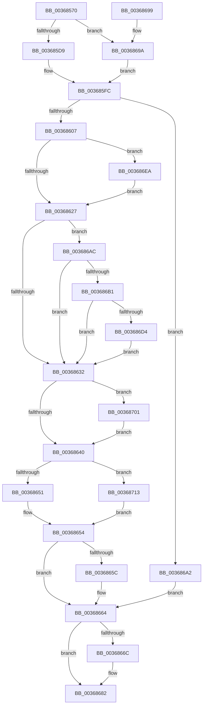

# MiWriteEnclavePte

- RVA: `0x00368570`–`0x00368729` (길이 `441` bytes)
- VA: `0x0000000140368570`
- 실행 섹션: `.text`
- PDB 이름 있음: `예`; PDB Function 태그: `아니요`
- unwind 정보 RVA: `0x0007A0D8`
- 디코드: `113`개 명령, `441/441` bytes 표시
- 미해석 바이트: `0` (있으면 어셈블리에 `.byte`로 보존)

> 이 문서는 커널 이미지의 기계어와 PDB 기호를 분석해 생성했습니다. 4번과 5번은 함수 원형과 자료형을 바이너리 사용 방식에서 추정한 C 해석이며 원본 소스 복구 결과는 아닙니다.

## 1. Dependencies

- 직접 호출 지점: **11**; 고유 호출 대상: **11**
- 직접 호출자로 확인된 함수: **3**
- RIP 상대 이미지 참조: **1**

### Outgoing calls
- `0x003685DC` → [MiLockWorkingSetShared](../27/MiLockWorkingSetShared_function_0027CBF0.md) (function, `0x0027CBF0`)
- `0x003685F7` → [MiMakeSystemAddressValid](../27/MiMakeSystemAddressValid_function_0027FF70.md) (function, `0x0027FF70`)
- `0x00368607` → [MI_READ_PTE_LOCK_FREE](../28/MI_READ_PTE_LOCK_FREE_function_002828A0.md) (function, `0x002828A0`)
- `0x0036861A` → [MiPteInShadowRange](../23/MiPteInShadowRange_function_0023FB00.md) (function, `0x0023FB00`)
- `0x0036865F` → [MiUpdateAwePageTable](MiUpdateAwePageTable_function_00368730.md) (function, `0x00368730`)
- `0x00368672` → [MiUnlockPageTable](../21/MiUnlockPageTable_function_00216EC0.md) (function, `0x00216EC0`)
- `0x0036867D` → [MiUnlockWorkingSetShared](../27/MiUnlockWorkingSetShared_function_0027D690.md) (function, `0x0027D690`)
- `0x003686A5` → [MiWriteValidPteNewProtection](../28/MiWriteValidPteNewProtection_function_00281810.md) (function, `0x00281810`)
- `0x003686E0` → [MiCheckLinearProtectedPteAccessedBit](../29/MiCheckLinearProtectedPteAccessedBit_function_00292D80.md) (function, `0x00292D80`)
- `0x003686EF` → [MiSanitizeShadowPxe](../29/MiSanitizeShadowPxe_function_00294B68.md) (function, `0x00294B68`)
- `0x00368707` → [MiWritePteShadow](../29/MiWritePteShadow_function_00294EAC.md) (function, `0x00294EAC`)

### Direct callers
- [MiAddPagesToEnclave](MiAddPagesToEnclave_function_00367EEC.md) at `0x003681A0`
- [MiProtectEnclavePages](../4D/MiProtectEnclavePages_function_004D5528.md) at `0x004D596E`
- [MiCopyPagesIntoEnclave](../../page/A4/MiCopyPagesIntoEnclave_function_00A472AC.md) at `0x00A4781D`

### Static image references
- `0x00368627` → RVA `0x00FC6A88` (`ALMOSTRO`; read)

## 2. Other-region calls and transfers

- 다른 실행 섹션으로 향하는 call: **0**
- 별도 외부 분기/꼬리 이동을 확인하지 못했습니다.

## 3. Assembly (complete function range)

```asm
00368570  48 89 5C 24 10                  mov qword ptr [rsp + 0x10], rbx
00368575  48 89 6C 24 18                  mov qword ptr [rsp + 0x18], rbp
0036857A  56                              push rsi
0036857B  57                              push rdi
0036857C  41 54                           push r12
0036857E  41 56                           push r14
00368580  41 57                           push r15
00368582  48 83 EC 20                     sub rsp, 0x20
00368586  65 48 8B 04 25 88 01 00 00      mov rax, qword ptr gs:[0x188]
0036858F  48 8B E9                        mov rbp, rcx
00368592  48 C1 ED 09                     shr rbp, 9
00368596  41 8B F9                        mov edi, r9d
00368599  4D 8B F8                        mov r15, r8
0036859C  48 8B DA                        mov rbx, rdx
0036859F  48 8B F1                        mov rsi, rcx
003685A2  4C 8B B0 B8 00 00 00            mov r14, qword ptr [rax + 0xb8]
003685A9  48 B8 F8 FF FF FF 7F 00 00 00   movabs rax, 0x7ffffffff8
003685B3  48 23 E8                        and rbp, rax
003685B6  49 81 C6 00 04 00 00            add r14, 0x400
003685BD  48 B8 00 00 00 00 80 F6 FF FF   movabs rax, 0xfffff68000000000
003685C7  48 8B C0                        mov rax, rax
003685CA  48 03 E8                        add rbp, rax
003685CD  33 C0                           xor eax, eax
003685CF  39 44 24 70                     cmp dword ptr [rsp + 0x70], eax
003685D3  0F 84 C1 00 00 00               je 0x14036869a
003685D9  49 8B CE                        mov rcx, r14
003685DC  E8 0F 46 F1 FF                  call 0x14027cbf0
003685E1  41 8B 57 30                     mov edx, dword ptr [r15 + 0x30]
003685E5  45 33 C9                        xor r9d, r9d
003685E8  C1 EA 0C                        shr edx, 0xc
003685EB  44 8A C0                        mov r8b, al
003685EE  83 E2 7F                        and edx, 0x7f
003685F1  48 8B CE                        mov rcx, rsi
003685F4  44 8A E0                        mov r12b, al
003685F7  E8 74 79 F1 FF                  call 0x14027ff70
003685FC  48 8B CE                        mov rcx, rsi
003685FF  85 FF                           test edi, edi
00368601  0F 85 9B 00 00 00               jne 0x1403686a2
00368607  E8 94 A2 F1 FF                  call 0x1402828a0
0036860C  48 8B CE                        mov rcx, rsi
0036860F  48 89 5C 24 50                  mov qword ptr [rsp + 0x50], rbx
00368614  48 8B F8                        mov rdi, rax
00368617  45 33 FF                        xor r15d, r15d
0036861A  E8 E1 74 ED FF                  call 0x14023fb00
0036861F  85 C0                           test eax, eax
00368621  0F 85 C3 00 00 00               jne 0x1403686ea
00368627  48 0F BA 25 58 E4 C5 00 24      bt qword ptr [rip + 0xc5e458], 0x24
00368630  72 7A                           jb 0x1403686ac
00368632  33 C0                           xor eax, eax
00368634  48 89 1E                        mov qword ptr [rsi], rbx
00368637  45 85 FF                        test r15d, r15d
0036863A  0F 85 C1 00 00 00               jne 0x140368701
00368640  BA 01 00 00 00                  mov edx, 1
00368645  44 8B C0                        mov r8d, eax
00368648  48 85 FF                        test rdi, rdi
0036864B  0F 85 C2 00 00 00               jne 0x140368713
00368651  44 8B C2                        mov r8d, edx
00368654  41 8B C0                        mov eax, r8d
00368657  48 0B C2                        or rax, rdx
0036865A  74 08                           je 0x140368664
0036865C  48 8B CD                        mov rcx, rbp
0036865F  E8 CC 00 00 00                  call 0x140368730
00368664  33 C0                           xor eax, eax
00368666  39 44 24 70                     cmp dword ptr [rsp + 0x70], eax
0036866A  74 16                           je 0x140368682
0036866C  48 8B D5                        mov rdx, rbp
0036866F  49 8B CE                        mov rcx, r14
00368672  E8 49 E8 EA FF                  call 0x140216ec0
00368677  41 8A D4                        mov dl, r12b
0036867A  49 8B CE                        mov rcx, r14
0036867D  E8 0E 50 F1 FF                  call 0x14027d690
00368682  48 8B 5C 24 58                  mov rbx, qword ptr [rsp + 0x58]
00368687  48 8B 6C 24 60                  mov rbp, qword ptr [rsp + 0x60]
0036868C  48 83 C4 20                     add rsp, 0x20
00368690  41 5F                           pop r15
00368692  41 5E                           pop r14
00368694  41 5C                           pop r12
00368696  5F                              pop rdi
00368697  5E                              pop rsi
00368698  C3                              ret
00368699  CC                              int3
0036869A  41 B4 11                        mov r12b, 0x11
0036869D  E9 5A FF FF FF                  jmp 0x1403685fc
003686A2  48 8B D3                        mov rdx, rbx
003686A5  E8 66 91 F1 FF                  call 0x140281810
003686AA  EB B8                           jmp 0x140368664
003686AC  F6 C3 20                        test bl, 0x20
003686AF  75 81                           jne 0x140368632
003686B1  48 B8 00 00 00 00 80 F6 FF FF   movabs rax, 0xfffff68000000000
003686BB  48 8B C8                        mov rcx, rax
003686BE  48 B8 00 00 00 00 40 00 00 00   movabs rax, 0x4000000000
003686C8  48 03 C8                        add rcx, rax
003686CB  48 3B F1                        cmp rsi, rcx
003686CE  0F 82 5E FF FF FF               jb 0x140368632
003686D4  41 B8 80 00 00 00               mov r8d, 0x80
003686DA  48 8B D3                        mov rdx, rbx
003686DD  48 8B CE                        mov rcx, rsi
003686E0  E8 9B A6 F2 FF                  call 0x140292d80
003686E5  E9 48 FF FF FF                  jmp 0x140368632
003686EA  48 8D 54 24 50                  lea rdx, [rsp + 0x50]
003686EF  E8 74 C4 F2 FF                  call 0x140294b68
003686F4  48 8B 5C 24 50                  mov rbx, qword ptr [rsp + 0x50]
003686F9  44 8B F8                        mov r15d, eax
003686FC  E9 26 FF FF FF                  jmp 0x140368627
00368701  48 8B D3                        mov rdx, rbx
00368704  48 8B CE                        mov rcx, rsi
00368707  E8 A0 C7 F2 FF                  call 0x140294eac
0036870C  33 C0                           xor eax, eax
0036870E  E9 2D FF FF FF                  jmp 0x140368640
00368713  81 E7 00 0C 00 00               and edi, 0xc00
00368719  48 81 FF 00 08 00 00            cmp rdi, 0x800
00368720  48 0F 44 D0                     cmove rdx, rax
00368724  E9 2B FF FF FF                  jmp 0x140368654
```

## 4. C-style interpretation (structured pseudocode)

```c
__int64 __fastcall MiWriteEnclavePte(__int64 a1, __int64 a2, __int64 a3, int a4, unsigned int a5)
{
    __int64 result;
    __int64 v_r14;
    __int64 v_r15;
    __int64 v_rbp;
    __int64 v_rdi;
    __int64 v_rsp;
    unsigned __int64 v_stack_p10;
    unsigned __int64 v_stack_p18;
    unsigned __int64 v_stack_p50;
    unsigned __int64 v_stack_p8;

    v_stack_p10 = v_rbx;
    v_stack_p18 = v_rbp;
    v_rsp = (v_rsp) - (32);
    v_rbp = (a1) >> (9);
    v_rbp = (v_rbp) & (*(unsigned __int64 *)(gs_base + (0 + 392)));
    v_r14 = (*(unsigned __int64 *)(*(unsigned __int64 *)(gs_base + (0 + 392)) + 184)) + (0x400ULL);
    v_rbp = (v_rbp) + (*(unsigned __int64 *)(gs_base + (0 + 392)));
    result = 0;
    if (a5 == 0) goto loc_0036869A;
    result = MiLockWorkingSetShared(v_r14, a2, a3, a4);
    a4 = 0;
    a2 = (unsigned int)(((unsigned int)(*(unsigned int *)(a3 + 48))) >> (12));
    a2 = (unsigned int)((a2) & (127));
    result = MiMakeSystemAddressValid(a1, a2, (unsigned __int8)(result), a4);
loc_003685FC:
    if ((unsigned int)((unsigned int)(a4)) != 0) goto loc_003686A2;
    result = MI_READ_PTE_LOCK_FREE(a1, a2, (unsigned __int8)(result), a4);
    v_stack_p8 = a2;
    v_r15 = 0;
    result = MiPteInShadowRange(a1, a2, (unsigned __int8)(result), a4);
    if ((unsigned int)(result) != 0) goto loc_003686EA;
loc_00368627:
    if (condition_is_below) goto loc_003686AC;
loc_00368632:
    result = 0;
    *(unsigned __int64 *)(a1) = a2;
    if (0 != 0) goto loc_00368701;
loc_00368640:
    if (0 != 0) goto loc_00368713;
loc_00368654:
    result = (1) | (1);
    if (!(condition_is_equal)) {
        a1 = v_rbp;
        result = MiUpdateAwePageTable(a1, 1, 1, a4);
    }
    result = 0;
    if (a5 != 0) {
        a2 = v_rbp;
        a1 = v_r14;
        result = MiUnlockPageTable(a1, a2, 1, a4);
        a2 = (unsigned __int8)((unsigned __int8)(result));
        a1 = v_r14;
        result = MiUnlockWorkingSetShared(a1, a2, 1, a4);
    }
    v_rsp = (v_rsp) + (32);
    return result;
loc_0036869A:
    goto loc_003685FC;
loc_003686A2:
    result = MiWriteValidPteNewProtection(a1, v_stack_p10, 1, a4);
    goto loc_00368664;
loc_003686AC:
    if ((((unsigned __int8)(v_stack_p10)) & (32)) != 0) goto loc_00368632;
    a1 = (result) + (result);
    if (a1 < a1) goto loc_00368632;
    result = MiCheckLinearProtectedPteAccessedBit(a1, v_stack_p10, 128, a4);
    goto loc_00368632;
loc_003686EA:
    result = MiSanitizeShadowPxe(a1, v_stack_p50, 128, a4);
    goto loc_00368627;
loc_00368701:
    result = MiWritePteShadow(a1, v_stack_p50, 128, a4);
    result = 0;
    goto loc_00368640;
loc_00368713:
    v_rdi = (unsigned int)((result) & (0xC00ULL));
    a2 = v_stack_p50;
    if (v_rdi == 0x800ULL) { a2 = 0; }
    goto loc_00368654;
}
```

## 5. (Beta) C Style

```c
int64_t MiWriteEnclavePte(int64_t Arg1, int64_t Arg2, void *Arg3, int32_t Arg4, uint32_t Arg5)
{
    uint8_t *arg3 = (uint8_t *)Arg3;

    int64_t result;
    int64_t local_r14;
    int64_t local_r15;
    int64_t local_rbp;
    int64_t local_rdi;
    int64_t local_rsp;
    uint64_t v_stack_p10;
    uint64_t v_stack_p18;
    uint64_t v_stack_p50;
    uint64_t v_stack_p8;

    v_stack_p10 = local_rbx;
    v_stack_p18 = local_rbp;
    local_rsp = (local_rsp) - (32);
    local_rbp = (Arg1) >> (9);
    local_rbp = (local_rbp) & (*(uint64_t *)(gs_base + (0 + 0x188)));
    local_r14 = (*(uint64_t *)(*(uint64_t *)(gs_base + (0 + 0x188)) + 0xB8)) + (0x400ULL);
    local_rbp = (local_rbp) + (*(uint64_t *)(gs_base + (0 + 0x188)));
    result = 0;
    if (Arg5 == 0) goto loc_0036869A;
    result = MiLockWorkingSetShared(local_r14, Arg2, Arg3, Arg4);
    Arg4 = 0;
    Arg2 = (uint32_t)(((uint32_t)(*(uint32_t *)(arg3 + 0x30))) >> (12));
    Arg2 = (uint32_t)((Arg2) & (127));
    result = MiMakeSystemAddressValid(Arg1, Arg2, (uint8_t)(result), Arg4);
loc_003685FC:
    if ((uint32_t)((uint32_t)(Arg4)) != 0) goto loc_003686A2;
    result = MI_READ_PTE_LOCK_FREE(Arg1, Arg2, (uint8_t)(result), Arg4);
    v_stack_p8 = Arg2;
    local_r15 = 0;
    result = MiPteInShadowRange(Arg1, Arg2, (uint8_t)(result), Arg4);
    if ((uint32_t)(result) != 0) goto loc_003686EA;
loc_00368627:
    if (condition_is_below) goto loc_003686AC;
loc_00368632:
    result = 0;
    *(uint64_t *)(Arg1) = Arg2;
    if (0 != 0) goto loc_00368701;
loc_00368640:
    if (0 != 0) goto loc_00368713;
loc_00368654:
    result = (1) | (1);
    if (!(condition_is_equal)) {
        Arg1 = local_rbp;
        result = MiUpdateAwePageTable(Arg1, 1, 1, Arg4);
    }
    result = 0;
    if (Arg5 != 0) {
        Arg2 = local_rbp;
        Arg1 = local_r14;
        result = MiUnlockPageTable(Arg1, Arg2, 1, Arg4);
        Arg2 = (uint8_t)((uint8_t)(result));
        Arg1 = local_r14;
        result = MiUnlockWorkingSetShared(Arg1, Arg2, 1, Arg4);
    }
    local_rsp = (local_rsp) + (32);
    return result;
loc_0036869A:
    goto loc_003685FC;
loc_003686A2:
    result = MiWriteValidPteNewProtection(Arg1, v_stack_p10, 1, Arg4);
    goto loc_00368664;
loc_003686AC:
    if ((((uint8_t)(v_stack_p10)) & (32)) != 0) goto loc_00368632;
    Arg1 = (result) + (result);
    if (Arg1 < Arg1) goto loc_00368632;
    result = MiCheckLinearProtectedPteAccessedBit(Arg1, v_stack_p10, 128, Arg4);
    goto loc_00368632;
loc_003686EA:
    result = MiSanitizeShadowPxe(Arg1, v_stack_p50, 128, Arg4);
    goto loc_00368627;
loc_00368701:
    result = MiWritePteShadow(Arg1, v_stack_p50, 128, Arg4);
    result = 0;
    goto loc_00368640;
loc_00368713:
    local_rdi = (uint32_t)((result) & (0xC00ULL));
    Arg2 = v_stack_p50;
    if (local_rdi == 0x800ULL) { Arg2 = 0; }
    goto loc_00368654;
}
```

### 관측된 메모리 오프셋

구조체 형식이 확인되지 않은 접근은 인자 기준의 오프셋으로만 기록했습니다.

| 기준 인자 | 오프셋 표현 | 폭 (bit) | 접근 |
|---|---:|---:|---|
| `Arg3` | `+ 0x30` | `32` | `R` |

## 6. Execution-region graph

[열기: 2D/3D 그래프와 함수 탐색 컨트롤 패널](../../../control-panel.html?section=text&rva=0x00368570&view=graph)

- 2D 그래프는 위에서 아래로 흐르고, 3D 그래프는 빈 공간을 드래그해 회전합니다. Shift+드래그는 이동, 휠은 확대·축소, 함수 노드 선택은 대상 보고서 이동입니다.

### Static fallback


