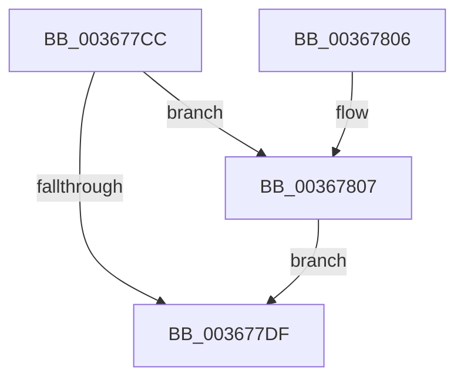

# MiZeroCfgSystemWideBitmap

- RVA: `0x003677CC`–`0x0036781E` (길이 `82` bytes)
- VA: `0x00000001403677CC`
- 실행 섹션: `.text`
- PDB 이름 있음: `예`; PDB Function 태그: `아니요`
- unwind 정보 RVA: `0x0006DBD4`
- 디코드: `22`개 명령, `82/82` bytes 표시
- 미해석 바이트: `0` (있으면 어셈블리에 `.byte`로 보존)

> 이 문서는 커널 이미지의 기계어와 PDB 기호를 분석해 생성했습니다. 4번과 5번은 함수 원형과 자료형을 바이너리 사용 방식에서 추정한 C 해석이며 원본 소스 복구 결과는 아닙니다.

## 1. Dependencies

- 직접 호출 지점: **1**; 고유 호출 대상: **1**
- 직접 호출자로 확인된 함수: **1**
- RIP 상대 이미지 참조: **2**

### Outgoing calls
- `0x003677FC` → [MiZeroCfgSystemWideBitmapWorker](MiZeroCfgSystemWideBitmapWorker_function_00367060.md) (function, `0x00367060`)

### Direct callers
- [sub_00988B28](../../page/98/Unknown_function_00988B28.md) at `0x00988B7B`

### Static image references
- `0x003677D3` → RVA `0x00E2D808` (`.data`; read)
- `0x0036780A` → RVA `0x00E2D7A0` (`.data`; read)

## 2. Other-region calls and transfers

- 다른 실행 섹션으로 향하는 call: **0**
- 별도 외부 분기/꼬리 이동을 확인하지 못했습니다.

## 3. Assembly (complete function range)

```asm
003677CC  48 83 EC 28                     sub rsp, 0x28
003677D0  8B 41 10                        mov eax, dword ptr [rcx + 0x10]
003677D3  4C 8B 0D 2E 60 AC 00            mov r9, qword ptr [rip + 0xac602e]
003677DA  83 F8 03                        cmp eax, 3
003677DD  74 28                           je 0x140367807
003677DF  44 8B 41 08                     mov r8d, dword ptr [rcx + 8]
003677E3  49 8D 89 80 00 00 00            lea rcx, [r9 + 0x80]
003677EA  49 C1 E0 10                     shl r8, 0x10
003677EE  49 C1 E8 04                     shr r8, 4
003677F2  48 C1 EA 04                     shr rdx, 4
003677F6  4D 03 C0                        add r8, r8
003677F9  48 03 D2                        add rdx, rdx
003677FC  E8 5F F8 FF FF                  call 0x140367060
00367801  48 83 C4 28                     add rsp, 0x28
00367805  C3                              ret
00367806  CC                              int3
00367807  83 C0 FD                        add eax, -3
0036780A  4C 8D 0D 8F 5F AC 00            lea r9, [rip + 0xac5f8f]
00367811  44 8B C0                        mov r8d, eax
00367814  49 C1 E0 06                     shl r8, 6
00367818  4F 8B 0C 08                     mov r9, qword ptr [r8 + r9]
0036781C  EB C1                           jmp 0x1403677df
```

## 4. C-style interpretation (structured pseudocode)

```c
__int64 __fastcall MiZeroCfgSystemWideBitmap(__int64 a1, __int64 a2)
{
    __int64 result;
    __int64 v_rsp;

    v_rsp = (v_rsp) - (40);
    if (((unsigned int)((unsigned int)(*(unsigned int *)(a1 + 16)))) == 3) goto loc_00367807;
loc_003677DF:
    a3 = ((unsigned int)(*(unsigned int *)(a1 + 8))) << (16);
    a3 = (a3) >> (4);
    a2 = (a2) >> (4);
    a3 = (a3) + (a3);
    a2 = (a2) + (a2);
    result = MiZeroCfgSystemWideBitmapWorker(*(unsigned __int64 *)(v_rip + 11296814) + 128, a2, a3, *(unsigned __int64 *)(v_rip + 11296814));
    v_rsp = (v_rsp) + (40);
    return result;
loc_00367807:
    result = (unsigned int)((result) + (-3));
    a3 = ((unsigned int)((unsigned int)(result))) << (6);
    goto loc_003677DF;
}
```

## 5. (Beta) C Style

```c
int64_t MiZeroCfgSystemWideBitmap(void *Arg1, int64_t Arg2)
{
    uint8_t *arg1 = (uint8_t *)Arg1;

    int64_t result;
    int64_t local_rsp;

    local_rsp = (local_rsp) - (40);
    if (((uint32_t)((uint32_t)(*(uint32_t *)(arg1 + 0x10)))) == 3) goto loc_00367807;
loc_003677DF:
    a3 = ((uint32_t)(*(uint32_t *)(arg1 + 0x8))) << (16);
    a3 = (a3) >> (4);
    Arg2 = (Arg2) >> (4);
    a3 = (a3) + (a3);
    Arg2 = (Arg2) + (Arg2);
    result = MiZeroCfgSystemWideBitmapWorker(*(uint64_t *)(v_rip + 0xAC602E) + 128, Arg2, a3, *(uint64_t *)(v_rip + 0xAC602E));
    local_rsp = (local_rsp) + (40);
    return result;
loc_00367807:
    result = (uint32_t)((result) + (-3));
    a3 = ((uint32_t)((uint32_t)(result))) << (6);
    goto loc_003677DF;
}
```

### 관측된 메모리 오프셋

구조체 형식이 확인되지 않은 접근은 인자 기준의 오프셋으로만 기록했습니다.

| 기준 인자 | 오프셋 표현 | 폭 (bit) | 접근 |
|---|---:|---:|---|
| `Arg1` | `+ 0x8` | `32` | `R` |
| `Arg1` | `+ 0x10` | `32` | `R` |

## 6. Execution-region graph

[열기: 2D/3D 그래프와 함수 탐색 컨트롤 패널](../../../control-panel.html?section=text&rva=0x003677CC&view=graph)

- 2D 그래프는 위에서 아래로 흐르고, 3D 그래프는 빈 공간을 드래그해 회전합니다. Shift+드래그는 이동, 휠은 확대·축소, 함수 노드 선택은 대상 보고서 이동입니다.

### Static fallback


