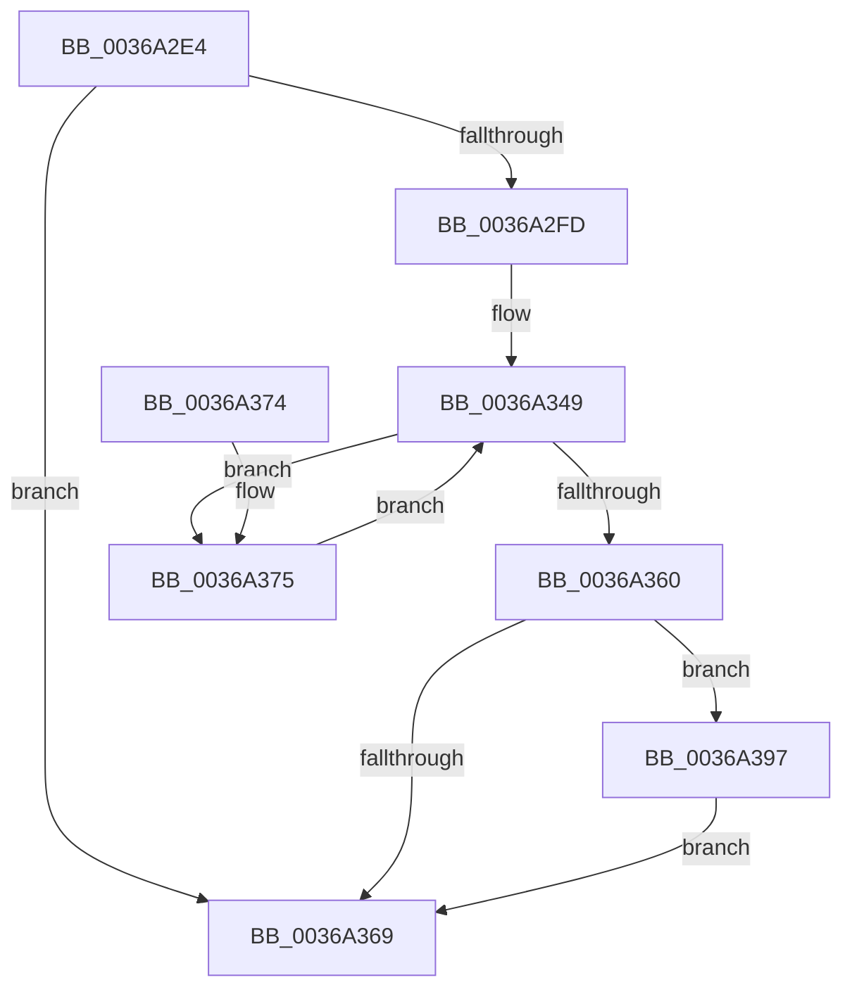

# MmInPageKernelStack

- RVA: `0x0036A2E4`–`0x0036A3E2` (길이 `254` bytes)
- VA: `0x000000014036A2E4`
- 실행 섹션: `.text`
- PDB 이름 있음: `예`; PDB Function 태그: `아니요`
- unwind 정보 RVA: `0x0007A290`
- 디코드: `63`개 명령, `254/254` bytes 표시
- 미해석 바이트: `0` (있으면 어셈블리에 `.byte`로 보존)

> 이 문서는 커널 이미지의 기계어와 PDB 기호를 분석해 생성했습니다. 4번과 5번은 함수 원형과 자료형을 바이너리 사용 방식에서 추정한 C 해석이며 원본 소스 복구 결과는 아닙니다.

## 1. Dependencies

- 직접 호출 지점: **2**; 고유 호출 대상: **1**
- 직접 호출자로 확인된 함수: **1**
- RIP 상대 이미지 참조: **3**

### Outgoing calls
- `0x0036A350` → [MiInPageSingleKernelStack](MiInPageSingleKernelStack_function_0036A3E8.md) (function, `0x0036A3E8`)
- `0x0036A3DB` → [MiInPageSingleKernelStack](MiInPageSingleKernelStack_function_0036A3E8.md) (function, `0x0036A3E8`)

### Direct callers
- [KeSwapProcessOrStack](../5C/KeSwapProcessOrStack_function_005C5E00.md) at `0x005C5ED4`

### Static image references
- `0x0036A2F1` → RVA `0x00FC6A88` (`ALMOSTRO`; read)
- `0x0036A39B` → RVA `0x00FC6C54` (`ALMOSTRO`; read)
- `0x0036A3A1` → RVA `0x00FC6CF8` (`ALMOSTRO`; read)

## 2. Other-region calls and transfers

- 다른 실행 섹션으로 향하는 call: **0**
- 별도 외부 분기/꼬리 이동을 확인하지 못했습니다.

## 3. Assembly (complete function range)

```asm
0036A2E4  48 89 5C 24 08                  mov qword ptr [rsp + 8], rbx
0036A2E9  55                              push rbp
0036A2EA  48 8B EC                        mov rbp, rsp
0036A2ED  48 83 EC 60                     sub rsp, 0x60
0036A2F1  F6 05 90 C7 C5 00 40            test byte ptr [rip + 0xc5c790], 0x40
0036A2F8  48 8B D9                        mov rbx, rcx
0036A2FB  74 6C                           je 0x14036a369
0036A2FD  48 8B 41 38                     mov rax, qword ptr [rcx + 0x38]
0036A301  48 89 45 C0                     mov qword ptr [rbp - 0x40], rax
0036A305  48 8B 41 30                     mov rax, qword ptr [rcx + 0x30]
0036A309  48 89 45 C8                     mov qword ptr [rbp - 0x38], rax
0036A30D  48 8B 41 58                     mov rax, qword ptr [rcx + 0x58]
0036A311  48 89 45 D0                     mov qword ptr [rbp - 0x30], rax
0036A315  48 8B 41 28                     mov rax, qword ptr [rcx + 0x28]
0036A319  48 89 45 D8                     mov qword ptr [rbp - 0x28], rax
0036A31D  48 8B 81 18 04 00 00            mov rax, qword ptr [rcx + 0x418]
0036A324  48 89 45 E0                     mov qword ptr [rbp - 0x20], rax
0036A328  48 8B 81 20 04 00 00            mov rax, qword ptr [rcx + 0x420]
0036A32F  48 89 45 E8                     mov qword ptr [rbp - 0x18], rax
0036A333  48 8B 81 08 04 00 00            mov rax, qword ptr [rcx + 0x408]
0036A33A  48 89 45 F0                     mov qword ptr [rbp - 0x10], rax
0036A33E  48 8B 81 10 04 00 00            mov rax, qword ptr [rcx + 0x410]
0036A345  48 89 45 F8                     mov qword ptr [rbp - 8], rax
0036A349  48 8D 55 C0                     lea rdx, [rbp - 0x40]
0036A34D  48 8B CB                        mov rcx, rbx
0036A350  E8 93 00 00 00                  call 0x14036a3e8
0036A355  48 8B 45 D8                     mov rax, qword ptr [rbp - 0x28]
0036A359  48 83 78 10 00                  cmp qword ptr [rax + 0x10], 0
0036A35E  75 15                           jne 0x14036a375
0036A360  F7 43 74 00 00 80 00            test dword ptr [rbx + 0x74], 0x800000
0036A367  75 2E                           jne 0x14036a397
0036A369  48 8B 5C 24 70                  mov rbx, qword ptr [rsp + 0x70]
0036A36E  48 83 C4 60                     add rsp, 0x60
0036A372  5D                              pop rbp
0036A373  C3                              ret
0036A374  CC                              int3
0036A375  0F 10 40 10                     movups xmm0, xmmword ptr [rax + 0x10]
0036A379  0F 10 48 20                     movups xmm1, xmmword ptr [rax + 0x20]
0036A37D  0F 29 45 C0                     movaps xmmword ptr [rbp - 0x40], xmm0
0036A381  0F 10 40 30                     movups xmm0, xmmword ptr [rax + 0x30]
0036A385  0F 29 4D D0                     movaps xmmword ptr [rbp - 0x30], xmm1
0036A389  0F 10 48 40                     movups xmm1, xmmword ptr [rax + 0x40]
0036A38D  0F 29 45 E0                     movaps xmmword ptr [rbp - 0x20], xmm0
0036A391  0F 29 4D F0                     movaps xmmword ptr [rbp - 0x10], xmm1
0036A395  EB B2                           jmp 0x14036a349
0036A397  4C 8B 43 60                     mov r8, qword ptr [rbx + 0x60]
0036A39B  8B 15 B3 C8 C5 00               mov edx, dword ptr [rip + 0xc5c8b3]
0036A3A1  8B 05 51 C9 C5 00               mov eax, dword ptr [rip + 0xc5c951]
0036A3A7  49 03 D0                        add rdx, r8
0036A3AA  48 83 65 E0 00                  and qword ptr [rbp - 0x20], 0
0036A3AF  48 8B CA                        mov rcx, rdx
0036A3B2  48 83 65 E8 00                  and qword ptr [rbp - 0x18], 0
0036A3B7  48 2B C8                        sub rcx, rax
0036A3BA  48 83 65 F0 00                  and qword ptr [rbp - 0x10], 0
0036A3BF  48 83 65 F8 00                  and qword ptr [rbp - 8], 0
0036A3C4  48 89 4D C8                     mov qword ptr [rbp - 0x38], rcx
0036A3C8  48 8B CB                        mov rcx, rbx
0036A3CB  48 89 55 C0                     mov qword ptr [rbp - 0x40], rdx
0036A3CF  48 89 55 D8                     mov qword ptr [rbp - 0x28], rdx
0036A3D3  48 8D 55 C0                     lea rdx, [rbp - 0x40]
0036A3D7  4C 89 45 D0                     mov qword ptr [rbp - 0x30], r8
0036A3DB  E8 08 00 00 00                  call 0x14036a3e8
0036A3E0  EB 87                           jmp 0x14036a369
```

## 4. C-style interpretation (structured pseudocode)

```c
__int64 __fastcall MmInPageKernelStack(__int64 a1)
{
    __int64 result;
    __int64 v_rsp;
    unsigned __int64 v_stack_m10;
    unsigned __int64 v_stack_m18;
    unsigned __int64 v_stack_m20;
    unsigned __int64 v_stack_m28;
    unsigned __int64 v_stack_m30;
    unsigned __int64 v_stack_m38;
    unsigned __int64 v_stack_m40;
    unsigned __int64 v_stack_m48;
    unsigned __int64 v_stack_p8;

    v_stack_p8 = v_rbx;
    v_rsp = (v_rsp) - (96);
    if (((*(unsigned __int8 *)(v_rip + 12961680)) & (64)) == 0) goto loc_0036A369;
    v_stack_m48 = *(unsigned __int64 *)(a1 + 56);
    v_stack_m40 = *(unsigned __int64 *)(a1 + 48);
    v_stack_m38 = *(unsigned __int64 *)(a1 + 88);
    v_stack_m30 = *(unsigned __int64 *)(a1 + 40);
    v_stack_m28 = *(unsigned __int64 *)(a1 + 1048);
    v_stack_m20 = *(unsigned __int64 *)(a1 + 1056);
    v_stack_m18 = *(unsigned __int64 *)(a1 + 1032);
    v_stack_m10 = *(unsigned __int64 *)(a1 + 1040);
loc_0036A349:
    result = MiInPageSingleKernelStack(a1, v_stack_m48, a3, a4);
    if ((*(unsigned __int64 *)(v_stack_m30 + 16)) != 0) goto loc_0036A375;
    if (((*(unsigned int *)(a1 + 116)) & (0x800000ULL)) != 0) goto loc_0036A397;
loc_0036A369:
    v_rsp = (v_rsp) + (96);
    return v_stack_m30;
loc_0036A375:
    v_stack_m48 = v_xmm0;
    v_stack_m38 = v_xmm1;
    v_stack_m28 = v_xmm0;
    v_stack_m18 = v_xmm1;
    goto loc_0036A349;
loc_0036A397:
    a2 = ((unsigned int)(*(unsigned int *)(v_rip + 12961971))) + (*(unsigned __int64 *)(v_stack_p8 + 96));
    a1 = (a2) - ((unsigned int)(*(unsigned int *)(v_rip + 12962129)));
    v_stack_m40 = a1;
    v_stack_m48 = a2;
    v_stack_m30 = a2;
    v_stack_m38 = *(unsigned __int64 *)(v_stack_p8 + 96);
    result = MiInPageSingleKernelStack(v_stack_p8, v_stack_m48, *(unsigned __int64 *)(v_stack_p8 + 96), a4);
    goto loc_0036A369;
}
```

## 5. (Beta) C Style

```c
int64_t MmInPageKernelStack(void *Arg1)
{
    uint8_t *arg1 = (uint8_t *)Arg1;

    int64_t result;
    int64_t local_rsp;
    uint64_t v_stack_m10;
    uint64_t v_stack_m18;
    uint64_t v_stack_m20;
    uint64_t v_stack_m28;
    uint64_t v_stack_m30;
    uint64_t v_stack_m38;
    uint64_t v_stack_m40;
    uint64_t v_stack_m48;
    uint64_t v_stack_p8;

    v_stack_p8 = local_rbx;
    local_rsp = (local_rsp) - (96);
    if (((*(uint8_t *)(v_rip + 0xC5C790)) & (64)) == 0) goto loc_0036A369;
    v_stack_m48 = *(uint64_t *)(arg1 + 0x38);
    v_stack_m40 = *(uint64_t *)(arg1 + 0x30);
    v_stack_m38 = *(uint64_t *)(arg1 + 0x58);
    v_stack_m30 = *(uint64_t *)(arg1 + 0x28);
    v_stack_m28 = *(uint64_t *)(arg1 + 0x418);
    v_stack_m20 = *(uint64_t *)(arg1 + 0x420);
    v_stack_m18 = *(uint64_t *)(arg1 + 0x408);
    v_stack_m10 = *(uint64_t *)(arg1 + 0x410);
loc_0036A349:
    result = MiInPageSingleKernelStack(Arg1, v_stack_m48, a3, a4);
    if ((*(uint64_t *)(v_stack_m30 + 0x10)) != 0) goto loc_0036A375;
    if (((*(uint32_t *)(arg1 + 0x74)) & (0x800000ULL)) != 0) goto loc_0036A397;
loc_0036A369:
    local_rsp = (local_rsp) + (96);
    return v_stack_m30;
loc_0036A375:
    v_stack_m48 = v_xmm0;
    v_stack_m38 = v_xmm1;
    v_stack_m28 = v_xmm0;
    v_stack_m18 = v_xmm1;
    goto loc_0036A349;
loc_0036A397:
    a2 = ((uint32_t)(*(uint32_t *)(v_rip + 0xC5C8B3))) + (*(uint64_t *)(v_stack_p8 + 0x60));
    Arg1 = (a2) - ((uint32_t)(*(uint32_t *)(v_rip + 0xC5C951)));
    v_stack_m40 = Arg1;
    v_stack_m48 = a2;
    v_stack_m30 = a2;
    v_stack_m38 = *(uint64_t *)(v_stack_p8 + 0x60);
    result = MiInPageSingleKernelStack(v_stack_p8, v_stack_m48, *(uint64_t *)(v_stack_p8 + 0x60), a4);
    goto loc_0036A369;
}
```

### 관측된 메모리 오프셋

구조체 형식이 확인되지 않은 접근은 인자 기준의 오프셋으로만 기록했습니다.

| 기준 인자 | 오프셋 표현 | 폭 (bit) | 접근 |
|---|---:|---:|---|
| `Arg1` | `+ 0x28` | `64` | `R` |
| `Arg1` | `+ 0x30` | `64` | `R` |
| `Arg1` | `+ 0x38` | `64` | `R` |
| `Arg1` | `+ 0x58` | `64` | `R` |
| `Arg1` | `+ 0x60` | `64` | `R` |
| `Arg1` | `+ 0x74` | `32` | `R` |
| `Arg1` | `+ 0x408` | `64` | `R` |
| `Arg1` | `+ 0x410` | `64` | `R` |
| `Arg1` | `+ 0x418` | `64` | `R` |
| `Arg1` | `+ 0x420` | `64` | `R` |

## 6. Execution-region graph

[열기: 2D/3D 그래프와 함수 탐색 컨트롤 패널](../../../control-panel.html?section=text&rva=0x0036A2E4&view=graph)

- 2D 그래프는 위에서 아래로 흐르고, 3D 그래프는 빈 공간을 드래그해 회전합니다. Shift+드래그는 이동, 휠은 확대·축소, 함수 노드 선택은 대상 보고서 이동입니다.

### Static fallback


