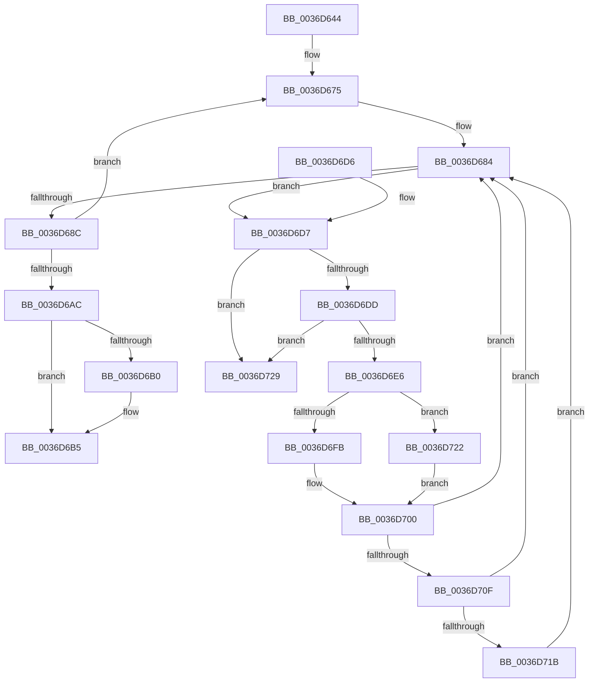

# MmWaitForCacheManagerPrefetch

- RVA: `0x0036D644`–`0x0036D730` (길이 `236` bytes)
- VA: `0x000000014036D644`
- 실행 섹션: `.text`
- PDB 이름 있음: `예`; PDB Function 태그: `아니요`
- unwind 정보 RVA: `0x0007A604`
- 디코드: `69`개 명령, `236/236` bytes 표시
- 미해석 바이트: `0` (있으면 어셈블리에 `.byte`로 보존)

> 이 문서는 커널 이미지의 기계어와 PDB 기호를 분석해 생성했습니다. 4번과 5번은 함수 원형과 자료형을 바이너리 사용 방식에서 추정한 C 해석이며 원본 소스 복구 결과는 아닙니다.

## 1. Dependencies

- 직접 호출 지점: **5**; 고유 호출 대상: **5**
- 직접 호출자로 확인된 함수: **3**
- RIP 상대 이미지 참조: **0**

### Outgoing calls
- `0x0036D68F` → [MiReleaseReadListResources](../../page/93/MiReleaseReadListResources_function_0093D570.md) (function, `0x0093D570`)
- `0x0036D699` → [ExFreePoolWithTag](../../poolcode/B8/ExFreePoolWithTag_function_00B82870.md) (function, `0x00B82870`)
- `0x0036D6B0` → [KeLeaveGuardedRegion](../2E/KeLeaveGuardedRegion_function_002E2C40.md) (function, `0x002E2C40`)
- `0x0036D6FB` → [MiPfCompleteInPageSupport](MiPfCompleteInPageSupport_function_0036D738.md) (function, `0x0036D738`)
- `0x0036D722` → [MiPfCompleteCoalescedIo](MiPfCompleteCoalescedIo_function_0036C344.md) (function, `0x0036C344`)

### Direct callers
- [sub_002F880D](../2F/Unknown_function_002F880D.md) at `0x002F8850`
- [MmWaitMultipleForCacheManagerPrefetch](MmWaitMultipleForCacheManagerPrefetch_function_0036D470.md) at `0x0036D544`
- [CcPerformReadAhead](../48/CcPerformReadAhead_function_0048F738.md) at `0x0048FA70`

### Static image references
- 디코드된 RIP-relative 메모리 참조가 없습니다.

## 2. Other-region calls and transfers

- 다른 실행 섹션으로 향하는 call: **2**
  - `0x0036D68F` → [MiReleaseReadListResources](../../page/93/MiReleaseReadListResources_function_0093D570.md) (`.text` → `PAGE`)
  - `0x0036D699` → [ExFreePoolWithTag](../../poolcode/B8/ExFreePoolWithTag_function_00B82870.md) (`.text` → `POOLCODE`)
- 별도 외부 분기/꼬리 이동을 확인하지 못했습니다.

## 3. Assembly (complete function range)

```asm
0036D644  48 8B C4                        mov rax, rsp
0036D647  48 89 58 08                     mov qword ptr [rax + 8], rbx
0036D64B  48 89 68 10                     mov qword ptr [rax + 0x10], rbp
0036D64F  48 89 70 18                     mov qword ptr [rax + 0x18], rsi
0036D653  48 89 78 20                     mov qword ptr [rax + 0x20], rdi
0036D657  41 54                           push r12
0036D659  41 56                           push r14
0036D65B  41 57                           push r15
0036D65D  48 83 EC 20                     sub rsp, 0x20
0036D661  8B A9 D0 00 00 00               mov ebp, dword ptr [rcx + 0xd0]
0036D667  33 DB                           xor ebx, ebx
0036D669  83 E5 01                        and ebp, 1
0036D66C  48 8B F9                        mov rdi, rcx
0036D66F  41 BC 00 00 00 80               mov r12d, 0x80000000
0036D675  4C 8B 37                        mov r14, qword ptr [rdi]
0036D678  48 8D B7 E0 00 00 00            lea rsi, [rdi + 0xe0]
0036D67F  44 8B FB                        mov r15d, ebx
0036D682  33 DB                           xor ebx, ebx
0036D684  48 8B 0E                        mov rcx, qword ptr [rsi]
0036D687  48 3B CE                        cmp rcx, rsi
0036D68A  75 4B                           jne 0x14036d6d7
0036D68C  48 8B CF                        mov rcx, rdi
0036D68F  E8 DC FE 5C 00                  call 0x14093d570
0036D694  33 D2                           xor edx, edx
0036D696  48 8B CF                        mov rcx, rdi
0036D699  E8 D2 51 81 00                  call 0x140b82870
0036D69E  85 DB                           test ebx, ebx
0036D6A0  49 8B FE                        mov rdi, r14
0036D6A3  41 0F 49 DF                     cmovns ebx, r15d
0036D6A7  4D 85 F6                        test r14, r14
0036D6AA  75 C9                           jne 0x14036d675
0036D6AC  85 ED                           test ebp, ebp
0036D6AE  74 05                           je 0x14036d6b5
0036D6B0  E8 8B 55 F7 FF                  call 0x1402e2c40
0036D6B5  48 8B 6C 24 48                  mov rbp, qword ptr [rsp + 0x48]
0036D6BA  8B C3                           mov eax, ebx
0036D6BC  48 8B 5C 24 40                  mov rbx, qword ptr [rsp + 0x40]
0036D6C1  48 8B 74 24 50                  mov rsi, qword ptr [rsp + 0x50]
0036D6C6  48 8B 7C 24 58                  mov rdi, qword ptr [rsp + 0x58]
0036D6CB  48 83 C4 20                     add rsp, 0x20
0036D6CF  41 5F                           pop r15
0036D6D1  41 5E                           pop r14
0036D6D3  41 5C                           pop r12
0036D6D5  C3                              ret
0036D6D6  CC                              int3
0036D6D7  48 39 71 08                     cmp qword ptr [rcx + 8], rsi
0036D6DB  75 4C                           jne 0x14036d729
0036D6DD  48 8B 01                        mov rax, qword ptr [rcx]
0036D6E0  48 39 48 08                     cmp qword ptr [rax + 8], rcx
0036D6E4  75 43                           jne 0x14036d729
0036D6E6  48 89 06                        mov qword ptr [rsi], rax
0036D6E9  33 D2                           xor edx, edx
0036D6EB  48 89 70 08                     mov qword ptr [rax + 8], rsi
0036D6EF  8B 81 C0 00 00 00               mov eax, dword ptr [rcx + 0xc0]
0036D6F5  0F BA E0 18                     bt eax, 0x18
0036D6F9  72 27                           jb 0x14036d722
0036D6FB  E8 38 00 00 00                  call 0x14036d738
0036D700  8B C8                           mov ecx, eax
0036D702  42 8D 04 20                     lea eax, [rax + r12]
0036D706  41 85 C4                        test r12d, eax
0036D709  0F 85 75 FF FF FF               jne 0x14036d684
0036D70F  81 F9 34 04 00 C0               cmp ecx, 0xc0000434
0036D715  0F 84 69 FF FF FF               je 0x14036d684
0036D71B  8B D9                           mov ebx, ecx
0036D71D  E9 62 FF FF FF                  jmp 0x14036d684
0036D722  E8 1D EC FF FF                  call 0x14036c344
0036D727  EB D7                           jmp 0x14036d700
0036D729  B9 03 00 00 00                  mov ecx, 3
0036D72E  CD 29                           int 0x29
```

## 4. C-style interpretation (structured pseudocode)

```c
__int64 __fastcall MmWaitForCacheManagerPrefetch(__int64 a1, int a2)
{
    __int64 result;
    __int64 v_rbp;
    __int64 v_rbx;
    __int64 v_rsp;
    unsigned __int64 v_stack_p10;
    unsigned __int64 v_stack_p18;
    unsigned __int64 v_stack_p20;
    unsigned __int64 v_stack_p8;

    *(unsigned __int64 *)(v_rsp + 8) = v_rbx;
    *(unsigned __int64 *)(v_rsp + 16) = v_rbp;
    *(unsigned __int64 *)(v_rsp + 24) = v_rsi;
    *(unsigned __int64 *)(v_rsp + 32) = v_rdi;
    v_rsp = (v_rsp) - (32);
    v_rbx = 0;
    v_rbp = (unsigned int)(((unsigned int)(*(unsigned int *)(a1 + 208))) & (1));
loc_0036D675:
    v_rbx = 0;
loc_0036D684:
    if ((*(unsigned __int64 *)(a1 + 224)) != (a1 + 224)) goto loc_0036D6D7;
    result = MiReleaseReadListResources(a1, a2, a3, a4);
    a2 = 0;
    result = ExFreePoolWithTag(a1, a2, a3, a4);
    if (!sign_flag) { v_rbx = 0; }
    if (*(unsigned __int64 *)(a1) != 0) goto loc_0036D675;
    if ((unsigned int)(v_rbp) != 0) {
        result = KeLeaveGuardedRegion(a1, a2, a3, a4);
    }
    v_rsp = (v_rsp) + (32);
    return (unsigned int)((unsigned int)(v_rbx));
loc_0036D6D7:
    if ((*(unsigned __int64 *)(a1 + 8)) != v_stack_p18) goto loc_0036D729;
    if ((*(unsigned __int64 *)(*(unsigned __int64 *)(a1) + 8)) != a1) goto loc_0036D729;
    *(unsigned __int64 *)(v_stack_p18) = *(unsigned __int64 *)(a1);
    a2 = 0;
    *(unsigned __int64 *)(*(unsigned __int64 *)(a1) + 8) = v_stack_p18;
    if (condition_is_below) goto loc_0036D722;
    result = MiPfCompleteInPageSupport(a1, a2, a3, a4);
loc_0036D700:
    if ((((unsigned int)((unsigned int)(0x80000000ULL))) & ((unsigned int)(result + (unsigned int)(0x80000000ULL) * 1))) != 0) goto loc_0036D684;
    if (((unsigned int)((unsigned int)((unsigned int)(result)))) == 0xC0000434ULL) goto loc_0036D684;
    goto loc_0036D684;
loc_0036D722:
    result = MiPfCompleteCoalescedIo((unsigned int)((unsigned int)(result)), a2, a3, a4);
    goto loc_0036D700;
loc_0036D729:
    return result;
}
```

## 5. (Beta) C Style

```c
int64_t MmWaitForCacheManagerPrefetch(void *Arg1, int32_t Arg2)
{
    uint8_t *arg1 = (uint8_t *)Arg1;

    int64_t result;
    int64_t local_rbp;
    int64_t local_rbx;
    int64_t local_rsp;
    uint64_t v_stack_p10;
    uint64_t v_stack_p18;
    uint64_t v_stack_p20;
    uint64_t v_stack_p8;

    *(uint64_t *)(local_rsp + 0x8) = local_rbx;
    *(uint64_t *)(local_rsp + 0x10) = local_rbp;
    *(uint64_t *)(local_rsp + 0x18) = local_rsi;
    *(uint64_t *)(local_rsp + 0x20) = local_rdi;
    local_rsp = (local_rsp) - (32);
    local_rbx = 0;
    local_rbp = (uint32_t)(((uint32_t)(*(uint32_t *)(arg1 + 0xD0))) & (1));
loc_0036D675:
    local_rbx = 0;
loc_0036D684:
    if ((*(uint64_t *)(arg1 + 0xE0)) != (Arg1 + 224)) goto loc_0036D6D7;
    result = MiReleaseReadListResources(Arg1, Arg2, a3, a4);
    Arg2 = 0;
    result = ExFreePoolWithTag(Arg1, Arg2, a3, a4);
    if (!sign_flag) { local_rbx = 0; }
    if (*(uint64_t *)(arg1) != 0) goto loc_0036D675;
    if ((uint32_t)(local_rbp) != 0) {
        result = KeLeaveGuardedRegion(Arg1, Arg2, a3, a4);
    }
    local_rsp = (local_rsp) + (32);
    return (uint32_t)((uint32_t)(local_rbx));
loc_0036D6D7:
    if ((*(uint64_t *)(arg1 + 0x8)) != v_stack_p18) goto loc_0036D729;
    if ((*(uint64_t *)(*(uint64_t *)(arg1) + 0x8)) != Arg1) goto loc_0036D729;
    *(uint64_t *)(v_stack_p18) = *(uint64_t *)(arg1);
    Arg2 = 0;
    *(uint64_t *)(*(uint64_t *)(arg1) + 0x8) = v_stack_p18;
    if (condition_is_below) goto loc_0036D722;
    result = MiPfCompleteInPageSupport(Arg1, Arg2, a3, a4);
loc_0036D700:
    if ((((uint32_t)((uint32_t)(0x80000000ULL))) & ((uint32_t)(result + (uint32_t)(0x80000000ULL) * 1))) != 0) goto loc_0036D684;
    if (((uint32_t)((uint32_t)((uint32_t)(result)))) == 0xC0000434ULL) goto loc_0036D684;
    goto loc_0036D684;
loc_0036D722:
    result = MiPfCompleteCoalescedIo((uint32_t)((uint32_t)(result)), Arg2, a3, a4);
    goto loc_0036D700;
loc_0036D729:
    return result;
}
```

### 관측된 메모리 오프셋

구조체 형식이 확인되지 않은 접근은 인자 기준의 오프셋으로만 기록했습니다.

| 기준 인자 | 오프셋 표현 | 폭 (bit) | 접근 |
|---|---:|---:|---|
| `Arg1` | `+ 0xD0` | `32` | `R` |

## 6. Execution-region graph

[열기: 2D/3D 그래프와 함수 탐색 컨트롤 패널](../../../control-panel.html?section=text&rva=0x0036D644&view=graph)

- 2D 그래프는 위에서 아래로 흐르고, 3D 그래프는 빈 공간을 드래그해 회전합니다. Shift+드래그는 이동, 휠은 확대·축소, 함수 노드 선택은 대상 보고서 이동입니다.

### Static fallback


