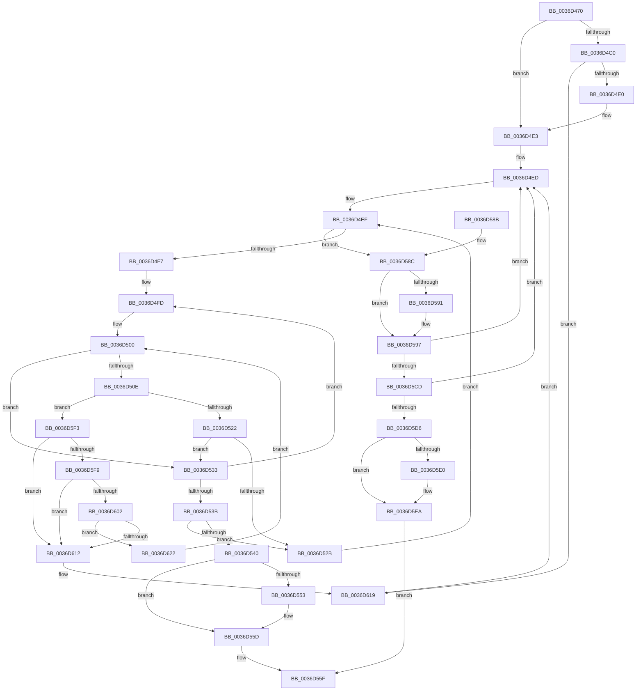

# MmWaitMultipleForCacheManagerPrefetch

- RVA: `0x0036D470`–`0x0036D63B` (길이 `459` bytes)
- VA: `0x000000014036D470`
- 실행 섹션: `.text`
- PDB 이름 있음: `예`; PDB Function 태그: `아니요`
- unwind 정보 RVA: `0x0007A5DC`
- 디코드: `126`개 명령, `459/459` bytes 표시
- 미해석 바이트: `0` (있으면 어셈블리에 `.byte`로 보존)

> 이 문서는 커널 이미지의 기계어와 PDB 기호를 분석해 생성했습니다. 4번과 5번은 함수 원형과 자료형을 바이너리 사용 방식에서 추정한 C 해석이며 원본 소스 복구 결과는 아닙니다.

## 1. Dependencies

- 직접 호출 지점: **6**; 고유 호출 대상: **5**
- 직접 호출자로 확인된 함수: **1**
- RIP 상대 이미지 참조: **1**

### Outgoing calls
- `0x0036D4CF` → [MiAllocatePool](../35/MiAllocatePool_function_0035B540.md) (function, `0x0035B540`)
- `0x0036D544` → [MmWaitForCacheManagerPrefetch](MmWaitForCacheManagerPrefetch_function_0036D644.md) (function, `0x0036D644`)
- `0x0036D558` → [ExFreePoolWithTag](../../poolcode/B8/ExFreePoolWithTag_function_00B82870.md) (function, `0x00B82870`)
- `0x0036D56A` → [_security_check_cookie](../6A/_security_check_cookie_function_006AC640.md) (function, `0x006AC640`)
- `0x0036D5BB` → [KeWaitForMultipleObjects](../20/KeWaitForMultipleObjects_function_0020D110.md) (function, `0x0020D110`)
- `0x0036D5E5` → [ExFreePoolWithTag](../../poolcode/B8/ExFreePoolWithTag_function_00B82870.md) (function, `0x00B82870`)

### Direct callers
- [CcAsyncReadWorker](../45/CcAsyncReadWorker_function_0045DB10.md) at `0x0045DC3D`

### Static image references
- `0x0036D489` → RVA `0x00E0A740` (`.data`; read)

## 2. Other-region calls and transfers

- 다른 실행 섹션으로 향하는 call: **2**
  - `0x0036D558` → [ExFreePoolWithTag](../../poolcode/B8/ExFreePoolWithTag_function_00B82870.md) (`.text` → `POOLCODE`)
  - `0x0036D5E5` → [ExFreePoolWithTag](../../poolcode/B8/ExFreePoolWithTag_function_00B82870.md) (`.text` → `POOLCODE`)
- 별도 외부 분기/꼬리 이동을 확인하지 못했습니다.

## 3. Assembly (complete function range)

```asm
0036D470  48 89 5C 24 18                  mov qword ptr [rsp + 0x18], rbx
0036D475  48 89 6C 24 20                  mov qword ptr [rsp + 0x20], rbp
0036D47A  56                              push rsi
0036D47B  57                              push rdi
0036D47C  41 54                           push r12
0036D47E  41 56                           push r14
0036D480  41 57                           push r15
0036D482  48 81 EC 30 01 00 00            sub rsp, 0x130
0036D489  48 8B 05 B0 D2 A9 00            mov rax, qword ptr [rip + 0xa9d2b0]
0036D490  48 33 C4                        xor rax, rsp
0036D493  48 89 84 24 20 01 00 00         mov qword ptr [rsp + 0x120], rax
0036D49B  4D 85 C0                        test r8, r8
0036D49E  44 8D 7A 01                     lea r15d, [rdx + 1]
0036D4A2  0F 57 C0                        xorps xmm0, xmm0
0036D4A5  49 8B E8                        mov rbp, r8
0036D4A8  44 0F 44 FA                     cmove r15d, edx
0036D4AC  8B F2                           mov esi, edx
0036D4AE  4C 8B E1                        mov r12, rcx
0036D4B1  0F 11 44 24 40                  movups xmmword ptr [rsp + 0x40], xmm0
0036D4B6  0F 11 44 24 50                  movups xmmword ptr [rsp + 0x50], xmm0
0036D4BB  83 FA 03                        cmp edx, 3
0036D4BE  76 23                           jbe 0x14036d4e3
0036D4C0  49 6B D7 38                     imul rdx, r15, 0x38
0036D4C4  B9 40 00 00 00                  mov ecx, 0x40
0036D4C9  41 B8 4D 69 57 61               mov r8d, 0x6157694d
0036D4CF  E8 6C E0 FE FF                  call 0x14035b540
0036D4D4  48 8B D8                        mov rbx, rax
0036D4D7  48 85 C0                        test rax, rax
0036D4DA  0F 85 39 01 00 00               jne 0x14036d619
0036D4E0  8D 70 03                        lea esi, [rax + 3]
0036D4E3  4C 8D 74 24 60                  lea r14, [rsp + 0x60]
0036D4E8  48 8D 5C 24 40                  lea rbx, [rsp + 0x40]
0036D4ED  33 FF                           xor edi, edi
0036D4EF  3B FE                           cmp edi, esi
0036D4F1  0F 83 95 00 00 00               jae 0x14036d58c
0036D4F7  49 8B 0C FC                     mov rcx, qword ptr [r12 + rdi*8]
0036D4FB  33 D2                           xor edx, edx
0036D4FD  4C 8B 09                        mov r9, qword ptr [rcx]
0036D500  8B 81 D4 00 00 00               mov eax, dword ptr [rcx + 0xd4]
0036D506  39 81 D8 00 00 00               cmp dword ptr [rcx + 0xd8], eax
0036D50C  74 25                           je 0x14036d533
0036D50E  4C 8D 81 E0 00 00 00            lea r8, [rcx + 0xe0]
0036D515  49 8B 00                        mov rax, qword ptr [r8]
0036D518  83 78 24 00                     cmp dword ptr [rax + 0x24], 0
0036D51C  0F 85 D1 00 00 00               jne 0x14036d5f3
0036D522  48 8D 50 20                     lea rdx, [rax + 0x20]
0036D526  48 85 D2                        test rdx, rdx
0036D529  74 08                           je 0x14036d533
0036D52B  48 89 14 FB                     mov qword ptr [rbx + rdi*8], rdx
0036D52F  FF C7                           inc edi
0036D531  EB BC                           jmp 0x14036d4ef
0036D533  49 8B C9                        mov rcx, r9
0036D536  4D 85 C9                        test r9, r9
0036D539  75 C2                           jne 0x14036d4fd
0036D53B  48 85 D2                        test rdx, rdx
0036D53E  75 EB                           jne 0x14036d52b
0036D540  49 8B 0C FC                     mov rcx, qword ptr [r12 + rdi*8]
0036D544  E8 FB 00 00 00                  call 0x14036d644
0036D549  48 8D 44 24 40                  lea rax, [rsp + 0x40]
0036D54E  48 3B D8                        cmp rbx, rax
0036D551  74 0A                           je 0x14036d55d
0036D553  33 D2                           xor edx, edx
0036D555  48 8B CB                        mov rcx, rbx
0036D558  E8 13 53 81 00                  call 0x140b82870
0036D55D  8B C7                           mov eax, edi
0036D55F  48 8B 8C 24 20 01 00 00         mov rcx, qword ptr [rsp + 0x120]
0036D567  48 33 CC                        xor rcx, rsp
0036D56A  E8 D1 F0 33 00                  call 0x1406ac640
0036D56F  4C 8D 9C 24 30 01 00 00         lea r11, [rsp + 0x130]
0036D577  49 8B 5B 40                     mov rbx, qword ptr [r11 + 0x40]
0036D57B  49 8B 6B 48                     mov rbp, qword ptr [r11 + 0x48]
0036D57F  49 8B E3                        mov rsp, r11
0036D582  41 5F                           pop r15
0036D584  41 5E                           pop r14
0036D586  41 5C                           pop r12
0036D588  5F                              pop rdi
0036D589  5E                              pop rsi
0036D58A  C3                              ret
0036D58B  CC                              int3
0036D58C  48 85 ED                        test rbp, rbp
0036D58F  74 06                           je 0x14036d597
0036D591  48 89 2C FB                     mov qword ptr [rbx + rdi*8], rbp
0036D595  FF C7                           inc edi
0036D597  4C 89 74 24 38                  mov qword ptr [rsp + 0x38], r14
0036D59C  41 B9 12 00 00 00               mov r9d, 0x12
0036D5A2  48 83 64 24 30 00               and qword ptr [rsp + 0x30], 0
0036D5A8  48 8B D3                        mov rdx, rbx
0036D5AB  C6 44 24 28 00                  mov byte ptr [rsp + 0x28], 0
0036D5B0  8B CF                           mov ecx, edi
0036D5B2  C6 44 24 20 00                  mov byte ptr [rsp + 0x20], 0
0036D5B7  45 8D 41 EF                     lea r8d, [r9 - 0x11]
0036D5BB  E8 50 FB E9 FF                  call 0x14020d110
0036D5C0  8B C8                           mov ecx, eax
0036D5C2  8D 47 FF                        lea eax, [rdi - 1]
0036D5C5  3B C8                           cmp ecx, eax
0036D5C7  0F 85 20 FF FF FF               jne 0x14036d4ed
0036D5CD  48 85 ED                        test rbp, rbp
0036D5D0  0F 84 17 FF FF FF               je 0x14036d4ed
0036D5D6  48 8D 44 24 40                  lea rax, [rsp + 0x40]
0036D5DB  48 3B D8                        cmp rbx, rax
0036D5DE  74 0A                           je 0x14036d5ea
0036D5E0  33 D2                           xor edx, edx
0036D5E2  48 8B CB                        mov rcx, rbx
0036D5E5  E8 86 52 81 00                  call 0x140b82870
0036D5EA  41 8D 47 FF                     lea eax, [r15 - 1]
0036D5EE  E9 6C FF FF FF                  jmp 0x14036d55f
0036D5F3  4C 39 40 08                     cmp qword ptr [rax + 8], r8
0036D5F7  75 19                           jne 0x14036d612
0036D5F9  4C 8B 10                        mov r10, qword ptr [rax]
0036D5FC  49 39 42 08                     cmp qword ptr [r10 + 8], rax
0036D600  75 10                           jne 0x14036d612
0036D602  4D 89 10                        mov qword ptr [r8], r10
0036D605  4D 89 42 08                     mov qword ptr [r10 + 8], r8
0036D609  4D 8B 50 08                     mov r10, qword ptr [r8 + 8]
0036D60D  4D 39 02                        cmp qword ptr [r10], r8
0036D610  74 10                           je 0x14036d622
0036D612  B9 03 00 00 00                  mov ecx, 3
0036D617  CD 29                           int 0x29
0036D619  4E 8D 34 F8                     lea r14, [rax + r15*8]
0036D61D  E9 CB FE FF FF                  jmp 0x14036d4ed
0036D622  4C 89 00                        mov qword ptr [rax], r8
0036D625  4C 89 50 08                     mov qword ptr [rax + 8], r10
0036D629  49 89 02                        mov qword ptr [r10], rax
0036D62C  49 89 40 08                     mov qword ptr [r8 + 8], rax
0036D630  FF 81 D8 00 00 00               inc dword ptr [rcx + 0xd8]
0036D636  E9 C5 FE FF FF                  jmp 0x14036d500
```

## 4. C-style interpretation (structured pseudocode)

```c
__int64 __fastcall MmWaitMultipleForCacheManagerPrefetch(__int64 a1, __int64 a2, __int64 a3)
{
    __int64 result;
    __int64 v_r15;
    __int64 v_rdi;
    __int64 v_rsp;
    unsigned __int64 v_stack_m100;
    unsigned __int64 v_stack_m108;
    unsigned __int8 v_stack_m110;
    unsigned __int64 v_stack_m118;
    unsigned __int64 v_stack_m28;
    unsigned __int64 v_stack_m38;
    unsigned __int64 v_stack_mF0;
    unsigned __int64 v_stack_mF8;
    unsigned __int64 v_stack_p18;
    unsigned __int64 v_stack_p20;

    v_stack_p18 = v_rbx;
    v_stack_p20 = v_rbp;
    v_rsp = (v_rsp) - (304);
    result = (*(unsigned __int64 *)(v_rip + 11129520)) ^ (v_rsp);
    v_stack_m38 = result;
    v_r15 = a2 + 1;
    if (a3 == 0) { v_r15 = (unsigned int)(a2); }
    v_stack_m118 = v_xmm0;
    v_stack_m108 = v_xmm0;
    if (((unsigned int)(a2)) <= 3) goto loc_0036D4E3;
    a2 = (a2) * (v_r15);
    result = MiAllocatePool(64, a2, (unsigned int)(0x6157694DULL), a4);
    if (result != 0) goto loc_0036D619;
loc_0036D4E3:
loc_0036D4ED:
    v_rdi = 0;
loc_0036D4EF:
    if (0 >= ((unsigned int)(result + 3))) goto loc_0036D58C;
    a2 = 0;
loc_0036D4FD:
loc_0036D500:
    if ((*(unsigned int *)(*(unsigned __int64 *)(a1 + v_rdi * 8) + 216)) == ((unsigned int)((unsigned int)(*(unsigned int *)(*(unsigned __int64 *)(a1 + v_rdi * 8) + 212))))) goto loc_0036D533;
    if ((*(unsigned int *)(*(unsigned __int64 *)(*(unsigned __int64 *)(a1 + v_rdi * 8) + 224) + 36)) != 0) goto loc_0036D5F3;
    if (*(unsigned __int64 *)(*(unsigned __int64 *)(a1 + v_rdi * 8) + 224) + 32 == 0) goto loc_0036D533;
loc_0036D52B:
    *(unsigned __int64 *)(v_stack_m118 + v_rdi * 8) = *(unsigned __int64 *)(*(unsigned __int64 *)(a1 + v_rdi * 8) + 224) + 32;
    v_rdi = (unsigned int)((v_rdi) + 1);
    goto loc_0036D4EF;
loc_0036D533:
    if (*(unsigned __int64 *)(*(unsigned __int64 *)(a1 + v_rdi * 8)) != 0) goto loc_0036D4FD;
    if (*(unsigned __int64 *)(*(unsigned __int64 *)(a1 + v_rdi * 8) + 224) + 32 != 0) goto loc_0036D52B;
    result = MmWaitForCacheManagerPrefetch(*(unsigned __int64 *)(a1 + v_rdi * 8), *(unsigned __int64 *)(*(unsigned __int64 *)(a1 + v_rdi * 8) + 224) + 32, *(unsigned __int64 *)(a1 + v_rdi * 8) + 224, *(unsigned __int64 *)(*(unsigned __int64 *)(a1 + v_rdi * 8)));
    result = v_stack_m118;
    if (v_stack_m118 != v_stack_m118) {
        a2 = 0;
        a1 = v_stack_m118;
        result = ExFreePoolWithTag(a1, a2, *(unsigned __int64 *)(a1 + v_rdi * 8) + 224, *(unsigned __int64 *)(*(unsigned __int64 *)(a1 + v_rdi * 8)));
    }
loc_0036D55F:
    a1 = (v_stack_m38) ^ (v_rsp);
    result = _security_check_cookie(a1, a2, *(unsigned __int64 *)(a1 + v_rdi * 8) + 224, *(unsigned __int64 *)(*(unsigned __int64 *)(a1 + v_rdi * 8)));
    return result;
loc_0036D58C:
    if (*(unsigned __int64 *)(v_stack_m28 + 72) != 0) {
        *(unsigned __int64 *)(*(unsigned __int64 *)(v_stack_m28 + 64) + v_rdi * 8) = *(unsigned __int64 *)(v_stack_m28 + 72);
        v_rdi = (unsigned int)((v_rdi) + 1);
    }
    v_stack_mF8 = v_stack_mF8;
    v_stack_m108 = 0;
    v_stack_m110 = 0;
    result = KeWaitForMultipleObjects((unsigned int)((unsigned int)(v_rdi)), *(unsigned __int64 *)(v_stack_m28 + 64), 18 - 17, 18);
    if (((unsigned int)((unsigned int)((unsigned int)(result)))) != ((unsigned int)(v_rdi - 1))) goto loc_0036D4ED;
    if (*(unsigned __int64 *)(v_stack_m28 + 72) == 0) goto loc_0036D4ED;
    result = v_stack_mF0;
    if ((*(unsigned __int64 *)(v_stack_m28 + 64)) != v_stack_mF0) {
        a2 = 0;
        a1 = *(unsigned __int64 *)(v_stack_m28 + 64);
        result = ExFreePoolWithTag(a1, a2, 18 - 17, 18);
    }
    goto loc_0036D55F;
loc_0036D5F3:
    if ((*(unsigned __int64 *)(v_r15 - 1 + 8)) != (18 - 17)) goto loc_0036D612;
    if ((*(unsigned __int64 *)(*(unsigned __int64 *)(v_r15 - 1) + 8)) != (v_r15 - 1)) goto loc_0036D612;
    *(unsigned __int64 *)(18 - 17) = *(unsigned __int64 *)(v_r15 - 1);
    *(unsigned __int64 *)(*(unsigned __int64 *)(v_r15 - 1) + 8) = 18 - 17;
    if ((*(unsigned __int64 *)(*(unsigned __int64 *)(18 - 17 + 8))) == (18 - 17)) goto loc_0036D622;
loc_0036D612:
loc_0036D619:
    goto loc_0036D4ED;
loc_0036D622:
    *(unsigned __int64 *)(v_r15 - 1) = 18 - 17;
    *(unsigned __int64 *)(v_r15 - 1 + 8) = *(unsigned __int64 *)(18 - 17 + 8);
    *(unsigned __int64 *)(*(unsigned __int64 *)(18 - 17 + 8)) = v_r15 - 1;
    *(unsigned __int64 *)(18 - 17 + 8) = v_r15 - 1;
    goto loc_0036D500;
}
```

## 5. (Beta) C Style

```c
int64_t MmWaitMultipleForCacheManagerPrefetch(void *Arg1, void *Arg2, int64_t Arg3)
{
    uint8_t *arg1 = (uint8_t *)Arg1;
    uint8_t *arg2 = (uint8_t *)Arg2;

    int64_t result;
    int64_t local_r15;
    int64_t local_rdi;
    int64_t local_rsp;
    uint64_t v_stack_m100;
    uint64_t v_stack_m108;
    uint8_t v_stack_m110;
    uint64_t v_stack_m118;
    uint64_t v_stack_m28;
    uint64_t v_stack_m38;
    uint64_t v_stack_mF0;
    uint64_t v_stack_mF8;
    uint64_t v_stack_p18;
    uint64_t v_stack_p20;

    v_stack_p18 = local_rbx;
    v_stack_p20 = local_rbp;
    local_rsp = (local_rsp) - (304);
    result = (*(uint64_t *)(v_rip + 0xA9D2B0)) ^ (local_rsp);
    v_stack_m38 = result;
    local_r15 = Arg2 + 1;
    if (Arg3 == 0) { local_r15 = (uint32_t)(Arg2); }
    v_stack_m118 = v_xmm0;
    v_stack_m108 = v_xmm0;
    if (((uint32_t)(Arg2)) <= 3) goto loc_0036D4E3;
    Arg2 = (Arg2) * (local_r15);
    result = MiAllocatePool(64, Arg2, (uint32_t)(0x6157694DULL), a4);
    if (result != 0) goto loc_0036D619;
loc_0036D4E3:
loc_0036D4ED:
    local_rdi = 0;
loc_0036D4EF:
    if (0 >= ((uint32_t)(result + 3))) goto loc_0036D58C;
    Arg2 = 0;
loc_0036D4FD:
loc_0036D500:
    if ((*(uint32_t *)(*(uint64_t *)(arg1 + local_rdi * 8) + 0xD8)) == ((uint32_t)((uint32_t)(*(uint32_t *)(*(uint64_t *)(arg1 + local_rdi * 8) + 0xD4))))) goto loc_0036D533;
    if ((*(uint32_t *)(*(uint64_t *)(*(uint64_t *)(arg1 + local_rdi * 8) + 0xE0) + 0x24)) != 0) goto loc_0036D5F3;
    if (*(uint64_t *)(*(uint64_t *)(arg1 + local_rdi * 8) + 0xE0) + 32 == 0) goto loc_0036D533;
loc_0036D52B:
    *(uint64_t *)(v_stack_m118 + local_rdi * 8) = *(uint64_t *)(*(uint64_t *)(arg1 + local_rdi * 8) + 0xE0) + 32;
    local_rdi = (uint32_t)((local_rdi) + 1);
    goto loc_0036D4EF;
loc_0036D533:
    if (*(uint64_t *)(*(uint64_t *)(arg1 + local_rdi * 8)) != 0) goto loc_0036D4FD;
    if (*(uint64_t *)(*(uint64_t *)(arg1 + local_rdi * 8) + 0xE0) + 32 != 0) goto loc_0036D52B;
    result = MmWaitForCacheManagerPrefetch(*(uint64_t *)(arg1 + local_rdi * 8), *(uint64_t *)(*(uint64_t *)(arg1 + local_rdi * 8) + 0xE0) + 32, *(uint64_t *)(arg1 + local_rdi * 8) + 224, *(uint64_t *)(*(uint64_t *)(arg1 + local_rdi * 8)));
    result = v_stack_m118;
    if (v_stack_m118 != v_stack_m118) {
        Arg2 = 0;
        Arg1 = v_stack_m118;
        result = ExFreePoolWithTag(Arg1, Arg2, *(uint64_t *)(arg1 + local_rdi * 8) + 224, *(uint64_t *)(*(uint64_t *)(arg1 + local_rdi * 8)));
    }
loc_0036D55F:
    Arg1 = (v_stack_m38) ^ (local_rsp);
    result = _security_check_cookie(Arg1, Arg2, *(uint64_t *)(arg1 + local_rdi * 8) + 224, *(uint64_t *)(*(uint64_t *)(arg1 + local_rdi * 8)));
    return result;
loc_0036D58C:
    if (*(uint64_t *)(v_stack_m28 + 0x48) != 0) {
        *(uint64_t *)(*(uint64_t *)(v_stack_m28 + 0x40) + local_rdi * 8) = *(uint64_t *)(v_stack_m28 + 0x48);
        local_rdi = (uint32_t)((local_rdi) + 1);
    }
    v_stack_mF8 = v_stack_mF8;
    v_stack_m108 = 0;
    v_stack_m110 = 0;
    result = KeWaitForMultipleObjects((uint32_t)((uint32_t)(local_rdi)), *(uint64_t *)(v_stack_m28 + 0x40), 18 - 17, 18);
    if (((uint32_t)((uint32_t)((uint32_t)(result)))) != ((uint32_t)(local_rdi - 1))) goto loc_0036D4ED;
    if (*(uint64_t *)(v_stack_m28 + 0x48) == 0) goto loc_0036D4ED;
    result = v_stack_mF0;
    if ((*(uint64_t *)(v_stack_m28 + 0x40)) != v_stack_mF0) {
        Arg2 = 0;
        Arg1 = *(uint64_t *)(v_stack_m28 + 0x40);
        result = ExFreePoolWithTag(Arg1, Arg2, 18 - 17, 18);
    }
    goto loc_0036D55F;
loc_0036D5F3:
    if ((*(uint64_t *)(local_r15 - 0x1 + 0x8)) != (18 - 17)) goto loc_0036D612;
    if ((*(uint64_t *)(*(uint64_t *)(local_r15 - 0x1) + 0x8)) != (local_r15 - 1)) goto loc_0036D612;
    *(uint64_t *)(18 - 0x11) = *(uint64_t *)(local_r15 - 0x1);
    *(uint64_t *)(*(uint64_t *)(local_r15 - 0x1) + 0x8) = 18 - 17;
    if ((*(uint64_t *)(*(uint64_t *)(18 - 0x11 + 0x8))) == (18 - 17)) goto loc_0036D622;
loc_0036D612:
loc_0036D619:
    goto loc_0036D4ED;
loc_0036D622:
    *(uint64_t *)(local_r15 - 0x1) = 18 - 17;
    *(uint64_t *)(local_r15 - 0x1 + 0x8) = *(uint64_t *)(18 - 0x11 + 0x8);
    *(uint64_t *)(*(uint64_t *)(18 - 0x11 + 0x8)) = local_r15 - 1;
    *(uint64_t *)(18 - 0x11 + 0x8) = local_r15 - 1;
    goto loc_0036D500;
}
```

### 관측된 메모리 오프셋

구조체 형식이 확인되지 않은 접근은 인자 기준의 오프셋으로만 기록했습니다.

| 기준 인자 | 오프셋 표현 | 폭 (bit) | 접근 |
|---|---:|---:|---|
| `Arg1` | `+ 0x0 + rdi*8` | `64` | `R` |
| `Arg2` | `+ 0x1` | `32` | `R` |

## 6. Execution-region graph

[열기: 2D/3D 그래프와 함수 탐색 컨트롤 패널](../../../control-panel.html?section=text&rva=0x0036D470&view=graph)

- 2D 그래프는 위에서 아래로 흐르고, 3D 그래프는 빈 공간을 드래그해 회전합니다. Shift+드래그는 이동, 휠은 확대·축소, 함수 노드 선택은 대상 보고서 이동입니다.

### Static fallback


