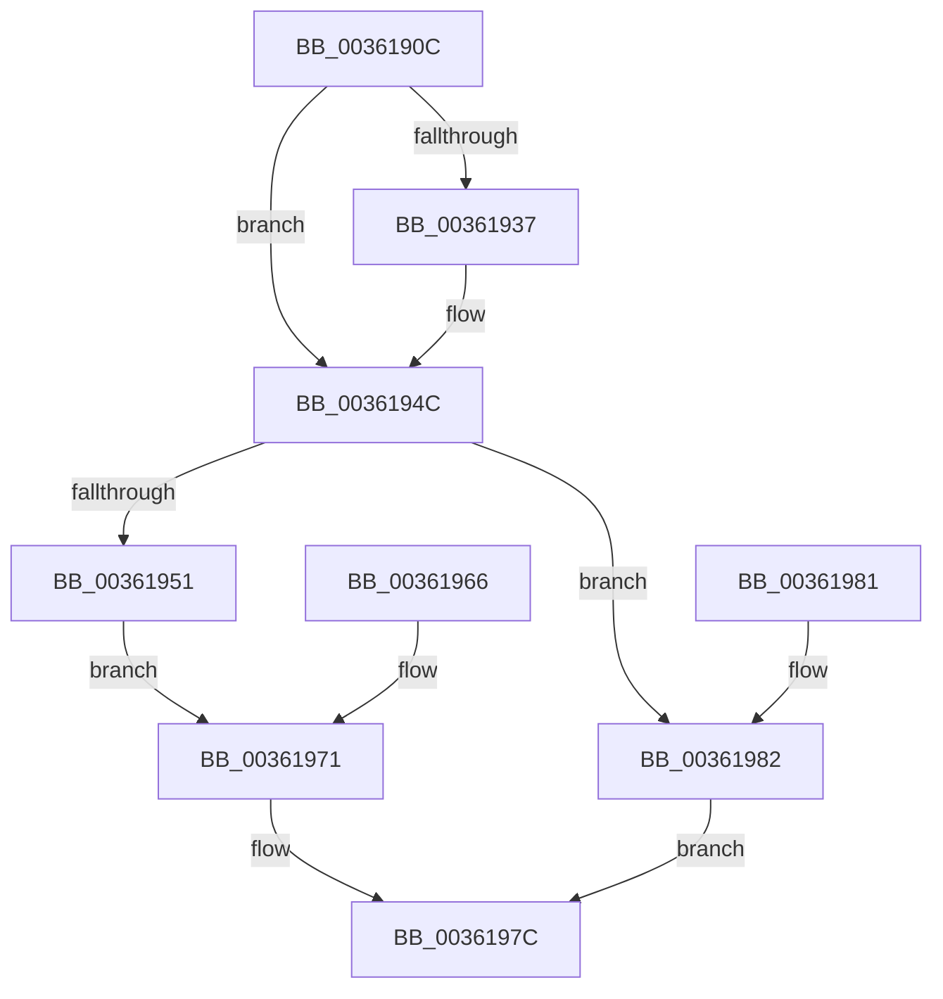

# RtlCSparseBitmapBitmaskRead

- RVA: `0x0036190C`–`0x00361986` (길이 `122` bytes)
- VA: `0x000000014036190C`
- 실행 섹션: `.text`
- PDB 이름 있음: `예`; PDB Function 태그: `아니요`
- unwind 정보 RVA: `0x00079D18`
- 디코드: `41`개 명령, `122/122` bytes 표시
- 미해석 바이트: `0` (있으면 어셈블리에 `.byte`로 보존)

> 이 문서는 커널 이미지의 기계어와 PDB 기호를 분석해 생성했습니다. 4번과 5번은 함수 원형과 자료형을 바이너리 사용 방식에서 추정한 C 해석이며 원본 소스 복구 결과는 아닙니다.

## 1. Dependencies

- 직접 호출 지점: **0**; 고유 호출 대상: **0**
- 직접 호출자로 확인된 함수: **12**
- RIP 상대 이미지 참조: **0**

### Outgoing calls
- 직접 디코드된 call 명령이 없습니다.

### Direct callers
- [RtlpHpAllocateHeapSlow](../2E/RtlpHpAllocateHeapSlow_function_002E9DEC.md) at `0x002EA508`
- [RtlpHpMetadataFree](../2E/RtlpHpMetadataFree_function_002ECA64.md) at `0x002ECABC`
- [ExAllocateHeapPool](../35/ExAllocateHeapPool_function_0035BA30.md) at `0x0035BC01`
- [ExAllocateHeapPool](../35/ExAllocateHeapPool_function_0035BA30.md) at `0x0035CAFF`
- [ExAllocateHeapPool](../35/ExAllocateHeapPool_function_0035BA30.md) at `0x0035D57F`
- [RtlpHpFreeHeap](../35/RtlpHpFreeHeap_function_0035F600.md) at `0x0035F635`
- [sub_0035FB85](../35/Unknown_function_0035FB85.md) at `0x0035FEE7`
- [sub_00360911](Unknown_function_00360911.md) at `0x00360929`
- [ExGetHeapFromVA](ExGetHeapFromVA_function_00361840.md) at `0x003618C5`
- [RtlpHpExtrasSetPresent](../60/RtlpHpExtrasSetPresent_function_00602CF4.md) at `0x00602D25`
- [RtlpHpMetadataCommit](../60/RtlpHpMetadataCommit_function_00603540.md) at `0x0060359C`
- [ExpAllocatePoolWithQuotaTag](../../poolcode/B8/ExpAllocatePoolWithQuotaTag_function_00B82210.md) at `0x00B8260E`
- [sub_00B82950](../../poolcode/B8/Unknown_function_00B82950.md) at `0x00B82CA8`
- [sub_00B836C7](../../poolcode/B8/Unknown_function_00B836C7.md) at `0x00B836DF`

### Static image references
- 디코드된 RIP-relative 메모리 참조가 없습니다.

## 2. Other-region calls and transfers

- 다른 실행 섹션으로 향하는 call: **0**
- 별도 외부 분기/꼬리 이동을 확인하지 못했습니다.

## 3. Assembly (complete function range)

```asm
0036190C  48 89 54 24 10                  mov qword ptr [rsp + 0x10], rdx
00361911  48 83 EC 18                     sub rsp, 0x18
00361915  4C 8B C1                        mov r8, rcx
00361918  4C 8B CA                        mov r9, rdx
0036191B  49 C1 E9 0F                     shr r9, 0xf
0036191F  49 8B C1                        mov rax, r9
00361922  48 C1 E8 0F                     shr rax, 0xf
00361926  48 0F A3 41 38                  bt qword ptr [rcx + 0x38], rax
0036192B  0F 92 C0                        setb al
0036192E  0F B6 C8                        movzx ecx, al
00361931  33 C0                           xor eax, eax
00361933  85 C9                           test ecx, ecx
00361935  74 15                           je 0x14036194c
00361937  49 8B 00                        mov rax, qword ptr [r8]
0036193A  4C 0F A3 08                     bt qword ptr [rax], r9
0036193E  0F 92 C0                        setb al
00361941  0F B6 C8                        movzx ecx, al
00361944  F7 D9                           neg ecx
00361946  1B C0                           sbb eax, eax
00361948  F7 D8                           neg eax
0036194A  FF C0                           inc eax
0036194C  83 F8 02                        cmp eax, 2
0036194F  75 31                           jne 0x140361982
00361951  48 8B CA                        mov rcx, rdx
00361954  48 C1 E9 06                     shr rcx, 6
00361958  49 8B 40 08                     mov rax, qword ptr [r8 + 8]
0036195C  48 8B 04 C8                     mov rax, qword ptr [rax + rcx*8]
00361960  48 89 04 24                     mov qword ptr [rsp], rax
00361964  EB 0B                           jmp 0x140361971
00361966  33 C0                           xor eax, eax
00361968  48 89 04 24                     mov qword ptr [rsp], rax
0036196C  48 8B 54 24 28                  mov rdx, qword ptr [rsp + 0x28]
00361971  8A CA                           mov cl, dl
00361973  80 E1 3F                        and cl, 0x3f
00361976  48 D3 E8                        shr rax, cl
00361979  83 E0 03                        and eax, 3
0036197C  48 83 C4 18                     add rsp, 0x18
00361980  C3                              ret
00361981  CC                              int3
00361982  33 C0                           xor eax, eax
00361984  EB F6                           jmp 0x14036197c
```

## 4. C-style interpretation (structured pseudocode)

```c
__int64 __fastcall RtlCSparseBitmapBitmaskRead(__int64 a1, __int64 a2)
{
    __int64 result;
    __int64 v_rsp;
    unsigned __int64 v_stack_m18;
    unsigned __int64 v_stack_p10;

    v_stack_p10 = a2;
    v_rsp = (v_rsp) - (24);
    a4 = (a2) >> (15);
    result = (a4) >> (15);
    result = (condition_is_below) ? 1 : 0;
    result = 0;
    if ((unsigned int)((unsigned __int8)(result)) != 0) {
        result = *(unsigned __int64 *)(a1);
        result = (condition_is_below) ? 1 : 0;
        a1 = (unsigned __int8)(result);
        a1 = (unsigned int)(-(a1));
        result = (unsigned int)(-(result));
        result = (unsigned int)((result) + 1);
    }
    if (((unsigned int)(result)) != 2) goto loc_00361982;
    a1 = (a2) >> (6);
    v_stack_m18 = *(unsigned __int64 *)(*(unsigned __int64 *)(a1 + 8) + a1 * 8);
    goto loc_00361971;
loc_00361971:
    a1 = (unsigned __int8)(((unsigned __int8)(a2)) & (63));
    result = (*(unsigned __int64 *)(*(unsigned __int64 *)(a1 + 8) + a1 * 8)) >> ((unsigned __int8)(a1));
    result = (unsigned int)((result) & (3));
loc_0036197C:
    v_rsp = (v_rsp) + (24);
    return result;
loc_00361982:
    result = 0;
    goto loc_0036197C;
}
```

## 5. (Beta) C Style

```c
int64_t RtlCSparseBitmapBitmaskRead(void *Arg1, int64_t Arg2)
{
    uint8_t *arg1 = (uint8_t *)Arg1;

    int64_t result;
    int64_t local_rsp;
    uint64_t v_stack_m18;
    uint64_t v_stack_p10;

    v_stack_p10 = Arg2;
    local_rsp = (local_rsp) - (24);
    a4 = (Arg2) >> (15);
    result = (a4) >> (15);
    result = (condition_is_below) ? 1 : 0;
    result = 0;
    if ((uint32_t)((uint8_t)(result)) != 0) {
        result = *(uint64_t *)(arg1);
        result = (condition_is_below) ? 1 : 0;
        Arg1 = (uint8_t)(result);
        Arg1 = (uint32_t)(-(Arg1));
        result = (uint32_t)(-(result));
        result = (uint32_t)((result) + 1);
    }
    if (((uint32_t)(result)) != 2) goto loc_00361982;
    Arg1 = (Arg2) >> (6);
    v_stack_m18 = *(uint64_t *)(*(uint64_t *)(arg1 + 0x8) + arg1 * 8);
    goto loc_00361971;
loc_00361971:
    Arg1 = (uint8_t)(((uint8_t)(Arg2)) & (63));
    result = (*(uint64_t *)(*(uint64_t *)(arg1 + 0x8) + arg1 * 8)) >> ((uint8_t)(Arg1));
    result = (uint32_t)((result) & (3));
loc_0036197C:
    local_rsp = (local_rsp) + (24);
    return result;
loc_00361982:
    result = 0;
    goto loc_0036197C;
}
```

### 관측된 메모리 오프셋

구조체 형식이 확인되지 않은 접근은 인자 기준의 오프셋으로만 기록했습니다.

| 기준 인자 | 오프셋 표현 | 폭 (bit) | 접근 |
|---|---:|---:|---|
| `Arg1` | `+ 0x0` | `64` | `R` |
| `Arg1` | `+ 0x8` | `64` | `R` |
| `Arg1` | `+ 0x38` | `64` | `R` |

## 6. Execution-region graph

[열기: 2D/3D 그래프와 함수 탐색 컨트롤 패널](../../../control-panel.html?section=text&rva=0x0036190C&view=graph)

- 2D 그래프는 위에서 아래로 흐르고, 3D 그래프는 빈 공간을 드래그해 회전합니다. Shift+드래그는 이동, 휠은 확대·축소, 함수 노드 선택은 대상 보고서 이동입니다.

### Static fallback


