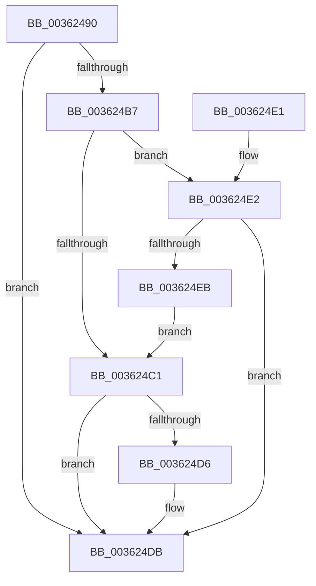

# RtlSetAllBits

- RVA: `0x00362490`–`0x003624F1` (길이 `97` bytes)
- VA: `0x0000000140362490`
- 실행 섹션: `.text`
- PDB 이름 있음: `예`; PDB Function 태그: `아니요`
- unwind 정보 RVA: `0x00079DDC`
- 디코드: `31`개 명령, `97/97` bytes 표시
- 미해석 바이트: `0` (있으면 어셈블리에 `.byte`로 보존)

> 이 문서는 커널 이미지의 기계어와 PDB 기호를 분석해 생성했습니다. 4번과 5번은 함수 원형과 자료형을 바이너리 사용 방식에서 추정한 C 해석이며 원본 소스 복구 결과는 아닙니다.

## 1. Dependencies

- 직접 호출 지점: **0**; 고유 호출 대상: **0**
- 직접 호출자로 확인된 함수: **19**
- RIP 상대 이미지 참조: **0**

### Outgoing calls
- 직접 디코드된 call 명령이 없습니다.

### Direct callers
- [MiBuildMdlForMappedFileFault](MiBuildMdlForMappedFileFault_function_0036380C.md) at `0x003638AE`
- [ST_STORE&lt;SM_TRAITS&gt;::StDmStart](../3B/ST_STORE_SM_TRAITS_StDmStart_function_003B25C8.md) at `0x003B2756`
- [ST_STORE&lt;SM_TRAITS&gt;::StDmStart](../3B/ST_STORE_SM_TRAITS_StDmStart_function_003B25C8.md) at `0x003B2847`
- [SMKM_STORE&lt;SM_TRAITS&gt;::SmStOutSwapPrepareStore](../49/SMKM_STORE_SM_TRAITS_SmStOutSwapPrepareStore_function_00496B0C.md) at `0x00496B82`
- [MiChangePagingFileMaximum](../67/MiChangePagingFileMaximum_function_0067FEFC.md) at `0x0067FF3E`
- [MiChangePagingFileMaximum](../67/MiChangePagingFileMaximum_function_0067FEFC.md) at `0x0067FF4F`
- [HalpDmaAllocateLocalContiguousPool](../../page/70/HalpDmaAllocateLocalContiguousPool_function_00708EE4.md) at `0x00708F41`
- [PnprMmAddRange](../../page/73/PnprMmAddRange_function_0073A63C.md) at `0x0073A6C5`
- [SmcStoreResize](../../page/7A/SmcStoreResize_function_007AC500.md) at `0x007AC5B9`
- [CmpLoadHiveThread](../../page/7D/CmpLoadHiveThread_function_007DB040.md) at `0x007DB8AF`
- [CmpMountPreloadedHives](../../page/7D/CmpMountPreloadedHives_function_007DBE18.md) at `0x007DC36C`
- [MiCreatePagefile](../../page/7F/MiCreatePagefile_function_007FEC30.md) at `0x007FEF33`
- [MiCreatePagefile](../../page/7F/MiCreatePagefile_function_007FEC30.md) at `0x007FEF51`
- [MiPrepareToHotPatchImage](../../page/80/MiPrepareToHotPatchImage_function_00806820.md) at `0x008068F4`
- [MiReserveDriverPtes](../../page/A7/MiReserveDriverPtes_function_00A75150.md) at `0x00A75298`
- [MiCaptureImageExceptionValues](../../page/AA/MiCaptureImageExceptionValues_function_00AAA890.md) at `0x00AAA934`
- [PopAllocateHiberContext](../../page/AD/PopAllocateHiberContext_function_00ADC05C.md) at `0x00ADC368`
- [PopAllocateHiberContext](../../page/AD/PopAllocateHiberContext_function_00ADC05C.md) at `0x00ADC370`
- [PopSaveHiberContext](../../pagelk/B6/PopSaveHiberContext_function_00B6F050.md) at `0x00B6F4EB`
- [HalpPowerInitDiscard](../../init/C1/HalpPowerInitDiscard_function_00C1EB40.md) at `0x00C1EBBC`
- [HalpDmaInitializeMasterAdapter](../../init/C2/HalpDmaInitializeMasterAdapter_function_00C21278.md) at `0x00C2132C`
- [VfInitBootDriversLoaded](../../init/C4/VfInitBootDriversLoaded_function_00C4BD0C.md) at `0x00C4BD7C`
- [VfInitBootDriversLoaded](../../init/C4/VfInitBootDriversLoaded_function_00C4BD0C.md) at `0x00C4BD9C`
- [VfInitBootDriversLoaded](../../init/C4/VfInitBootDriversLoaded_function_00C4BD0C.md) at `0x00C4BDC0`
- [MiCreateBootSlabEntries](../../init/C6/MiCreateBootSlabEntries_function_00C69A50.md) at `0x00C69ADD`

### Static image references
- 디코드된 RIP-relative 메모리 참조가 없습니다.

## 2. Other-region calls and transfers

- 다른 실행 섹션으로 향하는 call: **0**
- 별도 외부 분기/꼬리 이동을 확인하지 못했습니다.

## 3. Assembly (complete function range)

```asm
00362490  48 89 7C 24 08                  mov qword ptr [rsp + 8], rdi
00362495  8B 11                           mov edx, dword ptr [rcx]
00362497  B8 00 00 00 00                  mov eax, 0
0036249C  4C 8B 41 08                     mov r8, qword ptr [rcx + 8]
003624A0  F6 C2 1F                        test dl, 0x1f
003624A3  0F 95 C0                        setne al
003624A6  C1 EA 05                        shr edx, 5
003624A9  03 D0                           add edx, eax
003624AB  C1 E2 02                        shl edx, 2
003624AE  48 C1 EA 02                     shr rdx, 2
003624B2  48 85 D2                        test rdx, rdx
003624B5  74 24                           je 0x1403624db
003624B7  41 83 C9 FF                     or r9d, 0xffffffff
003624BB  41 F6 C0 04                     test r8b, 4
003624BF  75 21                           jne 0x1403624e2
003624C1  48 83 C8 FF                     or rax, 0xffffffffffffffff
003624C5  48 8B CA                        mov rcx, rdx
003624C8  48 D1 E9                        shr rcx, 1
003624CB  49 8B F8                        mov rdi, r8
003624CE  F3 48 AB                        rep stosq qword ptr [rdi], rax
003624D1  F6 C2 01                        test dl, 1
003624D4  74 05                           je 0x1403624db
003624D6  45 89 4C 90 FC                  mov dword ptr [r8 + rdx*4 - 4], r9d
003624DB  48 8B 7C 24 08                  mov rdi, qword ptr [rsp + 8]
003624E0  C3                              ret
003624E1  CC                              int3
003624E2  45 89 08                        mov dword ptr [r8], r9d
003624E5  48 83 EA 01                     sub rdx, 1
003624E9  74 F0                           je 0x1403624db
003624EB  49 83 C0 04                     add r8, 4
003624EF  EB D0                           jmp 0x1403624c1
```

## 4. C-style interpretation (structured pseudocode)

```c
__int64 __fastcall RtlSetAllBits(__int64 a1, __int64 a2, __int64 a3, int a4)
{
    __int64 result;
    unsigned __int64 v_stack_p8;

    v_stack_p8 = v_rdi;
    result = ((((unsigned __int8)((unsigned int)(*(unsigned int *)(a1)))) & (31)) != 0) ? 1 : 0;
    a2 = (unsigned int)(((unsigned int)(*(unsigned int *)(a1))) >> (5));
    a2 = (unsigned int)((a2) + ((unsigned int)(result)));
    a2 = (unsigned int)((a2) << (2));
    a2 = (a2) >> (2);
    if (a2 == 0) goto loc_003624DB;
    a4 = (unsigned int)((a4) | (0xFFFFFFFFULL));
    if ((((unsigned __int8)(*(unsigned __int64 *)(a1 + 8))) & (4)) != 0) goto loc_003624E2;
loc_003624C1:
    result = (result) | (-1);
    a1 = (a2) >> (1);
    if ((((unsigned __int8)(a2)) & (1)) != 0) {
        *(unsigned int *)(*(unsigned __int64 *)(a1 + 8) + a2 * 4 - 4) = a4;
    }
    return result;
loc_003624E2:
    *(unsigned int *)(*(unsigned __int64 *)(a1 + 8)) = a4;
    a2 = (a2) - (1);
    if (condition_is_equal) goto loc_003624DB;
    a3 = (*(unsigned __int64 *)(a1 + 8)) + (4);
    goto loc_003624C1;
}
```

## 5. (Beta) C Style

```c
int64_t RtlSetAllBits(void *Arg1, int64_t Arg2, int64_t Arg3, int32_t Arg4)
{
    uint8_t *arg1 = (uint8_t *)Arg1;

    int64_t result;
    uint64_t v_stack_p8;

    v_stack_p8 = local_rdi;
    result = ((((uint8_t)((uint32_t)(*(uint32_t *)(arg1)))) & (31)) != 0) ? 1 : 0;
    Arg2 = (uint32_t)(((uint32_t)(*(uint32_t *)(arg1))) >> (5));
    Arg2 = (uint32_t)((Arg2) + ((uint32_t)(result)));
    Arg2 = (uint32_t)((Arg2) << (2));
    Arg2 = (Arg2) >> (2);
    if (Arg2 == 0) goto loc_003624DB;
    Arg4 = (uint32_t)((Arg4) | (0xFFFFFFFFULL));
    if ((((uint8_t)(*(uint64_t *)(arg1 + 0x8))) & (4)) != 0) goto loc_003624E2;
loc_003624C1:
    result = (result) | (-1);
    Arg1 = (Arg2) >> (1);
    if ((((uint8_t)(Arg2)) & (1)) != 0) {
        *(uint32_t *)(*(uint64_t *)(arg1 + 0x8) + Arg2 * 4 - 0x4) = Arg4;
    }
    return result;
loc_003624E2:
    *(uint32_t *)(*(uint64_t *)(arg1 + 0x8)) = Arg4;
    Arg2 = (Arg2) - (1);
    if (condition_is_equal) goto loc_003624DB;
    Arg3 = (*(uint64_t *)(arg1 + 0x8)) + (4);
    goto loc_003624C1;
}
```

### 관측된 메모리 오프셋

구조체 형식이 확인되지 않은 접근은 인자 기준의 오프셋으로만 기록했습니다.

| 기준 인자 | 오프셋 표현 | 폭 (bit) | 접근 |
|---|---:|---:|---|
| `Arg1` | `+ 0x0` | `32` | `R` |
| `Arg1` | `+ 0x8` | `64` | `R` |

## 6. Execution-region graph

[열기: 2D/3D 그래프와 함수 탐색 컨트롤 패널](../../../control-panel.html?section=text&rva=0x00362490&view=graph)

- 2D 그래프는 위에서 아래로 흐르고, 3D 그래프는 빈 공간을 드래그해 회전합니다. Shift+드래그는 이동, 휠은 확대·축소, 함수 노드 선택은 대상 보고서 이동입니다.

### Static fallback


