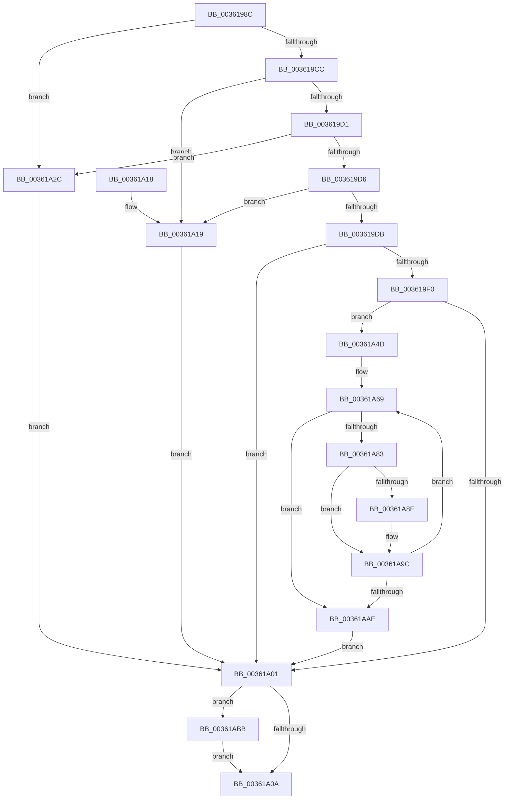

# RtlpHpSegFreeInternal

- RVA: `0x0036198C`–`0x00361AC6` (길이 `314` bytes)
- VA: `0x000000014036198C`
- 실행 섹션: `.text`
- PDB 이름 있음: `예`; PDB Function 태그: `아니요`
- unwind 정보 RVA: `0x00079D3C`
- 디코드: `85`개 명령, `314/314` bytes 표시
- 미해석 바이트: `0` (있으면 어셈블리에 `.byte`로 보존)

> 이 문서는 커널 이미지의 기계어와 PDB 기호를 분석해 생성했습니다. 4번과 5번은 함수 원형과 자료형을 바이너리 사용 방식에서 추정한 C 해석이며 원본 소스 복구 결과는 아닙니다.

## 1. Dependencies

- 직접 호출 지점: **3**; 고유 호출 대상: **3**
- 직접 호출자로 확인된 함수: **3**
- RIP 상대 이미지 참조: **1**

### Outgoing calls
- `0x003619E4` → [RtlpHpVsContextFree](RtlpHpVsContextFree_function_00361630.md) (function, `0x00361630`)
- `0x00361A1F` → [RtlpHpSegPageRangeShrink](../2E/RtlpHpSegPageRangeShrink_function_002E2FA0.md) (function, `0x002E2FA0`)
- `0x00361A43` → [RtlpLogHeapFailure](../35/RtlpLogHeapFailure_function_0035B7BC.md) (function, `0x0035B7BC`)

### Direct callers
- [RtlpHpSegLfhVsFree](../2E/RtlpHpSegLfhVsFree_function_002E7DF0.md) at `0x002E7E8F`
- [RtlpHpAllocateHeapSlow](../2E/RtlpHpAllocateHeapSlow_function_002E9DEC.md) at `0x002EA5BF`
- [RtlpHpMetadataFree](../2E/RtlpHpMetadataFree_function_002ECA64.md) at `0x002ECB94`

### Static image references
- `0x00361A5A` → RVA `0x00010B80` (`.rdata`; read)

## 2. Other-region calls and transfers

- 다른 실행 섹션으로 향하는 call: **0**
- 별도 외부 분기/꼬리 이동을 확인하지 못했습니다.

## 3. Assembly (complete function range)

```asm
0036198C  48 89 5C 24 10                  mov qword ptr [rsp + 0x10], rbx
00361991  57                              push rdi
00361992  48 83 EC 30                     sub rsp, 0x30
00361996  48 8B 01                        mov rax, qword ptr [rcx]
00361999  4D 8B D0                        mov r10, r8
0036199C  83 64 24 40 00                  and dword ptr [rsp + 0x40], 0
003619A1  4C 8B C2                        mov r8, rdx
003619A4  49 23 C2                        and rax, r10
003619A7  48 8B D9                        mov rbx, rcx
003619AA  8A 49 08                        mov cl, byte ptr [rcx + 8]
003619AD  49 8B D2                        mov rdx, r10
003619B0  48 2B D0                        sub rdx, rax
003619B3  49 8B F9                        mov rdi, r9
003619B6  48 C1 FA 05                     sar rdx, 5
003619BA  48 D3 E2                        shl rdx, cl
003619BD  41 8A 4A 18                     mov cl, byte ptr [r10 + 0x18]
003619C1  48 03 D0                        add rdx, rax
003619C4  8A C1                           mov al, cl
003619C6  24 03                           and al, 3
003619C8  3C 03                           cmp al, 3
003619CA  75 60                           jne 0x140361a2c
003619CC  4C 3B C2                        cmp r8, rdx
003619CF  74 48                           je 0x140361a19
003619D1  80 F9 0F                        cmp cl, 0xf
003619D4  75 56                           jne 0x140361a2c
003619D6  4C 3B C2                        cmp r8, rdx
003619D9  76 3E                           jbe 0x140361a19
003619DB  48 8B 4B 20                     mov rcx, qword ptr [rbx + 0x20]
003619DF  4C 8D 4C 24 40                  lea r9, [rsp + 0x40]
003619E4  E8 47 FC FF FF                  call 0x140361630
003619E9  44 8B D0                        mov r10d, eax
003619EC  85 C0                           test eax, eax
003619EE  74 11                           je 0x140361a01
003619F0  4C 8B 4B 18                     mov r9, qword ptr [rbx + 0x18]
003619F4  8B 44 24 40                     mov eax, dword ptr [rsp + 0x40]
003619F8  41 0F B7 49 44                  movzx ecx, word ptr [r9 + 0x44]
003619FD  3B C1                           cmp eax, ecx
003619FF  72 4C                           jb 0x140361a4d
00361A01  48 85 FF                        test rdi, rdi
00361A04  0F 85 B1 00 00 00               jne 0x140361abb
00361A0A  48 8B 5C 24 48                  mov rbx, qword ptr [rsp + 0x48]
00361A0F  41 8B C2                        mov eax, r10d
00361A12  48 83 C4 30                     add rsp, 0x30
00361A16  5F                              pop rdi
00361A17  C3                              ret
00361A18  CC                              int3
00361A19  49 8B D2                        mov rdx, r10
00361A1C  48 8B CB                        mov rcx, rbx
00361A1F  E8 7C 15 F8 FF                  call 0x1402e2fa0
00361A24  41 BA 01 00 00 00               mov r10d, 1
00361A2A  EB D5                           jmp 0x140361a01
00361A2C  48 83 64 24 28 00               and qword ptr [rsp + 0x28], 0
00361A32  45 33 C9                        xor r9d, r9d
00361A35  48 8B 53 38                     mov rdx, qword ptr [rbx + 0x38]
00361A39  48 83 64 24 20 00               and qword ptr [rsp + 0x20], 0
00361A3F  41 8D 49 09                     lea ecx, [r9 + 9]
00361A43  E8 74 9D FF FF                  call 0x14035b7bc
00361A48  45 33 D2                        xor r10d, r10d
00361A4B  EB B4                           jmp 0x140361a01
00361A4D  8D 50 0F                        lea edx, [rax + 0xf]
00361A50  41 B8 01 00 00 00               mov r8d, 1
00361A56  48 C1 EA 04                     shr rdx, 4
00361A5A  48 8D 05 1F F1 CA FF            lea rax, [rip - 0x350ee1]
00361A61  44 0F B6 1C 02                  movzx r11d, byte ptr [rdx + rax]
00361A66  45 2B D8                        sub r11d, r8d
00361A69  4B 8B 8C D9 C0 01 00 00         mov rcx, qword ptr [r9 + r11*8 + 0x1c0]
00361A71  48 89 4C 24 58                  mov qword ptr [rsp + 0x58], rcx
00361A76  48 8B D1                        mov rdx, rcx
00361A79  48 89 4C 24 50                  mov qword ptr [rsp + 0x50], rcx
00361A7E  41 84 C8                        test r8b, cl
00361A81  74 2B                           je 0x140361aae
00361A83  0F B7 44 24 5A                  movzx eax, word ptr [rsp + 0x5a]
00361A88  66 41 3B C0                     cmp ax, r8w
00361A8C  76 0E                           jbe 0x140361a9c
00361A8E  66 41 2B C0                     sub ax, r8w
00361A92  66 89 44 24 52                  mov word ptr [rsp + 0x52], ax
00361A97  48 8B 54 24 50                  mov rdx, qword ptr [rsp + 0x50]
00361A9C  48 8B C1                        mov rax, rcx
00361A9F  F0 4B 0F B1 94 D9 C0 01 00 00   lock cmpxchg qword ptr [r9 + r11*8 + 0x1c0], rdx
00361AA9  48 3B C1                        cmp rax, rcx
00361AAC  75 BB                           jne 0x140361a69
00361AAE  4B 8B 84 D9 C0 01 00 00         mov rax, qword ptr [r9 + r11*8 + 0x1c0]
00361AB6  E9 46 FF FF FF                  jmp 0x140361a01
00361ABB  C7 07 03 00 00 00               mov dword ptr [rdi], 3
00361AC1  E9 44 FF FF FF                  jmp 0x140361a0a
```

## 4. C-style interpretation (structured pseudocode)

```c
__int64 __fastcall RtlpHpSegFreeInternal(__int64 a1, __int64 a2, __int64 a3, __int64 a4)
{
    __int64 result;
    __int64 v_r10;
    __int64 v_r11;
    __int64 v_rsp;
    unsigned __int64 v_stack_p10;
    unsigned __int64 v_stack_p20;
    unsigned __int64 v_stack_p28;
    unsigned __int64 v_stack_p50;
    unsigned __int16 v_stack_p52;
    unsigned __int64 v_stack_p58;
    unsigned __int16 v_stack_p5A;
    unsigned int v_stack_p8;

    v_stack_p10 = v_rbx;
    v_rsp = (v_rsp) - (48);
    result = (*(unsigned __int64 *)(a1)) & (a3);
    a2 = (a3) - (result);
    a2 = (a2) >> (5);
    a2 = (a2) << ((unsigned __int8)(*(unsigned __int8 *)(a1 + 8)));
    a2 = (a2) + (result);
    result = (unsigned __int8)(((unsigned __int8)(*(unsigned __int8 *)(a3 + 24))) & (3));
    if (((unsigned __int8)(result)) != 3) goto loc_00361A2C;
    if (a2 == a2) goto loc_00361A19;
    if (((unsigned __int8)(*(unsigned __int8 *)(a3 + 24))) != 15) goto loc_00361A2C;
    if (a2 <= a2) goto loc_00361A19;
    result = RtlpHpVsContextFree(*(unsigned __int64 *)(a1 + 32), a2, a2, v_stack_p8);
    if ((unsigned int)(result) == 0) goto loc_00361A01;
    if (((unsigned int)((unsigned int)(v_stack_p8))) < ((unsigned int)(*(unsigned __int16 *)(*(unsigned __int64 *)(a1 + 24) + 68)))) goto loc_00361A4D;
loc_00361A01:
    if (a4 != 0) goto loc_00361ABB;
loc_00361A0A:
    v_rsp = (v_rsp) + (48);
    return (unsigned int)((unsigned int)((unsigned int)((unsigned int)(result))));
loc_00361A19:
    result = RtlpHpSegPageRangeShrink(v_stack_p10, (unsigned int)((unsigned int)(result)), a2, *(unsigned __int64 *)(a1 + 24));
    goto loc_00361A01;
loc_00361A2C:
    a4 = 0;
    result = RtlpLogHeapFailure(a4 + 9, *(unsigned __int64 *)(v_stack_p10 + 56), a2, a4);
    v_r10 = 0;
    goto loc_00361A01;
loc_00361A4D:
    a2 = (result + 15) >> (4);
    v_r11 = (unsigned int)((*(unsigned __int8 *)(a2 + v_rip - 3477217 * 1)) - (1));
loc_00361A69:
    v_stack_p58 = *(unsigned __int64 *)(a4 + v_r11 * 8 + 448);
    v_stack_p50 = *(unsigned __int64 *)(a4 + v_r11 * 8 + 448);
    if (((1) & ((unsigned __int8)(*(unsigned __int64 *)(a4 + v_r11 * 8 + 448)))) == 0) goto loc_00361AAE;
    result = v_stack_p5A;
    if (((unsigned __int16)(v_stack_p5A)) >= = 1) {
        result = (unsigned __int16)((v_stack_p5A) - (1));
        v_stack_p52 = (unsigned __int16)(result);
        a2 = v_stack_p50;
    }
    if ((*(unsigned __int64 *)(a4 + v_r11 * 8 + 448)) != (*(unsigned __int64 *)(a4 + v_r11 * 8 + 448))) goto loc_00361A69;
loc_00361AAE:
    goto loc_00361A01;
loc_00361ABB:
    *(unsigned int *)(a4) = 3;
    goto loc_00361A0A;
}
```

## 5. (Beta) C Style

```c
int64_t RtlpHpSegFreeInternal(void *Arg1, int64_t Arg2, void *Arg3, int64_t Arg4)
{
    uint8_t *arg1 = (uint8_t *)Arg1;
    uint8_t *arg3 = (uint8_t *)Arg3;

    int64_t result;
    int64_t local_r10;
    int64_t local_r11;
    int64_t local_rsp;
    uint64_t v_stack_p10;
    uint64_t v_stack_p20;
    uint64_t v_stack_p28;
    uint64_t v_stack_p50;
    uint16_t v_stack_p52;
    uint64_t v_stack_p58;
    uint16_t v_stack_p5A;
    uint32_t v_stack_p8;

    v_stack_p10 = local_rbx;
    local_rsp = (local_rsp) - (48);
    result = (*(uint64_t *)(arg1)) & (Arg3);
    Arg2 = (Arg3) - (result);
    Arg2 = (Arg2) >> (5);
    Arg2 = (Arg2) << ((uint8_t)(*(uint8_t *)(arg1 + 0x8)));
    Arg2 = (Arg2) + (result);
    result = (uint8_t)(((uint8_t)(*(uint8_t *)(arg3 + 0x18))) & (3));
    if (((uint8_t)(result)) != 3) goto loc_00361A2C;
    if (Arg2 == Arg2) goto loc_00361A19;
    if (((uint8_t)(*(uint8_t *)(arg3 + 0x18))) != 15) goto loc_00361A2C;
    if (Arg2 <= Arg2) goto loc_00361A19;
    result = RtlpHpVsContextFree(*(uint64_t *)(arg1 + 0x20), Arg2, Arg2, v_stack_p8);
    if ((uint32_t)(result) == 0) goto loc_00361A01;
    if (((uint32_t)((uint32_t)(v_stack_p8))) < ((uint32_t)(*(uint16_t *)(*(uint64_t *)(arg1 + 0x18) + 0x44)))) goto loc_00361A4D;
loc_00361A01:
    if (Arg4 != 0) goto loc_00361ABB;
loc_00361A0A:
    local_rsp = (local_rsp) + (48);
    return (uint32_t)((uint32_t)((uint32_t)((uint32_t)(result))));
loc_00361A19:
    result = RtlpHpSegPageRangeShrink(v_stack_p10, (uint32_t)((uint32_t)(result)), Arg2, *(uint64_t *)(arg1 + 0x18));
    goto loc_00361A01;
loc_00361A2C:
    Arg4 = 0;
    result = RtlpLogHeapFailure(Arg4 + 9, *(uint64_t *)(v_stack_p10 + 0x38), Arg2, Arg4);
    local_r10 = 0;
    goto loc_00361A01;
loc_00361A4D:
    Arg2 = (result + 15) >> (4);
    local_r11 = (uint32_t)((*(uint8_t *)(Arg2 + v_rip - 0x350EE1 * 1)) - (1));
loc_00361A69:
    v_stack_p58 = *(uint64_t *)(Arg4 + local_r11 * 8 + 0x1C0);
    v_stack_p50 = *(uint64_t *)(Arg4 + local_r11 * 8 + 0x1C0);
    if (((1) & ((uint8_t)(*(uint64_t *)(Arg4 + local_r11 * 8 + 0x1C0)))) == 0) goto loc_00361AAE;
    result = v_stack_p5A;
    if (((uint16_t)(v_stack_p5A)) >= = 1) {
        result = (uint16_t)((v_stack_p5A) - (1));
        v_stack_p52 = (uint16_t)(result);
        Arg2 = v_stack_p50;
    }
    if ((*(uint64_t *)(Arg4 + local_r11 * 8 + 0x1C0)) != (*(uint64_t *)(Arg4 + local_r11 * 8 + 0x1C0))) goto loc_00361A69;
loc_00361AAE:
    goto loc_00361A01;
loc_00361ABB:
    *(uint32_t *)(Arg4) = 3;
    goto loc_00361A0A;
}
```

### 관측된 메모리 오프셋

구조체 형식이 확인되지 않은 접근은 인자 기준의 오프셋으로만 기록했습니다.

| 기준 인자 | 오프셋 표현 | 폭 (bit) | 접근 |
|---|---:|---:|---|
| `Arg1` | `+ 0x0` | `64` | `R` |
| `Arg1` | `+ 0x8` | `8` | `R` |
| `Arg1` | `+ 0x18` | `64` | `R` |
| `Arg1` | `+ 0x20` | `64` | `R` |
| `Arg1` | `+ 0x38` | `64` | `R` |
| `Arg3` | `+ 0x18` | `8` | `R` |

## 6. Execution-region graph

[열기: 2D/3D 그래프와 함수 탐색 컨트롤 패널](../../../control-panel.html?section=text&rva=0x0036198C&view=graph)

- 2D 그래프는 위에서 아래로 흐르고, 3D 그래프는 빈 공간을 드래그해 회전합니다. Shift+드래그는 이동, 휠은 확대·축소, 함수 노드 선택은 대상 보고서 이동입니다.

### Static fallback


