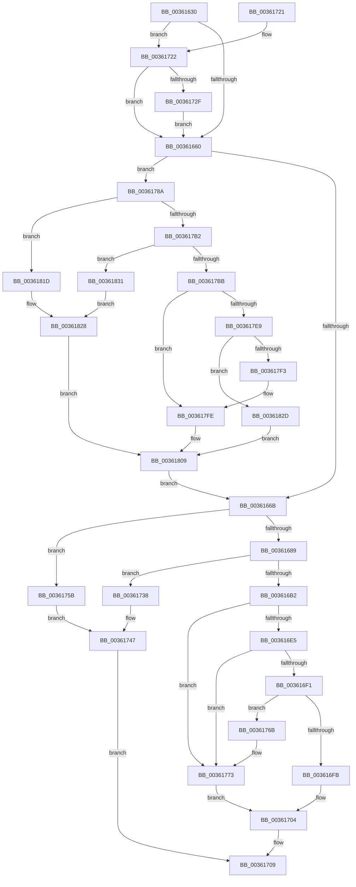

# RtlpHpVsContextFree

- RVA: `0x00361630`–`0x00361835` (길이 `517` bytes)
- VA: `0x0000000140361630`
- 실행 섹션: `.text`
- PDB 이름 있음: `예`; PDB Function 태그: `아니요`
- unwind 정보 RVA: `0x00079CF4`
- 디코드: `141`개 명령, `517/517` bytes 표시
- 미해석 바이트: `0` (있으면 어셈블리에 `.byte`로 보존)

> 이 문서는 커널 이미지의 기계어와 PDB 기호를 분석해 생성했습니다. 4번과 5번은 함수 원형과 자료형을 바이너리 사용 방식에서 추정한 C 해석이며 원본 소스 복구 결과는 아닙니다.

## 1. Dependencies

- 직접 호출 지점: **4**; 고유 호출 대상: **4**
- 직접 호출자로 확인된 함수: **6**
- RIP 상대 이미지 참조: **2**

### Outgoing calls
- `0x003616FF` → [ExpInterlockedPushEntrySList](../6B/ExpInterlockedPushEntrySList_function_006BA5B0.md) (function, `0x006BA5B0`)
- `0x00361754` → [RtlpLogHeapFailure](../35/RtlpLogHeapFailure_function_0035B7BC.md) (function, `0x0035B7BC`)
- `0x0036176B` → [ExpInterlockedFlushSList](../6B/ExpInterlockedFlushSList_function_006BA5F0.md) (function, `0x006BA5F0`)
- `0x00361780` → [RtlpHpVsSlotFreeList](RtlpHpVsSlotFreeList_function_00361ACC.md) (function, `0x00361ACC`)

### Direct callers
- [ExAllocateHeapPool](../35/ExAllocateHeapPool_function_0035BA30.md) at `0x0035BFDD`
- [ExAllocateHeapPool](../35/ExAllocateHeapPool_function_0035BA30.md) at `0x0035D257`
- [sub_0035F6BF](../35/Unknown_function_0035F6BF.md) at `0x0035F8AB`
- [sub_003602E3](Unknown_function_003602E3.md) at `0x00360710`
- [RtlpHpSegFreeInternal](RtlpHpSegFreeInternal_function_0036198C.md) at `0x003619E4`
- [RtlpFreeNTHeapInternal](../48/RtlpFreeNTHeapInternal_function_00487FDC.md) at `0x00488013`
- [sub_00B830A9](../../poolcode/B8/Unknown_function_00B830A9.md) at `0x00B834CD`

### Static image references
- `0x0036168C` → RVA `0x00E28300` (`.data`; read)
- `0x003616BD` → RVA `0x00E28302` (`.data`; read)

## 2. Other-region calls and transfers

- 다른 실행 섹션으로 향하는 call: **0**
- 별도 외부 분기/꼬리 이동을 확인하지 못했습니다.

## 3. Assembly (complete function range)

```asm
00361630  48 89 5C 24 10                  mov qword ptr [rsp + 0x10], rbx
00361635  48 89 74 24 18                  mov qword ptr [rsp + 0x18], rsi
0036163A  48 89 7C 24 20                  mov qword ptr [rsp + 0x20], rdi
0036163F  41 56                           push r14
00361641  48 83 EC 30                     sub rsp, 0x30
00361645  44 8A 59 04                     mov r11b, byte ptr [rcx + 4]
00361649  49 8D 78 F0                     lea rdi, [r8 - 0x10]
0036164D  4D 8B F1                        mov r14, r9
00361650  4D 8B D0                        mov r10, r8
00361653  48 8B F1                        mov rsi, rcx
00361656  41 F6 C3 01                     test r11b, 1
0036165A  0F 85 C2 00 00 00               jne 0x140361722
00361660  33 DB                           xor ebx, ebx
00361662  48 85 D2                        test rdx, rdx
00361665  0F 84 1F 01 00 00               je 0x14036178a
0036166B  0F B7 4A 24                     movzx ecx, word ptr [rdx + 0x24]
0036166F  B8 ED 2B 00 00                  mov eax, 0x2bed
00361674  66 33 4A 20                     xor cx, word ptr [rdx + 0x20]
00361678  66 33 C8                        xor cx, ax
0036167B  B8 FF 7F 00 00                  mov eax, 0x7fff
00361680  66 85 C8                        test ax, cx
00361683  0F 85 D2 00 00 00               jne 0x14036175b
00361689  48 8B 0F                        mov rcx, qword ptr [rdi]
0036168C  48 8B 05 6D 6C AC 00            mov rax, qword ptr [rip + 0xac6c6d]
00361693  48 C1 E8 20                     shr rax, 0x20
00361697  48 C1 E9 20                     shr rcx, 0x20
0036169B  33 C8                           xor ecx, eax
0036169D  48 8B C7                        mov rax, rdi
003616A0  48 C1 E8 20                     shr rax, 0x20
003616A4  33 C8                           xor ecx, eax
003616A6  F7 C1 00 00 FF 00               test ecx, 0xff0000
003616AC  0F 84 86 00 00 00               je 0x140361738
003616B2  0F B7 4F 02                     movzx ecx, word ptr [rdi + 2]
003616B6  8B C7                           mov eax, edi
003616B8  C1 E8 10                        shr eax, 0x10
003616BB  33 C8                           xor ecx, eax
003616BD  0F B7 05 3E 6C AC 00            movzx eax, word ptr [rip + 0xac6c3e]
003616C4  33 C8                           xor ecx, eax
003616C6  C1 E1 04                        shl ecx, 4
003616C9  83 C1 F0                        add ecx, -0x10
003616CC  41 89 0E                        mov dword ptr [r14], ecx
003616CF  44 0F B7 72 22                  movzx r14d, word ptr [rdx + 0x22]
003616D4  49 C1 E6 06                     shl r14, 6
003616D8  4C 03 F6                        add r14, rsi
003616DB  41 F6 C3 02                     test r11b, 2
003616DF  0F 84 8E 00 00 00               je 0x140361773
003616E5  81 F9 00 10 00 00               cmp ecx, 0x1000
003616EB  0F 83 82 00 00 00               jae 0x140361773
003616F1  49 8D 4E 40                     lea rcx, [r14 + 0x40]
003616F5  66 83 39 20                     cmp word ptr [rcx], 0x20
003616F9  73 70                           jae 0x14036176b
003616FB  48 8D 57 10                     lea rdx, [rdi + 0x10]
003616FF  E8 AC 8E 35 00                  call 0x1406ba5b0
00361704  BB 01 00 00 00                  mov ebx, 1
00361709  48 8B 74 24 50                  mov rsi, qword ptr [rsp + 0x50]
0036170E  8B C3                           mov eax, ebx
00361710  48 8B 5C 24 48                  mov rbx, qword ptr [rsp + 0x48]
00361715  48 8B 7C 24 58                  mov rdi, qword ptr [rsp + 0x58]
0036171A  48 83 C4 30                     add rsp, 0x30
0036171E  41 5E                           pop r14
00361720  C3                              ret
00361721  CC                              int3
00361722  49 F7 C2 FF 0F 00 00            test r10, 0xfff
00361729  0F 85 31 FF FF FF               jne 0x140361660
0036172F  48 83 C7 F0                     add rdi, -0x10
00361733  E9 28 FF FF FF                  jmp 0x140361660
00361738  48 33 76 08                     xor rsi, qword ptr [rsi + 8]
0036173C  4C 8B CF                        mov r9, rdi
0036173F  4D 8B C2                        mov r8, r10
00361742  B9 08 00 00 00                  mov ecx, 8
00361747  48 89 5C 24 28                  mov qword ptr [rsp + 0x28], rbx
0036174C  48 8B D6                        mov rdx, rsi
0036174F  48 89 5C 24 20                  mov qword ptr [rsp + 0x20], rbx
00361754  E8 63 A0 FF FF                  call 0x14035b7bc
00361759  EB AE                           jmp 0x140361709
0036175B  48 33 76 08                     xor rsi, qword ptr [rsi + 8]
0036175F  4C 8B C2                        mov r8, rdx
00361762  45 33 C9                        xor r9d, r9d
00361765  41 8D 49 12                     lea ecx, [r9 + 0x12]
00361769  EB DC                           jmp 0x140361747
0036176B  E8 80 8E 35 00                  call 0x1406ba5f0
00361770  48 8B D8                        mov rbx, rax
00361773  4C 8D 47 10                     lea r8, [rdi + 0x10]
00361777  49 8B D6                        mov rdx, r14
0036177A  48 8B CE                        mov rcx, rsi
0036177D  49 89 18                        mov qword ptr [r8], rbx
00361780  E8 47 03 00 00                  call 0x140361acc
00361785  E9 7A FF FF FF                  jmp 0x140361704
0036178A  48 8B 0F                        mov rcx, qword ptr [rdi]
0036178D  48 8B C7                        mov rax, rdi
00361790  4C 8B 05 69 6B AC 00            mov r8, qword ptr [rip + 0xac6b69]
00361797  49 33 C8                        xor rcx, r8
0036179A  48 C1 E8 20                     shr rax, 0x20
0036179E  48 8B D1                        mov rdx, rcx
003617A1  48 C1 E9 20                     shr rcx, 0x20
003617A5  33 C8                           xor ecx, eax
003617A7  48 33 D7                        xor rdx, rdi
003617AA  F7 C1 00 00 FF 00               test ecx, 0xff0000
003617B0  75 6B                           jne 0x14036181d
003617B2  48 C1 EA 20                     shr rdx, 0x20
003617B6  66 85 D2                        test dx, dx
003617B9  74 76                           je 0x140361831
003617BB  0F B7 C2                        movzx eax, dx
003617BE  48 8B D7                        mov rdx, rdi
003617C1  48 C1 E0 04                     shl rax, 4
003617C5  48 2B D0                        sub rdx, rax
003617C8  48 8B C2                        mov rax, rdx
003617CB  48 C1 E8 20                     shr rax, 0x20
003617CF  48 8B 0A                        mov rcx, qword ptr [rdx]
003617D2  49 33 C8                        xor rcx, r8
003617D5  4C 8B C9                        mov r9, rcx
003617D8  48 C1 E9 20                     shr rcx, 0x20
003617DC  33 C8                           xor ecx, eax
003617DE  4C 33 CA                        xor r9, rdx
003617E1  F7 C1 00 00 FF 00               test ecx, 0xff0000
003617E7  75 15                           jne 0x1403617fe
003617E9  49 C1 E9 20                     shr r9, 0x20
003617ED  66 45 85 C9                     test r9w, r9w
003617F1  74 3A                           je 0x14036182d
003617F3  41 0F B7 C1                     movzx eax, r9w
003617F7  48 C1 E0 04                     shl rax, 4
003617FB  48 2B D0                        sub rdx, rax
003617FE  8B C2                           mov eax, edx
00361800  33 42 08                        xor eax, dword ptr [rdx + 8]
00361803  41 33 C0                        xor eax, r8d
00361806  0F B6 C8                        movzx ecx, al
00361809  C1 E1 0C                        shl ecx, 0xc
0036180C  8B C1                           mov eax, ecx
0036180E  48 2B D0                        sub rdx, rax
00361811  48 81 E2 00 F0 FF FF            and rdx, 0xfffffffffffff000
00361818  E9 4E FE FF FF                  jmp 0x14036166b
0036181D  8B C7                           mov eax, edi
0036181F  33 47 08                        xor eax, dword ptr [rdi + 8]
00361822  41 33 C0                        xor eax, r8d
00361825  0F B6 C8                        movzx ecx, al
00361828  48 8B D7                        mov rdx, rdi
0036182B  EB DC                           jmp 0x140361809
0036182D  8B CB                           mov ecx, ebx
0036182F  EB D8                           jmp 0x140361809
00361831  8B CB                           mov ecx, ebx
00361833  EB F3                           jmp 0x140361828
```

## 4. C-style interpretation (structured pseudocode)

```c
__int64 __fastcall RtlpHpVsContextFree(__int64 a1, __int64 a2, __int64 a3, __int64 a4)
{
    __int64 result;
    __int64 v_r14;
    __int64 v_rbx;
    __int64 v_rdi;
    __int64 v_rsi;
    __int64 v_rsp;
    unsigned __int64 v_stack_p10;
    unsigned __int64 v_stack_p18;
    unsigned __int64 v_stack_p20;
    unsigned __int64 v_stack_p28;

    v_stack_p10 = v_rbx;
    v_stack_p18 = v_rsi;
    v_stack_p20 = v_rdi;
    v_rsp = (v_rsp) - (48);
    if ((((unsigned __int8)(*(unsigned __int8 *)(a1 + 4))) & (1)) != 0) goto loc_00361722;
loc_00361660:
    v_rbx = 0;
    if (a2 == 0) goto loc_0036178A;
loc_0036166B:
    a1 = (unsigned __int16)((*(unsigned __int16 *)(a2 + 36)) ^ (*(unsigned __int16 *)(a2 + 32)));
    a1 = (unsigned __int16)((a1) ^ ((unsigned __int16)((unsigned int)(0x2BEDULL))));
    if ((((unsigned __int16)((unsigned int)(0x7FFFULL))) & ((unsigned __int16)(a1))) != 0) goto loc_0036175B;
    result = (*(unsigned __int64 *)(v_rip + 11299949)) >> (32);
    a1 = (*(unsigned __int64 *)(a3 - 16)) >> (32);
    a1 = (unsigned int)((a1) ^ ((unsigned int)(result)));
    result = (a3 - 16) >> (32);
    a1 = (unsigned int)((a1) ^ ((unsigned int)(result)));
    if ((((unsigned int)(a1)) & (0xFF0000ULL)) == 0) goto loc_00361738;
    result = (unsigned int)(((unsigned int)((unsigned int)(a3 - 16))) >> (16));
    a1 = (unsigned int)((*(unsigned __int16 *)(a3 - 16 + 2)) ^ ((unsigned int)(result)));
    a1 = (unsigned int)((a1) ^ ((unsigned int)(*(unsigned __int16 *)(v_rip + 11299902))));
    a1 = (unsigned int)((a1) << (4));
    a1 = (unsigned int)((a1) + (-16));
    *(unsigned int *)(a4) = (unsigned int)(a1);
    v_r14 = (*(unsigned __int16 *)(a2 + 34)) << (6);
    v_r14 = (v_r14) + (a1);
    if ((((unsigned __int8)(*(unsigned __int8 *)(a1 + 4))) & (2)) == 0) goto loc_00361773;
    if (((unsigned int)(a1)) >= 0x1000ULL) goto loc_00361773;
    if ((*(unsigned __int16 *)(v_r14 + 64)) >= 32) goto loc_0036176B;
    result = ExpInterlockedPushEntrySList(v_r14 + 64, a3 - 16 + 16, a3, a4);
loc_00361704:
loc_00361709:
    v_rsp = (v_rsp) + (48);
    return 1;
loc_00361722:
    if (((a3) & (0xFFFULL)) != 0) goto loc_00361660;
    v_rdi = (v_stack_p20) + (-16);
    goto loc_00361660;
loc_00361738:
    v_rsi = (v_stack_p18) ^ (*(unsigned __int64 *)(v_stack_p18 + 8));
loc_00361747:
    v_stack_p28 = v_stack_p10;
    v_stack_p20 = v_stack_p10;
    result = RtlpLogHeapFailure(8, v_rsi, a3, v_rdi);
    goto loc_00361709;
loc_0036175B:
    v_rsi = (v_rsi) ^ (*(unsigned __int64 *)(v_rsi + 8));
    a4 = 0;
    goto loc_00361747;
loc_0036176B:
    result = ExpInterlockedFlushSList(a4 + 18, v_rsi, v_rsi, a4);
loc_00361773:
    *(unsigned __int64 *)(v_rdi + 16) = result;
    result = RtlpHpVsSlotFreeList(v_rsi, v_r14, v_rdi + 16, a4);
    goto loc_00361704;
loc_0036178A:
    a1 = (*(unsigned __int64 *)(v_rdi)) ^ (*(unsigned __int64 *)(v_rip + 11299689));
    result = (v_rdi) >> (32);
    a1 = (a1) >> (32);
    a1 = (unsigned int)((a1) ^ ((unsigned int)(result)));
    a2 = (a1) ^ (v_rdi);
    if ((((unsigned int)(a1)) & (0xFF0000ULL)) != 0) goto loc_0036181D;
    a2 = (a2) >> (32);
    if ((unsigned __int16)(a2) == 0) goto loc_00361831;
    result = ((unsigned __int16)(a2)) << (4);
    a2 = (v_rdi) - (result);
    result = (a2) >> (32);
    a1 = (*(unsigned __int64 *)(a2)) ^ (*(unsigned __int64 *)(v_rip + 11299689));
    a1 = (a1) >> (32);
    a1 = (unsigned int)((a1) ^ ((unsigned int)(result)));
    a4 = (a1) ^ (a2);
    if ((((unsigned int)(a1)) & (0xFF0000ULL)) != 0) goto loc_003617FE;
    a4 = (a4) >> (32);
    if ((unsigned __int16)(a4) == 0) goto loc_0036182D;
    result = ((unsigned __int16)(a4)) << (4);
    a2 = (a2) - (result);
loc_003617FE:
    result = (unsigned int)(((unsigned int)((unsigned int)(a2))) ^ (*(unsigned int *)(a2 + 8)));
    result = (unsigned int)((result) ^ ((unsigned int)(*(unsigned __int64 *)(v_rip + 11299689))));
loc_00361809:
    a1 = (unsigned int)(((unsigned __int8)(result)) << (12));
    a2 = (a2) - ((unsigned int)((unsigned int)(a1)));
    a2 = (a2) & (0xFFFFFFFFFFFFF000ULL);
    goto loc_0036166B;
loc_0036181D:
    result = (unsigned int)(((unsigned int)((unsigned int)(v_rdi))) ^ (*(unsigned int *)(v_rdi + 8)));
    result = (unsigned int)((result) ^ ((unsigned int)(*(unsigned __int64 *)(v_rip + 11299689))));
loc_00361828:
    goto loc_00361809;
loc_0036182D:
    goto loc_00361809;
loc_00361831:
    goto loc_00361828;
}
```

## 5. (Beta) C Style

```c
int64_t RtlpHpVsContextFree(void *Arg1, int64_t Arg2, void *Arg3, void *Arg4)
{
    uint8_t *arg1 = (uint8_t *)Arg1;
    uint8_t *arg3 = (uint8_t *)Arg3;
    uint8_t *arg4 = (uint8_t *)Arg4;

    int64_t result;
    int64_t local_r14;
    int64_t local_rbx;
    int64_t local_rdi;
    int64_t local_rsi;
    int64_t local_rsp;
    uint64_t v_stack_p10;
    uint64_t v_stack_p18;
    uint64_t v_stack_p20;
    uint64_t v_stack_p28;

    v_stack_p10 = local_rbx;
    v_stack_p18 = local_rsi;
    v_stack_p20 = local_rdi;
    local_rsp = (local_rsp) - (48);
    if ((((uint8_t)(*(uint8_t *)(arg1 + 0x4))) & (1)) != 0) goto loc_00361722;
loc_00361660:
    local_rbx = 0;
    if (Arg2 == 0) goto loc_0036178A;
loc_0036166B:
    Arg1 = (uint16_t)((*(uint16_t *)(Arg2 + 0x24)) ^ (*(uint16_t *)(Arg2 + 0x20)));
    Arg1 = (uint16_t)((Arg1) ^ ((uint16_t)((uint32_t)(0x2BEDULL))));
    if ((((uint16_t)((uint32_t)(0x7FFFULL))) & ((uint16_t)(Arg1))) != 0) goto loc_0036175B;
    result = (*(uint64_t *)(v_rip + 0xAC6C6D)) >> (32);
    Arg1 = (*(uint64_t *)(arg3 - 0x10)) >> (32);
    Arg1 = (uint32_t)((Arg1) ^ ((uint32_t)(result)));
    result = (Arg3 - 16) >> (32);
    Arg1 = (uint32_t)((Arg1) ^ ((uint32_t)(result)));
    if ((((uint32_t)(Arg1)) & (0xFF0000ULL)) == 0) goto loc_00361738;
    result = (uint32_t)(((uint32_t)((uint32_t)(Arg3 - 16))) >> (16));
    Arg1 = (uint32_t)((*(uint16_t *)(arg3 - 0x10 + 0x2)) ^ ((uint32_t)(result)));
    Arg1 = (uint32_t)((Arg1) ^ ((uint32_t)(*(uint16_t *)(v_rip + 0xAC6C3E))));
    Arg1 = (uint32_t)((Arg1) << (4));
    Arg1 = (uint32_t)((Arg1) + (-16));
    *(uint32_t *)(arg4) = (uint32_t)(Arg1);
    local_r14 = (*(uint16_t *)(Arg2 + 0x22)) << (6);
    local_r14 = (local_r14) + (Arg1);
    if ((((uint8_t)(*(uint8_t *)(arg1 + 0x4))) & (2)) == 0) goto loc_00361773;
    if (((uint32_t)(Arg1)) >= 0x1000ULL) goto loc_00361773;
    if ((*(uint16_t *)(local_r14 + 0x40)) >= 32) goto loc_0036176B;
    result = ExpInterlockedPushEntrySList(local_r14 + 64, Arg3 - 16 + 16, Arg3, Arg4);
loc_00361704:
loc_00361709:
    local_rsp = (local_rsp) + (48);
    return 1;
loc_00361722:
    if (((Arg3) & (0xFFFULL)) != 0) goto loc_00361660;
    local_rdi = (v_stack_p20) + (-16);
    goto loc_00361660;
loc_00361738:
    local_rsi = (v_stack_p18) ^ (*(uint64_t *)(v_stack_p18 + 0x8));
loc_00361747:
    v_stack_p28 = v_stack_p10;
    v_stack_p20 = v_stack_p10;
    result = RtlpLogHeapFailure(8, local_rsi, Arg3, local_rdi);
    goto loc_00361709;
loc_0036175B:
    local_rsi = (local_rsi) ^ (*(uint64_t *)(local_rsi + 0x8));
    Arg4 = 0;
    goto loc_00361747;
loc_0036176B:
    result = ExpInterlockedFlushSList(Arg4 + 18, local_rsi, local_rsi, Arg4);
loc_00361773:
    *(uint64_t *)(local_rdi + 0x10) = result;
    result = RtlpHpVsSlotFreeList(local_rsi, local_r14, local_rdi + 16, Arg4);
    goto loc_00361704;
loc_0036178A:
    Arg1 = (*(uint64_t *)(local_rdi)) ^ (*(uint64_t *)(v_rip + 0xAC6B69));
    result = (local_rdi) >> (32);
    Arg1 = (Arg1) >> (32);
    Arg1 = (uint32_t)((Arg1) ^ ((uint32_t)(result)));
    Arg2 = (Arg1) ^ (local_rdi);
    if ((((uint32_t)(Arg1)) & (0xFF0000ULL)) != 0) goto loc_0036181D;
    Arg2 = (Arg2) >> (32);
    if ((uint16_t)(Arg2) == 0) goto loc_00361831;
    result = ((uint16_t)(Arg2)) << (4);
    Arg2 = (local_rdi) - (result);
    result = (Arg2) >> (32);
    Arg1 = (*(uint64_t *)(Arg2)) ^ (*(uint64_t *)(v_rip + 0xAC6B69));
    Arg1 = (Arg1) >> (32);
    Arg1 = (uint32_t)((Arg1) ^ ((uint32_t)(result)));
    Arg4 = (Arg1) ^ (Arg2);
    if ((((uint32_t)(Arg1)) & (0xFF0000ULL)) != 0) goto loc_003617FE;
    Arg4 = (Arg4) >> (32);
    if ((uint16_t)(Arg4) == 0) goto loc_0036182D;
    result = ((uint16_t)(Arg4)) << (4);
    Arg2 = (Arg2) - (result);
loc_003617FE:
    result = (uint32_t)(((uint32_t)((uint32_t)(Arg2))) ^ (*(uint32_t *)(Arg2 + 0x8)));
    result = (uint32_t)((result) ^ ((uint32_t)(*(uint64_t *)(v_rip + 0xAC6B69))));
loc_00361809:
    Arg1 = (uint32_t)(((uint8_t)(result)) << (12));
    Arg2 = (Arg2) - ((uint32_t)((uint32_t)(Arg1)));
    Arg2 = (Arg2) & (0xFFFFFFFFFFFFF000ULL);
    goto loc_0036166B;
loc_0036181D:
    result = (uint32_t)(((uint32_t)((uint32_t)(local_rdi))) ^ (*(uint32_t *)(local_rdi + 0x8)));
    result = (uint32_t)((result) ^ ((uint32_t)(*(uint64_t *)(v_rip + 0xAC6B69))));
loc_00361828:
    goto loc_00361809;
loc_0036182D:
    goto loc_00361809;
loc_00361831:
    goto loc_00361828;
}
```

### 관측된 메모리 오프셋

구조체 형식이 확인되지 않은 접근은 인자 기준의 오프셋으로만 기록했습니다.

| 기준 인자 | 오프셋 표현 | 폭 (bit) | 접근 |
|---|---:|---:|---|
| `Arg1` | `+ 0x4` | `8` | `R` |
| `Arg1` | `+ 0x8` | `64` | `R` |
| `Arg3` | `- 0x10` | `64` | `R` |
| `Arg3` | `+ 0x0` | `64` | `R` |
| `Arg3` | `+ 0x0` | `64` | `W` |
| `Arg3` | `+ 0x2` | `16` | `R` |
| `Arg3` | `+ 0x8` | `32` | `R` |
| `Arg3` | `+ 0x10` | `64` | `R` |
| `Arg4` | `+ 0x0` | `32` | `W` |

## 6. Execution-region graph

[열기: 2D/3D 그래프와 함수 탐색 컨트롤 패널](../../../control-panel.html?section=text&rva=0x00361630&view=graph)

- 2D 그래프는 위에서 아래로 흐르고, 3D 그래프는 빈 공간을 드래그해 회전합니다. Shift+드래그는 이동, 휠은 확대·축소, 함수 노드 선택은 대상 보고서 이동입니다.

### Static fallback


