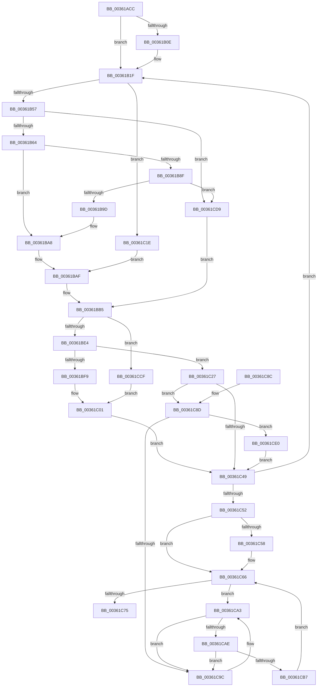

# RtlpHpVsSlotFreeList

- RVA: `0x00361ACC`–`0x00361CF9` (길이 `557` bytes)
- VA: `0x0000000140361ACC`
- 실행 섹션: `.text`
- PDB 이름 있음: `예`; PDB Function 태그: `아니요`
- unwind 정보 RVA: `0x00079D4C`
- 디코드: `149`개 명령, `557/557` bytes 표시
- 미해석 바이트: `0` (있으면 어셈블리에 `.byte`로 보존)

> 이 문서는 커널 이미지의 기계어와 PDB 기호를 분석해 생성했습니다. 4번과 5번은 함수 원형과 자료형을 바이너리 사용 방식에서 추정한 C 해석이며 원본 소스 복구 결과는 아닙니다.

## 1. Dependencies

- 직접 호출 지점: **5**; 고유 호출 대상: **5**
- 직접 호출자로 확인된 함수: **2**
- RIP 상대 이미지 참조: **1**

### Outgoing calls
- `0x00361B1A` → [RtlpHpAcquireQueuedLockExclusive](../32/RtlpHpAcquireQueuedLockExclusive_function_00324820.md) (function, `0x00324820`)
- `0x00361C17` → [RtlpLogHeapFailure](../35/RtlpLogHeapFailure_function_0035B7BC.md) (function, `0x0035B7BC`)
- `0x00361C3F` → [RtlpHpVsChunkFree](../2E/RtlpHpVsChunkFree_function_002E3980.md) (function, `0x002E3980`)
- `0x00361C61` → [RtlpHpReleaseQueuedLockExclusive](../2E/RtlpHpReleaseQueuedLockExclusive_function_002E2A70.md) (function, `0x002E2A70`)
- `0x00361CC8` → [RtlpHpVsSubsegmentFree](../2E/RtlpHpVsSubsegmentFree_function_002E7D9C.md) (function, `0x002E7D9C`)

### Direct callers
- [RtlpHpVsContextCompact](../2E/RtlpHpVsContextCompact_function_002E7524.md) at `0x002E7584`
- [RtlpHpVsContextFree](RtlpHpVsContextFree_function_00361630.md) at `0x00361780`

### Static image references
- `0x00361B1F` → RVA `0x00E28300` (`.data`; read)

## 2. Other-region calls and transfers

- 다른 실행 섹션으로 향하는 call: **0**
- 별도 외부 분기/꼬리 이동을 확인하지 못했습니다.

## 3. Assembly (complete function range)

```asm
00361ACC  4C 8B DC                        mov r11, rsp
00361ACF  49 89 5B 08                     mov qword ptr [r11 + 8], rbx
00361AD3  49 89 73 10                     mov qword ptr [r11 + 0x10], rsi
00361AD7  49 89 7B 18                     mov qword ptr [r11 + 0x18], rdi
00361ADB  41 56                           push r14
00361ADD  48 83 EC 60                     sub rsp, 0x60
00361AE1  33 C0                           xor eax, eax
00361AE3  0F 57 C0                        xorps xmm0, xmm0
00361AE6  F6 41 05 01                     test byte ptr [rcx + 5], 1
00361AEA  49 8B F8                        mov rdi, r8
00361AED  0F 11 44 24 40                  movups xmmword ptr [rsp + 0x40], xmm0
00361AF2  49 89 43 E8                     mov qword ptr [r11 - 0x18], rax
00361AF6  4C 8B F2                        mov r14, rdx
00361AF9  49 8D 43 C8                     lea rax, [r11 - 0x38]
00361AFD  48 8B D9                        mov rbx, rcx
00361B00  49 89 43 D0                     mov qword ptr [r11 - 0x30], rax
00361B04  49 8D 43 C8                     lea rax, [r11 - 0x38]
00361B08  49 89 43 C8                     mov qword ptr [r11 - 0x38], rax
00361B0C  75 11                           jne 0x140361b1f
00361B0E  0F B6 51 03                     movzx edx, byte ptr [rcx + 3]
00361B12  4D 8D 43 D8                     lea r8, [r11 - 0x28]
00361B16  49 8D 4E 08                     lea rcx, [r14 + 8]
00361B1A  E8 01 2D FC FF                  call 0x140324820
00361B1F  4C 8B 0D DA 67 AC 00            mov r9, qword ptr [rip + 0xac67da]
00361B26  4C 8D 57 F0                     lea r10, [rdi - 0x10]
00361B2A  49 8B 12                        mov rdx, qword ptr [r10]
00361B2D  49 8B F2                        mov rsi, r10
00361B30  48 8B 3F                        mov rdi, qword ptr [rdi]
00361B33  48 8B C2                        mov rax, rdx
00361B36  49 33 C1                        xor rax, r9
00361B39  48 C1 EE 20                     shr rsi, 0x20
00361B3D  48 8B C8                        mov rcx, rax
00361B40  4D 8B C2                        mov r8, r10
00361B43  48 C1 E8 20                     shr rax, 0x20
00361B47  49 33 CA                        xor rcx, r10
00361B4A  33 C6                           xor eax, esi
00361B4C  A9 00 00 FF 00                  test eax, 0xff0000
00361B51  0F 85 C7 00 00 00               jne 0x140361c1e
00361B57  48 C1 E9 20                     shr rcx, 0x20
00361B5B  66 85 C9                        test cx, cx
00361B5E  0F 84 75 01 00 00               je 0x140361cd9
00361B64  0F B7 C1                        movzx eax, cx
00361B67  48 C1 E0 04                     shl rax, 4
00361B6B  4C 2B C0                        sub r8, rax
00361B6E  49 8B C0                        mov rax, r8
00361B71  48 C1 E8 20                     shr rax, 0x20
00361B75  49 8B 08                        mov rcx, qword ptr [r8]
00361B78  49 33 C9                        xor rcx, r9
00361B7B  4C 8B D9                        mov r11, rcx
00361B7E  48 C1 E9 20                     shr rcx, 0x20
00361B82  33 C8                           xor ecx, eax
00361B84  4D 33 D8                        xor r11, r8
00361B87  F7 C1 00 00 FF 00               test ecx, 0xff0000
00361B8D  75 19                           jne 0x140361ba8
00361B8F  49 C1 EB 20                     shr r11, 0x20
00361B93  66 45 85 DB                     test r11w, r11w
00361B97  0F 84 3C 01 00 00               je 0x140361cd9
00361B9D  41 0F B7 C3                     movzx eax, r11w
00361BA1  48 C1 E0 04                     shl rax, 4
00361BA5  4C 2B C0                        sub r8, rax
00361BA8  41 8B C0                        mov eax, r8d
00361BAB  41 33 40 08                     xor eax, dword ptr [r8 + 8]
00361BAF  41 33 C1                        xor eax, r9d
00361BB2  0F B6 C8                        movzx ecx, al
00361BB5  C1 E1 0C                        shl ecx, 0xc
00361BB8  8B C1                           mov eax, ecx
00361BBA  4C 2B C0                        sub r8, rax
00361BBD  B8 ED 2B 00 00                  mov eax, 0x2bed
00361BC2  49 81 E0 00 F0 FF FF            and r8, 0xfffffffffffff000
00361BC9  41 0F B7 48 24                  movzx ecx, word ptr [r8 + 0x24]
00361BCE  66 41 33 48 20                  xor cx, word ptr [r8 + 0x20]
00361BD3  66 33 C8                        xor cx, ax
00361BD6  B8 FF 7F 00 00                  mov eax, 0x7fff
00361BDB  66 85 C8                        test ax, cx
00361BDE  0F 85 EB 00 00 00               jne 0x140361ccf
00361BE4  48 C1 EA 20                     shr rdx, 0x20
00361BE8  49 C1 E9 20                     shr r9, 0x20
00361BEC  41 33 D1                        xor edx, r9d
00361BEF  33 D6                           xor edx, esi
00361BF1  F7 C2 00 00 FF 00               test edx, 0xff0000
00361BF7  75 2E                           jne 0x140361c27
00361BF9  4D 8B C2                        mov r8, r10
00361BFC  B9 08 00 00 00                  mov ecx, 8
00361C01  48 83 64 24 28 00               and qword ptr [rsp + 0x28], 0
00361C07  48 8B D3                        mov rdx, rbx
00361C0A  48 33 53 08                     xor rdx, qword ptr [rbx + 8]
00361C0E  45 33 C9                        xor r9d, r9d
00361C11  48 83 64 24 20 00               and qword ptr [rsp + 0x20], 0
00361C17  E8 A0 9B FF FF                  call 0x14035b7bc
00361C1C  EB 2B                           jmp 0x140361c49
00361C1E  41 8B C2                        mov eax, r10d
00361C21  41 33 42 08                     xor eax, dword ptr [r10 + 8]
00361C25  EB 88                           jmp 0x140361baf
00361C27  48 8D 44 24 40                  lea rax, [rsp + 0x40]
00361C2C  4D 8B CA                        mov r9, r10
00361C2F  48 89 44 24 28                  mov qword ptr [rsp + 0x28], rax
00361C34  49 8B D6                        mov rdx, r14
00361C37  83 64 24 20 00                  and dword ptr [rsp + 0x20], 0
00361C3C  48 8B CB                        mov rcx, rbx
00361C3F  E8 3C 1D F8 FF                  call 0x1402e3980
00361C44  48 85 C0                        test rax, rax
00361C47  75 44                           jne 0x140361c8d
00361C49  48 85 FF                        test rdi, rdi
00361C4C  0F 85 CD FE FF FF               jne 0x140361b1f
00361C52  F6 43 05 01                     test byte ptr [rbx + 5], 1
00361C56  75 0E                           jne 0x140361c66
00361C58  0F B6 4B 03                     movzx ecx, byte ptr [rbx + 3]
00361C5C  48 8D 54 24 40                  lea rdx, [rsp + 0x40]
00361C61  E8 0A 0E F8 FF                  call 0x1402e2a70
00361C66  48 8B 54 24 30                  mov rdx, qword ptr [rsp + 0x30]
00361C6B  48 8D 44 24 30                  lea rax, [rsp + 0x30]
00361C70  48 3B D0                        cmp rdx, rax
00361C73  75 2E                           jne 0x140361ca3
00361C75  4C 8D 5C 24 60                  lea r11, [rsp + 0x60]
00361C7A  49 8B 5B 10                     mov rbx, qword ptr [r11 + 0x10]
00361C7E  49 8B 73 18                     mov rsi, qword ptr [r11 + 0x18]
00361C82  49 8B 7B 20                     mov rdi, qword ptr [r11 + 0x20]
00361C86  49 8B E3                        mov rsp, r11
00361C89  41 5E                           pop r14
00361C8B  C3                              ret
00361C8C  CC                              int3
00361C8D  48 8B 4C 24 38                  mov rcx, qword ptr [rsp + 0x38]
00361C92  48 8D 54 24 30                  lea rdx, [rsp + 0x30]
00361C97  48 39 11                        cmp qword ptr [rcx], rdx
00361C9A  74 44                           je 0x140361ce0
00361C9C  B9 03 00 00 00                  mov ecx, 3
00361CA1  CD 29                           int 0x29
00361CA3  48 8D 44 24 30                  lea rax, [rsp + 0x30]
00361CA8  48 39 42 08                     cmp qword ptr [rdx + 8], rax
00361CAC  75 EE                           jne 0x140361c9c
00361CAE  48 8B 02                        mov rax, qword ptr [rdx]
00361CB1  48 39 50 08                     cmp qword ptr [rax + 8], rdx
00361CB5  75 E5                           jne 0x140361c9c
00361CB7  48 8D 4C 24 30                  lea rcx, [rsp + 0x30]
00361CBC  48 89 44 24 30                  mov qword ptr [rsp + 0x30], rax
00361CC1  48 89 48 08                     mov qword ptr [rax + 8], rcx
00361CC5  48 8B CB                        mov rcx, rbx
00361CC8  E8 CF 60 F8 FF                  call 0x1402e7d9c
00361CCD  EB 97                           jmp 0x140361c66
00361CCF  B9 12 00 00 00                  mov ecx, 0x12
00361CD4  E9 28 FF FF FF                  jmp 0x140361c01
00361CD9  33 C9                           xor ecx, ecx
00361CDB  E9 D5 FE FF FF                  jmp 0x140361bb5
00361CE0  48 89 48 08                     mov qword ptr [rax + 8], rcx
00361CE4  48 8D 54 24 30                  lea rdx, [rsp + 0x30]
00361CE9  48 89 10                        mov qword ptr [rax], rdx
00361CEC  48 89 01                        mov qword ptr [rcx], rax
00361CEF  48 89 44 24 38                  mov qword ptr [rsp + 0x38], rax
00361CF4  E9 50 FF FF FF                  jmp 0x140361c49
```

## 4. C-style interpretation (structured pseudocode)

```c
__int64 __fastcall RtlpHpVsSlotFreeList(__int64 a1, __int64 a2, __int64 a3)
{
    __int64 result;
    __int64 v_r11;
    __int64 v_rsi;
    __int64 v_rsp;
    unsigned __int64 v_stack_m28;
    unsigned __int64 v_stack_m30;
    unsigned __int64 v_stack_m38;
    unsigned __int64 v_stack_m40;
    unsigned __int64 v_stack_m48;
    unsigned __int64 v_stack_m8;

    *(unsigned __int64 *)(v_rsp + 8) = v_rbx;
    *(unsigned __int64 *)(v_rsp + 16) = v_rsi;
    *(unsigned __int64 *)(v_rsp + 24) = v_rdi;
    v_rsp = (v_rsp) - (96);
    result = 0;
    v_stack_m28 = v_xmm0;
    *(unsigned __int64 *)(v_rsp - 24) = 0;
    *(unsigned __int64 *)(v_rsp - 48) = v_rsp - 56;
    *(unsigned __int64 *)(v_rsp - 56) = v_rsp - 56;
    result = v_rsp - 56;
    if (((*(unsigned __int8 *)(a1 + 5)) & (1)) == 0) {
        a2 = *(unsigned __int8 *)(a1 + 3);
        a3 = v_rsp - 40;
        a1 = a2 + 8;
        result = RtlpHpAcquireQueuedLockExclusive(a1, a2, a3, a4);
    }
    result = (*(unsigned __int64 *)(a3 - 16)) ^ (*(unsigned __int64 *)(v_rip + 11298778));
    v_rsi = (a3 - 16) >> (32);
    result = (result) >> (32);
    a1 = (result) ^ (a3 - 16);
    result = (unsigned int)((result) ^ ((unsigned int)(v_rsi)));
    if ((((unsigned int)(result)) & (0xFF0000ULL)) != 0) goto loc_00361C1E;
    a1 = (a1) >> (32);
    if ((unsigned __int16)(a1) == 0) goto loc_00361CD9;
    result = ((unsigned __int16)(a1)) << (4);
    a3 = (a3 - 16) - (result);
    result = (a3) >> (32);
    a1 = (*(unsigned __int64 *)(a3)) ^ (*(unsigned __int64 *)(v_rip + 11298778));
    a1 = (a1) >> (32);
    a1 = (unsigned int)((a1) ^ ((unsigned int)(result)));
    v_r11 = (a1) ^ (a3);
    if ((((unsigned int)(a1)) & (0xFF0000ULL)) != 0) goto loc_00361BA8;
    v_r11 = (v_r11) >> (32);
    if ((unsigned __int16)(v_r11) == 0) goto loc_00361CD9;
    result = ((unsigned __int16)(v_r11)) << (4);
    a3 = (a3) - (result);
loc_00361BA8:
    result = (unsigned int)(((unsigned int)((unsigned int)(a3))) ^ (*(unsigned int *)(a3 + 8)));
loc_00361BAF:
    result = (unsigned int)((result) ^ ((unsigned int)(*(unsigned __int64 *)(v_rip + 11298778))));
loc_00361BB5:
    a1 = (unsigned int)(((unsigned __int8)(result)) << (12));
    a3 = (a3) - ((unsigned int)((unsigned int)(a1)));
    a3 = (a3) & (0xFFFFFFFFFFFFF000ULL);
    a1 = (unsigned __int16)((*(unsigned __int16 *)(a3 + 36)) ^ (*(unsigned __int16 *)(a3 + 32)));
    a1 = (unsigned __int16)((a1) ^ ((unsigned __int16)((unsigned int)(0x2BEDULL))));
    if ((((unsigned __int16)((unsigned int)(0x7FFFULL))) & ((unsigned __int16)(a1))) != 0) goto loc_00361CCF;
    a2 = (*(unsigned __int64 *)(a3 - 16)) >> (32);
    a4 = (*(unsigned __int64 *)(v_rip + 11298778)) >> (32);
    a2 = (unsigned int)((a2) ^ ((unsigned int)(a4)));
    a2 = (unsigned int)((a2) ^ ((unsigned int)(v_rsi)));
    if ((((unsigned int)(a2)) & (0xFF0000ULL)) != 0) goto loc_00361C27;
loc_00361C01:
    a2 = (a1) ^ (*(unsigned __int64 *)(a1 + 8));
    a4 = 0;
    result = RtlpLogHeapFailure(8, a2, a3 - 16, a4);
    goto loc_00361C49;
loc_00361C1E:
    result = (unsigned int)(((unsigned int)((unsigned int)(a3 - 16))) ^ (*(unsigned int *)(a3 - 16 + 8)));
    goto loc_00361BAF;
loc_00361C27:
    v_stack_m40 = v_stack_m28;
    result = RtlpHpVsChunkFree(a1, a2, a3 - 16, a3 - 16);
    if (result != 0) goto loc_00361C8D;
loc_00361C49:
    if (*(unsigned __int64 *)(a3) != 0) goto loc_00361B1F;
    if (((*(unsigned __int8 *)(a1 + 5)) & (1)) == 0) {
        a1 = *(unsigned __int8 *)(a1 + 3);
        a2 = v_stack_m28;
        result = RtlpHpReleaseQueuedLockExclusive(a1, a2, a3 - 16, a3 - 16);
    }
    if (v_stack_m38 != v_stack_m38) goto loc_00361CA3;
    return v_stack_m38;
loc_00361C8D:
    if ((*(unsigned __int64 *)(v_stack_m28)) == v_stack_m30) goto loc_00361CE0;
loc_00361C9C:
loc_00361CA3:
    if ((*(unsigned __int64 *)(v_stack_m30 + 8)) != v_stack_m30) goto loc_00361C9C;
    if ((*(unsigned __int64 *)(*(unsigned __int64 *)(v_stack_m30) + 8)) != v_stack_m30) goto loc_00361C9C;
    v_stack_m30 = *(unsigned __int64 *)(v_stack_m30);
    *(unsigned __int64 *)(*(unsigned __int64 *)(v_stack_m30) + 8) = v_stack_m30;
    result = RtlpHpVsSubsegmentFree(*(unsigned __int64 *)(v_stack_m8 + 16), v_stack_m30, a3 - 16, a3 - 16);
    goto loc_00361C66;
loc_00361CCF:
    goto loc_00361C01;
loc_00361CD9:
    a1 = 0;
    goto loc_00361BB5;
loc_00361CE0:
    *(unsigned __int64 *)(result + 8) = 0;
    *(unsigned __int64 *)(result) = v_stack_m30;
    *(unsigned __int64 *)(a1) = result;
    v_stack_m28 = result;
    goto loc_00361C49;
}
```

## 5. (Beta) C Style

```c
int64_t RtlpHpVsSlotFreeList(void *Arg1, void *Arg2, int64_t Arg3)
{
    uint8_t *arg1 = (uint8_t *)Arg1;
    uint8_t *arg2 = (uint8_t *)Arg2;

    int64_t result;
    int64_t local_r11;
    int64_t local_rsi;
    int64_t local_rsp;
    uint64_t v_stack_m28;
    uint64_t v_stack_m30;
    uint64_t v_stack_m38;
    uint64_t v_stack_m40;
    uint64_t v_stack_m48;
    uint64_t v_stack_m8;

    *(uint64_t *)(local_rsp + 0x8) = local_rbx;
    *(uint64_t *)(local_rsp + 0x10) = local_rsi;
    *(uint64_t *)(local_rsp + 0x18) = local_rdi;
    local_rsp = (local_rsp) - (96);
    result = 0;
    v_stack_m28 = v_xmm0;
    *(uint64_t *)(local_rsp - 0x18) = 0;
    *(uint64_t *)(local_rsp - 0x30) = local_rsp - 56;
    *(uint64_t *)(local_rsp - 0x38) = local_rsp - 56;
    result = local_rsp - 56;
    if (((*(uint8_t *)(arg1 + 0x5)) & (1)) == 0) {
        Arg2 = *(uint8_t *)(arg1 + 0x3);
        Arg3 = local_rsp - 40;
        Arg1 = Arg2 + 8;
        result = RtlpHpAcquireQueuedLockExclusive(Arg1, Arg2, Arg3, a4);
    }
    result = (*(uint64_t *)(Arg3 - 0x10)) ^ (*(uint64_t *)(v_rip + 0xAC67DA));
    local_rsi = (Arg3 - 16) >> (32);
    result = (result) >> (32);
    Arg1 = (result) ^ (Arg3 - 16);
    result = (uint32_t)((result) ^ ((uint32_t)(local_rsi)));
    if ((((uint32_t)(result)) & (0xFF0000ULL)) != 0) goto loc_00361C1E;
    Arg1 = (Arg1) >> (32);
    if ((uint16_t)(Arg1) == 0) goto loc_00361CD9;
    result = ((uint16_t)(Arg1)) << (4);
    Arg3 = (Arg3 - 16) - (result);
    result = (Arg3) >> (32);
    Arg1 = (*(uint64_t *)(Arg3)) ^ (*(uint64_t *)(v_rip + 0xAC67DA));
    Arg1 = (Arg1) >> (32);
    Arg1 = (uint32_t)((Arg1) ^ ((uint32_t)(result)));
    local_r11 = (Arg1) ^ (Arg3);
    if ((((uint32_t)(Arg1)) & (0xFF0000ULL)) != 0) goto loc_00361BA8;
    local_r11 = (local_r11) >> (32);
    if ((uint16_t)(local_r11) == 0) goto loc_00361CD9;
    result = ((uint16_t)(local_r11)) << (4);
    Arg3 = (Arg3) - (result);
loc_00361BA8:
    result = (uint32_t)(((uint32_t)((uint32_t)(Arg3))) ^ (*(uint32_t *)(Arg3 + 0x8)));
loc_00361BAF:
    result = (uint32_t)((result) ^ ((uint32_t)(*(uint64_t *)(v_rip + 0xAC67DA))));
loc_00361BB5:
    Arg1 = (uint32_t)(((uint8_t)(result)) << (12));
    Arg3 = (Arg3) - ((uint32_t)((uint32_t)(Arg1)));
    Arg3 = (Arg3) & (0xFFFFFFFFFFFFF000ULL);
    Arg1 = (uint16_t)((*(uint16_t *)(Arg3 + 0x24)) ^ (*(uint16_t *)(Arg3 + 0x20)));
    Arg1 = (uint16_t)((Arg1) ^ ((uint16_t)((uint32_t)(0x2BEDULL))));
    if ((((uint16_t)((uint32_t)(0x7FFFULL))) & ((uint16_t)(Arg1))) != 0) goto loc_00361CCF;
    Arg2 = (*(uint64_t *)(Arg3 - 0x10)) >> (32);
    a4 = (*(uint64_t *)(v_rip + 0xAC67DA)) >> (32);
    Arg2 = (uint32_t)((Arg2) ^ ((uint32_t)(a4)));
    Arg2 = (uint32_t)((Arg2) ^ ((uint32_t)(local_rsi)));
    if ((((uint32_t)(Arg2)) & (0xFF0000ULL)) != 0) goto loc_00361C27;
loc_00361C01:
    Arg2 = (Arg1) ^ (*(uint64_t *)(arg1 + 0x8));
    a4 = 0;
    result = RtlpLogHeapFailure(8, Arg2, Arg3 - 16, a4);
    goto loc_00361C49;
loc_00361C1E:
    result = (uint32_t)(((uint32_t)((uint32_t)(Arg3 - 16))) ^ (*(uint32_t *)(Arg3 - 0x10 + 0x8)));
    goto loc_00361BAF;
loc_00361C27:
    v_stack_m40 = v_stack_m28;
    result = RtlpHpVsChunkFree(Arg1, Arg2, Arg3 - 16, Arg3 - 16);
    if (result != 0) goto loc_00361C8D;
loc_00361C49:
    if (*(uint64_t *)(Arg3) != 0) goto loc_00361B1F;
    if (((*(uint8_t *)(arg1 + 0x5)) & (1)) == 0) {
        Arg1 = *(uint8_t *)(arg1 + 0x3);
        Arg2 = v_stack_m28;
        result = RtlpHpReleaseQueuedLockExclusive(Arg1, Arg2, Arg3 - 16, Arg3 - 16);
    }
    if (v_stack_m38 != v_stack_m38) goto loc_00361CA3;
    return v_stack_m38;
loc_00361C8D:
    if ((*(uint64_t *)(v_stack_m28)) == v_stack_m30) goto loc_00361CE0;
loc_00361C9C:
loc_00361CA3:
    if ((*(uint64_t *)(v_stack_m30 + 0x8)) != v_stack_m30) goto loc_00361C9C;
    if ((*(uint64_t *)(*(uint64_t *)(v_stack_m30) + 0x8)) != v_stack_m30) goto loc_00361C9C;
    v_stack_m30 = *(uint64_t *)(v_stack_m30);
    *(uint64_t *)(*(uint64_t *)(v_stack_m30) + 0x8) = v_stack_m30;
    result = RtlpHpVsSubsegmentFree(*(uint64_t *)(v_stack_m8 + 0x10), v_stack_m30, Arg3 - 16, Arg3 - 16);
    goto loc_00361C66;
loc_00361CCF:
    goto loc_00361C01;
loc_00361CD9:
    Arg1 = 0;
    goto loc_00361BB5;
loc_00361CE0:
    *(uint64_t *)(result + 0x8) = 0;
    *(uint64_t *)(result) = v_stack_m30;
    *(uint64_t *)(arg1) = result;
    v_stack_m28 = result;
    goto loc_00361C49;
}
```

### 관측된 메모리 오프셋

구조체 형식이 확인되지 않은 접근은 인자 기준의 오프셋으로만 기록했습니다.

| 기준 인자 | 오프셋 표현 | 폭 (bit) | 접근 |
|---|---:|---:|---|
| `Arg1` | `+ 0x3` | `8` | `R` |
| `Arg1` | `+ 0x5` | `8` | `R` |
| `Arg1` | `+ 0x8` | `64` | `R` |
| `Arg2` | `+ 0x8` | `64` | `R` |

## 6. Execution-region graph

[열기: 2D/3D 그래프와 함수 탐색 컨트롤 패널](../../../control-panel.html?section=text&rva=0x00361ACC&view=graph)

- 2D 그래프는 위에서 아래로 흐르고, 3D 그래프는 빈 공간을 드래그해 회전합니다. Shift+드래그는 이동, 휠은 확대·축소, 함수 노드 선택은 대상 보고서 이동입니다.

### Static fallback


