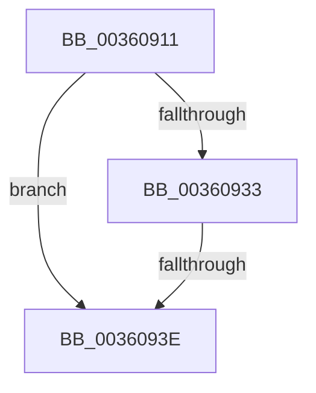

# sub_00360911

- RVA: `0x00360911`–`0x00360968` (길이 `87` bytes)
- VA: `0x0000000140360911`
- 실행 섹션: `.text`
- PDB 이름 있음: `아니요`; PDB Function 태그: `아니요`
- unwind 정보 RVA: `0x00079C94`
- 디코드: `21`개 명령, `87/87` bytes 표시
- 미해석 바이트: `0` (있으면 어셈블리에 `.byte`로 보존)

> 이 문서는 커널 이미지의 기계어와 PDB 기호를 분석해 생성했습니다. 4번과 5번은 함수 원형과 자료형을 바이너리 사용 방식에서 추정한 C 해석이며 원본 소스 복구 결과는 아닙니다.

## 1. Dependencies

- 직접 호출 지점: **2**; 고유 호출 대상: **2**
- 직접 호출자로 확인된 함수: **0**
- RIP 상대 이미지 참조: **3**

### Outgoing calls
- `0x00360929` → [RtlCSparseBitmapBitmaskRead](RtlCSparseBitmapBitmaskRead_function_0036190C.md) (function, `0x0036190C`)
- `0x00360957` → [RtlpHpVaMgrCtxQuery](../32/RtlpHpVaMgrCtxQuery_function_003273C0.md) (function, `0x003273C0`)

### Direct callers
- 이 함수 시작 RVA로 연결되는 직접 call은 확인되지 않았습니다. 간접 호출은 완전히 역산할 수 없습니다.

### Static image references
- `0x00360914` → RVA `0x00E68610` (`.data`; read)
- `0x0036091B` → RVA `0x00E68608` (`.data`; read)
- `0x00360948` → RVA `0x00E68658` (`.data`; read)

## 2. Other-region calls and transfers

- 다른 실행 섹션으로 향하는 call: **0**
- call이 아닌 외부 분기/꼬리 이동: **2**
  - `0x00360938` → [ExFreeHeapPool + 0x43](../35/ExFreeHeapPool_function_0035FAE0.md) (`tail-transfer`)
  - `0x00360963` → [ExFreeHeapPool + 0x7E](../35/ExFreeHeapPool_function_0035FAE0.md) (`tail-transfer`)

## 3. Assembly (complete function range)

```asm
00360911  49 8B D4                        mov rdx, r12
00360914  48 8D 0D F5 7C B0 00            lea rcx, [rip + 0xb07cf5]
0036091B  48 2B 15 E6 7C B0 00            sub rdx, qword ptr [rip + 0xb07ce6]
00360922  48 C1 EA 14                     shr rdx, 0x14
00360926  48 03 D2                        add rdx, rdx
00360929  E8 DE 0F 00 00                  call 0x14036190c
0036092E  48 85 C0                        test rax, rax
00360931  74 0B                           je 0x14036093e
00360933  FF C8                           dec eax
00360935  83 F8 02                        cmp eax, 2
00360938  0F 85 E5 F1 FF FF               jne 0x14035fb23
0036093E  0F 57 C0                        xorps xmm0, xmm0
00360941  4C 8D 45 EF                     lea r8, [rbp - 0x11]
00360945  49 8B D4                        mov rdx, r12
00360948  48 8D 0D 09 7D B0 00            lea rcx, [rip + 0xb07d09]
0036094F  0F 11 45 EF                     movups xmmword ptr [rbp - 0x11], xmm0
00360953  0F 11 45 FF                     movups xmmword ptr [rbp - 1], xmm0
00360957  E8 64 6A FC FF                  call 0x1403273c0
0036095C  48 8B 45 FF                     mov rax, qword ptr [rbp - 1]
00360960  4C 8B 28                        mov r13, qword ptr [rax]
00360963  E9 F6 F1 FF FF                  jmp 0x14035fb5e
```

## 4. C-style interpretation (structured pseudocode)

```c
__int64 __fastcall sub_00360911(void)
{
    __int64 result;

    a2 = (v_r12) - (*(unsigned __int64 *)(v_rip + 11566310));
    a2 = (a2) >> (20);
    a2 = (a2) + (a2);
    result = RtlCSparseBitmapBitmaskRead(v_rip + 11566325, a2, a3, a4);
    if (result == 0) goto loc_0036093E;
    result = (unsigned int)((result) - 1);
loc_0036093E:
    *(unsigned __int64 *)(v_rbp - 17) = v_xmm0;
    *(unsigned __int64 *)(v_rbp - 1) = v_xmm0;
    result = RtlpHpVaMgrCtxQuery(v_rip + 11566345, v_r12, v_rbp - 17, a4);
}
```

## 5. (Beta) C Style

```c
void sub_00360911(void)
{
    int64_t result;

    a2 = (local_r12) - (*(uint64_t *)(v_rip + 0xB07CE6));
    a2 = (a2) >> (20);
    a2 = (a2) + (a2);
    result = RtlCSparseBitmapBitmaskRead(v_rip + 11566325, a2, a3, a4);
    if (result == 0) goto loc_0036093E;
    result = (uint32_t)((result) - 1);
loc_0036093E:
    *(uint64_t *)(local_rbp - 0x11) = v_xmm0;
    *(uint64_t *)(local_rbp - 0x1) = v_xmm0;
    result = RtlpHpVaMgrCtxQuery(v_rip + 11566345, local_r12, local_rbp - 17, a4);
}
```

## 6. Execution-region graph

[열기: 2D/3D 그래프와 함수 탐색 컨트롤 패널](../../../control-panel.html?section=text&rva=0x00360911&view=graph)

- 2D 그래프는 위에서 아래로 흐르고, 3D 그래프는 빈 공간을 드래그해 회전합니다. Shift+드래그는 이동, 휠은 확대·축소, 함수 노드 선택은 대상 보고서 이동입니다.

### Static fallback


