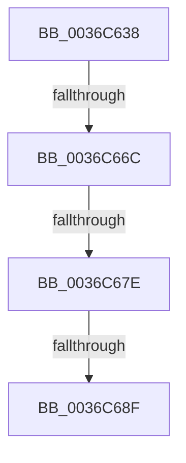

# sub_0036C638

- RVA: `0x0036C638`–`0x0036C6B5` (길이 `125` bytes)
- VA: `0x000000014036C638`
- 실행 섹션: `.text`
- PDB 이름 있음: `아니요`; PDB Function 태그: `아니요`
- unwind 정보 RVA: `0x0007A424`
- 디코드: `23`개 명령, `125/125` bytes 표시
- 미해석 바이트: `0` (있으면 어셈블리에 `.byte`로 보존)

> 이 문서는 커널 이미지의 기계어와 PDB 기호를 분석해 생성했습니다. 4번과 5번은 함수 원형과 자료형을 바이너리 사용 방식에서 추정한 C 해석이며 원본 소스 복구 결과는 아닙니다.

## 1. Dependencies

- 직접 호출 지점: **0**; 고유 호출 대상: **0**
- 직접 호출자로 확인된 함수: **0**
- RIP 상대 이미지 참조: **1**

### Outgoing calls
- 직접 디코드된 call 명령이 없습니다.

### Direct callers
- 이 함수 시작 RVA로 연결되는 직접 call은 확인되지 않았습니다. 간접 호출은 완전히 역산할 수 없습니다.

### Static image references
- `0x0036C696` → RVA `0x00E30088` (`.data`; read)

## 2. Other-region calls and transfers

- 다른 실행 섹션으로 향하는 call: **0**
- call이 아닌 외부 분기/꼬리 이동: **3**
  - `0x0036C666` → [sub_0036CC92](Unknown_function_0036CC92.md) (`tail-transfer`)
  - `0x0036C678` → [sub_0036CB0E](Unknown_function_0036CB0E.md) (`tail-transfer`)
  - `0x0036C689` → [sub_0036CEAA](Unknown_function_0036CEAA.md) (`tail-transfer`)

## 3. Assembly (complete function range)

```asm
0036C638  48 89 BC 24 98 01 00 00         mov qword ptr [rsp + 0x198], rdi
0036C640  66 C7 44 24 70 01 00            mov word ptr [rsp + 0x70], 1
0036C647  4C 89 44 24 78                  mov qword ptr [rsp + 0x78], r8
0036C64C  48 89 4D 80                     mov qword ptr [rbp - 0x80], rcx
0036C650  4C 89 6D B8                     mov qword ptr [rbp - 0x48], r13
0036C654  4C 89 6D E0                     mov qword ptr [rbp - 0x20], r13
0036C658  48 89 45 D8                     mov qword ptr [rbp - 0x28], rax
0036C65C  0F 11 45 C8                     movups xmmword ptr [rbp - 0x38], xmm0
0036C660  81 E3 00 00 01 00               and ebx, 0x10000
0036C666  0F 85 26 06 00 00               jne 0x14036cc92
0036C66C  4C 89 A4 24 90 01 00 00         mov qword ptr [rsp + 0x190], r12
0036C674  49 83 FF 01                     cmp r15, 1
0036C678  0F 84 90 04 00 00               je 0x14036cb0e
0036C67E  41 8B BF B8 00 00 00            mov edi, dword ptr [r15 + 0xb8]
0036C685  40 F6 C7 0F                     test dil, 0xf
0036C689  0F 85 1B 08 00 00               jne 0x14036ceaa
0036C68F  0F B7 8A AE 04 00 00            movzx ecx, word ptr [rdx + 0x4ae]
0036C696  48 8B 05 EB 39 AC 00            mov rax, qword ptr [rip + 0xac39eb]
0036C69D  4C 8B 24 C8                     mov r12, qword ptr [rax + rcx*8]
0036C6A1  41 FE 86 AE 05 00 00            inc byte ptr [r14 + 0x5ae]
0036C6A8  66 41 FF 8E E4 01 00 00         dec word ptr [r14 + 0x1e4]
0036C6B0  90                              nop
0036C6B1  4C 89 65 00                     mov qword ptr [rbp], r12
```

## 4. C-style interpretation (structured pseudocode)

```c
__int64 __fastcall sub_0036C638(__int64 a1, __int64 a2, __int64 a3)
{
    __int64 v_rbx;
    unsigned __int64 v_stack_p190;
    unsigned __int64 v_stack_p198;
    unsigned __int16 v_stack_p70;
    unsigned __int64 v_stack_p78;

    v_stack_p198 = v_rdi;
    v_stack_p70 = 1;
    v_stack_p78 = a3;
    *(unsigned __int64 *)(v_rbp - 128) = a1;
    *(unsigned __int64 *)(v_rbp - 72) = v_r13;
    *(unsigned __int64 *)(v_rbp - 32) = v_r13;
    *(unsigned __int64 *)(v_rbp - 40) = result;
    *(unsigned __int64 *)(v_rbp - 56) = v_xmm0;
    v_rbx = (unsigned int)((v_rbx) & (0x10000ULL));
    v_stack_p190 = v_r12;
    *(unsigned __int64 *)(v_rbp) = *(unsigned __int64 *)(*(unsigned __int64 *)(v_rip + 11287019) + *(unsigned __int16 *)(a2 + 1198) * 8);
    return *(unsigned __int64 *)(v_rip + 11287019);
}
```

## 5. (Beta) C Style

```c
int64_t sub_0036C638(int64_t Arg1, void *Arg2, int64_t Arg3)
{
    uint8_t *arg2 = (uint8_t *)Arg2;

    int64_t local_rbx;
    uint64_t v_stack_p190;
    uint64_t v_stack_p198;
    uint16_t v_stack_p70;
    uint64_t v_stack_p78;

    v_stack_p198 = local_rdi;
    v_stack_p70 = 1;
    v_stack_p78 = Arg3;
    *(uint64_t *)(local_rbp - 0x80) = Arg1;
    *(uint64_t *)(local_rbp - 0x48) = local_r13;
    *(uint64_t *)(local_rbp - 0x20) = local_r13;
    *(uint64_t *)(local_rbp - 0x28) = result;
    *(uint64_t *)(local_rbp - 0x38) = v_xmm0;
    local_rbx = (uint32_t)((local_rbx) & (0x10000ULL));
    v_stack_p190 = local_r12;
    *(uint64_t *)(local_rbp) = *(uint64_t *)(*(uint64_t *)(v_rip + 0xAC39EB) + *(uint16_t *)(arg2 + 0x4AE) * 8);
    return *(uint64_t *)(v_rip + 0xAC39EB);
}
```

### 관측된 메모리 오프셋

구조체 형식이 확인되지 않은 접근은 인자 기준의 오프셋으로만 기록했습니다.

| 기준 인자 | 오프셋 표현 | 폭 (bit) | 접근 |
|---|---:|---:|---|
| `Arg2` | `+ 0x4AE` | `16` | `R` |

## 6. Execution-region graph

[열기: 2D/3D 그래프와 함수 탐색 컨트롤 패널](../../../control-panel.html?section=text&rva=0x0036C638&view=graph)

- 2D 그래프는 위에서 아래로 흐르고, 3D 그래프는 빈 공간을 드래그해 회전합니다. Shift+드래그는 이동, 휠은 확대·축소, 함수 노드 선택은 대상 보고서 이동입니다.

### Static fallback


