# sub_0036C6B5

- RVA: `0x0036C6B5`–`0x0036CA38` (길이 `899` bytes)
- VA: `0x000000014036C6B5`
- 실행 섹션: `.text`
- PDB 이름 있음: `아니요`; PDB Function 태그: `아니요`
- unwind 정보 RVA: `0x0007A43C`
- 디코드: `197`개 명령, `899/899` bytes 표시
- 미해석 바이트: `0` (있으면 어셈블리에 `.byte`로 보존)

> 이 문서는 커널 이미지의 기계어와 PDB 기호를 분석해 생성했습니다. 4번과 5번은 함수 원형과 자료형을 바이너리 사용 방식에서 추정한 C 해석이며 원본 소스 복구 결과는 아닙니다.

## 1. Dependencies

- 직접 호출 지점: **7**; 고유 호출 대상: **7**
- 직접 호출자로 확인된 함수: **0**
- RIP 상대 이미지 참조: **2**

### Outgoing calls
- `0x0036C7A9` → [MiSufficientAvailablePages](MiSufficientAvailablePages_function_0036D0B0.md) (function, `0x0036D0B0`)
- `0x0036C81F` → [MmAccessFault](../27/MmAccessFault_function_0027EE80.md) (function, `0x0027EE80`)
- `0x0036C985` → [MiAdvanceFaultList](MiAdvanceFaultList_function_003637A0.md) (function, `0x003637A0`)
- `0x0036C9CB` → [MiPfCoalesceAndIssueIOs](MiPfCoalesceAndIssueIOs_function_0036D158.md) (function, `0x0036D158`)
- `0x0036CA09` → [KeAbPostReleaseEx](../26/KeAbPostReleaseEx_function_00262210.md) (function, `0x00262210`)
- `0x0036CA12` → [MiDereferenceInPageAutoBoostLock](MiDereferenceInPageAutoBoostLock_function_0036D398.md) (function, `0x0036D398`)
- `0x0036CA22` → [KeLeaveCriticalRegionThread](../25/KeLeaveCriticalRegionThread_function_0025EFF0.md) (function, `0x0025EFF0`)

### Direct callers
- 이 함수 시작 RVA로 연결되는 직접 call은 확인되지 않았습니다. 간접 호출은 완전히 역산할 수 없습니다.

### Static image references
- `0x0036C759` → RVA `0x00E2F380` (`.data`; read)
- `0x0036C973` → RVA `0x00E2F390` (`.data`; read)

## 2. Other-region calls and transfers

- 다른 실행 섹션으로 향하는 call: **0**
- call이 아닌 외부 분기/꼬리 이동: **14**
  - `0x0036C710` → [sub_0036CEB4](Unknown_function_0036CEB4.md) (`tail-transfer`)
  - `0x0036C748` → [sub_0036CEB4 + 0xE](Unknown_function_0036CEB4.md) (`tail-transfer`)
  - `0x0036C76C` → [sub_0036CD3D + 0xE4](Unknown_function_0036CD3D.md) (`tail-transfer`)
  - `0x0036C778` → [sub_0036CD3D + 0xAF](Unknown_function_0036CD3D.md) (`tail-transfer`)
  - `0x0036C7F7` → [sub_0036CB1C + 0x94](Unknown_function_0036CB1C.md) (`tail-transfer`)
  - `0x0036C800` → [sub_0036CA68](Unknown_function_0036CA68.md) (`tail-transfer`)
  - `0x0036C898` → [sub_0036CB1C + 0xC0](Unknown_function_0036CB1C.md) (`tail-transfer`)
  - `0x0036C902` → [sub_0036CD3D + 0x95](Unknown_function_0036CD3D.md) (`tail-transfer`)
  - `0x0036C90C` → [sub_0036CB1C](Unknown_function_0036CB1C.md) (`tail-transfer`)
  - `0x0036C9A4` → [sub_0036CE62 + 0x21](Unknown_function_0036CE62.md) (`tail-transfer`)
  - `0x0036C9BA` → [sub_0036CD3D + 0xF9](Unknown_function_0036CD3D.md) (`tail-transfer`)
  - `0x0036C9DD` → [sub_0036CA68 + 0x38](Unknown_function_0036CA68.md) (`tail-transfer`)
  - `0x0036C9E5` → [sub_0036CEB4 + 0x23](Unknown_function_0036CEB4.md) (`tail-transfer`)
  - `0x0036C9F6` → [sub_0036CEB4 + 0x34](Unknown_function_0036CEB4.md) (`tail-transfer`)

## 3. Assembly (complete function range)

```asm
0036C6B5  48 89 B4 24 D0 01 00 00         mov qword ptr [rsp + 0x1d0], rsi
0036C6BD  0F 11 45 10                     movups xmmword ptr [rbp + 0x10], xmm0
0036C6C1  0F 11 45 20                     movups xmmword ptr [rbp + 0x20], xmm0
0036C6C5  0F 11 45 30                     movups xmmword ptr [rbp + 0x30], xmm0
0036C6C9  49 BB FF FF FF FF FF F6 FF FF   movabs r11, 0xfffff6ffffffffff
0036C6D3  49 B9 00 00 00 00 00 80 FF FF   movabs r9, 0xffff800000000000
0036C6DD  49 BA 00 00 00 00 80 F6 FF FF   movabs r10, 0xfffff68000000000
0036C6E7  66 0F 1F 84 00 00 00 00 00      nop word ptr [rax + rax]
0036C6F0  48 8B 45 80                     mov rax, qword ptr [rbp - 0x80]
0036C6F4  48 39 45 88                     cmp qword ptr [rbp - 0x78], rax
0036C6F8  0F 83 B6 02 00 00               jae 0x14036c9b4
0036C6FE  F7 45 C0 00 00 02 00            test dword ptr [rbp - 0x40], 0x20000
0036C705  74 0F                           je 0x14036c716
0036C707  41 8B 86 A0 05 00 00            mov eax, dword ptr [r14 + 0x5a0]
0036C70E  A8 01                           test al, 1
0036C710  0F 85 9E 07 00 00               jne 0x14036ceb4
0036C716  4C 8B 75 88                     mov r14, qword ptr [rbp - 0x78]
0036C71A  49 C1 E6 04                     shl r14, 4
0036C71E  4D 03 F0                        add r14, r8
0036C721  41 8B 06                        mov eax, dword ptr [r14]
0036C724  49 8B 56 08                     mov rdx, qword ptr [r14 + 8]
0036C728  25 FF 0F 00 00                  and eax, 0xfff
0036C72D  48 8D 8A FF 0F 00 00            lea rcx, [rdx + 0xfff]
0036C734  48 03 C8                        add rcx, rax
0036C737  48 C1 E9 0C                     shr rcx, 0xc
0036C73B  48 39 4D 90                     cmp qword ptr [rbp - 0x70], rcx
0036C73F  0F 83 3B 02 00 00               jae 0x14036c980
0036C745  48 85 D2                        test rdx, rdx
0036C748  0F 84 74 07 00 00               je 0x14036cec2
0036C74E  48 8B 75 90                     mov rsi, qword ptr [rbp - 0x70]
0036C752  48 C1 E6 0C                     shl rsi, 0xc
0036C756  49 03 36                        add rsi, qword ptr [r14]
0036C759  48 3B 35 20 2C AC 00            cmp rsi, qword ptr [rip + 0xac2c20]
0036C760  4C 8B C6                        mov r8, rsi
0036C763  0F 83 0A 02 00 00               jae 0x14036c973
0036C769  49 3B F1                        cmp rsi, r9
0036C76C  0F 83 AF 06 00 00               jae 0x14036ce21
0036C772  49 8B C2                        mov rax, r10
0036C775  48 3B F0                        cmp rsi, rax
0036C778  0F 83 6E 06 00 00               jae 0x14036cdec
0036C77E  4D 3B C1                        cmp r8, r9
0036C781  0F 83 9C 01 00 00               jae 0x14036c923
0036C787  49 83 FF 01                     cmp r15, 1
0036C78B  0F 84 EF 01 00 00               je 0x14036c980
0036C791  40 F6 C7 0F                     test dil, 0xf
0036C795  0F 85 E5 01 00 00               jne 0x14036c980
0036C79B  F6 45 C0 80                     test byte ptr [rbp - 0x40], 0x80
0036C79F  75 54                           jne 0x14036c7f5
0036C7A1  BA 20 01 00 00                  mov edx, 0x120
0036C7A6  49 8B CC                        mov rcx, r12
0036C7A9  E8 02 09 00 00                  call 0x14036d0b0
0036C7AE  85 C0                           test eax, eax
0036C7B0  0F 84 F9 01 00 00               je 0x14036c9af
0036C7B6  4D 8B 84 24 98 4C 00 00         mov r8, qword ptr [r12 + 0x4c98]
0036C7BE  33 C0                           xor eax, eax
0036C7C0  49 8B 94 24 40 4B 00 00         mov rdx, qword ptr [r12 + 0x4b40]
0036C7C8  49 8B C8                        mov rcx, r8
0036C7CB  48 2B CA                        sub rcx, rdx
0036C7CE  49 3B D0                        cmp rdx, r8
0036C7D1  48 0F 42 C1                     cmovb rax, rcx
0036C7D5  48 3D 80 10 00 00               cmp rax, 0x1080
0036C7DB  0F 82 CE 01 00 00               jb 0x14036c9af
0036C7E1  49 8B 84 24 40 49 00 00         mov rax, qword ptr [r12 + 0x4940]
0036C7E9  48 3D 20 01 00 00               cmp rax, 0x120
0036C7EF  0F 8C BA 01 00 00               jl 0x14036c9af
0036C7F5  85 DB                           test ebx, ebx
0036C7F7  0F 85 B3 03 00 00               jne 0x14036cbb0
0036C7FD  4D 85 ED                        test r13, r13
0036C800  0F 84 62 02 00 00               je 0x14036ca68
0036C806  4C 8B 75 88                     mov r14, qword ptr [rbp - 0x78]
0036C80A  4C 8D 4C 24 70                  lea r9, [rsp + 0x70]
0036C80F  4C 8B 7D 90                     mov r15, qword ptr [rbp - 0x70]
0036C813  49 83 C9 01                     or r9, 1
0036C817  45 33 C0                        xor r8d, r8d
0036C81A  48 8B D6                        mov rdx, rsi
0036C81D  33 C9                           xor ecx, ecx
0036C81F  E8 5C 26 F1 FF                  call 0x14027ee80
0036C824  44 8B C0                        mov r8d, eax
0036C827  0F B6 44 24 71                  movzx eax, byte ptr [rsp + 0x71]
0036C82C  3C 02                           cmp al, 2
0036C82E  0F 84 FB 00 00 00               je 0x14036c92f
0036C834  3C 01                           cmp al, 1
0036C836  0F 84 F9 00 00 00               je 0x14036c935
0036C83C  4C 8B 55 88                     mov r10, qword ptr [rbp - 0x78]
0036C840  4D 3B D6                        cmp r10, r14
0036C843  75 42                           jne 0x14036c887
0036C845  4C 39 7D 90                     cmp qword ptr [rbp - 0x70], r15
0036C849  75 3C                           jne 0x14036c887
0036C84B  4C 8B 5C 24 78                  mov r11, qword ptr [rsp + 0x78]
0036C850  49 8B C2                        mov rax, r10
0036C853  4C 8B 4D 90                     mov r9, qword ptr [rbp - 0x70]
0036C857  48 03 C0                        add rax, rax
0036C85A  49 FF C1                        inc r9
0036C85D  41 8B 0C C3                     mov ecx, dword ptr [r11 + rax*8]
0036C861  49 8B 54 C3 08                  mov rdx, qword ptr [r11 + rax*8 + 8]
0036C866  81 E1 FF 0F 00 00               and ecx, 0xfff
0036C86C  4C 89 4D 90                     mov qword ptr [rbp - 0x70], r9
0036C870  48 8D 82 FF 0F 00 00            lea rax, [rdx + 0xfff]
0036C877  48 03 C1                        add rax, rcx
0036C87A  48 C1 E8 0C                     shr rax, 0xc
0036C87E  4C 3B C8                        cmp r9, rax
0036C881  0F 84 B8 00 00 00               je 0x14036c93f
0036C887  45 85 C0                        test r8d, r8d
0036C88A  0F 88 09 01 00 00               js 0x14036c999
0036C890  48 81 7D B8 00 00 20 00         cmp qword ptr [rbp - 0x48], 0x200000
0036C898  0F 83 3E 03 00 00               jae 0x14036cbdc
0036C89E  48 8B 75 A8                     mov rsi, qword ptr [rbp - 0x58]
0036C8A2  F7 45 C0 00 04 00 00            test dword ptr [rbp - 0x40], 0x400
0036C8A9  49 B9 00 00 00 00 00 80 FF FF   movabs r9, 0xffff800000000000
0036C8B3  4C 8B 6D F0                     mov r13, qword ptr [rbp - 0x10]
0036C8B7  4C 8B 74 24 48                  mov r14, qword ptr [rsp + 0x48]
0036C8BC  4C 8B 44 24 50                  mov r8, qword ptr [rsp + 0x50]
0036C8C1  4C 8B 65 00                     mov r12, qword ptr [rbp]
0036C8C5  4C 8B 7C 24 68                  mov r15, qword ptr [rsp + 0x68]
0036C8CA  49 BA 00 00 00 00 80 F6 FF FF   movabs r10, 0xfffff68000000000
0036C8D4  49 BB FF FF FF FF FF F6 FF FF   movabs r11, 0xfffff6ffffffffff
0036C8DE  0F 84 0C FE FF FF               je 0x14036c6f0
0036C8E4  45 33 C0                        xor r8d, r8d
0036C8E7  33 C0                           xor eax, eax
0036C8E9  48 8B 4D 98                     mov rcx, qword ptr [rbp - 0x68]
0036C8ED  48 8D 55 98                     lea rdx, [rbp - 0x68]
0036C8F1  85 C0                           test eax, eax
0036C8F3  4C 8D 4D A8                     lea r9, [rbp - 0x58]
0036C8F7  48 0F 44 CE                     cmove rcx, rsi
0036C8FB  49 0F 44 D1                     cmove rdx, r9
0036C8FF  48 3B CA                        cmp rcx, rdx
0036C902  0F 85 CA 04 00 00               jne 0x14036cdd2
0036C908  41 83 F8 04                     cmp r8d, 4
0036C90C  0F 84 0A 02 00 00               je 0x14036cb1c
0036C912  FF C0                           inc eax
0036C914  83 F8 02                        cmp eax, 2
0036C917  72 D0                           jb 0x14036c8e9
0036C919  4C 8B 44 24 50                  mov r8, qword ptr [rsp + 0x50]
0036C91E  E9 A6 FD FF FF                  jmp 0x14036c6c9
0036C923  49 83 FF 01                     cmp r15, 1
0036C927  0F 84 6E FE FF FF               je 0x14036c79b
0036C92D  EB 51                           jmp 0x14036c980
0036C92F  F6 45 C0 80                     test byte ptr [rbp - 0x40], 0x80
0036C933  74 75                           je 0x14036c9aa
0036C935  C6 44 24 71 00                  mov byte ptr [rsp + 0x71], 0
0036C93A  E9 48 FF FF FF                  jmp 0x14036c887
0036C93F  48 8B 45 80                     mov rax, qword ptr [rbp - 0x80]
0036C943  49 FF C2                        inc r10
0036C946  4C 89 55 88                     mov qword ptr [rbp - 0x78], r10
0036C94A  48 C7 45 90 00 00 00 00         mov qword ptr [rbp - 0x70], 0
0036C952  4C 3B D0                        cmp r10, rax
0036C955  0F 83 2C FF FF FF               jae 0x14036c887
0036C95B  4D 03 D2                        add r10, r10
0036C95E  4B 83 7C D3 08 00               cmp qword ptr [r11 + r10*8 + 8], 0
0036C964  0F 85 1D FF FF FF               jne 0x14036c887
0036C96A  48 89 45 88                     mov qword ptr [rbp - 0x78], rax
0036C96E  E9 14 FF FF FF                  jmp 0x14036c887
0036C973  48 3B 35 16 2A AC 00            cmp rsi, qword ptr [rip + 0xac2a16]
0036C97A  0F 87 E9 FD FF FF               ja 0x14036c769
0036C980  48 8D 4C 24 70                  lea rcx, [rsp + 0x70]
0036C985  E8 16 6E FF FF                  call 0x1403637a0
0036C98A  4C 8B 44 24 50                  mov r8, qword ptr [rsp + 0x50]
0036C98F  4C 8B 74 24 48                  mov r14, qword ptr [rsp + 0x48]
0036C994  E9 3A FD FF FF                  jmp 0x14036c6d3
0036C999  44 89 45 F8                     mov dword ptr [rbp - 8], r8d
0036C99D  41 81 F8 05 00 00 C0            cmp r8d, 0xc0000005
0036C9A4  0F 84 D9 04 00 00               je 0x14036ce83
0036C9AA  4C 8B 7C 24 68                  mov r15, qword ptr [rsp + 0x68]
0036C9AF  4C 8B 74 24 48                  mov r14, qword ptr [rsp + 0x48]
0036C9B4  8B 74 24 40                     mov esi, dword ptr [rsp + 0x40]
0036C9B8  85 DB                           test ebx, ebx
0036C9BA  0F 85 76 04 00 00               jne 0x14036ce36
0036C9C0  45 33 C0                        xor r8d, r8d
0036C9C3  48 8D 55 98                     lea rdx, [rbp - 0x68]
0036C9C7  48 8D 4D A8                     lea rcx, [rbp - 0x58]
0036C9CB  E8 88 07 00 00                  call 0x14036d158
0036C9D0  33 DB                           xor ebx, ebx
0036C9D2  48 8B 4D 98                     mov rcx, qword ptr [rbp - 0x68]
0036C9D6  48 8D 45 98                     lea rax, [rbp - 0x68]
0036C9DA  48 3B C8                        cmp rcx, rax
0036C9DD  0F 85 BD 00 00 00               jne 0x14036caa0
0036C9E3  85 DB                           test ebx, ebx
0036C9E5  0F 88 EC 04 00 00               js 0x14036ced7
0036C9EB  8B DE                           mov ebx, esi
0036C9ED  85 F6                           test esi, esi
0036C9EF  78 0B                           js 0x14036c9fc
0036C9F1  8B 45 F8                        mov eax, dword ptr [rbp - 8]
0036C9F4  85 C0                           test eax, eax
0036C9F6  0F 88 EC 04 00 00               js 0x14036cee8
0036C9FC  49 83 FD 01                     cmp r13, 1
0036CA00  76 1D                           jbe 0x14036ca1f
0036CA02  48 8B 4D E0                     mov rcx, qword ptr [rbp - 0x20]
0036CA06  49 8B D5                        mov rdx, r13
0036CA09  E8 02 58 EF FF                  call 0x140262210
0036CA0E  48 8B 4D E0                     mov rcx, qword ptr [rbp - 0x20]
0036CA12  E8 81 09 00 00                  call 0x14036d398
0036CA17  48 C7 45 E0 00 00 00 00         mov qword ptr [rbp - 0x20], 0
0036CA1F  49 8B CE                        mov rcx, r14
0036CA22  E8 C9 25 EF FF                  call 0x14025eff0
0036CA27  41 FE 8E AE 05 00 00            dec byte ptr [r14 + 0x5ae]
0036CA2E  8B C3                           mov eax, ebx
0036CA30  48 8B B4 24 D0 01 00 00         mov rsi, qword ptr [rsp + 0x1d0]
```

## 4. C-style interpretation (structured pseudocode)

```c
__int64 __fastcall sub_0036C6B5(__int64 a1, __int64 a2, __int64 a3, __int64 a4, __int64 a5, __int64 a6, __int64 a7, unsigned int a8, __int64 a9, __int64 a10, __int64 a11, __int64 a12, __int64 a13, __int64 a14, __int64 a15, __int64 a16, __int64 a17, __int64 a18, __int64 a19, __int64 a20, __int64 a21, __int64 a22, __int64 a23, __int64 a24, __int64 a25, __int64 a26, __int64 a27, __int64 a28, __int64 a29, __int64 a30, __int64 a31, __int64 a32, __int64 a33, __int64 a34, __int64 a35, __int64 a36, __int64 a37, __int64 a38, __int64 a39, __int64 a40, __int64 a41, __int64 a42, __int64 a43, __int64 a44, __int64 a45, __int64 a46, __int64 a47, __int64 a48, __int64 a49, __int64 a50, __int64 a51, __int64 a52, __int64 a53, __int64 a54, __int64 a55, __int64 a56, __int64 a57, __int64 a58)
{
    __int64 result;
    __int64 v_r10;
    __int64 v_r14;
    __int64 v_rbx;
    __int64 v_rsi;
    unsigned __int64 v_stack_p1D0;
    unsigned __int8 v_stack_p71;

    v_stack_p1D0 = v_rsi;
    *(unsigned __int64 *)(v_rbp + 16) = v_xmm0;
    *(unsigned __int64 *)(v_rbp + 32) = v_xmm0;
    *(unsigned __int64 *)(v_rbp + 48) = v_xmm0;
loc_0036C6C9:
loc_0036C6D3:
loc_0036C6F0:
    if ((*(unsigned __int64 *)(v_rbp - 120)) >= (*(unsigned __int64 *)(v_rbp - 128))) goto loc_0036C9B4;
    if (((*(unsigned int *)(v_rbp - 64)) & (0x20000ULL)) == 0) goto loc_0036C716;
loc_0036C716:
    v_r14 = (*(unsigned __int64 *)(v_rbp - 120)) << (4);
    v_r14 = (v_r14) + (a3);
    result = (unsigned int)(((unsigned int)(*(unsigned int *)(v_r14))) & (0xFFFULL));
    a1 = (*(unsigned __int64 *)(v_r14 + 8) + 4095) + (result);
    a1 = (a1) >> (12);
    if ((*(unsigned __int64 *)(v_rbp - 112)) >= a1) goto loc_0036C980;
    v_rsi = (*(unsigned __int64 *)(v_rbp - 112)) << (12);
    v_rsi = (v_rsi) + (*(unsigned __int64 *)(v_r14));
    if (v_rsi >= (*(unsigned __int64 *)(v_rip + 11283488))) goto loc_0036C973;
loc_0036C769:
    if (v_rsi >= a4) goto loc_0036C923;
    if (v_r15 == 1) goto loc_0036C980;
    if ((((unsigned __int8)(v_rdi)) & (15)) != 0) goto loc_0036C980;
loc_0036C79B:
    if (((*(unsigned __int8 *)(v_rbp - 64)) & (128)) != 0) goto loc_0036C7F5;
    result = MiSufficientAvailablePages(v_r12, 288, v_rsi, a4);
    if ((unsigned int)(result) == 0) goto loc_0036C9AF;
    result = 0;
    a1 = (*(unsigned __int64 *)(v_r12 + 19608)) - (*(unsigned __int64 *)(v_r12 + 19264));
    if ((*(unsigned __int64 *)(v_r12 + 19264)) < (*(unsigned __int64 *)(v_r12 + 19608))) { result = a1; }
    if (result < 0x1080ULL) goto loc_0036C9AF;
    if ((*(unsigned __int64 *)(v_r12 + 18752)) < 288) goto loc_0036C9AF;
loc_0036C7F5:
    a4 = (a14) | (1);
    a3 = 0;
    a1 = 0;
    result = MmAccessFault(a1, v_rsi, a3, a4);
    if (((unsigned __int8)(v_stack_p71)) == 2) goto loc_0036C92F;
    if (((unsigned __int8)(v_stack_p71)) == 1) goto loc_0036C935;
    if ((*(unsigned __int64 *)(v_rbp - 120)) != (*(unsigned __int64 *)(v_rbp - 120))) goto loc_0036C887;
    if ((*(unsigned __int64 *)(v_rbp - 112)) != (*(unsigned __int64 *)(v_rbp - 112))) goto loc_0036C887;
    result = (*(unsigned __int64 *)(v_rbp - 120)) + (*(unsigned __int64 *)(v_rbp - 120));
    a4 = (*(unsigned __int64 *)(v_rbp - 112)) + 1;
    a1 = (unsigned int)(((unsigned int)(*(unsigned int *)(a15 + result * 8))) & (0xFFFULL));
    *(unsigned __int64 *)(v_rbp - 112) = a4;
    result = (*(unsigned __int64 *)(a15 + result * 8 + 8) + 4095) + (a1);
    result = (result) >> (12);
    if (a4 == result) goto loc_0036C93F;
loc_0036C887:
    if (sign_flag) goto loc_0036C999;
    if (((*(unsigned int *)(v_rbp - 64)) & (0x400ULL)) == 0) goto loc_0036C6F0;
    a3 = 0;
    result = 0;
loc_0036C8E9:
    a1 = *(unsigned __int64 *)(v_rbp - 104);
    if (0 == 0) { a1 = *(unsigned __int64 *)(v_rbp - 88); }
    a2 = v_rbp - 104;
    if (0 == 0) { a2 = v_rbp - 88; }
    result = (unsigned int)((result) + 1);
    if (((unsigned int)(result)) < 2) goto loc_0036C8E9;
    goto loc_0036C6C9;
loc_0036C923:
    if (a13 == 1) goto loc_0036C79B;
    goto loc_0036C980;
loc_0036C92F:
    if (((*(unsigned __int8 *)(v_rbp - 64)) & (128)) == 0) goto loc_0036C9AA;
loc_0036C935:
    v_stack_p71 = 0;
    goto loc_0036C887;
loc_0036C93F:
    v_r10 = (*(unsigned __int64 *)(v_rbp - 120)) + 1;
    *(unsigned __int64 *)(v_rbp - 120) = v_r10;
    *(unsigned __int64 *)(v_rbp - 112) = 0;
    if (v_r10 >= (*(unsigned __int64 *)(v_rbp - 128))) goto loc_0036C887;
    v_r10 = (v_r10) + (v_r10);
    if ((*(unsigned __int64 *)(a15 + v_r10 * 8 + 8)) != 0) goto loc_0036C887;
    *(unsigned __int64 *)(v_rbp - 120) = *(unsigned __int64 *)(v_rbp - 128);
    goto loc_0036C887;
loc_0036C973:
    if ((*(unsigned __int64 *)(v_rbp - 88)) > (*(unsigned __int64 *)(v_rip + 11282966))) goto loc_0036C769;
loc_0036C980:
    result = MiAdvanceFaultList(a14, a2, a10, v_rbp - 88);
    goto loc_0036C6D3;
loc_0036C999:
    *(unsigned int *)(v_rbp - 8) = (unsigned int)(a10);
loc_0036C9AA:
loc_0036C9AF:
loc_0036C9B4:
    a3 = 0;
    result = MiPfCoalesceAndIssueIOs(v_rbp - 88, v_rbp - 104, a3, v_rbp - 88);
    v_rbx = 0;
    if (sign_flag) goto loc_0036C9FC;
loc_0036C9FC:
    result = (unsigned int)(*(unsigned int *)(v_rbp - 8));
    if ((*(unsigned __int64 *)(v_rbp - 16)) >= = 1) {
        a1 = *(unsigned __int64 *)(v_rbp - 32);
        a2 = *(unsigned __int64 *)(v_rbp - 16);
        result = KeAbPostReleaseEx(a1, a2, a3, v_rbp - 88);
        a1 = *(unsigned __int64 *)(v_rbp - 32);
        result = MiDereferenceInPageAutoBoostLock(a1, a2, a3, v_rbp - 88);
        *(unsigned __int64 *)(v_rbp - 32) = 0;
    }
    result = KeLeaveCriticalRegionThread(a9, a2, a3, v_rbp - 88);
    return (unsigned int)((unsigned int)((unsigned int)((unsigned int)((unsigned int)(a8)))));
}
```

## 5. (Beta) C Style

```c
int64_t sub_0036C6B5(int64_t Arg1, int64_t Arg2, int64_t Arg3, int64_t Arg4, uint64_t Arg5, uint64_t Arg6, uint64_t Arg7, uint32_t Arg8, int64_t Arg9, int64_t Arg10, uint64_t Arg11, uint64_t Arg12, int64_t Arg13, int64_t Arg14, void *Arg15, uint64_t Arg16, uint64_t Arg17, uint64_t Arg18, uint64_t Arg19, uint64_t Arg20, uint64_t Arg21, uint64_t Arg22, uint64_t Arg23, uint64_t Arg24, uint64_t Arg25, uint64_t Arg26, uint64_t Arg27, uint64_t Arg28, uint64_t Arg29, uint64_t Arg30, uint64_t Arg31, uint64_t Arg32, uint64_t Arg33, uint64_t Arg34, uint64_t Arg35, uint64_t Arg36, uint64_t Arg37, uint64_t Arg38, uint64_t Arg39, uint64_t Arg40, uint64_t Arg41, uint64_t Arg42, uint64_t Arg43, uint64_t Arg44, uint64_t Arg45, uint64_t Arg46, uint64_t Arg47, uint64_t Arg48, uint64_t Arg49, uint64_t Arg50, uint64_t Arg51, uint64_t Arg52, uint64_t Arg53, uint64_t Arg54, uint64_t Arg55, uint64_t Arg56, uint64_t Arg57, int64_t Arg58)
{
    uint8_t *arg15 = (uint8_t *)Arg15;

    int64_t result;
    int64_t local_r10;
    int64_t local_r14;
    int64_t local_rbx;
    int64_t local_rsi;
    uint64_t v_stack_p1D0;
    uint8_t v_stack_p71;

    v_stack_p1D0 = local_rsi;
    *(uint64_t *)(local_rbp + 0x10) = v_xmm0;
    *(uint64_t *)(local_rbp + 0x20) = v_xmm0;
    *(uint64_t *)(local_rbp + 0x30) = v_xmm0;
loc_0036C6C9:
loc_0036C6D3:
loc_0036C6F0:
    if ((*(uint64_t *)(local_rbp - 0x78)) >= (*(uint64_t *)(local_rbp - 0x80))) goto loc_0036C9B4;
    if (((*(uint32_t *)(local_rbp - 0x40)) & (0x20000ULL)) == 0) goto loc_0036C716;
loc_0036C716:
    local_r14 = (*(uint64_t *)(local_rbp - 0x78)) << (4);
    local_r14 = (local_r14) + (Arg3);
    result = (uint32_t)(((uint32_t)(*(uint32_t *)(local_r14))) & (0xFFFULL));
    Arg1 = (*(uint64_t *)(local_r14 + 0x8) + 4095) + (result);
    Arg1 = (Arg1) >> (12);
    if ((*(uint64_t *)(local_rbp - 0x70)) >= Arg1) goto loc_0036C980;
    local_rsi = (*(uint64_t *)(local_rbp - 0x70)) << (12);
    local_rsi = (local_rsi) + (*(uint64_t *)(local_r14));
    if (local_rsi >= (*(uint64_t *)(v_rip + 0xAC2C20))) goto loc_0036C973;
loc_0036C769:
    if (local_rsi >= Arg4) goto loc_0036C923;
    if (local_r15 == 1) goto loc_0036C980;
    if ((((uint8_t)(local_rdi)) & (15)) != 0) goto loc_0036C980;
loc_0036C79B:
    if (((*(uint8_t *)(local_rbp - 0x40)) & (128)) != 0) goto loc_0036C7F5;
    result = MiSufficientAvailablePages(local_r12, 288, local_rsi, Arg4);
    if ((uint32_t)(result) == 0) goto loc_0036C9AF;
    result = 0;
    Arg1 = (*(uint64_t *)(local_r12 + 0x4C98)) - (*(uint64_t *)(local_r12 + 0x4B40));
    if ((*(uint64_t *)(local_r12 + 0x4B40)) < (*(uint64_t *)(local_r12 + 0x4C98))) { result = Arg1; }
    if (result < 0x1080ULL) goto loc_0036C9AF;
    if ((*(uint64_t *)(local_r12 + 0x4940)) < 288) goto loc_0036C9AF;
loc_0036C7F5:
    Arg4 = (Arg14) | (1);
    Arg3 = 0;
    Arg1 = 0;
    result = MmAccessFault(Arg1, local_rsi, Arg3, Arg4);
    if (((uint8_t)(v_stack_p71)) == 2) goto loc_0036C92F;
    if (((uint8_t)(v_stack_p71)) == 1) goto loc_0036C935;
    if ((*(uint64_t *)(local_rbp - 0x78)) != (*(uint64_t *)(local_rbp - 0x78))) goto loc_0036C887;
    if ((*(uint64_t *)(local_rbp - 0x70)) != (*(uint64_t *)(local_rbp - 0x70))) goto loc_0036C887;
    result = (*(uint64_t *)(local_rbp - 0x78)) + (*(uint64_t *)(local_rbp - 0x78));
    Arg4 = (*(uint64_t *)(local_rbp - 0x70)) + 1;
    Arg1 = (uint32_t)(((uint32_t)(*(uint32_t *)(arg15 + result * 8))) & (0xFFFULL));
    *(uint64_t *)(local_rbp - 0x70) = Arg4;
    result = (*(uint64_t *)(arg15 + result * 8 + 0x8) + 4095) + (Arg1);
    result = (result) >> (12);
    if (Arg4 == result) goto loc_0036C93F;
loc_0036C887:
    if (sign_flag) goto loc_0036C999;
    if (((*(uint32_t *)(local_rbp - 0x40)) & (0x400ULL)) == 0) goto loc_0036C6F0;
    Arg3 = 0;
    result = 0;
loc_0036C8E9:
    Arg1 = *(uint64_t *)(local_rbp - 0x68);
    if (0 == 0) { Arg1 = *(uint64_t *)(local_rbp - 0x58); }
    Arg2 = local_rbp - 104;
    if (0 == 0) { Arg2 = local_rbp - 88; }
    result = (uint32_t)((result) + 1);
    if (((uint32_t)(result)) < 2) goto loc_0036C8E9;
    goto loc_0036C6C9;
loc_0036C923:
    if (Arg13 == 1) goto loc_0036C79B;
    goto loc_0036C980;
loc_0036C92F:
    if (((*(uint8_t *)(local_rbp - 0x40)) & (128)) == 0) goto loc_0036C9AA;
loc_0036C935:
    v_stack_p71 = 0;
    goto loc_0036C887;
loc_0036C93F:
    local_r10 = (*(uint64_t *)(local_rbp - 0x78)) + 1;
    *(uint64_t *)(local_rbp - 0x78) = local_r10;
    *(uint64_t *)(local_rbp - 0x70) = 0;
    if (local_r10 >= (*(uint64_t *)(local_rbp - 0x80))) goto loc_0036C887;
    local_r10 = (local_r10) + (local_r10);
    if ((*(uint64_t *)(arg15 + local_r10 * 8 + 0x8)) != 0) goto loc_0036C887;
    *(uint64_t *)(local_rbp - 0x78) = *(uint64_t *)(local_rbp - 0x80);
    goto loc_0036C887;
loc_0036C973:
    if ((*(uint64_t *)(local_rbp - 0x58)) > (*(uint64_t *)(v_rip + 0xAC2A16))) goto loc_0036C769;
loc_0036C980:
    result = MiAdvanceFaultList(Arg14, Arg2, Arg10, local_rbp - 88);
    goto loc_0036C6D3;
loc_0036C999:
    *(uint32_t *)(local_rbp - 0x8) = (uint32_t)(Arg10);
loc_0036C9AA:
loc_0036C9AF:
loc_0036C9B4:
    Arg3 = 0;
    result = MiPfCoalesceAndIssueIOs(local_rbp - 88, local_rbp - 104, Arg3, local_rbp - 88);
    local_rbx = 0;
    if (sign_flag) goto loc_0036C9FC;
loc_0036C9FC:
    result = (uint32_t)(*(uint32_t *)(local_rbp - 0x8));
    if ((*(uint64_t *)(local_rbp - 0x10)) >= = 1) {
        Arg1 = *(uint64_t *)(local_rbp - 0x20);
        Arg2 = *(uint64_t *)(local_rbp - 0x10);
        result = KeAbPostReleaseEx(Arg1, Arg2, Arg3, local_rbp - 88);
        Arg1 = *(uint64_t *)(local_rbp - 0x20);
        result = MiDereferenceInPageAutoBoostLock(Arg1, Arg2, Arg3, local_rbp - 88);
        *(uint64_t *)(local_rbp - 0x20) = 0;
    }
    result = KeLeaveCriticalRegionThread(Arg9, Arg2, Arg3, local_rbp - 88);
    return (uint32_t)((uint32_t)((uint32_t)((uint32_t)((uint32_t)(Arg8)))));
}
```

### 관측된 메모리 오프셋

구조체 형식이 확인되지 않은 접근은 인자 기준의 오프셋으로만 기록했습니다.

| 기준 인자 | 오프셋 표현 | 폭 (bit) | 접근 |
|---|---:|---:|---|
| `Arg15` | `+ 0x0 + rax*8` | `32` | `R` |
| `Arg15` | `+ 0x8 + r10*8` | `64` | `R` |
| `Arg15` | `+ 0x8 + rax*8` | `64` | `R` |

## 6. Execution-region graph

[열기: 2D/3D 그래프와 함수 탐색 컨트롤 패널](../../../control-panel.html?section=text&rva=0x0036C6B5&view=graph)

- 2D 그래프는 위에서 아래로 흐르고, 3D 그래프는 빈 공간을 드래그해 회전합니다. Shift+드래그는 이동, 휠은 확대·축소, 함수 노드 선택은 대상 보고서 이동입니다.

### Static fallback

```mermaid
flowchart TD
  bb_0036C6B5[BB_0036C6B5]
  bb_0036C6C9[BB_0036C6C9]
  bb_0036C6D3[BB_0036C6D3]
  bb_0036C6F0[BB_0036C6F0]
  bb_0036C6FE[BB_0036C6FE]
  bb_0036C707[BB_0036C707]
  bb_0036C716[BB_0036C716]
  bb_0036C745[BB_0036C745]
  bb_0036C74E[BB_0036C74E]
  bb_0036C769[BB_0036C769]
  bb_0036C772[BB_0036C772]
  bb_0036C77E[BB_0036C77E]
  bb_0036C787[BB_0036C787]
  bb_0036C791[BB_0036C791]
  bb_0036C79B[BB_0036C79B]
  bb_0036C7A1[BB_0036C7A1]
  bb_0036C7B6[BB_0036C7B6]
  bb_0036C7E1[BB_0036C7E1]
  bb_0036C7F5[BB_0036C7F5]
  bb_0036C7FD[BB_0036C7FD]
  bb_0036C806[BB_0036C806]
  bb_0036C834[BB_0036C834]
  bb_0036C83C[BB_0036C83C]
  bb_0036C845[BB_0036C845]
  bb_0036C84B[BB_0036C84B]
  bb_0036C887[BB_0036C887]
  bb_0036C890[BB_0036C890]
  bb_0036C89E[BB_0036C89E]
  bb_0036C8E4[BB_0036C8E4]
  bb_0036C8E9[BB_0036C8E9]
  bb_0036C908[BB_0036C908]
  bb_0036C912[BB_0036C912]
  bb_0036C919[BB_0036C919]
  bb_0036C923[BB_0036C923]
  bb_0036C92D[BB_0036C92D]
  bb_0036C92F[BB_0036C92F]
  bb_0036C935[BB_0036C935]
  bb_0036C93F[BB_0036C93F]
  bb_0036C95B[BB_0036C95B]
  bb_0036C96A[BB_0036C96A]
  bb_0036C973[BB_0036C973]
  bb_0036C980[BB_0036C980]
  bb_0036C999[BB_0036C999]
  bb_0036C9AA[BB_0036C9AA]
  bb_0036C9AF[BB_0036C9AF]
  bb_0036C9B4[BB_0036C9B4]
  bb_0036C9C0[BB_0036C9C0]
  bb_0036C9E3[BB_0036C9E3]
  bb_0036C9EB[BB_0036C9EB]
  bb_0036C9F1[BB_0036C9F1]
  bb_0036C9FC[BB_0036C9FC]
  bb_0036CA02[BB_0036CA02]
  bb_0036CA1F[BB_0036CA1F]
  bb_0036C6B5 -->|flow| bb_0036C6C9
  bb_0036C6C9 -->|flow| bb_0036C6D3
  bb_0036C6D3 -->|flow| bb_0036C6F0
  bb_0036C6F0 -->|branch| bb_0036C9B4
  bb_0036C6F0 -->|fallthrough| bb_0036C6FE
  bb_0036C6FE -->|branch| bb_0036C716
  bb_0036C6FE -->|fallthrough| bb_0036C707
  bb_0036C707 -->|fallthrough| bb_0036C716
  bb_0036C716 -->|branch| bb_0036C980
  bb_0036C716 -->|fallthrough| bb_0036C745
  bb_0036C745 -->|fallthrough| bb_0036C74E
  bb_0036C74E -->|branch| bb_0036C973
  bb_0036C74E -->|fallthrough| bb_0036C769
  bb_0036C769 -->|fallthrough| bb_0036C772
  bb_0036C772 -->|fallthrough| bb_0036C77E
  bb_0036C77E -->|branch| bb_0036C923
  bb_0036C77E -->|fallthrough| bb_0036C787
  bb_0036C787 -->|branch| bb_0036C980
  bb_0036C787 -->|fallthrough| bb_0036C791
  bb_0036C791 -->|branch| bb_0036C980
  bb_0036C791 -->|fallthrough| bb_0036C79B
  bb_0036C79B -->|branch| bb_0036C7F5
  bb_0036C79B -->|fallthrough| bb_0036C7A1
  bb_0036C7A1 -->|branch| bb_0036C9AF
  bb_0036C7A1 -->|fallthrough| bb_0036C7B6
  bb_0036C7B6 -->|branch| bb_0036C9AF
  bb_0036C7B6 -->|fallthrough| bb_0036C7E1
  bb_0036C7E1 -->|branch| bb_0036C9AF
  bb_0036C7E1 -->|fallthrough| bb_0036C7F5
  bb_0036C7F5 -->|fallthrough| bb_0036C7FD
  bb_0036C7FD -->|fallthrough| bb_0036C806
  bb_0036C806 -->|branch| bb_0036C92F
  bb_0036C806 -->|fallthrough| bb_0036C834
  bb_0036C834 -->|branch| bb_0036C935
  bb_0036C834 -->|fallthrough| bb_0036C83C
  bb_0036C83C -->|branch| bb_0036C887
  bb_0036C83C -->|fallthrough| bb_0036C845
  bb_0036C845 -->|branch| bb_0036C887
  bb_0036C845 -->|fallthrough| bb_0036C84B
  bb_0036C84B -->|branch| bb_0036C93F
  bb_0036C84B -->|fallthrough| bb_0036C887
  bb_0036C887 -->|branch| bb_0036C999
  bb_0036C887 -->|fallthrough| bb_0036C890
  bb_0036C890 -->|fallthrough| bb_0036C89E
  bb_0036C89E -->|branch| bb_0036C6F0
  bb_0036C89E -->|fallthrough| bb_0036C8E4
  bb_0036C8E4 -->|flow| bb_0036C8E9
  bb_0036C8E9 -->|fallthrough| bb_0036C908
  bb_0036C908 -->|fallthrough| bb_0036C912
  bb_0036C912 -->|branch| bb_0036C8E9
  bb_0036C912 -->|fallthrough| bb_0036C919
  bb_0036C919 -->|branch| bb_0036C6C9
  bb_0036C923 -->|branch| bb_0036C79B
  bb_0036C923 -->|fallthrough| bb_0036C92D
  bb_0036C92D -->|branch| bb_0036C980
  bb_0036C92F -->|branch| bb_0036C9AA
  bb_0036C92F -->|fallthrough| bb_0036C935
  bb_0036C935 -->|branch| bb_0036C887
  bb_0036C93F -->|branch| bb_0036C887
  bb_0036C93F -->|fallthrough| bb_0036C95B
  bb_0036C95B -->|branch| bb_0036C887
  bb_0036C95B -->|fallthrough| bb_0036C96A
  bb_0036C96A -->|branch| bb_0036C887
  bb_0036C973 -->|branch| bb_0036C769
  bb_0036C973 -->|fallthrough| bb_0036C980
  bb_0036C980 -->|branch| bb_0036C6D3
  bb_0036C999 -->|fallthrough| bb_0036C9AA
  bb_0036C9AA -->|flow| bb_0036C9AF
  bb_0036C9AF -->|flow| bb_0036C9B4
  bb_0036C9B4 -->|fallthrough| bb_0036C9C0
  bb_0036C9C0 -->|fallthrough| bb_0036C9E3
  bb_0036C9E3 -->|fallthrough| bb_0036C9EB
  bb_0036C9EB -->|branch| bb_0036C9FC
  bb_0036C9EB -->|fallthrough| bb_0036C9F1
  bb_0036C9F1 -->|fallthrough| bb_0036C9FC
  bb_0036C9FC -->|branch| bb_0036CA1F
  bb_0036C9FC -->|fallthrough| bb_0036CA02
  bb_0036CA02 -->|flow| bb_0036CA1F
```


