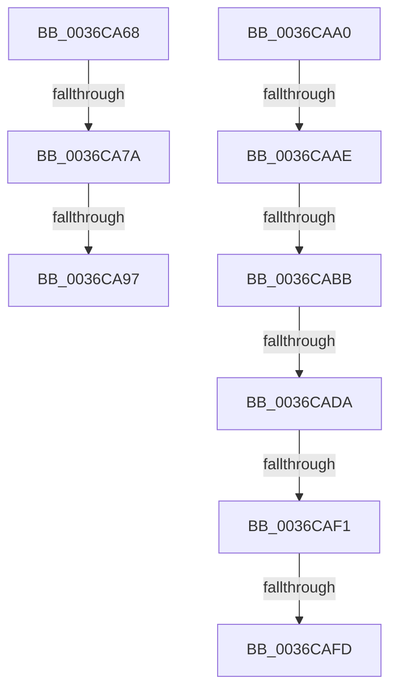

# sub_0036CA68

- RVA: `0x0036CA68`–`0x0036CB04` (길이 `156` bytes)
- VA: `0x000000014036CA68`
- 실행 섹션: `.text`
- PDB 이름 있음: `아니요`; PDB Function 태그: `아니요`
- unwind 정보 RVA: `0x0007A474`
- 디코드: `37`개 명령, `156/156` bytes 표시
- 미해석 바이트: `0` (있으면 어셈블리에 `.byte`로 보존)

> 이 문서는 커널 이미지의 기계어와 PDB 기호를 분석해 생성했습니다. 4번과 5번은 함수 원형과 자료형을 바이너리 사용 방식에서 추정한 C 해석이며 원본 소스 복구 결과는 아닙니다.

## 1. Dependencies

- 직접 호출 지점: **3**; 고유 호출 대상: **3**
- 직접 호출자로 확인된 함수: **0**
- RIP 상대 이미지 참조: **0**

### Outgoing calls
- `0x0036CA68` → [MiGetInPageAutoBoostLock](MiGetInPageAutoBoostLock_function_0036D3CC.md) (function, `0x0036D3CC`)
- `0x0036CA82` → [KeAbPreAcquire](../21/KeAbPreAcquire_function_00210230.md) (function, `0x00210230`)
- `0x0036CADA` → [MiPfCompleteInPageSupport](MiPfCompleteInPageSupport_function_0036D738.md) (function, `0x0036D738`)

### Direct callers
- 이 함수 시작 RVA로 연결되는 직접 call은 확인되지 않았습니다. 간접 호출은 완전히 역산할 수 없습니다.

### Static image references
- 디코드된 RIP-relative 메모리 참조가 없습니다.

## 2. Other-region calls and transfers

- 다른 실행 섹션으로 향하는 call: **0**
- call이 아닌 외부 분기/꼬리 이동: **9**
  - `0x0036CA74` → [sub_0036CFD7 + 0xB1](Unknown_function_0036CFD7.md) (`tail-transfer`)
  - `0x0036CA91` → [sub_0036CFD7 + 0x98](Unknown_function_0036CFD7.md) (`tail-transfer`)
  - `0x0036CA9B` → [sub_0036C6B5 + 0x151](Unknown_function_0036C6B5.md) (`tail-transfer`)
  - `0x0036CAA8` → [sub_0036CD3D + 0x8E](Unknown_function_0036CD3D.md) (`tail-transfer`)
  - `0x0036CAB5` → [sub_0036CD3D + 0x8E](Unknown_function_0036CD3D.md) (`tail-transfer`)
  - `0x0036CAD4` → [sub_0036CB1C + 0x8A](Unknown_function_0036CB1C.md) (`tail-transfer`)
  - `0x0036CAEB` → [sub_0036C6B5 + 0x31D](Unknown_function_0036C6B5.md) (`tail-transfer`)
  - `0x0036CAF7` → [sub_0036C6B5 + 0x31D](Unknown_function_0036C6B5.md) (`tail-transfer`)
  - `0x0036CAFF` → [sub_0036C6B5 + 0x31D](Unknown_function_0036C6B5.md) (`tail-transfer`)

## 3. Assembly (complete function range)

```asm
0036CA68  E8 5F 09 00 00                  call 0x14036d3cc
0036CA6D  48 89 45 E0                     mov qword ptr [rbp - 0x20], rax
0036CA71  48 85 C0                        test rax, rax
0036CA74  0F 84 0E 06 00 00               je 0x14036d088
0036CA7A  45 33 C0                        xor r8d, r8d
0036CA7D  33 D2                           xor edx, edx
0036CA7F  48 8B C8                        mov rcx, rax
0036CA82  E8 A9 37 EA FF                  call 0x140210230
0036CA87  48 89 45 F0                     mov qword ptr [rbp - 0x10], rax
0036CA8B  4C 8B E8                        mov r13, rax
0036CA8E  48 85 C0                        test rax, rax
0036CA91  0F 84 D8 05 00 00               je 0x14036d06f
0036CA97  C6 40 0A 01                     mov byte ptr [rax + 0xa], 1
0036CA9B  E9 66 FD FF FF                  jmp 0x14036c806
0036CAA0  48 8D 45 98                     lea rax, [rbp - 0x68]
0036CAA4  48 39 41 08                     cmp qword ptr [rcx + 8], rax
0036CAA8  0F 85 1D 03 00 00               jne 0x14036cdcb
0036CAAE  48 8B 01                        mov rax, qword ptr [rcx]
0036CAB1  48 39 48 08                     cmp qword ptr [rax + 8], rcx
0036CAB5  0F 85 10 03 00 00               jne 0x14036cdcb
0036CABB  48 8D 55 98                     lea rdx, [rbp - 0x68]
0036CABF  48 89 45 98                     mov qword ptr [rbp - 0x68], rax
0036CAC3  48 89 50 08                     mov qword ptr [rax + 8], rdx
0036CAC7  49 8B D7                        mov rdx, r15
0036CACA  8B 81 C0 00 00 00               mov eax, dword ptr [rcx + 0xc0]
0036CAD0  0F BA E0 18                     bt eax, 0x18
0036CAD4  0F 82 CC 00 00 00               jb 0x14036cba6
0036CADA  E8 59 0C 00 00                  call 0x14036d738
0036CADF  BA 00 00 00 80                  mov edx, 0x80000000
0036CAE4  8B C8                           mov ecx, eax
0036CAE6  8D 04 10                        lea eax, [rax + rdx]
0036CAE9  85 C2                           test edx, eax
0036CAEB  0F 85 E1 FE FF FF               jne 0x14036c9d2
0036CAF1  81 F9 34 04 00 C0               cmp ecx, 0xc0000434
0036CAF7  0F 84 D5 FE FF FF               je 0x14036c9d2
0036CAFD  8B D9                           mov ebx, ecx
0036CAFF  E9 CE FE FF FF                  jmp 0x14036c9d2
```

## 4. C-style interpretation (structured pseudocode)

```c
__int64 __fastcall sub_0036CA68(__int64 a1, int a2, int a3)
{
    __int64 result;

    result = MiGetInPageAutoBoostLock(a1, a2, a3, a4);
    *(unsigned __int64 *)(v_rbp - 32) = result;
    a3 = 0;
    a2 = 0;
    result = KeAbPreAcquire(result, a2, a3, a4);
    *(unsigned __int64 *)(v_rbp - 16) = result;
    *(unsigned __int8 *)(result + 10) = 1;
}
```

## 5. (Beta) C Style

```c
int64_t sub_0036CA68(int64_t Arg1, int32_t Arg2, int32_t Arg3)
{
    int64_t result;

    result = MiGetInPageAutoBoostLock(Arg1, Arg2, Arg3, a4);
    *(uint64_t *)(local_rbp - 0x20) = result;
    Arg3 = 0;
    Arg2 = 0;
    result = KeAbPreAcquire(result, Arg2, Arg3, a4);
    *(uint64_t *)(local_rbp - 0x10) = result;
    *(uint8_t *)(result + 0xA) = 1;
}
```

## 6. Execution-region graph

[열기: 2D/3D 그래프와 함수 탐색 컨트롤 패널](../../../control-panel.html?section=text&rva=0x0036CA68&view=graph)

- 2D 그래프는 위에서 아래로 흐르고, 3D 그래프는 빈 공간을 드래그해 회전합니다. Shift+드래그는 이동, 휠은 확대·축소, 함수 노드 선택은 대상 보고서 이동입니다.

### Static fallback


