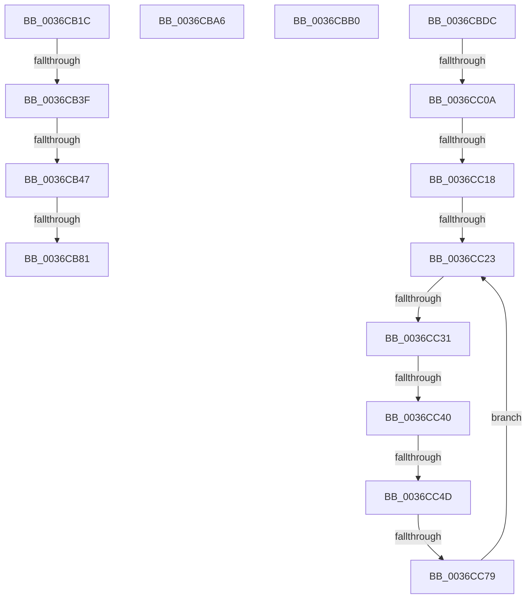

# sub_0036CB1C

- RVA: `0x0036CB1C`–`0x0036CC92` (길이 `374` bytes)
- VA: `0x000000014036CB1C`
- 실행 섹션: `.text`
- PDB 이름 있음: `아니요`; PDB Function 태그: `아니요`
- unwind 정보 RVA: `0x0007A4B8`
- 디코드: `83`개 명령, `374/374` bytes 표시
- 미해석 바이트: `0` (있으면 어셈블리에 `.byte`로 보존)

> 이 문서는 커널 이미지의 기계어와 PDB 기호를 분석해 생성했습니다. 4번과 5번은 함수 원형과 자료형을 바이너리 사용 방식에서 추정한 C 해석이며 원본 소스 복구 결과는 아닙니다.

## 1. Dependencies

- 직접 호출 지점: **6**; 고유 호출 대상: **6**
- 직접 호출자로 확인된 함수: **0**
- RIP 상대 이미지 참조: **0**

### Outgoing calls
- `0x0036CB27` → [MiPfCoalesceAndIssueIOs](MiPfCoalesceAndIssueIOs_function_0036D158.md) (function, `0x0036D158`)
- `0x0036CB88` → [KeAbPostReleaseEx](../26/KeAbPostReleaseEx_function_00262210.md) (function, `0x00262210`)
- `0x0036CB98` → [MiDereferenceInPageAutoBoostLock](MiDereferenceInPageAutoBoostLock_function_0036D398.md) (function, `0x0036D398`)
- `0x0036CBA6` → [MiPfCompleteCoalescedIo](MiPfCompleteCoalescedIo_function_0036C344.md) (function, `0x0036C344`)
- `0x0036CBD2` → [MiPrefetchPreallocatePages](MiPrefetchPreallocatePages_function_0036B1F0.md) (function, `0x0036B1F0`)
- `0x0036CC63` → [MiIssueHardFaultIo](../38/MiIssueHardFaultIo_function_003812EC.md) (function, `0x003812EC`)

### Direct callers
- 이 함수 시작 RVA로 연결되는 직접 call은 확인되지 않았습니다. 간접 호출은 완전히 역산할 수 없습니다.

### Static image references
- 디코드된 RIP-relative 메모리 참조가 없습니다.

## 2. Other-region calls and transfers

- 다른 실행 섹션으로 향하는 call: **0**
- call이 아닌 외부 분기/꼬리 이동: **13**
  - `0x0036CB39` → [sub_0036CFD7](Unknown_function_0036CFD7.md) (`tail-transfer`)
  - `0x0036CB41` → [sub_0036CFD7 + 0xC0](Unknown_function_0036CFD7.md) (`tail-transfer`)
  - `0x0036CB7B` → [sub_0036C6B5 + 0x3B](Unknown_function_0036C6B5.md) (`tail-transfer`)
  - `0x0036CBA1` → [sub_0036C6B5 + 0x264](Unknown_function_0036C6B5.md) (`tail-transfer`)
  - `0x0036CBAB` → [sub_0036CA68 + 0x77](Unknown_function_0036CA68.md) (`tail-transfer`)
  - `0x0036CBD7` → [sub_0036C6B5 + 0x148](Unknown_function_0036C6B5.md) (`tail-transfer`)
  - `0x0036CC04` → [sub_0036CD3D](Unknown_function_0036CD3D.md) (`tail-transfer`)
  - `0x0036CC12` → [sub_0036C6B5 + 0x1ED](Unknown_function_0036C6B5.md) (`tail-transfer`)
  - `0x0036CC1D` → [sub_0036CEB4 + 0xDC](Unknown_function_0036CEB4.md) (`tail-transfer`)
  - `0x0036CC2B` → [sub_0036C6B5 + 0x1E9](Unknown_function_0036C6B5.md) (`tail-transfer`)
  - `0x0036CC3A` → [sub_0036CD3D + 0x8E](Unknown_function_0036CD3D.md) (`tail-transfer`)
  - `0x0036CC47` → [sub_0036CD3D + 0x8E](Unknown_function_0036CD3D.md) (`tail-transfer`)
  - `0x0036CC73` → [sub_0036CD3D + 0x8E](Unknown_function_0036CD3D.md) (`tail-transfer`)

## 3. Assembly (complete function range)

```asm
0036CB1C  45 33 C0                        xor r8d, r8d
0036CB1F  48 8D 55 98                     lea rdx, [rbp - 0x68]
0036CB23  48 8D 4D A8                     lea rcx, [rbp - 0x58]
0036CB27  E8 2C 06 00 00                  call 0x14036d158
0036CB2C  33 F6                           xor esi, esi
0036CB2E  48 8B 4D 98                     mov rcx, qword ptr [rbp - 0x68]
0036CB32  48 8D 45 98                     lea rax, [rbp - 0x68]
0036CB36  48 3B C8                        cmp rcx, rax
0036CB39  0F 85 98 04 00 00               jne 0x14036cfd7
0036CB3F  85 F6                           test esi, esi
0036CB41  0F 88 50 05 00 00               js 0x14036d097
0036CB47  4C 8B 74 24 48                  mov r14, qword ptr [rsp + 0x48]
0036CB4C  49 B9 00 00 00 00 00 80 FF FF   movabs r9, 0xffff800000000000
0036CB56  4C 8B 44 24 50                  mov r8, qword ptr [rsp + 0x50]
0036CB5B  48 C7 45 B8 00 00 00 00         mov qword ptr [rbp - 0x48], 0
0036CB63  49 BA 00 00 00 00 80 F6 FF FF   movabs r10, 0xfffff68000000000
0036CB6D  49 BB FF FF FF FF FF F6 FF FF   movabs r11, 0xfffff6ffffffffff
0036CB77  49 83 FD 01                     cmp r13, 1
0036CB7B  0F 86 6F FB FF FF               jbe 0x14036c6f0
0036CB81  48 8B 4D E0                     mov rcx, qword ptr [rbp - 0x20]
0036CB85  49 8B D5                        mov rdx, r13
0036CB88  E8 83 56 EF FF                  call 0x140262210
0036CB8D  48 8B 4D E0                     mov rcx, qword ptr [rbp - 0x20]
0036CB91  45 33 ED                        xor r13d, r13d
0036CB94  4C 89 6D F0                     mov qword ptr [rbp - 0x10], r13
0036CB98  E8 FB 07 00 00                  call 0x14036d398
0036CB9D  4C 89 6D E0                     mov qword ptr [rbp - 0x20], r13
0036CBA1  E9 73 FD FF FF                  jmp 0x14036c919
0036CBA6  E8 99 F7 FF FF                  call 0x14036c344
0036CBAB  E9 2F FF FF FF                  jmp 0x14036cadf
0036CBB0  48 8D 45 40                     lea rax, [rbp + 0x40]
0036CBB4  4D 8B CF                        mov r9, r15
0036CBB7  48 89 44 24 30                  mov qword ptr [rsp + 0x30], rax
0036CBBC  48 8D 54 24 70                  lea rdx, [rsp + 0x70]
0036CBC1  48 89 74 24 28                  mov qword ptr [rsp + 0x28], rsi
0036CBC6  48 8D 4D 10                     lea rcx, [rbp + 0x10]
0036CBCA  4D 8B C4                        mov r8, r12
0036CBCD  4C 89 74 24 20                  mov qword ptr [rsp + 0x20], r14
0036CBD2  E8 19 E6 FF FF                  call 0x14036b1f0
0036CBD7  E9 21 FC FF FF                  jmp 0x14036c7fd
0036CBDC  48 8D 44 24 58                  lea rax, [rsp + 0x58]
0036CBE1  45 33 ED                        xor r13d, r13d
0036CBE4  4C 8D 74 24 58                  lea r14, [rsp + 0x58]
0036CBE9  48 89 44 24 60                  mov qword ptr [rsp + 0x60], rax
0036CBEE  45 33 FF                        xor r15d, r15d
0036CBF1  4C 89 74 24 58                  mov qword ptr [rsp + 0x58], r14
0036CBF6  45 33 E4                        xor r12d, r12d
0036CBF9  48 8B 75 A8                     mov rsi, qword ptr [rbp - 0x58]
0036CBFD  48 8D 4D A8                     lea rcx, [rbp - 0x58]
0036CC01  48 3B F1                        cmp rsi, rcx
0036CC04  0F 85 33 01 00 00               jne 0x14036cd3d
0036CC0A  48 8D 44 24 58                  lea rax, [rsp + 0x58]
0036CC0F  4C 3B F0                        cmp r14, rax
0036CC12  0F 84 8A FC FF FF               je 0x14036c8a2
0036CC18  4C 3B 74 24 60                  cmp r14, qword ptr [rsp + 0x60]
0036CC1D  0F 85 6D 03 00 00               jne 0x14036cf90
0036CC23  48 8D 44 24 58                  lea rax, [rsp + 0x58]
0036CC28  4C 3B F0                        cmp r14, rax
0036CC2B  0F 84 6D FC FF FF               je 0x14036c89e
0036CC31  48 8D 44 24 58                  lea rax, [rsp + 0x58]
0036CC36  49 39 46 08                     cmp qword ptr [r14 + 8], rax
0036CC3A  0F 85 8B 01 00 00               jne 0x14036cdcb
0036CC40  49 8B 06                        mov rax, qword ptr [r14]
0036CC43  4C 39 70 08                     cmp qword ptr [rax + 8], r14
0036CC47  0F 85 7E 01 00 00               jne 0x14036cdcb
0036CC4D  48 8D 4C 24 58                  lea rcx, [rsp + 0x58]
0036CC52  48 89 44 24 58                  mov qword ptr [rsp + 0x58], rax
0036CC57  48 89 48 08                     mov qword ptr [rax + 8], rcx
0036CC5B  45 33 C0                        xor r8d, r8d
0036CC5E  49 8B CE                        mov rcx, r14
0036CC61  33 D2                           xor edx, edx
0036CC63  E8 84 46 01 00                  call 0x1403812ec
0036CC68  48 8B 45 A0                     mov rax, qword ptr [rbp - 0x60]
0036CC6C  48 8D 4D 98                     lea rcx, [rbp - 0x68]
0036CC70  48 39 08                        cmp qword ptr [rax], rcx
0036CC73  0F 85 52 01 00 00               jne 0x14036cdcb
0036CC79  49 89 46 08                     mov qword ptr [r14 + 8], rax
0036CC7D  48 8D 4D 98                     lea rcx, [rbp - 0x68]
0036CC81  49 89 0E                        mov qword ptr [r14], rcx
0036CC84  4C 89 30                        mov qword ptr [rax], r14
0036CC87  4C 89 75 A0                     mov qword ptr [rbp - 0x60], r14
0036CC8B  4C 8B 74 24 58                  mov r14, qword ptr [rsp + 0x58]
0036CC90  EB 91                           jmp 0x14036cc23
```

## 4. C-style interpretation (structured pseudocode)

```c
__int64 __fastcall sub_0036CB1C(__int64 a1, __int64 a2, int a3, __int64 a4, __int64 a5, __int64 a6, __int64 a7, __int64 a8, __int64 a9, __int64 a10)
{
    __int64 result;
    __int64 v_r13;
    __int64 v_rsi;
    unsigned __int64 v_stack_p20;
    unsigned __int64 v_stack_p28;
    unsigned __int64 v_stack_p30;
    unsigned __int64 v_stack_p58;
    unsigned __int64 v_stack_p60;
    unsigned __int64 v_stack_p70;

    a3 = 0;
    result = MiPfCoalesceAndIssueIOs(v_rbp - 88, v_rbp - 104, a3, a4);
    v_rsi = 0;
    *(unsigned __int64 *)(v_rbp - 72) = 0;
    result = KeAbPostReleaseEx(*(unsigned __int64 *)(v_rbp - 32), v_r13, a10, a4);
    v_r13 = 0;
    *(unsigned __int64 *)(v_rbp - 16) = 0;
    result = MiDereferenceInPageAutoBoostLock(*(unsigned __int64 *)(v_rbp - 32), v_r13, a10, a4);
    *(unsigned __int64 *)(v_rbp - 32) = 0;
}
```

## 5. (Beta) C Style

```c
int64_t sub_0036CB1C(int64_t Arg1, int64_t Arg2, int32_t Arg3, int64_t Arg4, uint64_t Arg5, uint64_t Arg6, uint64_t Arg7, uint64_t Arg8, int64_t Arg9, int64_t Arg10)
{
    int64_t result;
    int64_t local_r13;
    int64_t local_rsi;
    uint64_t v_stack_p20;
    uint64_t v_stack_p28;
    uint64_t v_stack_p30;
    uint64_t v_stack_p58;
    uint64_t v_stack_p60;
    uint64_t v_stack_p70;

    Arg3 = 0;
    result = MiPfCoalesceAndIssueIOs(local_rbp - 88, local_rbp - 104, Arg3, Arg4);
    local_rsi = 0;
    *(uint64_t *)(local_rbp - 0x48) = 0;
    result = KeAbPostReleaseEx(*(uint64_t *)(local_rbp - 0x20), local_r13, Arg10, Arg4);
    local_r13 = 0;
    *(uint64_t *)(local_rbp - 0x10) = 0;
    result = MiDereferenceInPageAutoBoostLock(*(uint64_t *)(local_rbp - 0x20), local_r13, Arg10, Arg4);
    *(uint64_t *)(local_rbp - 0x20) = 0;
}
```

## 6. Execution-region graph

[열기: 2D/3D 그래프와 함수 탐색 컨트롤 패널](../../../control-panel.html?section=text&rva=0x0036CB1C&view=graph)

- 2D 그래프는 위에서 아래로 흐르고, 3D 그래프는 빈 공간을 드래그해 회전합니다. Shift+드래그는 이동, 휠은 확대·축소, 함수 노드 선택은 대상 보고서 이동입니다.

### Static fallback


