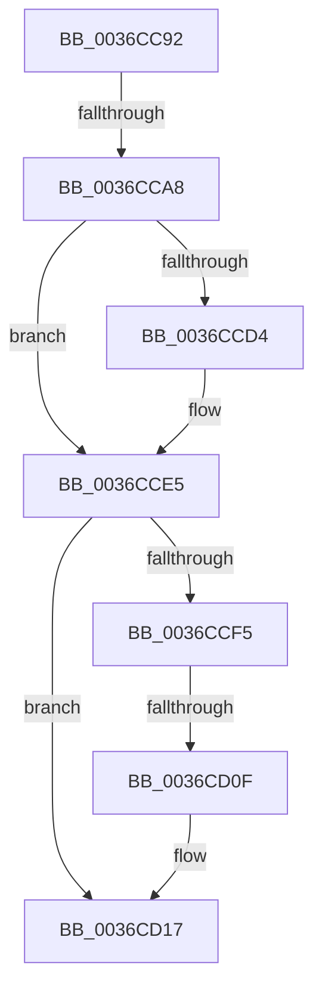

# sub_0036CC92

- RVA: `0x0036CC92`–`0x0036CD3D` (길이 `171` bytes)
- VA: `0x000000014036CC92`
- 실행 섹션: `.text`
- PDB 이름 있음: `아니요`; PDB Function 태그: `아니요`
- unwind 정보 RVA: `0x0007A4D4`
- 디코드: `39`개 명령, `171/171` bytes 표시
- 미해석 바이트: `0` (있으면 어셈블리에 `.byte`로 보존)

> 이 문서는 커널 이미지의 기계어와 PDB 기호를 분석해 생성했습니다. 4번과 5번은 함수 원형과 자료형을 바이너리 사용 방식에서 추정한 C 해석이며 원본 소스 복구 결과는 아닙니다.

## 1. Dependencies

- 직접 호출 지점: **0**; 고유 호출 대상: **0**
- 직접 호출자로 확인된 함수: **0**
- RIP 상대 이미지 참조: **2**

### Outgoing calls
- 직접 디코드된 call 명령이 없습니다.

### Direct callers
- 이 함수 시작 RVA로 연결되는 직접 call은 확인되지 않았습니다. 간접 호출은 완전히 역산할 수 없습니다.

### Static image references
- `0x0036CC92` → RVA `0x00FC5000` (`ALMOSTRO`; read)
- `0x0036CCE7` → RVA `0x00000000` (`image boundary/outside`; read)

## 2. Other-region calls and transfers

- 다른 실행 섹션으로 향하는 call: **0**
- call이 아닌 외부 분기/꼬리 이동: **3**
  - `0x0036CCA2` → [sub_0036CFCE](Unknown_function_0036CFCE.md) (`tail-transfer`)
  - `0x0036CD09` → [sub_0036CE5B](Unknown_function_0036CE5B.md) (`tail-transfer`)
  - `0x0036CD38` → [sub_0036C638 + 0x34](Unknown_function_0036C638.md) (`tail-transfer`)

## 3. Assembly (complete function range)

```asm
0036CC92  44 0F B7 15 66 83 C5 00         movzx r10d, word ptr [rip + 0xc58366]
0036CC9A  4C 8D 45 40                     lea r8, [rbp + 0x40]
0036CC9E  41 83 E0 04                     and r8d, 4
0036CCA2  0F 85 26 03 00 00               jne 0x14036cfce
0036CCA8  4D 85 C0                        test r8, r8
0036CCAB  48 8D 45 44                     lea rax, [rbp + 0x44]
0036CCAF  4C 8D 4D 40                     lea r9, [rbp + 0x40]
0036CCB3  49 8B CA                        mov rcx, r10
0036CCB6  4C 0F 45 C8                     cmovne r9, rax
0036CCBA  48 C1 E1 20                     shl rcx, 0x20
0036CCBE  49 8B C2                        mov rax, r10
0036CCC1  49 8B F9                        mov rdi, r9
0036CCC4  48 0B C1                        or rax, rcx
0036CCC7  B9 01 00 00 00                  mov ecx, 1
0036CCCC  F3 48 AB                        rep stosq qword ptr [rdi], rax
0036CCCF  4D 85 C0                        test r8, r8
0036CCD2  75 11                           jne 0x14036cce5
0036CCD4  B8 04 00 00 00                  mov eax, 4
0036CCD9  B9 08 00 00 00                  mov ecx, 8
0036CCDE  0F 44 C1                        cmove eax, ecx
0036CCE1  46 89 14 08                     mov dword ptr [rax + r9], r10d
0036CCE5  33 C9                           xor ecx, ecx
0036CCE7  4C 8D 05 12 33 C9 FF            lea r8, [rip - 0x36ccee]
0036CCEE  33 FF                           xor edi, edi
0036CCF0  83 FF 03                        cmp edi, 3
0036CCF3  73 22                           jae 0x14036cd17
0036CCF5  48 8D 04 FD 00 00 00 00         lea rax, [rdi*8]
0036CCFD  4A 81 BC 00 60 1C 01 00 00 02 00 00  cmp qword ptr [rax + r8 + 0x11c60], 0x200
0036CD09  0F 85 4C 01 00 00               jne 0x14036ce5b
0036CD0F  4A 8B 8C 00 D0 EC E0 00         mov rcx, qword ptr [rax + r8 + 0xe0ecd0]
0036CD17  4C 8B 44 24 50                  mov r8, qword ptr [rsp + 0x50]
0036CD1C  B8 40 42 0F 00                  mov eax, 0xf4240
0036CD21  48 C1 E1 07                     shl rcx, 7
0036CD25  0F 57 C0                        xorps xmm0, xmm0
0036CD28  48 3B C8                        cmp rcx, rax
0036CD2B  66 0F 7F 45 70                  movdqa xmmword ptr [rbp + 0x70], xmm0
0036CD30  48 0F 43 C8                     cmovae rcx, rax
0036CD34  48 89 4D 68                     mov qword ptr [rbp + 0x68], rcx
0036CD38  E9 2F F9 FF FF                  jmp 0x14036c66c
```

## 4. C-style interpretation (structured pseudocode)

```c
__int64 __fastcall sub_0036CC92(__int64 a1, __int64 a2, __int64 a3, __int64 a4, __int64 a5, __int64 a6, __int64 a7, __int64 a8, __int64 a9, __int64 a10)
{
    __int64 result;
    __int64 v_rdi;

    a3 = (unsigned int)((v_rbp + 64) & (4));
    a4 = v_rbp + 64;
    if (a3 != 0) { a4 = v_rbp + 68; }
    a1 = (*(unsigned __int16 *)(v_rip + 12944230)) << (32);
    result = (*(unsigned __int16 *)(v_rip + 12944230)) | (a1);
    if (a3 == 0) {
        result = 4;
        a1 = 8;
        if (a3 == 0) { result = (unsigned int)(a1); }
        *(unsigned int *)(result + a4 * 1) = (unsigned int)(*(unsigned __int16 *)(v_rip + 12944230));
    }
    a1 = 0;
    v_rdi = 0;
    if (0 >= 3) goto loc_0036CD17;
loc_0036CD17:
    a1 = (*(unsigned __int64 *)(v_rdi * 8 + v_rip - 3591406 * 1 + 14740688)) << (7);
    *(unsigned __int64 *)(v_rbp + 112) = v_xmm0;
    if (a1 >= ((unsigned int)(0xF4240ULL))) { a1 = (unsigned int)(0xF4240ULL); }
    *(unsigned __int64 *)(v_rbp + 104) = a1;
}
```

## 5. (Beta) C Style

```c
int64_t sub_0036CC92(int64_t Arg1, int64_t Arg2, int64_t Arg3, int64_t Arg4, uint64_t Arg5, uint64_t Arg6, uint64_t Arg7, uint64_t Arg8, uint64_t Arg9, int64_t Arg10)
{
    int64_t result;
    int64_t local_rdi;

    Arg3 = (uint32_t)((local_rbp + 64) & (4));
    Arg4 = local_rbp + 64;
    if (Arg3 != 0) { Arg4 = local_rbp + 68; }
    Arg1 = (*(uint16_t *)(v_rip + 0xC58366)) << (32);
    result = (*(uint16_t *)(v_rip + 0xC58366)) | (Arg1);
    if (Arg3 == 0) {
        result = 4;
        Arg1 = 8;
        if (Arg3 == 0) { result = (uint32_t)(Arg1); }
        *(uint32_t *)(result + Arg4 * 1) = (uint32_t)(*(uint16_t *)(v_rip + 0xC58366));
    }
    Arg1 = 0;
    local_rdi = 0;
    if (0 >= 3) goto loc_0036CD17;
loc_0036CD17:
    Arg1 = (*(uint64_t *)(local_rdi * 8 + v_rip - 0x36CCEE * 1 + 0xE0ECD0)) << (7);
    *(uint64_t *)(local_rbp + 0x70) = v_xmm0;
    if (Arg1 >= ((uint32_t)(0xF4240ULL))) { Arg1 = (uint32_t)(0xF4240ULL); }
    *(uint64_t *)(local_rbp + 0x68) = Arg1;
}
```

## 6. Execution-region graph

[열기: 2D/3D 그래프와 함수 탐색 컨트롤 패널](../../../control-panel.html?section=text&rva=0x0036CC92&view=graph)

- 2D 그래프는 위에서 아래로 흐르고, 3D 그래프는 빈 공간을 드래그해 회전합니다. Shift+드래그는 이동, 휠은 확대·축소, 함수 노드 선택은 대상 보고서 이동입니다.

### Static fallback


