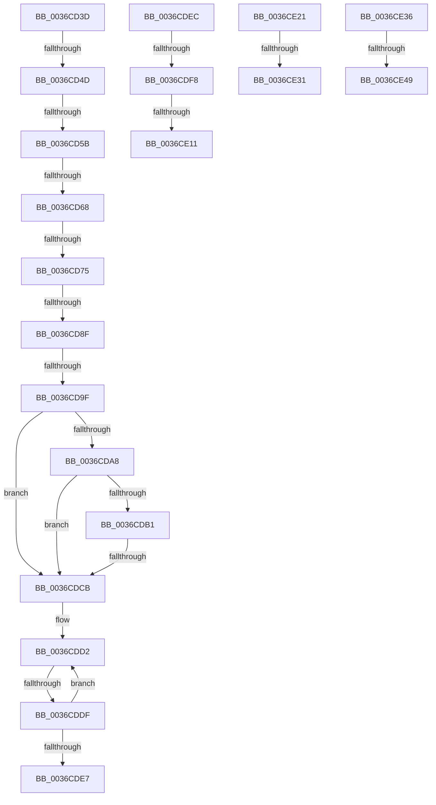

# sub_0036CD3D

- RVA: `0x0036CD3D`–`0x0036CE5B` (길이 `286` bytes)
- VA: `0x000000014036CD3D`
- 실행 섹션: `.text`
- PDB 이름 있음: `아니요`; PDB Function 태그: `아니요`
- unwind 정보 RVA: `0x0007A4E8`
- 디코드: `64`개 명령, `286/286` bytes 표시
- 미해석 바이트: `0` (있으면 어셈블리에 `.byte`로 보존)

> 이 문서는 커널 이미지의 기계어와 PDB 기호를 분석해 생성했습니다. 4번과 5번은 함수 원형과 자료형을 바이너리 사용 방식에서 추정한 C 해석이며 원본 소스 복구 결과는 아닙니다.

## 1. Dependencies

- 직접 호출 지점: **4**; 고유 호출 대상: **4**
- 직접 호출자로 확인된 함수: **0**
- RIP 상대 이미지 참조: **0**

### Outgoing calls
- `0x0036CE14` → [MiGetLeafVa](../27/MiGetLeafVa_function_0027C0A0.md) (function, `0x0027C0A0`)
- `0x0036CE24` → [MiVaIsUltra](../22/MiVaIsUltra_function_002284F0.md) (function, `0x002284F0`)
- `0x0036CE3A` → [MiFreePageChain](../37/MiFreePageChain_function_00377D9C.md) (function, `0x00377D9C`)
- `0x0036CE51` → [MiReleaseNonPagedResources](../32/MiReleaseNonPagedResources_function_0032299C.md) (function, `0x0032299C`)

### Direct callers
- 이 함수 시작 RVA로 연결되는 직접 call은 확인되지 않았습니다. 간접 호출은 완전히 역산할 수 없습니다.

### Static image references
- 디코드된 RIP-relative 메모리 참조가 없습니다.

## 2. Other-region calls and transfers

- 다른 실행 섹션으로 향하는 call: **0**
- call이 아닌 외부 분기/꼬리 이동: **16**
  - `0x0036CD47` → [sub_0036CEB4 + 0x69](Unknown_function_0036CEB4.md) (`tail-transfer`)
  - `0x0036CD55` → [sub_0036CE62](Unknown_function_0036CE62.md) (`tail-transfer`)
  - `0x0036CD62` → [sub_0036CEB4 + 0x43](Unknown_function_0036CEB4.md) (`tail-transfer`)
  - `0x0036CD6F` → [sub_0036CEB4 + 0x43](Unknown_function_0036CEB4.md) (`tail-transfer`)
  - `0x0036CD89` → [sub_0036CEB4 + 0x43](Unknown_function_0036CEB4.md) (`tail-transfer`)
  - `0x0036CD99` → [sub_0036CEB4 + 0x43](Unknown_function_0036CEB4.md) (`tail-transfer`)
  - `0x0036CDC5` → [sub_0036CFD7 + 0x60](Unknown_function_0036CFD7.md) (`tail-transfer`)
  - `0x0036CDD9` → [sub_0036CB1C](Unknown_function_0036CB1C.md) (`tail-transfer`)
  - `0x0036CDE7` → [sub_0036C6B5 + 0x253](Unknown_function_0036C6B5.md) (`tail-transfer`)
  - `0x0036CDF2` → [sub_0036C6B5 + 0xC9](Unknown_function_0036C6B5.md) (`tail-transfer`)
  - `0x0036CE0B` → [sub_0036C6B5 + 0x2CB](Unknown_function_0036C6B5.md) (`tail-transfer`)
  - `0x0036CE1C` → [sub_0036C6B5 + 0xC9](Unknown_function_0036C6B5.md) (`tail-transfer`)
  - `0x0036CE2B` → [sub_0036C6B5 + 0xBD](Unknown_function_0036C6B5.md) (`tail-transfer`)
  - `0x0036CE31` → [sub_0036C6B5 + 0x2CB](Unknown_function_0036C6B5.md) (`tail-transfer`)
  - `0x0036CE43` → [sub_0036C6B5 + 0x30B](Unknown_function_0036C6B5.md) (`tail-transfer`)
  - `0x0036CE56` → [sub_0036C6B5 + 0x30B](Unknown_function_0036C6B5.md) (`tail-transfer`)

## 3. Assembly (complete function range)

```asm
0036CD3D  81 BE B8 00 00 00 00 00 10 00   cmp dword ptr [rsi + 0xb8], 0x100000
0036CD47  0F 83 D0 01 00 00               jae 0x14036cf1d
0036CD4D  48 8D 4C 24 58                  lea rcx, [rsp + 0x58]
0036CD52  4C 3B F1                        cmp r14, rcx
0036CD55  0F 84 07 01 00 00               je 0x14036ce62
0036CD5B  48 8B 4E 60                     mov rcx, qword ptr [rsi + 0x60]
0036CD5F  4C 3B F9                        cmp r15, rcx
0036CD62  0F 8F 8F 01 00 00               jg 0x14036cef7
0036CD68  4C 3B A6 C8 00 00 00            cmp r12, qword ptr [rsi + 0xc8]
0036CD6F  0F 85 82 01 00 00               jne 0x14036cef7
0036CD75  44 8B 86 B8 00 00 00            mov r8d, dword ptr [rsi + 0xb8]
0036CD7C  49 2B CF                        sub rcx, r15
0036CD7F  44 03 C1                        add r8d, ecx
0036CD82  48 81 F9 00 00 02 00            cmp rcx, 0x20000
0036CD89  0F 87 68 01 00 00               ja 0x14036cef7
0036CD8F  43 8D 14 28                     lea edx, [r8 + r13]
0036CD93  81 FA 00 00 10 00               cmp edx, 0x100000
0036CD99  0F 87 58 01 00 00               ja 0x14036cef7
0036CD9F  48 8B 0E                        mov rcx, qword ptr [rsi]
0036CDA2  48 39 71 08                     cmp qword ptr [rcx + 8], rsi
0036CDA6  75 23                           jne 0x14036cdcb
0036CDA8  48 8B 46 08                     mov rax, qword ptr [rsi + 8]
0036CDAC  48 39 30                        cmp qword ptr [rax], rsi
0036CDAF  75 1A                           jne 0x14036cdcb
0036CDB1  48 89 08                        mov qword ptr [rax], rcx
0036CDB4  48 89 41 08                     mov qword ptr [rcx + 8], rax
0036CDB8  48 8D 4C 24 58                  lea rcx, [rsp + 0x58]
0036CDBD  48 8B 44 24 60                  mov rax, qword ptr [rsp + 0x60]
0036CDC2  48 39 08                        cmp qword ptr [rax], rcx
0036CDC5  0F 84 6C 02 00 00               je 0x14036d037
0036CDCB  B9 03 00 00 00                  mov ecx, 3
0036CDD0  CD 29                           int 0x29
0036CDD2  41 FF C0                        inc r8d
0036CDD5  41 83 F8 04                     cmp r8d, 4
0036CDD9  0F 84 3D FD FF FF               je 0x14036cb1c
0036CDDF  48 8B 09                        mov rcx, qword ptr [rcx]
0036CDE2  48 3B CA                        cmp rcx, rdx
0036CDE5  75 EB                           jne 0x14036cdd2
0036CDE7  E9 1C FB FF FF                  jmp 0x14036c908
0036CDEC  49 8B C3                        mov rax, r11
0036CDEF  48 3B F0                        cmp rsi, rax
0036CDF2  0F 87 86 F9 FF FF               ja 0x14036c77e
0036CDF8  49 8B C2                        mov rax, r10
0036CDFB  48 B9 00 00 00 00 40 00 00 00   movabs rcx, 0x4000000000
0036CE05  48 03 C1                        add rax, rcx
0036CE08  48 3B F0                        cmp rsi, rax
0036CE0B  0F 83 6F FB FF FF               jae 0x14036c980
0036CE11  48 8B CE                        mov rcx, rsi
0036CE14  E8 87 F2 F0 FF                  call 0x14027c0a0
0036CE19  4C 8B C0                        mov r8, rax
0036CE1C  E9 5D F9 FF FF                  jmp 0x14036c77e
0036CE21  48 8B CE                        mov rcx, rsi
0036CE24  E8 C7 B6 EB FF                  call 0x1402284f0
0036CE29  85 C0                           test eax, eax
0036CE2B  0F 84 41 F9 FF FF               je 0x14036c772
0036CE31  E9 4A FB FF FF                  jmp 0x14036c980
0036CE36  48 8D 4D C8                     lea rcx, [rbp - 0x38]
0036CE3A  E8 5D AF 00 00                  call 0x140377d9c
0036CE3F  83 7D 20 00                     cmp dword ptr [rbp + 0x20], 0
0036CE43  0F 84 77 FB FF FF               je 0x14036c9c0
0036CE49  BA 00 02 00 00                  mov edx, 0x200
0036CE4E  49 8B CC                        mov rcx, r12
0036CE51  E8 46 5B FB FF                  call 0x14032299c
0036CE56  E9 65 FB FF FF                  jmp 0x14036c9c0
```

## 4. C-style interpretation (structured pseudocode)

```c
__int64 __fastcall sub_0036CD3D(__int64 a1, __int64 a2, __int64 a3, __int64 a4, __int64 a5, __int64 a6, __int64 a7, __int64 a8, __int64 a9, __int64 a10, __int64 a11, __int64 a12)
{
    a1 = (*(unsigned __int64 *)(v_rsi + 96)) - (v_r15);
    a3 = (unsigned int)(((unsigned int)(*(unsigned int *)(v_rsi + 184))) + ((unsigned int)(a1)));
    if ((*(unsigned __int64 *)(*(unsigned __int64 *)(v_rsi) + 8)) != v_rsi) goto loc_0036CDCB;
    if ((*(unsigned __int64 *)(*(unsigned __int64 *)(v_rsi + 8))) != v_rsi) goto loc_0036CDCB;
    *(unsigned __int64 *)(*(unsigned __int64 *)(v_rsi + 8)) = *(unsigned __int64 *)(v_rsi);
    *(unsigned __int64 *)(*(unsigned __int64 *)(v_rsi) + 8) = *(unsigned __int64 *)(v_rsi + 8);
loc_0036CDCB:
loc_0036CDD2:
    a3 = (unsigned int)((a3) + 1);
    if ((*(unsigned __int64 *)(3)) != (a3 + v_r13 * 1)) goto loc_0036CDD2;
}
```

## 5. (Beta) C Style

```c
int64_t sub_0036CD3D(int64_t Arg1, int64_t Arg2, int64_t Arg3, int64_t Arg4, uint64_t Arg5, uint64_t Arg6, uint64_t Arg7, uint64_t Arg8, uint64_t Arg9, uint64_t Arg10, int64_t Arg11, void *Arg12)
{
    uint8_t *arg12 = (uint8_t *)Arg12;

    Arg1 = (*(uint64_t *)(local_rsi + 0x60)) - (local_r15);
    Arg3 = (uint32_t)(((uint32_t)(*(uint32_t *)(local_rsi + 0xB8))) + ((uint32_t)(Arg1)));
    if ((*(uint64_t *)(*(uint64_t *)(local_rsi) + 0x8)) != local_rsi) goto loc_0036CDCB;
    if ((*(uint64_t *)(*(uint64_t *)(local_rsi + 0x8))) != local_rsi) goto loc_0036CDCB;
    *(uint64_t *)(*(uint64_t *)(local_rsi + 0x8)) = *(uint64_t *)(local_rsi);
    *(uint64_t *)(*(uint64_t *)(local_rsi) + 0x8) = *(uint64_t *)(local_rsi + 0x8);
loc_0036CDCB:
loc_0036CDD2:
    Arg3 = (uint32_t)((Arg3) + 1);
    if ((*(uint64_t *)(3)) != (Arg3 + local_r13 * 1)) goto loc_0036CDD2;
}
```

### 관측된 메모리 오프셋

구조체 형식이 확인되지 않은 접근은 인자 기준의 오프셋으로만 기록했습니다.

| 기준 인자 | 오프셋 표현 | 폭 (bit) | 접근 |
|---|---:|---:|---|
| `Arg12` | `+ 0x0` | `64` | `R` |

## 6. Execution-region graph

[열기: 2D/3D 그래프와 함수 탐색 컨트롤 패널](../../../control-panel.html?section=text&rva=0x0036CD3D&view=graph)

- 2D 그래프는 위에서 아래로 흐르고, 3D 그래프는 빈 공간을 드래그해 회전합니다. Shift+드래그는 이동, 휠은 확대·축소, 함수 노드 선택은 대상 보고서 이동입니다.

### Static fallback


