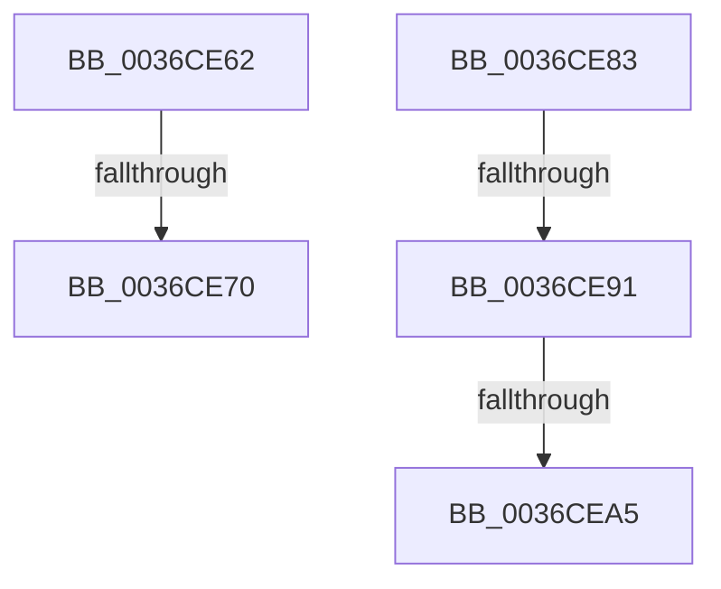

# sub_0036CE62

- RVA: `0x0036CE62`–`0x0036CEAA` (길이 `72` bytes)
- VA: `0x000000014036CE62`
- 실행 섹션: `.text`
- PDB 이름 있음: `아니요`; PDB Function 태그: `아니요`
- unwind 정보 RVA: `0x0007A518`
- 디코드: `15`개 명령, `72/72` bytes 표시
- 미해석 바이트: `0` (있으면 어셈블리에 `.byte`로 보존)

> 이 문서는 커널 이미지의 기계어와 PDB 기호를 분석해 생성했습니다. 4번과 5번은 함수 원형과 자료형을 바이너리 사용 방식에서 추정한 C 해석이며 원본 소스 복구 결과는 아닙니다.

## 1. Dependencies

- 직접 호출 지점: **1**; 고유 호출 대상: **1**
- 직접 호출자로 확인된 함수: **0**
- RIP 상대 이미지 참조: **0**

### Outgoing calls
- `0x0036CE98` → [MiLeapPrefetch](../4C/MiLeapPrefetch_function_004CAED0.md) (function, `0x004CAED0`)

### Direct callers
- 이 함수 시작 RVA로 연결되는 직접 call은 확인되지 않았습니다. 간접 호출은 완전히 역산할 수 없습니다.

### Static image references
- 디코드된 RIP-relative 메모리 참조가 없습니다.

## 2. Other-region calls and transfers

- 다른 실행 섹션으로 향하는 call: **0**
- call이 아닌 외부 분기/꼬리 이동: **5**
  - `0x0036CE6A` → [sub_0036C6B5 + 0x1ED](Unknown_function_0036C6B5.md) (`tail-transfer`)
  - `0x0036CE7E` → [sub_0036CD3D + 0x38](Unknown_function_0036CD3D.md) (`tail-transfer`)
  - `0x0036CE8B` → [sub_0036C6B5 + 0x2F5](Unknown_function_0036C6B5.md) (`tail-transfer`)
  - `0x0036CE9F` → [sub_0036C6B5 + 0x2F5](Unknown_function_0036C6B5.md) (`tail-transfer`)
  - `0x0036CEA5` → [sub_0036C6B5 + 0x1DB](Unknown_function_0036C6B5.md) (`tail-transfer`)

## 3. Assembly (complete function range)

```asm
0036CE62  48 81 7D B8 00 00 10 00         cmp qword ptr [rbp - 0x48], 0x100000
0036CE6A  0F 82 32 FA FF FF               jb 0x14036c8a2
0036CE70  4C 8B 7E 60                     mov r15, qword ptr [rsi + 0x60]
0036CE74  4C 8B A6 C8 00 00 00            mov r12, qword ptr [rsi + 0xc8]
0036CE7B  49 8B CF                        mov rcx, r15
0036CE7E  E9 F2 FE FF FF                  jmp 0x14036cd75
0036CE83  48 8B 45 80                     mov rax, qword ptr [rbp - 0x80]
0036CE87  48 39 45 88                     cmp qword ptr [rbp - 0x78], rax
0036CE8B  0F 84 19 FB FF FF               je 0x14036c9aa
0036CE91  33 D2                           xor edx, edx
0036CE93  48 8D 4C 24 70                  lea rcx, [rsp + 0x70]
0036CE98  E8 33 E0 15 00                  call 0x1404caed0
0036CE9D  85 C0                           test eax, eax
0036CE9F  0F 84 05 FB FF FF               je 0x14036c9aa
0036CEA5  E9 E6 F9 FF FF                  jmp 0x14036c890
```

## 4. C-style interpretation (structured pseudocode)

```c
__int64 __fastcall sub_0036CE62(__int64 a1, int a2)
{
    unsigned __int64 v_stack_p70;
}
```

## 5. (Beta) C Style

```c
int64_t sub_0036CE62(int64_t Arg1, int32_t Arg2)
{
    uint64_t v_stack_p70;
}
```

## 6. Execution-region graph

[열기: 2D/3D 그래프와 함수 탐색 컨트롤 패널](../../../control-panel.html?section=text&rva=0x0036CE62&view=graph)

- 2D 그래프는 위에서 아래로 흐르고, 3D 그래프는 빈 공간을 드래그해 회전합니다. Shift+드래그는 이동, 휠은 확대·축소, 함수 노드 선택은 대상 보고서 이동입니다.

### Static fallback


