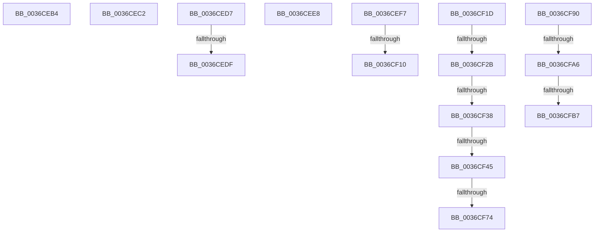

# sub_0036CEB4

- RVA: `0x0036CEB4`–`0x0036CFCE` (길이 `282` bytes)
- VA: `0x000000014036CEB4`
- 실행 섹션: `.text`
- PDB 이름 있음: `아니요`; PDB Function 태그: `아니요`
- unwind 정보 RVA: `0x0007A54C`
- 디코드: `66`개 명령, `282/282` bytes 표시
- 미해석 바이트: `0` (있으면 어셈블리에 `.byte`로 보존)

> 이 문서는 커널 이미지의 기계어와 PDB 기호를 분석해 생성했습니다. 4번과 5번은 함수 원형과 자료형을 바이너리 사용 방식에서 추정한 C 해석이며 원본 소스 복구 결과는 아닙니다.

## 1. Dependencies

- 직접 호출 지점: **3**; 고유 호출 대상: **3**
- 직접 호출자로 확인된 함수: **0**
- RIP 상대 이미지 참조: **0**

### Outgoing calls
- `0x0036CF03` → [MiPfIssueCoalesceCandidates](MiPfIssueCoalesceCandidates_function_0036B4D4.md) (function, `0x0036B4D4`)
- `0x0036CF5E` → [MiIssueHardFaultIo](../38/MiIssueHardFaultIo_function_003812EC.md) (function, `0x003812EC`)
- `0x0036CF98` → [MiPfIssueCoalescedSupport](MiPfIssueCoalescedSupport_function_0036AE14.md) (function, `0x0036AE14`)

### Direct callers
- 이 함수 시작 RVA로 연결되는 직접 call은 확인되지 않았습니다. 간접 호출은 완전히 역산할 수 없습니다.

### Static image references
- 디코드된 RIP-relative 메모리 참조가 없습니다.

## 2. Other-region calls and transfers

- 다른 실행 섹션으로 향하는 call: **0**
- call이 아닌 외부 분기/꼬리 이동: **15**
  - `0x0036CEBD` → [sub_0036C6B5 + 0x303](Unknown_function_0036C6B5.md) (`tail-transfer`)
  - `0x0036CED2` → [sub_0036C6B5 + 0x2FA](Unknown_function_0036C6B5.md) (`tail-transfer`)
  - `0x0036CED9` → [sub_0036C6B5 + 0x347](Unknown_function_0036C6B5.md) (`tail-transfer`)
  - `0x0036CEE3` → [sub_0036C6B5 + 0x347](Unknown_function_0036C6B5.md) (`tail-transfer`)
  - `0x0036CEF2` → [sub_0036C6B5 + 0x347](Unknown_function_0036C6B5.md) (`tail-transfer`)
  - `0x0036CF0A` → [sub_0036C6B5 + 0x1E9](Unknown_function_0036C6B5.md) (`tail-transfer`)
  - `0x0036CF18` → [sub_0036CB1C + 0xDD](Unknown_function_0036CB1C.md) (`tail-transfer`)
  - `0x0036CF25` → [sub_0036CD3D + 0x10](Unknown_function_0036CD3D.md) (`tail-transfer`)
  - `0x0036CF32` → [sub_0036CD3D + 0x8E](Unknown_function_0036CD3D.md) (`tail-transfer`)
  - `0x0036CF3F` → [sub_0036CD3D + 0x8E](Unknown_function_0036CD3D.md) (`tail-transfer`)
  - `0x0036CF6E` → [sub_0036CD3D + 0x8E](Unknown_function_0036CD3D.md) (`tail-transfer`)
  - `0x0036CF8B` → [sub_0036CB1C + 0xDD](Unknown_function_0036CB1C.md) (`tail-transfer`)
  - `0x0036CFA0` → [sub_0036CB1C + 0x16F](Unknown_function_0036CB1C.md) (`tail-transfer`)
  - `0x0036CFB1` → [sub_0036CD3D + 0x8E](Unknown_function_0036CD3D.md) (`tail-transfer`)
  - `0x0036CFC9` → [sub_0036CB1C + 0x16F](Unknown_function_0036CB1C.md) (`tail-transfer`)

## 3. Assembly (complete function range)

```asm
0036CEB4  BE 4B 00 00 C0                  mov esi, 0xc000004b
0036CEB9  89 74 24 40                     mov dword ptr [rsp + 0x40], esi
0036CEBD  E9 F6 FA FF FF                  jmp 0x14036c9b8
0036CEC2  48 8B 45 80                     mov rax, qword ptr [rbp - 0x80]
0036CEC6  48 89 45 88                     mov qword ptr [rbp - 0x78], rax
0036CECA  48 C7 45 90 00 00 00 00         mov qword ptr [rbp - 0x70], 0
0036CED2  E9 D8 FA FF FF                  jmp 0x14036c9af
0036CED7  85 F6                           test esi, esi
0036CED9  0F 89 1D FB FF FF               jns 0x14036c9fc
0036CEDF  8B 5C 24 40                     mov ebx, dword ptr [rsp + 0x40]
0036CEE3  E9 14 FB FF FF                  jmp 0x14036c9fc
0036CEE8  F7 45 C0 00 80 00 00            test dword ptr [rbp - 0x40], 0x8000
0036CEEF  0F 45 D8                        cmovne ebx, eax
0036CEF2  E9 05 FB FF FF                  jmp 0x14036c9fc
0036CEF7  4C 8D 45 98                     lea r8, [rbp - 0x68]
0036CEFB  41 8B D5                        mov edx, r13d
0036CEFE  48 8D 4C 24 58                  lea rcx, [rsp + 0x58]
0036CF03  E8 CC E5 FF FF                  call 0x14036b4d4
0036CF08  85 C0                           test eax, eax
0036CF0A  0F 88 8E F9 FF FF               js 0x14036c89e
0036CF10  4C 8B 74 24 58                  mov r14, qword ptr [rsp + 0x58]
0036CF15  45 33 ED                        xor r13d, r13d
0036CF18  E9 DC FC FF FF                  jmp 0x14036cbf9
0036CF1D  48 8D 4C 24 58                  lea rcx, [rsp + 0x58]
0036CF22  4C 3B F1                        cmp r14, rcx
0036CF25  0F 85 22 FE FF FF               jne 0x14036cd4d
0036CF2B  48 8B 0E                        mov rcx, qword ptr [rsi]
0036CF2E  48 39 71 08                     cmp qword ptr [rcx + 8], rsi
0036CF32  0F 85 93 FE FF FF               jne 0x14036cdcb
0036CF38  48 8B 46 08                     mov rax, qword ptr [rsi + 8]
0036CF3C  48 39 30                        cmp qword ptr [rax], rsi
0036CF3F  0F 85 86 FE FF FF               jne 0x14036cdcb
0036CF45  48 89 08                        mov qword ptr [rax], rcx
0036CF48  45 33 C0                        xor r8d, r8d
0036CF4B  48 89 41 08                     mov qword ptr [rcx + 8], rax
0036CF4F  33 D2                           xor edx, edx
0036CF51  8B 86 B8 00 00 00               mov eax, dword ptr [rsi + 0xb8]
0036CF57  48 8B CE                        mov rcx, rsi
0036CF5A  48 29 45 B8                     sub qword ptr [rbp - 0x48], rax
0036CF5E  E8 89 43 01 00                  call 0x1403812ec
0036CF63  48 8B 45 A0                     mov rax, qword ptr [rbp - 0x60]
0036CF67  48 8D 4D 98                     lea rcx, [rbp - 0x68]
0036CF6B  48 39 08                        cmp qword ptr [rax], rcx
0036CF6E  0F 85 57 FE FF FF               jne 0x14036cdcb
0036CF74  48 89 46 08                     mov qword ptr [rsi + 8], rax
0036CF78  48 8D 4D 98                     lea rcx, [rbp - 0x68]
0036CF7C  48 89 0E                        mov qword ptr [rsi], rcx
0036CF7F  48 89 30                        mov qword ptr [rax], rsi
0036CF82  4C 8B 74 24 58                  mov r14, qword ptr [rsp + 0x58]
0036CF87  48 89 75 A0                     mov qword ptr [rbp - 0x60], rsi
0036CF8B  E9 69 FC FF FF                  jmp 0x14036cbf9
0036CF90  41 8B D5                        mov edx, r13d
0036CF93  48 8D 4C 24 58                  lea rcx, [rsp + 0x58]
0036CF98  E8 77 DE FF FF                  call 0x14036ae14
0036CF9D  48 85 C0                        test rax, rax
0036CFA0  0F 84 E5 FC FF FF               je 0x14036cc8b
0036CFA6  48 8B 4D A0                     mov rcx, qword ptr [rbp - 0x60]
0036CFAA  48 8D 55 98                     lea rdx, [rbp - 0x68]
0036CFAE  48 39 11                        cmp qword ptr [rcx], rdx
0036CFB1  0F 85 14 FE FF FF               jne 0x14036cdcb
0036CFB7  48 89 48 08                     mov qword ptr [rax + 8], rcx
0036CFBB  48 8D 55 98                     lea rdx, [rbp - 0x68]
0036CFBF  48 89 10                        mov qword ptr [rax], rdx
0036CFC2  48 89 01                        mov qword ptr [rcx], rax
0036CFC5  48 89 45 A0                     mov qword ptr [rbp - 0x60], rax
0036CFC9  E9 BD FC FF FF                  jmp 0x14036cc8b
```

## 4. C-style interpretation (structured pseudocode)

```c
__int64 __fastcall sub_0036CEB4(void)
{
    unsigned int v_stack_p40;
    unsigned __int64 v_stack_p58;

    v_stack_p40 = (unsigned int)((unsigned int)(0xC000004BULL));
}
```

## 5. (Beta) C Style

```c
void sub_0036CEB4(void)
{
    uint32_t v_stack_p40;
    uint64_t v_stack_p58;

    v_stack_p40 = (uint32_t)((uint32_t)(0xC000004BULL));
}
```

## 6. Execution-region graph

[열기: 2D/3D 그래프와 함수 탐색 컨트롤 패널](../../../control-panel.html?section=text&rva=0x0036CEB4&view=graph)

- 2D 그래프는 위에서 아래로 흐르고, 3D 그래프는 빈 공간을 드래그해 회전합니다. Shift+드래그는 이동, 휠은 확대·축소, 함수 노드 선택은 대상 보고서 이동입니다.

### Static fallback


