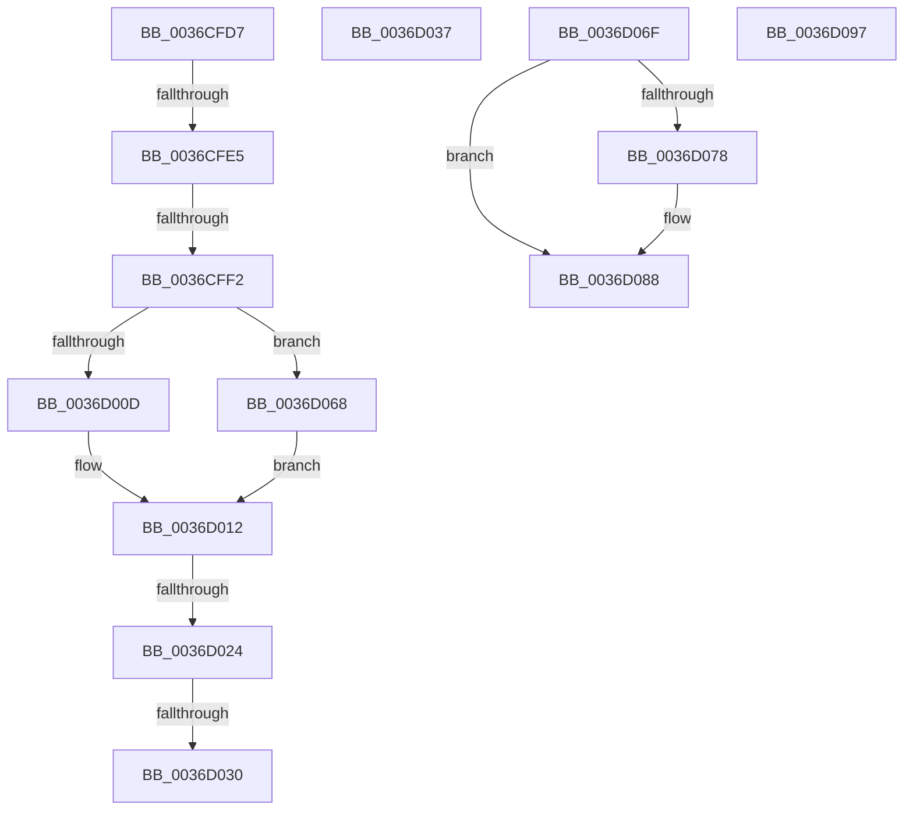

# sub_0036CFD7

- RVA: `0x0036CFD7`–`0x0036D0A9` (길이 `210` bytes)
- VA: `0x000000014036CFD7`
- 실행 섹션: `.text`
- PDB 이름 있음: `아니요`; PDB Function 태그: `아니요`
- unwind 정보 RVA: `0x0007A57C`
- 디코드: `51`개 명령, `210/210` bytes 표시
- 미해석 바이트: `0` (있으면 어셈블리에 `.byte`로 보존)

> 이 문서는 커널 이미지의 기계어와 PDB 기호를 분석해 생성했습니다. 4번과 5번은 함수 원형과 자료형을 바이너리 사용 방식에서 추정한 C 해석이며 원본 소스 복구 결과는 아닙니다.

## 1. Dependencies

- 직접 호출 지점: **3**; 고유 호출 대상: **3**
- 직접 호출자로 확인된 함수: **0**
- RIP 상대 이미지 참조: **0**

### Outgoing calls
- `0x0036D00D` → [MiPfCompleteInPageSupport](MiPfCompleteInPageSupport_function_0036D738.md) (function, `0x0036D738`)
- `0x0036D068` → [MiPfCompleteCoalescedIo](MiPfCompleteCoalescedIo_function_0036C344.md) (function, `0x0036C344`)
- `0x0036D07B` → [MiDereferenceInPageAutoBoostLock](MiDereferenceInPageAutoBoostLock_function_0036D398.md) (function, `0x0036D398`)

### Direct callers
- 이 함수 시작 RVA로 연결되는 직접 call은 확인되지 않았습니다. 간접 호출은 완전히 역산할 수 없습니다.

### Static image references
- 디코드된 RIP-relative 메모리 참조가 없습니다.

## 2. Other-region calls and transfers

- 다른 실행 섹션으로 향하는 call: **0**
- call이 아닌 외부 분기/꼬리 이동: **8**
  - `0x0036CFDF` → [sub_0036CD3D + 0x8E](Unknown_function_0036CD3D.md) (`tail-transfer`)
  - `0x0036CFEC` → [sub_0036CD3D + 0x8E](Unknown_function_0036CD3D.md) (`tail-transfer`)
  - `0x0036D01E` → [sub_0036CB1C + 0x12](Unknown_function_0036CB1C.md) (`tail-transfer`)
  - `0x0036D02A` → [sub_0036CB1C + 0x12](Unknown_function_0036CB1C.md) (`tail-transfer`)
  - `0x0036D032` → [sub_0036CB1C + 0x12](Unknown_function_0036CB1C.md) (`tail-transfer`)
  - `0x0036D063` → [sub_0036CB1C + 0xDD](Unknown_function_0036CB1C.md) (`tail-transfer`)
  - `0x0036D092` → [sub_0036C6B5 + 0x151](Unknown_function_0036C6B5.md) (`tail-transfer`)
  - `0x0036D0A4` → [sub_0036CB1C + 0x2B](Unknown_function_0036CB1C.md) (`tail-transfer`)

## 3. Assembly (complete function range)

```asm
0036CFD7  48 8D 45 98                     lea rax, [rbp - 0x68]
0036CFDB  48 39 41 08                     cmp qword ptr [rcx + 8], rax
0036CFDF  0F 85 E6 FD FF FF               jne 0x14036cdcb
0036CFE5  48 8B 01                        mov rax, qword ptr [rcx]
0036CFE8  48 39 48 08                     cmp qword ptr [rax + 8], rcx
0036CFEC  0F 85 D9 FD FF FF               jne 0x14036cdcb
0036CFF2  48 8D 55 98                     lea rdx, [rbp - 0x68]
0036CFF6  48 89 45 98                     mov qword ptr [rbp - 0x68], rax
0036CFFA  48 89 50 08                     mov qword ptr [rax + 8], rdx
0036CFFE  49 8B D7                        mov rdx, r15
0036D001  8B 81 C0 00 00 00               mov eax, dword ptr [rcx + 0xc0]
0036D007  0F BA E0 18                     bt eax, 0x18
0036D00B  72 5B                           jb 0x14036d068
0036D00D  E8 26 07 00 00                  call 0x14036d738
0036D012  BA 00 00 00 80                  mov edx, 0x80000000
0036D017  8B C8                           mov ecx, eax
0036D019  8D 04 10                        lea eax, [rax + rdx]
0036D01C  85 C2                           test edx, eax
0036D01E  0F 85 0A FB FF FF               jne 0x14036cb2e
0036D024  81 F9 34 04 00 C0               cmp ecx, 0xc0000434
0036D02A  0F 84 FE FA FF FF               je 0x14036cb2e
0036D030  8B F1                           mov esi, ecx
0036D032  E9 F7 FA FF FF                  jmp 0x14036cb2e
0036D037  48 89 46 08                     mov qword ptr [rsi + 8], rax
0036D03B  48 8D 4C 24 58                  lea rcx, [rsp + 0x58]
0036D040  48 89 0E                        mov qword ptr [rsi], rcx
0036D043  44 8B EA                        mov r13d, edx
0036D046  48 89 30                        mov qword ptr [rax], rsi
0036D049  4C 8B 74 24 58                  mov r14, qword ptr [rsp + 0x58]
0036D04E  41 8B C0                        mov eax, r8d
0036D051  4C 03 F8                        add r15, rax
0036D054  48 89 74 24 60                  mov qword ptr [rsp + 0x60], rsi
0036D059  8B 86 B8 00 00 00               mov eax, dword ptr [rsi + 0xb8]
0036D05F  48 29 45 B8                     sub qword ptr [rbp - 0x48], rax
0036D063  E9 91 FB FF FF                  jmp 0x14036cbf9
0036D068  E8 D7 F2 FF FF                  call 0x14036c344
0036D06D  EB A3                           jmp 0x14036d012
0036D06F  48 8B 45 E0                     mov rax, qword ptr [rbp - 0x20]
0036D073  48 85 C0                        test rax, rax
0036D076  74 10                           je 0x14036d088
0036D078  48 8B C8                        mov rcx, rax
0036D07B  E8 18 03 00 00                  call 0x14036d398
0036D080  48 C7 45 E0 00 00 00 00         mov qword ptr [rbp - 0x20], 0
0036D088  41 BD 01 00 00 00               mov r13d, 1
0036D08E  4C 89 6D F0                     mov qword ptr [rbp - 0x10], r13
0036D092  E9 6F F7 FF FF                  jmp 0x14036c806
0036D097  8B 44 24 40                     mov eax, dword ptr [rsp + 0x40]
0036D09B  85 C0                           test eax, eax
0036D09D  0F 49 C6                        cmovns eax, esi
0036D0A0  89 44 24 40                     mov dword ptr [rsp + 0x40], eax
0036D0A4  E9 9E FA FF FF                  jmp 0x14036cb47
```

## 4. C-style interpretation (structured pseudocode)

```c
__int64 __fastcall sub_0036CFD7(__int64 a1, __int64 a2, int a3)
{
    __int64 result;
    unsigned int v_stack_p40;
    unsigned __int64 v_stack_p58;
    unsigned __int64 v_stack_p60;

    *(unsigned __int64 *)(v_rbp - 104) = *(unsigned __int64 *)(a1);
    *(unsigned __int64 *)(*(unsigned __int64 *)(a1) + 8) = v_rbp - 104;
    if ((*(unsigned __int64 *)(*(unsigned __int64 *)(a1) + 8)) < a1) goto loc_0036D068;
    result = MiPfCompleteInPageSupport(a1, v_r15, a3, a4);
loc_0036D012:
loc_0036D068:
    result = MiPfCompleteCoalescedIo((unsigned int)((unsigned int)(result)), (unsigned int)(0x80000000ULL), a3, a4);
    goto loc_0036D012;
}
```

## 5. (Beta) C Style

```c
int64_t sub_0036CFD7(void *Arg1, int64_t Arg2, int32_t Arg3)
{
    uint8_t *arg1 = (uint8_t *)Arg1;

    int64_t result;
    uint32_t v_stack_p40;
    uint64_t v_stack_p58;
    uint64_t v_stack_p60;

    *(uint64_t *)(local_rbp - 0x68) = *(uint64_t *)(arg1);
    *(uint64_t *)(*(uint64_t *)(arg1) + 0x8) = local_rbp - 104;
    if ((*(uint64_t *)(*(uint64_t *)(arg1) + 0x8)) < Arg1) goto loc_0036D068;
    result = MiPfCompleteInPageSupport(Arg1, local_r15, Arg3, a4);
loc_0036D012:
loc_0036D068:
    result = MiPfCompleteCoalescedIo((uint32_t)((uint32_t)(result)), (uint32_t)(0x80000000ULL), Arg3, a4);
    goto loc_0036D012;
}
```

### 관측된 메모리 오프셋

구조체 형식이 확인되지 않은 접근은 인자 기준의 오프셋으로만 기록했습니다.

| 기준 인자 | 오프셋 표현 | 폭 (bit) | 접근 |
|---|---:|---:|---|
| `Arg1` | `+ 0x0` | `64` | `R` |
| `Arg1` | `+ 0x8` | `64` | `R` |
| `Arg1` | `+ 0xC0` | `32` | `R` |

## 6. Execution-region graph

[열기: 2D/3D 그래프와 함수 탐색 컨트롤 패널](../../../control-panel.html?section=text&rva=0x0036CFD7&view=graph)

- 2D 그래프는 위에서 아래로 흐르고, 3D 그래프는 빈 공간을 드래그해 회전합니다. Shift+드래그는 이동, 휠은 확대·축소, 함수 노드 선택은 대상 보고서 이동입니다.

### Static fallback


