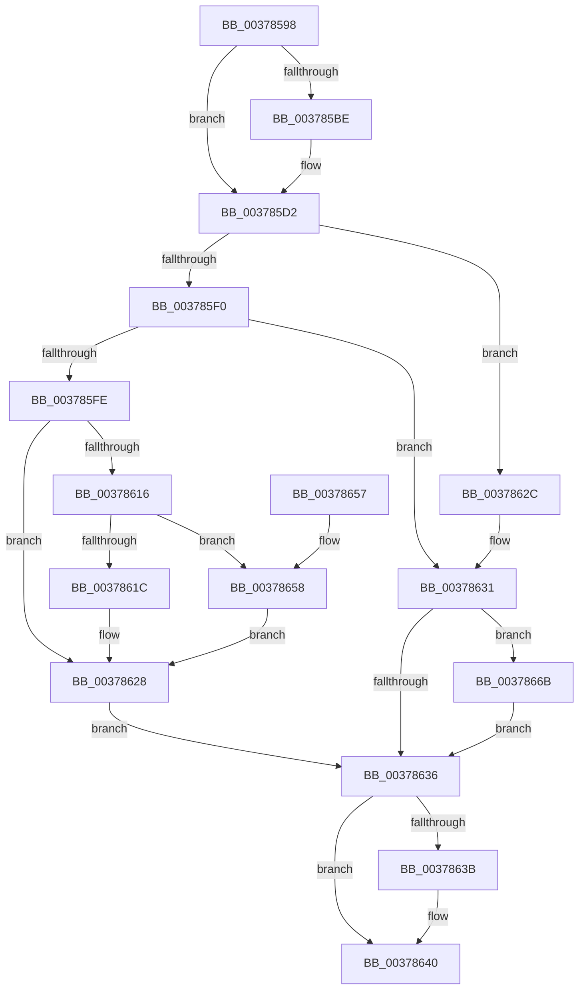

# CmFcManagerNotifyFeatureUsage

- RVA: `0x00378598`–`0x0037867B` (길이 `227` bytes)
- VA: `0x0000000140378598`
- 실행 섹션: `.text`
- PDB 이름 있음: `예`; PDB Function 태그: `아니요`
- unwind 정보 RVA: `0x0007AE84`
- 디코드: `62`개 명령, `227/227` bytes 표시
- 미해석 바이트: `0` (있으면 어셈블리에 `.byte`로 보존)

> 이 문서는 커널 이미지의 기계어와 PDB 기호를 분석해 생성했습니다. 4번과 5번은 함수 원형과 자료형을 바이너리 사용 방식에서 추정한 C 해석이며 원본 소스 복구 결과는 아닙니다.

## 1. Dependencies

- 직접 호출 지점: **8**; 고유 호출 대상: **7**
- 직접 호출자로 확인된 함수: **2**
- RIP 상대 이미지 참조: **5**

### Outgoing calls
- `0x003785B2` → [KeGetEffectiveIrql](../2F/KeGetEffectiveIrql_function_002F8030.md) (function, `0x002F8030`)
- `0x003785D9` → [RtlAcquireSwapReference](RtlAcquireSwapReference_function_00378684.md) (function, `0x00378684`)
- `0x003785F3` → [RtlpFcAddDelayedUsageReportToBuffer](RtlpFcAddDelayedUsageReportToBuffer_function_003786DC.md) (function, `0x003786DC`)
- `0x00378607` → [RtlReleaseSwapReference](RtlReleaseSwapReference_function_0037885C.md) (function, `0x0037885C`)
- `0x00378623` → [CmpWorkItemQueueWork](CmpWorkItemQueueWork_function_00378D4C.md) (function, `0x00378D4C`)
- `0x0037863B` → [KeLeaveCriticalRegion](../25/KeLeaveCriticalRegion_function_0025D8B0.md) (function, `0x0025D8B0`)
- `0x00378664` → [KeInsertQueueDpc](../20/KeInsertQueueDpc_function_00207C50.md) (function, `0x00207C50`)
- `0x00378674` → [RtlReleaseSwapReference](RtlReleaseSwapReference_function_0037885C.md) (function, `0x0037885C`)

### Direct callers
- [wil_details_FeatureReporting_ReportUsageToServiceDirect](wil_details_FeatureReporting_ReportUsageToServiceDirect_function_003783A0.md) at `0x00378483`
- [RtlNotifyFeatureUsage](RtlNotifyFeatureUsage_function_00378580.md) at `0x00378587`

### Static image references
- `0x003785D2` → RVA `0x00EF7458` (`.data`; read)
- `0x003785E0` → RVA `0x00EF7480` (`.data`; read)
- `0x0037860C` → RVA `0x00EF7478` (`.data`; read)
- `0x0037861C` → RVA `0x00EF74D0` (`.data`; read)
- `0x0037865B` → RVA `0x00EF7490` (`.data`; read)

## 2. Other-region calls and transfers

- 다른 실행 섹션으로 향하는 call: **0**
- 별도 외부 분기/꼬리 이동을 확인하지 못했습니다.

## 3. Assembly (complete function range)

```asm
00378598  48 89 5C 24 08                  mov qword ptr [rsp + 8], rbx
0037859D  48 89 6C 24 10                  mov qword ptr [rsp + 0x10], rbp
003785A2  48 89 74 24 18                  mov qword ptr [rsp + 0x18], rsi
003785A7  57                              push rdi
003785A8  48 83 EC 20                     sub rsp, 0x20
003785AC  48 8B DA                        mov rbx, rdx
003785AF  40 32 ED                        xor bpl, bpl
003785B2  E8 79 FA F7 FF                  call 0x1402f8030
003785B7  40 8A F0                        mov sil, al
003785BA  3C 02                           cmp al, 2
003785BC  73 14                           jae 0x1403785d2
003785BE  65 48 8B 0C 25 88 01 00 00      mov rcx, qword ptr gs:[0x188]
003785C7  40 B5 01                        mov bpl, 1
003785CA  66 FF 89 E4 01 00 00            dec word ptr [rcx + 0x1e4]
003785D1  90                              nop
003785D2  48 8D 0D 7F EE B7 00            lea rcx, [rip + 0xb7ee7f]
003785D9  E8 A6 00 00 00                  call 0x140378684
003785DE  8B F8                           mov edi, eax
003785E0  48 8D 05 99 EE B7 00            lea rax, [rip + 0xb7ee99]
003785E7  48 8B 0C F8                     mov rcx, qword ptr [rax + rdi*8]
003785EB  48 85 C9                        test rcx, rcx
003785EE  74 3C                           je 0x14037862c
003785F0  48 8B D3                        mov rdx, rbx
003785F3  E8 E4 00 00 00                  call 0x1403786dc
003785F8  8B D8                           mov ebx, eax
003785FA  85 C0                           test eax, eax
003785FC  78 33                           js 0x140378631
003785FE  8B D7                           mov edx, edi
00378600  48 8D 0D 51 EE B7 00            lea rcx, [rip + 0xb7ee51]
00378607  E8 50 02 00 00                  call 0x14037885c
0037860C  8A 05 66 EE B7 00               mov al, byte ptr [rip + 0xb7ee66]
00378612  84 C0                           test al, al
00378614  74 12                           je 0x140378628
00378616  40 80 FE 02                     cmp sil, 2
0037861A  73 3C                           jae 0x140378658
0037861C  48 8D 0D AD EE B7 00            lea rcx, [rip + 0xb7eead]
00378623  E8 24 07 00 00                  call 0x140378d4c
00378628  33 DB                           xor ebx, ebx
0037862A  EB 0A                           jmp 0x140378636
0037862C  BB 9A 00 00 C0                  mov ebx, 0xc000009a
00378631  83 FF FF                        cmp edi, -1
00378634  75 35                           jne 0x14037866b
00378636  40 84 ED                        test bpl, bpl
00378639  74 05                           je 0x140378640
0037863B  E8 70 52 EE FF                  call 0x14025d8b0
00378640  48 8B 6C 24 38                  mov rbp, qword ptr [rsp + 0x38]
00378645  8B C3                           mov eax, ebx
00378647  48 8B 5C 24 30                  mov rbx, qword ptr [rsp + 0x30]
0037864C  48 8B 74 24 40                  mov rsi, qword ptr [rsp + 0x40]
00378651  48 83 C4 20                     add rsp, 0x20
00378655  5F                              pop rdi
00378656  C3                              ret
00378657  CC                              int3
00378658  45 33 C0                        xor r8d, r8d
0037865B  48 8D 0D 2E EE B7 00            lea rcx, [rip + 0xb7ee2e]
00378662  33 D2                           xor edx, edx
00378664  E8 E7 F5 E8 FF                  call 0x140207c50
00378669  EB BD                           jmp 0x140378628
0037866B  8B D7                           mov edx, edi
0037866D  48 8D 0D E4 ED B7 00            lea rcx, [rip + 0xb7ede4]
00378674  E8 E3 01 00 00                  call 0x14037885c
00378679  EB BB                           jmp 0x140378636
```

## 4. C-style interpretation (structured pseudocode)

```c
__int64 __fastcall CmFcManagerNotifyFeatureUsage(__int64 a1, __int64 a2, int a3)
{
    __int64 result;
    __int64 v_rbp;
    __int64 v_rbx;
    __int64 v_rsp;
    unsigned __int64 v_stack_p10;
    unsigned __int64 v_stack_p18;
    unsigned __int64 v_stack_p8;

    v_stack_p8 = v_rbx;
    v_stack_p10 = v_rbp;
    v_stack_p18 = v_rsi;
    v_rsp = (v_rsp) - (32);
    v_rbp = 0;
    result = KeGetEffectiveIrql(a1, a2, a3, a4);
    if (((unsigned __int8)(result)) < 2) {
        a1 = *(unsigned __int64 *)(gs_base + (0 + 392));
        v_rbp = 1;
    }
    result = RtlAcquireSwapReference(v_rip + 12054143, a2, a3, a4);
    if (*(unsigned __int64 *)(v_rip + 12054169 + (unsigned int)((unsigned int)(result)) * 8) == 0) goto loc_0037862C;
    result = RtlpFcAddDelayedUsageReportToBuffer(*(unsigned __int64 *)(v_rip + 12054169 + (unsigned int)((unsigned int)(result)) * 8), a2, a3, a4);
    if (sign_flag) goto loc_00378631;
    result = RtlReleaseSwapReference(v_rip + 12054097, (unsigned int)((unsigned int)((unsigned int)((unsigned int)(result)))), a3, a4);
    if ((unsigned __int8)(*(unsigned __int8 *)(v_rip + 12054118)) == 0) goto loc_00378628;
    if (((unsigned __int8)((unsigned __int8)(result))) >= 2) goto loc_00378658;
    result = CmpWorkItemQueueWork(v_rip + 12054189, (unsigned int)((unsigned int)((unsigned int)((unsigned int)(result)))), a3, a4);
loc_00378628:
    v_rbx = 0;
    goto loc_00378636;
loc_0037862C:
loc_00378631:
    if (((unsigned int)((unsigned int)((unsigned int)(result)))) != -1) goto loc_0037866B;
loc_00378636:
    if ((unsigned __int8)(v_rbp) != 0) {
        result = KeLeaveCriticalRegion(v_rip + 12054189, (unsigned int)((unsigned int)((unsigned int)((unsigned int)(result)))), a3, a4);
    }
    v_rsp = (v_rsp) + (32);
    return (unsigned int)((unsigned int)((unsigned int)(0xC000009AULL)));
loc_00378658:
    a3 = 0;
    a2 = 0;
    result = KeInsertQueueDpc(v_rip + 12054062, a2, a3, a4);
    goto loc_00378628;
loc_0037866B:
    result = RtlReleaseSwapReference(v_rip + 12053988, (unsigned int)((unsigned int)((unsigned int)((unsigned int)(result)))), a3, a4);
    goto loc_00378636;
}
```

## 5. (Beta) C Style

```c
int64_t CmFcManagerNotifyFeatureUsage(int64_t Arg1, int64_t Arg2, int32_t Arg3)
{
    int64_t result;
    int64_t local_rbp;
    int64_t local_rbx;
    int64_t local_rsp;
    uint64_t v_stack_p10;
    uint64_t v_stack_p18;
    uint64_t v_stack_p8;

    v_stack_p8 = local_rbx;
    v_stack_p10 = local_rbp;
    v_stack_p18 = local_rsi;
    local_rsp = (local_rsp) - (32);
    local_rbp = 0;
    result = KeGetEffectiveIrql(Arg1, Arg2, Arg3, a4);
    if (((uint8_t)(result)) < 2) {
        Arg1 = *(uint64_t *)(gs_base + (0 + 0x188));
        local_rbp = 1;
    }
    result = RtlAcquireSwapReference(v_rip + 12054143, Arg2, Arg3, a4);
    if (*(uint64_t *)(v_rip + 0xB7EE99 + (uint32_t)((uint32_t)(result)) * 8) == 0) goto loc_0037862C;
    result = RtlpFcAddDelayedUsageReportToBuffer(*(uint64_t *)(v_rip + 0xB7EE99 + (uint32_t)((uint32_t)(result)) * 8), Arg2, Arg3, a4);
    if (sign_flag) goto loc_00378631;
    result = RtlReleaseSwapReference(v_rip + 12054097, (uint32_t)((uint32_t)((uint32_t)((uint32_t)(result)))), Arg3, a4);
    if ((uint8_t)(*(uint8_t *)(v_rip + 0xB7EE66)) == 0) goto loc_00378628;
    if (((uint8_t)((uint8_t)(result))) >= 2) goto loc_00378658;
    result = CmpWorkItemQueueWork(v_rip + 12054189, (uint32_t)((uint32_t)((uint32_t)((uint32_t)(result)))), Arg3, a4);
loc_00378628:
    local_rbx = 0;
    goto loc_00378636;
loc_0037862C:
loc_00378631:
    if (((uint32_t)((uint32_t)((uint32_t)(result)))) != -1) goto loc_0037866B;
loc_00378636:
    if ((uint8_t)(local_rbp) != 0) {
        result = KeLeaveCriticalRegion(v_rip + 12054189, (uint32_t)((uint32_t)((uint32_t)((uint32_t)(result)))), Arg3, a4);
    }
    local_rsp = (local_rsp) + (32);
    return (uint32_t)((uint32_t)((uint32_t)(0xC000009AULL)));
loc_00378658:
    Arg3 = 0;
    Arg2 = 0;
    result = KeInsertQueueDpc(v_rip + 12054062, Arg2, Arg3, a4);
    goto loc_00378628;
loc_0037866B:
    result = RtlReleaseSwapReference(v_rip + 12053988, (uint32_t)((uint32_t)((uint32_t)((uint32_t)(result)))), Arg3, a4);
    goto loc_00378636;
}
```

## 6. Execution-region graph

[열기: 2D/3D 그래프와 함수 탐색 컨트롤 패널](../../../control-panel.html?section=text&rva=0x00378598&view=graph)

- 2D 그래프는 위에서 아래로 흐르고, 3D 그래프는 빈 공간을 드래그해 회전합니다. Shift+드래그는 이동, 휠은 확대·축소, 함수 노드 선택은 대상 보고서 이동입니다.

### Static fallback


