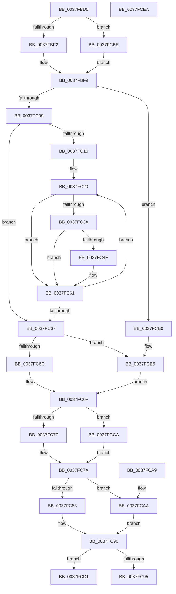

# EtwGetKernelTraceTimestampSilo

- RVA: `0x0037FBD0`–`0x0037FCEB` (길이 `283` bytes)
- VA: `0x000000014037FBD0`
- 실행 섹션: `.text`
- PDB 이름 있음: `예`; PDB Function 태그: `아니요`
- unwind 정보 RVA: `0x0007B808`
- 디코드: `78`개 명령, `283/283` bytes 표시
- 미해석 바이트: `0` (있으면 어셈블리에 `.byte`로 보존)

> 이 문서는 커널 이미지의 기계어와 PDB 기호를 분석해 생성했습니다. 4번과 5번은 함수 원형과 자료형을 바이너리 사용 방식에서 추정한 C 해석이며 원본 소스 복구 결과는 아닙니다.

## 1. Dependencies

- 직접 호출 지점: **3**; 고유 호출 대상: **3**
- 직접 호출자로 확인된 함수: **1**
- RIP 상대 이미지 참조: **1**

### Outgoing calls
- `0x0037FCB7` → [KeQueryPerformanceCounter](KeQueryPerformanceCounter_function_0037E7E0.md) (function, `0x0037E7E0`)
- `0x0037FCCA` → [RtlGetSystemTimePrecise](RtlGetSystemTimePrecise_function_0037EDD0.md) (function, `0x0037EDD0`)
- `0x0037FCD1` → [EtwpGetHostPerfCounter](../3A/EtwpGetHostPerfCounter_function_003A4134.md) (function, `0x003A4134`)

### Direct callers
- [MiIssueHardFault](../38/MiIssueHardFault_function_00380074.md) at `0x00380278`

### Static image references
- `0x0037FBF2` → RVA `0x00FCF940` (`CACHEALI`; read)

## 2. Other-region calls and transfers

- 다른 실행 섹션으로 향하는 call: **0**
- 별도 외부 분기/꼬리 이동을 확인하지 못했습니다.

## 3. Assembly (complete function range)

```asm
0037FBD0  48 89 5C 24 08                  mov qword ptr [rsp + 8], rbx
0037FBD5  48 89 74 24 10                  mov qword ptr [rsp + 0x10], rsi
0037FBDA  57                              push rdi
0037FBDB  48 83 EC 20                     sub rsp, 0x20
0037FBDF  33 F6                           xor esi, esi
0037FBE1  44 8B D2                        mov r10d, edx
0037FBE4  48 8B F9                        mov rdi, rcx
0037FBE7  8B DE                           mov ebx, esi
0037FBE9  4D 85 C0                        test r8, r8
0037FBEC  0F 85 CC 00 00 00               jne 0x14037fcbe
0037FBF2  4C 8D 0D 47 FD C4 00            lea r9, [rip + 0xc4fd47]
0037FBF9  4D 8B 89 40 03 00 00            mov r9, qword ptr [r9 + 0x340]
0037FC00  4D 85 C9                        test r9, r9
0037FC03  0F 84 A7 00 00 00               je 0x14037fcb0
0037FC09  45 8B 81 A8 11 00 00            mov r8d, dword ptr [r9 + 0x11a8]
0037FC10  41 0F BC C8                     bsf ecx, r8d
0037FC14  74 51                           je 0x14037fc67
0037FC16  66 66 0F 1F 84 00 00 00 00 00   nop word ptr [rax + rax]
0037FC20  48 8B D1                        mov rdx, rcx
0037FC23  41 8D 40 FF                     lea eax, [r8 - 1]
0037FC27  48 C1 E2 05                     shl rdx, 5
0037FC2B  44 23 C0                        and r8d, eax
0037FC2E  48 81 C2 CC 11 00 00            add rdx, 0x11cc
0037FC35  49 03 D1                        add rdx, r9
0037FC38  74 27                           je 0x14037fc61
0037FC3A  49 8B C2                        mov rax, r10
0037FC3D  48 C1 E8 1D                     shr rax, 0x1d
0037FC41  8B 14 82                        mov edx, dword ptr [rdx + rax*4]
0037FC44  41 23 D2                        and edx, r10d
0037FC47  F7 C2 FF FF FF 1F               test edx, 0x1fffffff
0037FC4D  74 12                           je 0x14037fc61
0037FC4F  41 0F B6 8C 49 99 11 00 00      movzx ecx, byte ptr [r9 + rcx*2 + 0x1199]
0037FC58  B8 01 00 00 00                  mov eax, 1
0037FC5D  D3 E0                           shl eax, cl
0037FC5F  0B D8                           or ebx, eax
0037FC61  41 0F BC C8                     bsf ecx, r8d
0037FC65  75 B9                           jne 0x14037fc20
0037FC67  F6 C3 02                        test bl, 2
0037FC6A  75 49                           jne 0x14037fcb5
0037FC6C  48 8B C6                        mov rax, rsi
0037FC6F  48 89 07                        mov qword ptr [rdi], rax
0037FC72  F6 C3 04                        test bl, 4
0037FC75  75 53                           jne 0x14037fcca
0037FC77  48 8B C6                        mov rax, rsi
0037FC7A  48 89 47 08                     mov qword ptr [rdi + 8], rax
0037FC7E  F6 C3 08                        test bl, 8
0037FC81  74 27                           je 0x14037fcaa
0037FC83  0F 31                           rdtsc
0037FC85  48 C1 E2 20                     shl rdx, 0x20
0037FC89  48 0B C2                        or rax, rdx
0037FC8C  48 89 47 10                     mov qword ptr [rdi + 0x10], rax
0037FC90  F6 C3 10                        test bl, 0x10
0037FC93  75 3C                           jne 0x14037fcd1
0037FC95  48 89 77 18                     mov qword ptr [rdi + 0x18], rsi
0037FC99  48 8B 5C 24 30                  mov rbx, qword ptr [rsp + 0x30]
0037FC9E  48 8B 74 24 38                  mov rsi, qword ptr [rsp + 0x38]
0037FCA3  48 83 C4 20                     add rsp, 0x20
0037FCA7  5F                              pop rdi
0037FCA8  C3                              ret
0037FCA9  CC                              int3
0037FCAA  48 89 77 10                     mov qword ptr [rdi + 0x10], rsi
0037FCAE  EB E0                           jmp 0x14037fc90
0037FCB0  BB 1E 00 00 00                  mov ebx, 0x1e
0037FCB5  33 C9                           xor ecx, ecx
0037FCB7  E8 24 EB FF FF                  call 0x14037e7e0
0037FCBC  EB B1                           jmp 0x14037fc6f
0037FCBE  4D 8B 88 E0 05 00 00            mov r9, qword ptr [r8 + 0x5e0]
0037FCC5  E9 2F FF FF FF                  jmp 0x14037fbf9
0037FCCA  E8 01 F1 FF FF                  call 0x14037edd0
0037FCCF  EB A9                           jmp 0x14037fc7a
0037FCD1  E8 5E 44 02 00                  call 0x1403a4134
0037FCD6  48 89 47 18                     mov qword ptr [rdi + 0x18], rax
0037FCDA  48 8B 5C 24 30                  mov rbx, qword ptr [rsp + 0x30]
0037FCDF  48 8B 74 24 38                  mov rsi, qword ptr [rsp + 0x38]
0037FCE4  48 83 C4 20                     add rsp, 0x20
0037FCE8  5F                              pop rdi
0037FCE9  C3                              ret
0037FCEA  CC                              int3
```

## 4. C-style interpretation (structured pseudocode)

```c
__int64 __fastcall EtwGetKernelTraceTimestampSilo(__int64 a1, int a2, __int64 a3)
{
    __int64 result;
    __int64 v_rbx;
    __int64 v_rsi;
    __int64 v_rsp;
    unsigned __int64 v_stack_p10;
    unsigned __int64 v_stack_p30;
    unsigned __int64 v_stack_p38;
    unsigned __int64 v_stack_p8;

    v_stack_p8 = v_rbx;
    v_stack_p10 = v_rsi;
    v_rsp = (v_rsp) - (32);
    v_rsi = 0;
    if (a3 != 0) goto loc_0037FCBE;
loc_0037FBF9:
    if (*(unsigned __int64 *)(v_rip + 12909895 + 832) == 0) goto loc_0037FCB0;
    if (*(unsigned __int64 *)(v_rip + 12909895 + 832) == 0) goto loc_0037FC67;
loc_0037FC20:
    a2 = (a1) << (5);
    a3 = (unsigned int)(((unsigned int)(*(unsigned int *)(*(unsigned __int64 *)(v_rip + 12909895 + 832) + 4520))) & ((unsigned int)((unsigned int)(*(unsigned int *)(*(unsigned __int64 *)(v_rip + 12909895 + 832) + 4520)) - 1)));
    a2 = (a2) + (0x11CCULL);
    a2 = (a2) + (*(unsigned __int64 *)(v_rip + 12909895 + 832));
    if (condition_is_equal) goto loc_0037FC61;
    result = ((unsigned int)(a2)) >> (29);
    a2 = (unsigned int)(((unsigned int)(*(unsigned int *)(a2 + result * 4))) & ((unsigned int)((unsigned int)(a2))));
    v_rbx = 0;
    if (((a2) & (0x1FFFFFFFULL)) != 0) {
        a1 = *(unsigned __int8 *)(*(unsigned __int64 *)(v_rip + 12909895 + 832) + a1 * 2 + 4505);
        result = 1;
        result = (unsigned int)((result) << ((unsigned __int8)(a1)));
        v_rbx = (unsigned int)((0) | ((unsigned int)(result)));
    }
    if (condition_is_not_equal) goto loc_0037FC20;
loc_0037FC67:
    if ((((unsigned __int8)(v_rbx)) & (2)) != 0) goto loc_0037FCB5;
loc_0037FC6F:
    *(unsigned __int64 *)(a1) = 0;
    if ((((unsigned __int8)(v_rbx)) & (4)) != 0) goto loc_0037FCCA;
loc_0037FC7A:
    *(unsigned __int64 *)(a1 + 8) = 0;
    if ((((unsigned __int8)(v_rbx)) & (8)) == 0) goto loc_0037FCAA;
    a2 = (a2) << (32);
    result = (0) | (a2);
    *(unsigned __int64 *)(a1 + 16) = result;
loc_0037FC90:
    if ((((unsigned __int8)(v_rbx)) & (16)) != 0) goto loc_0037FCD1;
    *(unsigned __int64 *)(a1 + 24) = 0;
    v_rsp = (v_rsp) + (32);
    return result;
loc_0037FCAA:
    *(unsigned __int64 *)(a1 + 16) = v_stack_p10;
    goto loc_0037FC90;
loc_0037FCB0:
loc_0037FCB5:
    a1 = 0;
    result = KeQueryPerformanceCounter(a1, a2, a3, *(unsigned __int64 *)(v_rip + 12909895 + 832));
    goto loc_0037FC6F;
loc_0037FCBE:
    goto loc_0037FBF9;
loc_0037FCCA:
    result = RtlGetSystemTimePrecise(a1, a2, a3, *(unsigned __int64 *)(a3 + 1504));
    goto loc_0037FC7A;
loc_0037FCD1:
    result = EtwpGetHostPerfCounter(a1, a2, a3, *(unsigned __int64 *)(a3 + 1504));
    *(unsigned __int64 *)(a1 + 24) = result;
    v_rsp = (v_rsp) + (32);
    return result;
}
```

## 5. (Beta) C Style

```c
int64_t EtwGetKernelTraceTimestampSilo(void *Arg1, int32_t Arg2, int64_t Arg3)
{
    uint8_t *arg1 = (uint8_t *)Arg1;

    int64_t result;
    int64_t local_rbx;
    int64_t local_rsi;
    int64_t local_rsp;
    uint64_t v_stack_p10;
    uint64_t v_stack_p30;
    uint64_t v_stack_p38;
    uint64_t v_stack_p8;

    v_stack_p8 = local_rbx;
    v_stack_p10 = local_rsi;
    local_rsp = (local_rsp) - (32);
    local_rsi = 0;
    if (Arg3 != 0) goto loc_0037FCBE;
loc_0037FBF9:
    if (*(uint64_t *)(v_rip + 0xC4FD47 + 0x340) == 0) goto loc_0037FCB0;
    if (*(uint64_t *)(v_rip + 0xC4FD47 + 0x340) == 0) goto loc_0037FC67;
loc_0037FC20:
    Arg2 = (Arg1) << (5);
    Arg3 = (uint32_t)(((uint32_t)(*(uint32_t *)(*(uint64_t *)(v_rip + 0xC4FD47 + 0x340) + 0x11A8))) & ((uint32_t)((uint32_t)(*(uint32_t *)(*(uint64_t *)(v_rip + 0xC4FD47 + 0x340) + 0x11A8)) - 1)));
    Arg2 = (Arg2) + (0x11CCULL);
    Arg2 = (Arg2) + (*(uint64_t *)(v_rip + 0xC4FD47 + 0x340));
    if (condition_is_equal) goto loc_0037FC61;
    result = ((uint32_t)(Arg2)) >> (29);
    Arg2 = (uint32_t)(((uint32_t)(*(uint32_t *)(Arg2 + result * 4))) & ((uint32_t)((uint32_t)(Arg2))));
    local_rbx = 0;
    if (((Arg2) & (0x1FFFFFFFULL)) != 0) {
        Arg1 = *(uint8_t *)(*(uint64_t *)(v_rip + 0xC4FD47 + 0x340) + arg1 * 2 + 0x1199);
        result = 1;
        result = (uint32_t)((result) << ((uint8_t)(Arg1)));
        local_rbx = (uint32_t)((0) | ((uint32_t)(result)));
    }
    if (condition_is_not_equal) goto loc_0037FC20;
loc_0037FC67:
    if ((((uint8_t)(local_rbx)) & (2)) != 0) goto loc_0037FCB5;
loc_0037FC6F:
    *(uint64_t *)(arg1) = 0;
    if ((((uint8_t)(local_rbx)) & (4)) != 0) goto loc_0037FCCA;
loc_0037FC7A:
    *(uint64_t *)(arg1 + 0x8) = 0;
    if ((((uint8_t)(local_rbx)) & (8)) == 0) goto loc_0037FCAA;
    Arg2 = (Arg2) << (32);
    result = (0) | (Arg2);
    *(uint64_t *)(arg1 + 0x10) = result;
loc_0037FC90:
    if ((((uint8_t)(local_rbx)) & (16)) != 0) goto loc_0037FCD1;
    *(uint64_t *)(arg1 + 0x18) = 0;
    local_rsp = (local_rsp) + (32);
    return result;
loc_0037FCAA:
    *(uint64_t *)(arg1 + 0x10) = v_stack_p10;
    goto loc_0037FC90;
loc_0037FCB0:
loc_0037FCB5:
    Arg1 = 0;
    result = KeQueryPerformanceCounter(Arg1, Arg2, Arg3, *(uint64_t *)(v_rip + 0xC4FD47 + 0x340));
    goto loc_0037FC6F;
loc_0037FCBE:
    goto loc_0037FBF9;
loc_0037FCCA:
    result = RtlGetSystemTimePrecise(Arg1, Arg2, Arg3, *(uint64_t *)(Arg3 + 0x5E0));
    goto loc_0037FC7A;
loc_0037FCD1:
    result = EtwpGetHostPerfCounter(Arg1, Arg2, Arg3, *(uint64_t *)(Arg3 + 0x5E0));
    *(uint64_t *)(arg1 + 0x18) = result;
    local_rsp = (local_rsp) + (32);
    return result;
}
```

### 관측된 메모리 오프셋

구조체 형식이 확인되지 않은 접근은 인자 기준의 오프셋으로만 기록했습니다.

| 기준 인자 | 오프셋 표현 | 폭 (bit) | 접근 |
|---|---:|---:|---|
| `Arg1` | `+ 0x0` | `64` | `W` |
| `Arg1` | `+ 0x8` | `64` | `W` |
| `Arg1` | `+ 0x10` | `64` | `W` |
| `Arg1` | `+ 0x18` | `64` | `W` |

## 6. Execution-region graph

[열기: 2D/3D 그래프와 함수 탐색 컨트롤 패널](../../../control-panel.html?section=text&rva=0x0037FBD0&view=graph)

- 2D 그래프는 위에서 아래로 흐르고, 3D 그래프는 빈 공간을 드래그해 회전합니다. Shift+드래그는 이동, 휠은 확대·축소, 함수 노드 선택은 대상 보고서 이동입니다.

### Static fallback


