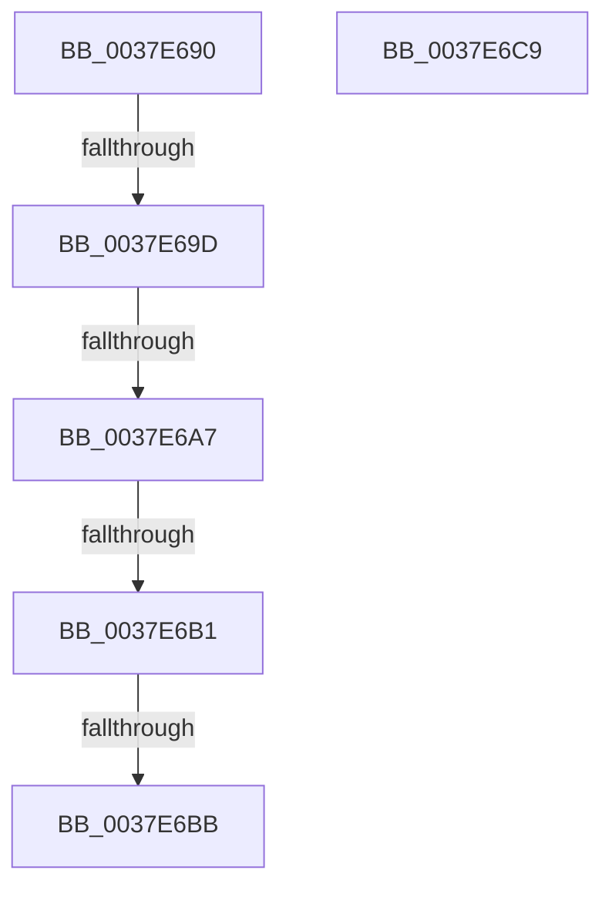

# EtwpGetLoggerTimeStamp

- RVA: `0x0037E690`–`0x0037E6CA` (길이 `58` bytes)
- VA: `0x000000014037E690`
- 실행 섹션: `.text`
- PDB 이름 있음: `예`; PDB Function 태그: `아니요`
- unwind 정보 RVA: `0x0007B660`
- 디코드: `16`개 명령, `58/58` bytes 표시
- 미해석 바이트: `0` (있으면 어셈블리에 `.byte`로 보존)

> 이 문서는 커널 이미지의 기계어와 PDB 기호를 분석해 생성했습니다. 4번과 5번은 함수 원형과 자료형을 바이너리 사용 방식에서 추정한 C 해석이며 원본 소스 복구 결과는 아닙니다.

## 1. Dependencies

- 직접 호출 지점: **0**; 고유 호출 대상: **0**
- 직접 호출자로 확인된 함수: **7**
- RIP 상대 이미지 참조: **0**

### Outgoing calls
- 직접 디코드된 call 명령이 없습니다.

### Direct callers
- [EtwpReserveTraceBuffer](../2F/EtwpReserveTraceBuffer_function_002FC8C0.md) at `0x002FCA77`
- [EtwpReserveTraceBuffer](../2F/EtwpReserveTraceBuffer_function_002FC8C0.md) at `0x002FCB0C`
- [EtwpPrepareDirtyBuffer](../2F/EtwpPrepareDirtyBuffer_function_002FE750.md) at `0x002FE770`
- [EtwpLogContextSwapEvent](../41/EtwpLogContextSwapEvent_function_004175F0.md) at `0x004179DE`
- [EtwSendTraceBuffer](../65/EtwSendTraceBuffer_function_00651560.md) at `0x00651636`
- [EtwpRelinquishCompressionTarget](../65/EtwpRelinquishCompressionTarget_function_00653818.md) at `0x0065382B`
- [EtwpRotateCompressionTarget](../65/EtwpRotateCompressionTarget_function_00653868.md) at `0x00653880`
- [EtwpInitializeTimeStamp](../../page/A8/EtwpInitializeTimeStamp_function_00A8F750.md) at `0x00A8F87B`
- [EtwpInitializeTimeStamp](../../page/A8/EtwpInitializeTimeStamp_function_00A8F750.md) at `0x00A8F894`

### Static image references
- 디코드된 RIP-relative 메모리 참조가 없습니다.

## 2. Other-region calls and transfers

- 다른 실행 섹션으로 향하는 call: **0**
- call이 아닌 외부 분기/꼬리 이동: **4**
  - `0x0037E69B` → [sub_0037E6CA](Unknown_function_0037E6CA.md) (`tail-transfer`)
  - `0x0037E6A1` → [sub_0037E7B3 + 0x1](Unknown_function_0037E7B3.md) (`tail-transfer`)
  - `0x0037E6AB` → [sub_0037E7C8 + 0x7](Unknown_function_0037E7C8.md) (`tail-transfer`)
  - `0x0037E6B5` → [sub_0037E7C8](Unknown_function_0037E7C8.md) (`tail-transfer`)

## 3. Assembly (complete function range)

```asm
0037E690  48 83 EC 48                     sub rsp, 0x48
0037E694  48 8B 41 18                     mov rax, qword ptr [rcx + 0x18]
0037E698  48 85 C0                        test rax, rax
0037E69B  74 2D                           je 0x14037e6ca
0037E69D  48 83 E8 01                     sub rax, 1
0037E6A1  0F 84 0D 01 00 00               je 0x14037e7b4
0037E6A7  48 83 E8 01                     sub rax, 1
0037E6AB  0F 84 1E 01 00 00               je 0x14037e7cf
0037E6B1  48 83 F8 01                     cmp rax, 1
0037E6B5  0F 85 0D 01 00 00               jne 0x14037e7c8
0037E6BB  0F 31                           rdtsc
0037E6BD  48 C1 E2 20                     shl rdx, 0x20
0037E6C1  48 0B C2                        or rax, rdx
0037E6C4  48 83 C4 48                     add rsp, 0x48
0037E6C8  C3                              ret
0037E6C9  CC                              int3
```

## 4. C-style interpretation (structured pseudocode)

```c
__int64 __fastcall EtwpGetLoggerTimeStamp(__int64 a1, __int64 a2)
{
    __int64 result;
    __int64 v_rsp;

    v_rsp = (v_rsp) - (72);
    result = (*(unsigned __int64 *)(a1 + 24)) - (1);
    result = (result) - (1);
    a2 = (a2) << (32);
    result = (result) | (a2);
    v_rsp = (v_rsp) + (72);
    return result;
}
```

## 5. (Beta) C Style

```c
int64_t EtwpGetLoggerTimeStamp(void *Arg1, int64_t Arg2)
{
    uint8_t *arg1 = (uint8_t *)Arg1;

    int64_t result;
    int64_t local_rsp;

    local_rsp = (local_rsp) - (72);
    result = (*(uint64_t *)(arg1 + 0x18)) - (1);
    result = (result) - (1);
    Arg2 = (Arg2) << (32);
    result = (result) | (Arg2);
    local_rsp = (local_rsp) + (72);
    return result;
}
```

### 관측된 메모리 오프셋

구조체 형식이 확인되지 않은 접근은 인자 기준의 오프셋으로만 기록했습니다.

| 기준 인자 | 오프셋 표현 | 폭 (bit) | 접근 |
|---|---:|---:|---|
| `Arg1` | `+ 0x18` | `64` | `R` |

## 6. Execution-region graph

[열기: 2D/3D 그래프와 함수 탐색 컨트롤 패널](../../../control-panel.html?section=text&rva=0x0037E690&view=graph)

- 2D 그래프는 위에서 아래로 흐르고, 3D 그래프는 빈 공간을 드래그해 회전합니다. Shift+드래그는 이동, 휠은 확대·축소, 함수 노드 선택은 대상 보고서 이동입니다.

### Static fallback


