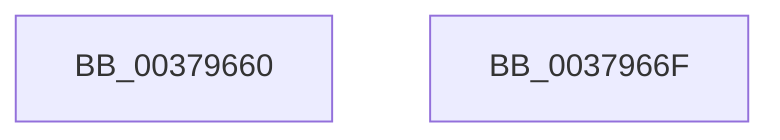

# HalpHpetQueryCounter

- RVA: `0x00379660`–`0x00379670` (길이 `16` bytes)
- VA: `0x0000000140379660`
- 실행 섹션: `.text`
- PDB 이름 있음: `예`; PDB Function 태그: `아니요`
- unwind 정보 RVA: `0x000DB714`
- 디코드: `5`개 명령, `16/16` bytes 표시
- 미해석 바이트: `0` (있으면 어셈블리에 `.byte`로 보존)

> 이 문서는 커널 이미지의 기계어와 PDB 기호를 분석해 생성했습니다. 4번과 5번은 함수 원형과 자료형을 바이너리 사용 방식에서 추정한 C 해석이며 원본 소스 복구 결과는 아닙니다.

## 1. Dependencies

- 직접 호출 지점: **0**; 고유 호출 대상: **0**
- 직접 호출자로 확인된 함수: **14**
- RIP 상대 이미지 참조: **1**

### Outgoing calls
- 직접 디코드된 call 명령이 없습니다.

### Direct callers
- [sub_0020A643](../20/Unknown_function_0020A643.md) at `0x0020A869`
- [sub_0020A8E8](../20/Unknown_function_0020A8E8.md) at `0x0020AA04`
- [KiStartThreadCycleAccumulationContextSwap](../30/KiStartThreadCycleAccumulationContextSwap_function_00309C10.md) at `0x0030A2F1`
- [KiStartThreadCycleAccumulationContextSwap](../30/KiStartThreadCycleAccumulationContextSwap_function_00309C10.md) at `0x0030A481`
- [sub_0037AE18](Unknown_function_0037AE18.md) at `0x0037B062`
- [sub_0037AE18](Unknown_function_0037AE18.md) at `0x0037B1E0`
- [sub_0037BC17](Unknown_function_0037BC17.md) at `0x0037BC48`
- [sub_0037BC17](Unknown_function_0037BC17.md) at `0x0037BDD9`
- [KiEndThreadCycleAccumulation](KiEndThreadCycleAccumulation_function_0037BFF0.md) at `0x0037C7D6`
- [KiEndThreadCycleAccumulation](KiEndThreadCycleAccumulation_function_0037BFF0.md) at `0x0037C973`
- [sub_0037D3AC](Unknown_function_0037D3AC.md) at `0x0037D3DD`
- [sub_0037D3AC](Unknown_function_0037D3AC.md) at `0x0037D575`
- [sub_0037EAAA](Unknown_function_0037EAAA.md) at `0x0037EAD7`
- [sub_0037EAAA](Unknown_function_0037EAAA.md) at `0x0037EC58`
- [HalpTimerCalibratePerformanceCounter](../4A/HalpTimerCalibratePerformanceCounter_function_004AB874.md) at `0x004AB926`
- [HalpTimerDpcRoutine](../4B/HalpTimerDpcRoutine_function_004B2870.md) at `0x004B296F`
- [HalpTimerSavePerformanceCounter](../4B/HalpTimerSavePerformanceCounter_function_004B37F0.md) at `0x004B38F7`
- [HalpTimerSavePerformanceCounter](../4B/HalpTimerSavePerformanceCounter_function_004B37F0.md) at `0x004B397B`
- [HalpTimerDelayedQueryCounter](../54/HalpTimerDelayedQueryCounter_function_00548F20.md) at `0x00548FBA`
- [HalpTimerPerformanceCounterPowerChange](../54/HalpTimerPerformanceCounterPowerChange_function_00549738.md) at `0x0054980E`
- [HalpTimerPerformanceCounterPowerChange](../54/HalpTimerPerformanceCounterPowerChange_function_00549738.md) at `0x005499F1`
- [HalpTimerPerformanceCounterPowerChange](../54/HalpTimerPerformanceCounterPowerChange_function_00549738.md) at `0x00549B1A`
- [HalpTimerPerformanceCounterPowerChange](../54/HalpTimerPerformanceCounterPowerChange_function_00549738.md) at `0x00549C71`
- [sub_006F11D4](../6F/Unknown_function_006F11D4.md) at `0x006F11FD`

### Static image references
- `0x00379660` → RVA `0x00F8FBB0` (`.data`; read)

## 2. Other-region calls and transfers

- 다른 실행 섹션으로 향하는 call: **0**
- 별도 외부 분기/꼬리 이동을 확인하지 못했습니다.

## 3. Assembly (complete function range)

```asm
00379660  48 8B 05 49 65 C1 00            mov rax, qword ptr [rip + 0xc16549]
00379667  90                              nop
00379668  8B 80 F0 00 00 00               mov eax, dword ptr [rax + 0xf0]
0037966E  C3                              ret
0037966F  CC                              int3
```

## 4. C-style interpretation (structured pseudocode)

```c
__int64 __fastcall HalpHpetQueryCounter(void)
{
    return (unsigned int)(*(unsigned int *)(*(unsigned __int64 *)(v_rip + 12674377) + 240));
}
```

## 5. (Beta) C Style

```c
void HalpHpetQueryCounter(void)
{
    return (uint32_t)(*(uint32_t *)(*(uint64_t *)(v_rip + 0xC16549) + 0xF0));
}
```

## 6. Execution-region graph

[열기: 2D/3D 그래프와 함수 탐색 컨트롤 패널](../../../control-panel.html?section=text&rva=0x00379660&view=graph)

- 2D 그래프는 위에서 아래로 흐르고, 3D 그래프는 빈 공간을 드래그해 회전합니다. Shift+드래그는 이동, 휠은 확대·축소, 함수 노드 선택은 대상 보고서 이동입니다.

### Static fallback


