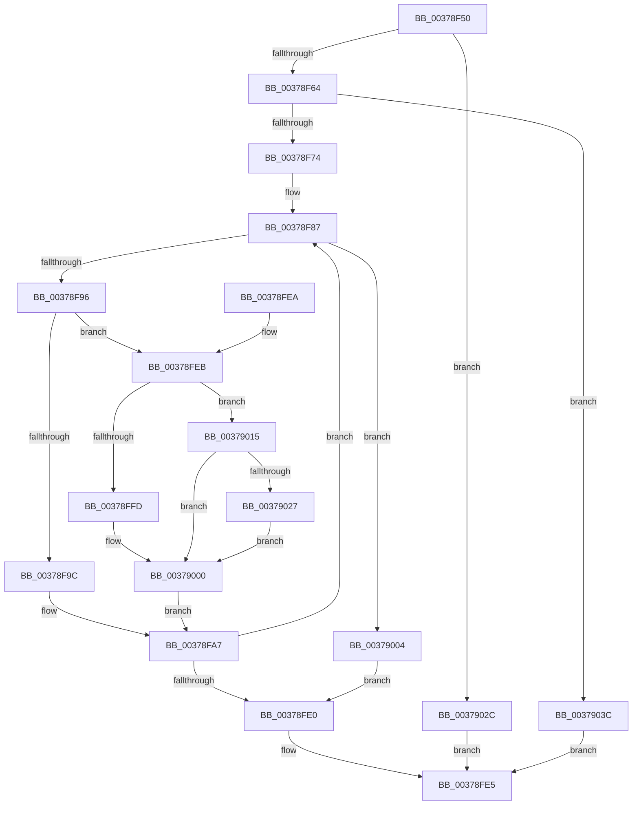

# HalpHvCounterQueryCounter

- RVA: `0x00378F50`–`0x00379045` (길이 `245` bytes)
- VA: `0x0000000140378F50`
- 실행 섹션: `.text`
- PDB 이름 있음: `예`; PDB Function 태그: `아니요`
- unwind 정보 RVA: `0x0007AF1C`
- 디코드: `59`개 명령, `245/245` bytes 표시
- 미해석 바이트: `0` (있으면 어셈블리에 `.byte`로 보존)

> 이 문서는 커널 이미지의 기계어와 PDB 기호를 분석해 생성했습니다. 4번과 5번은 함수 원형과 자료형을 바이너리 사용 방식에서 추정한 C 해석이며 원본 소스 복구 결과는 아닙니다.

## 1. Dependencies

- 직접 호출 지점: **2**; 고유 호출 대상: **2**
- 직접 호출자로 확인된 함수: **7**
- RIP 상대 이미지 참조: **3**

### Outgoing calls
- `0x0037900E` → [HvlpGetRegister64](HvlpGetRegister64_function_00379050.md) (function, `0x00379050`)
- `0x0037903E` → [guard_dispatch_icall](../6B/guard_dispatch_icall_function_006BAAD0.md) (function, `0x006BAAD0`)

### Direct callers
- [HalpHvTimerArm](HalpHvTimerArm_function_00378EB0.md) at `0x00378ECC`
- [KeStallExecutionProcessor](../44/KeStallExecutionProcessor_function_0044F620.md) at `0x0044F6A7`
- [HalpTimerCalibratePerformanceCounter](../4A/HalpTimerCalibratePerformanceCounter_function_004AB874.md) at `0x004AB8B3`
- [HalpTimerDpcRoutine](../4B/HalpTimerDpcRoutine_function_004B2870.md) at `0x004B28C3`
- [HalpTimerSavePerformanceCounter](../4B/HalpTimerSavePerformanceCounter_function_004B37F0.md) at `0x004B3850`
- [HalpTimerSavePerformanceCounter](../4B/HalpTimerSavePerformanceCounter_function_004B37F0.md) at `0x004B38B8`
- [HalpTimerDelayedQueryCounter](../54/HalpTimerDelayedQueryCounter_function_00548F20.md) at `0x00549092`
- [HalpTimerPerformanceCounterPowerChange](../54/HalpTimerPerformanceCounterPowerChange_function_00549738.md) at `0x005498DB`
- [HalpTimerPerformanceCounterPowerChange](../54/HalpTimerPerformanceCounterPowerChange_function_00549738.md) at `0x00549AB0`
- [HalpTimerPerformanceCounterPowerChange](../54/HalpTimerPerformanceCounterPowerChange_function_00549738.md) at `0x00549BD7`
- [HalpTimerPerformanceCounterPowerChange](../54/HalpTimerPerformanceCounterPowerChange_function_00549738.md) at `0x00549D2B`

### Static image references
- `0x00378F54` → RVA `0x00E11760` (`.data`; read)
- `0x00378F64` → RVA `0x002DDBC0` (`HvlGetReferenceTimeUsingTscPage`; read)
- `0x00378F87` → RVA `0x00FC6D88` (`ALMOSTRO`; read)

## 2. Other-region calls and transfers

- 다른 실행 섹션으로 향하는 call: **0**
- 별도 외부 분기/꼬리 이동을 확인하지 못했습니다.

## 3. Assembly (complete function range)

```asm
00378F50  48 83 EC 28                     sub rsp, 0x28
00378F54  48 8B 05 05 88 A9 00            mov rax, qword ptr [rip + 0xa98805]
00378F5B  48 85 C0                        test rax, rax
00378F5E  0F 84 C8 00 00 00               je 0x14037902c
00378F64  48 8D 0D 55 4C F6 FF            lea rcx, [rip - 0x9b3ab]
00378F6B  48 3B C1                        cmp rax, rcx
00378F6E  0F 85 C8 00 00 00               jne 0x14037903c
00378F74  48 C7 44 24 38 00 00 00 00      mov qword ptr [rsp + 0x38], 0
00378F7D  49 BA 94 02 00 00 80 F7 FF FF   movabs r10, 0xfffff78000000294
00378F87  4C 8B 05 FA DD C4 00            mov r8, qword ptr [rip + 0xc4ddfa]
00378F8E  45 8B 00                        mov r8d, dword ptr [r8]
00378F91  45 85 C0                        test r8d, r8d
00378F94  74 6E                           je 0x140379004
00378F96  41 80 3A 00                     cmp byte ptr [r10], 0
00378F9A  74 4F                           je 0x140378feb
00378F9C  0F 01 F9                        rdtscp
00378F9F  4C 8D 4C 24 38                  lea r9, [rsp + 0x38]
00378FA4  41 89 09                        mov dword ptr [r9], ecx
00378FA7  48 C1 E2 20                     shl rdx, 0x20
00378FAB  48 0B D0                        or rdx, rax
00378FAE  48 8B 05 D3 DD C4 00            mov rax, qword ptr [rip + 0xc4ddd3]
00378FB5  48 8B 48 08                     mov rcx, qword ptr [rax + 8]
00378FB9  48 8B 05 C8 DD C4 00            mov rax, qword ptr [rip + 0xc4ddc8]
00378FC0  4C 8B 48 10                     mov r9, qword ptr [rax + 0x10]
00378FC4  48 8B C1                        mov rax, rcx
00378FC7  48 F7 E2                        mul rdx
00378FCA  48 8B 05 B7 DD C4 00            mov rax, qword ptr [rip + 0xc4ddb7]
00378FD1  49 03 D1                        add rdx, r9
00378FD4  48 89 54 24 38                  mov qword ptr [rsp + 0x38], rdx
00378FD9  8B 08                           mov ecx, dword ptr [rax]
00378FDB  41 3B C8                        cmp ecx, r8d
00378FDE  75 A7                           jne 0x140378f87
00378FE0  48 8B 44 24 38                  mov rax, qword ptr [rsp + 0x38]
00378FE5  48 83 C4 28                     add rsp, 0x28
00378FE9  C3                              ret
00378FEA  CC                              int3
00378FEB  65 48 8B 04 25 20 00 00 00      mov rax, qword ptr gs:[0x20]
00378FF4  80 B8 8D 00 00 00 02            cmp byte ptr [rax + 0x8d], 2
00378FFB  75 18                           jne 0x140379015
00378FFD  0F AE E8                        lfence
00379000  0F 31                           rdtsc
00379002  EB A3                           jmp 0x140378fa7
00379004  48 8D 54 24 38                  lea rdx, [rsp + 0x38]
00379009  B9 04 00 09 00                  mov ecx, 0x90004
0037900E  E8 3D 00 00 00                  call 0x140379050
00379013  EB CB                           jmp 0x140378fe0
00379015  65 48 8B 04 25 20 00 00 00      mov rax, qword ptr gs:[0x20]
0037901E  80 B8 8D 00 00 00 01            cmp byte ptr [rax + 0x8d], 1
00379025  75 D9                           jne 0x140379000
00379027  0F AE F0                        mfence
0037902A  EB D4                           jmp 0x140379000
0037902C  B9 20 00 00 40                  mov ecx, 0x40000020
00379031  0F 32                           rdmsr
00379033  48 C1 E2 20                     shl rdx, 0x20
00379037  48 0B C2                        or rax, rdx
0037903A  EB A9                           jmp 0x140378fe5
0037903C  33 C9                           xor ecx, ecx
0037903E  E8 8D 1A 34 00                  call 0x1406baad0
00379043  EB A0                           jmp 0x140378fe5
```

## 4. C-style interpretation (structured pseudocode)

```c
__int64 __fastcall HalpHvCounterQueryCounter(__int64 a1, __int64 a2)
{
    __int64 result;
    __int64 v_rsp;
    unsigned __int64 v_stack_p10;
    unsigned __int64 v_stack_p38;

    v_rsp = (v_rsp) - (40);
    if (*(unsigned __int64 *)(v_rip + 11110405) == 0) goto loc_0037902C;
    if ((*(unsigned __int64 *)(v_rip + 11110405)) != (v_rip - 635819)) goto loc_0037903C;
    v_stack_p10 = 0;
loc_00378F87:
    if ((unsigned int)((unsigned int)(*(unsigned int *)(*(unsigned __int64 *)(v_rip + 12901882)))) == 0) goto loc_00379004;
    if ((*(unsigned __int8 *)(v_r10)) == 0) goto loc_00378FEB;
    *(unsigned int *)(v_stack_p10) = (unsigned int)(v_rip - 635819);
loc_00378FA7:
    a2 = (a2) << (32);
    a2 = (a2) | (*(unsigned __int64 *)(v_rip + 11110405));
    a2 = (a2) + (*(unsigned __int64 *)(*(unsigned __int64 *)(v_rip + 12901832) + 16));
    v_stack_p10 = a2;
    if (((unsigned int)((unsigned int)(*(unsigned int *)(*(unsigned __int64 *)(v_rip + 12901815))))) != ((unsigned int)((unsigned int)(*(unsigned int *)(*(unsigned __int64 *)(v_rip + 12901882)))))) goto loc_00378F87;
loc_00378FE0:
loc_00378FE5:
    v_rsp = (v_rsp) + (40);
    return v_stack_p10;
loc_00378FEB:
    if ((*(unsigned __int8 *)(*(unsigned __int64 *)(gs_base + (0 + 32)) + 141)) != 2) goto loc_00379015;
loc_00379000:
    goto loc_00378FA7;
loc_00379004:
    result = HvlpGetRegister64((unsigned int)(0x90004ULL), v_stack_p38, (unsigned int)(*(unsigned int *)(*(unsigned __int64 *)(v_rip + 12901882))), *(unsigned __int64 *)(*(unsigned __int64 *)(v_rip + 12901832) + 16));
    goto loc_00378FE0;
loc_00379015:
    if ((*(unsigned __int8 *)(*(unsigned __int64 *)(gs_base + (0 + 32)) + 141)) != 1) goto loc_00379000;
    goto loc_00379000;
loc_0037902C:
    a2 = (v_stack_p38) << (32);
    result = (*(unsigned __int64 *)(gs_base + (0 + 32))) | (a2);
    goto loc_00378FE5;
loc_0037903C:
    a1 = 0;
    result = guard_dispatch_icall(a1, a2, (unsigned int)(*(unsigned int *)(*(unsigned __int64 *)(v_rip + 12901882))), *(unsigned __int64 *)(*(unsigned __int64 *)(v_rip + 12901832) + 16));
    goto loc_00378FE5;
}
```

## 5. (Beta) C Style

```c
int64_t HalpHvCounterQueryCounter(int64_t Arg1, int64_t Arg2)
{
    int64_t result;
    int64_t local_rsp;
    uint64_t v_stack_p10;
    uint64_t v_stack_p38;

    local_rsp = (local_rsp) - (40);
    if (*(uint64_t *)(v_rip + 0xA98805) == 0) goto loc_0037902C;
    if ((*(uint64_t *)(v_rip + 0xA98805)) != (v_rip - 635819)) goto loc_0037903C;
    v_stack_p10 = 0;
loc_00378F87:
    if ((uint32_t)((uint32_t)(*(uint32_t *)(*(uint64_t *)(v_rip + 0xC4DDFA)))) == 0) goto loc_00379004;
    if ((*(uint8_t *)(local_r10)) == 0) goto loc_00378FEB;
    *(uint32_t *)(v_stack_p10) = (uint32_t)(v_rip - 635819);
loc_00378FA7:
    Arg2 = (Arg2) << (32);
    Arg2 = (Arg2) | (*(uint64_t *)(v_rip + 0xA98805));
    Arg2 = (Arg2) + (*(uint64_t *)(*(uint64_t *)(v_rip + 0xC4DDC8) + 0x10));
    v_stack_p10 = Arg2;
    if (((uint32_t)((uint32_t)(*(uint32_t *)(*(uint64_t *)(v_rip + 0xC4DDB7))))) != ((uint32_t)((uint32_t)(*(uint32_t *)(*(uint64_t *)(v_rip + 0xC4DDFA)))))) goto loc_00378F87;
loc_00378FE0:
loc_00378FE5:
    local_rsp = (local_rsp) + (40);
    return v_stack_p10;
loc_00378FEB:
    if ((*(uint8_t *)(*(uint64_t *)(gs_base + (0 + 0x20)) + 0x8D)) != 2) goto loc_00379015;
loc_00379000:
    goto loc_00378FA7;
loc_00379004:
    result = HvlpGetRegister64((uint32_t)(0x90004ULL), v_stack_p38, (uint32_t)(*(uint32_t *)(*(uint64_t *)(v_rip + 0xC4DDFA))), *(uint64_t *)(*(uint64_t *)(v_rip + 0xC4DDC8) + 0x10));
    goto loc_00378FE0;
loc_00379015:
    if ((*(uint8_t *)(*(uint64_t *)(gs_base + (0 + 0x20)) + 0x8D)) != 1) goto loc_00379000;
    goto loc_00379000;
loc_0037902C:
    Arg2 = (v_stack_p38) << (32);
    result = (*(uint64_t *)(gs_base + (0 + 0x20))) | (Arg2);
    goto loc_00378FE5;
loc_0037903C:
    Arg1 = 0;
    result = guard_dispatch_icall(Arg1, Arg2, (uint32_t)(*(uint32_t *)(*(uint64_t *)(v_rip + 0xC4DDFA))), *(uint64_t *)(*(uint64_t *)(v_rip + 0xC4DDC8) + 0x10));
    goto loc_00378FE5;
}
```

## 6. Execution-region graph

[열기: 2D/3D 그래프와 함수 탐색 컨트롤 패널](../../../control-panel.html?section=text&rva=0x00378F50&view=graph)

- 2D 그래프는 위에서 아래로 흐르고, 3D 그래프는 빈 공간을 드래그해 회전합니다. Shift+드래그는 이동, 휠은 확대·축소, 함수 노드 선택은 대상 보고서 이동입니다.

### Static fallback


