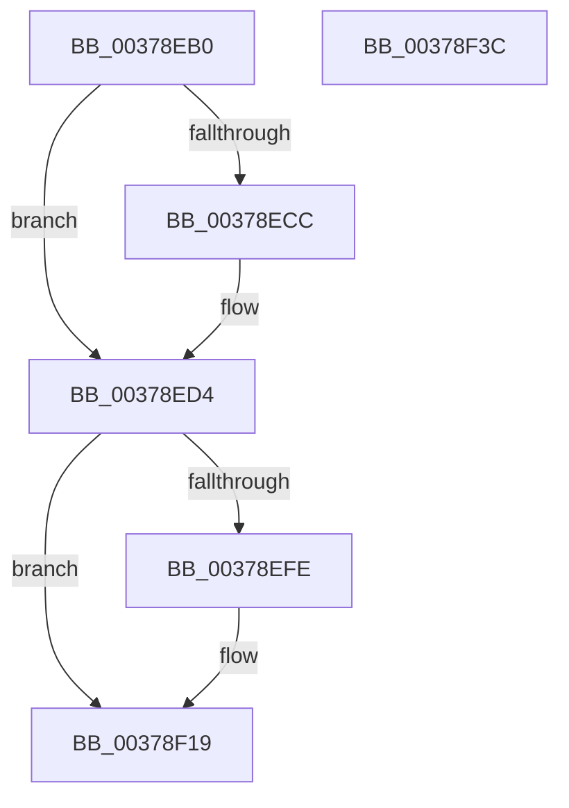

# HalpHvTimerArm

- RVA: `0x00378EB0`–`0x00378F3D` (길이 `141` bytes)
- VA: `0x0000000140378EB0`
- 실행 섹션: `.text`
- PDB 이름 있음: `예`; PDB Function 태그: `아니요`
- unwind 정보 RVA: `0x00060BC4`
- 디코드: `43`개 명령, `141/141` bytes 표시
- 미해석 바이트: `0` (있으면 어셈블리에 `.byte`로 보존)

> 이 문서는 커널 이미지의 기계어와 PDB 기호를 분석해 생성했습니다. 4번과 5번은 함수 원형과 자료형을 바이너리 사용 방식에서 추정한 C 해석이며 원본 소스 복구 결과는 아닙니다.

## 1. Dependencies

- 직접 호출 지점: **1**; 고유 호출 대상: **1**
- 직접 호출자로 확인된 함수: **0**
- RIP 상대 이미지 참조: **0**

### Outgoing calls
- `0x00378ECC` → [HalpHvCounterQueryCounter](HalpHvCounterQueryCounter_function_00378F50.md) (function, `0x00378F50`)

### Direct callers
- 이 함수 시작 RVA로 연결되는 직접 call은 확인되지 않았습니다. 간접 호출은 완전히 역산할 수 없습니다.

### Static image references
- 디코드된 RIP-relative 메모리 참조가 없습니다.

## 2. Other-region calls and transfers

- 다른 실행 섹션으로 향하는 call: **0**
- 별도 외부 분기/꼬리 이동을 확인하지 못했습니다.

## 3. Assembly (complete function range)

```asm
00378EB0  48 89 5C 24 08                  mov qword ptr [rsp + 8], rbx
00378EB5  48 89 74 24 10                  mov qword ptr [rsp + 0x10], rsi
00378EBA  57                              push rdi
00378EBB  48 83 EC 20                     sub rsp, 0x20
00378EBF  49 8B D8                        mov rbx, r8
00378EC2  8B F2                           mov esi, edx
00378EC4  48 8B F9                        mov rdi, rcx
00378EC7  83 FA 03                        cmp edx, 3
00378ECA  75 08                           jne 0x140378ed4
00378ECC  E8 7F 00 00 00                  call 0x140378f50
00378ED1  48 03 D8                        add rbx, rax
00378ED4  65 8B 04 25 A4 01 00 00         mov eax, dword ptr gs:[0x1a4]
00378EDC  33 D2                           xor edx, edx
00378EDE  83 FE 02                        cmp esi, 2
00378EE1  0F 94 C2                        sete dl
00378EE4  48 8D 04 40                     lea rax, [rax + rax*2]
00378EE8  48 8B 0C C7                     mov rcx, qword ptr [rdi + rax*8]
00378EEC  4C 8D 04 C7                     lea r8, [rdi + rax*8]
00378EF0  48 8B C1                        mov rax, rcx
00378EF3  48 D1 E8                        shr rax, 1
00378EF6  83 E0 01                        and eax, 1
00378EF9  48 3B D0                        cmp rdx, rax
00378EFC  74 1B                           je 0x140378f19
00378EFE  48 83 E1 FC                     and rcx, 0xfffffffffffffffc
00378F02  48 03 D2                        add rdx, rdx
00378F05  48 0B D1                        or rdx, rcx
00378F08  B9 B0 00 00 40                  mov ecx, 0x400000b0
00378F0D  49 89 10                        mov qword ptr [r8], rdx
00378F10  48 8B C2                        mov rax, rdx
00378F13  48 C1 EA 20                     shr rdx, 0x20
00378F17  0F 30                           wrmsr
00378F19  48 8B D3                        mov rdx, rbx
00378F1C  48 8B C3                        mov rax, rbx
00378F1F  48 C1 EA 20                     shr rdx, 0x20
00378F23  B9 B1 00 00 40                  mov ecx, 0x400000b1
00378F28  0F 30                           wrmsr
00378F2A  48 8B 5C 24 30                  mov rbx, qword ptr [rsp + 0x30]
00378F2F  33 C0                           xor eax, eax
00378F31  48 8B 74 24 38                  mov rsi, qword ptr [rsp + 0x38]
00378F36  48 83 C4 20                     add rsp, 0x20
00378F3A  5F                              pop rdi
00378F3B  C3                              ret
00378F3C  CC                              int3
```

## 4. C-style interpretation (structured pseudocode)

```c
__int64 __fastcall HalpHvTimerArm(__int64 a1, int a2, __int64 a3)
{
    __int64 result;
    __int64 v_rbx;
    __int64 v_rsp;
    unsigned __int64 v_stack_p10;
    unsigned __int64 v_stack_p8;

    v_stack_p8 = v_rbx;
    v_stack_p10 = v_rsi;
    v_rsp = (v_rsp) - (32);
    v_rbx = a3;
    if (a2 == 3) {
        result = HalpHvCounterQueryCounter(a1, a2, a3, a4);
        v_rbx = (a3) + (result);
    }
    a2 = 0;
    a2 = (((unsigned int)((unsigned int)(a2))) == 2) ? 1 : 0;
    result = (*(unsigned __int64 *)(a1 + (unsigned int)(*(unsigned int *)(gs_base + (0 + 420))) + (unsigned int)(*(unsigned int *)(gs_base + (0 + 420))) * 2 * 8)) >> (1);
    result = (unsigned int)((result) & (1));
    if (a2 != result) {
        a1 = (*(unsigned __int64 *)(a1 + (unsigned int)(*(unsigned int *)(gs_base + (0 + 420))) + (unsigned int)(*(unsigned int *)(gs_base + (0 + 420))) * 2 * 8)) & (-4);
        a2 = (a2) + (a2);
        a2 = (a2) | (a1);
        a1 = 0x400000B0ULL;
        *(unsigned __int64 *)(a1 + (unsigned int)(*(unsigned int *)(gs_base + (0 + 420))) + (unsigned int)(*(unsigned int *)(gs_base + (0 + 420))) * 2 * 8) = a2;
        result = a2;
        a2 = (a2) >> (32);
    }
    a2 = (v_rbx) >> (32);
    result = 0;
    v_rsp = (v_rsp) + (32);
    return result;
}
```

## 5. (Beta) C Style

```c
int64_t HalpHvTimerArm(void *Arg1, int32_t Arg2, int64_t Arg3)
{
    uint8_t *arg1 = (uint8_t *)Arg1;

    int64_t result;
    int64_t local_rbx;
    int64_t local_rsp;
    uint64_t v_stack_p10;
    uint64_t v_stack_p8;

    v_stack_p8 = local_rbx;
    v_stack_p10 = local_rsi;
    local_rsp = (local_rsp) - (32);
    local_rbx = Arg3;
    if (Arg2 == 3) {
        result = HalpHvCounterQueryCounter(Arg1, Arg2, Arg3, a4);
        local_rbx = (Arg3) + (result);
    }
    Arg2 = 0;
    Arg2 = (((uint32_t)((uint32_t)(Arg2))) == 2) ? 1 : 0;
    result = (*(uint64_t *)(arg1 + (uint32_t)(*(uint32_t *)(gs_base + (0 + 0x1A4))) + (uint32_t)(*(uint32_t *)(gs_base + (0 + 0x1A4))) * 2 * 8)) >> (1);
    result = (uint32_t)((result) & (1));
    if (Arg2 != result) {
        Arg1 = (*(uint64_t *)(arg1 + (uint32_t)(*(uint32_t *)(gs_base + (0 + 0x1A4))) + (uint32_t)(*(uint32_t *)(gs_base + (0 + 0x1A4))) * 2 * 8)) & (-4);
        Arg2 = (Arg2) + (Arg2);
        Arg2 = (Arg2) | (Arg1);
        Arg1 = 0x400000B0ULL;
        *(uint64_t *)(arg1 + (uint32_t)(*(uint32_t *)(gs_base + (0 + 0x1A4))) + (uint32_t)(*(uint32_t *)(gs_base + (0 + 0x1A4))) * 2 * 8) = Arg2;
        result = Arg2;
        Arg2 = (Arg2) >> (32);
    }
    Arg2 = (local_rbx) >> (32);
    result = 0;
    local_rsp = (local_rsp) + (32);
    return result;
}
```

### 관측된 메모리 오프셋

구조체 형식이 확인되지 않은 접근은 인자 기준의 오프셋으로만 기록했습니다.

| 기준 인자 | 오프셋 표현 | 폭 (bit) | 접근 |
|---|---:|---:|---|
| `Arg1` | `+ 0x0` | `64` | `W` |
| `Arg1` | `+ 0x0 + rax*8` | `64` | `R` |

## 6. Execution-region graph

[열기: 2D/3D 그래프와 함수 탐색 컨트롤 패널](../../../control-panel.html?section=text&rva=0x00378EB0&view=graph)

- 2D 그래프는 위에서 아래로 흐르고, 3D 그래프는 빈 공간을 드래그해 회전합니다. Shift+드래그는 이동, 휠은 확대·축소, 함수 노드 선택은 대상 보고서 이동입니다.

### Static fallback


