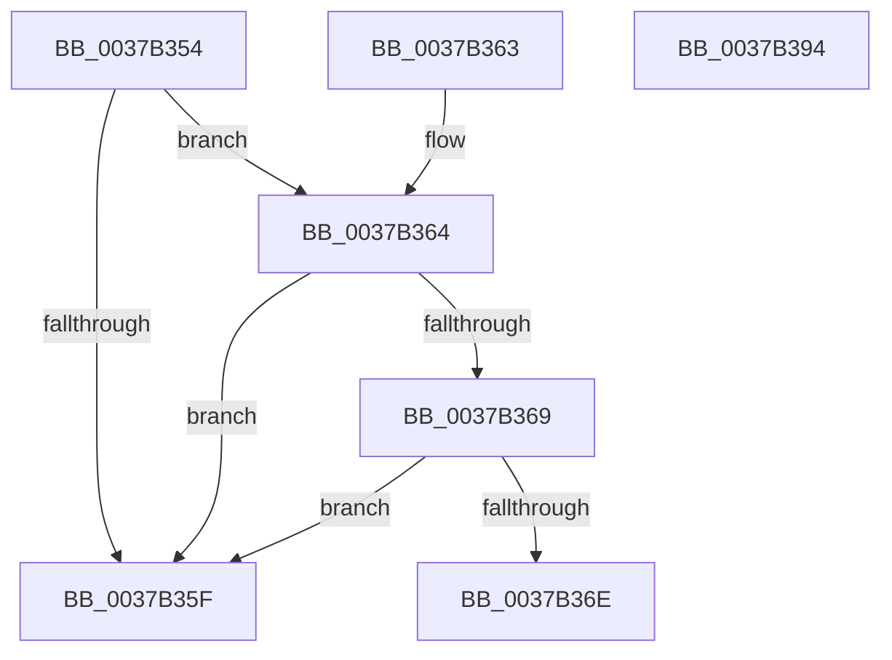

# HalpTimerScaleCounter

- RVA: `0x0037B354`–`0x0037B395` (길이 `65` bytes)
- VA: `0x000000014037B354`
- 실행 섹션: `.text`
- PDB 이름 있음: `예`; PDB Function 태그: `아니요`
- unwind 정보 RVA: `0x000DB714`
- 디코드: `25`개 명령, `65/65` bytes 표시
- 미해석 바이트: `0` (있으면 어셈블리에 `.byte`로 보존)

> 이 문서는 커널 이미지의 기계어와 PDB 기호를 분석해 생성했습니다. 4번과 5번은 함수 원형과 자료형을 바이너리 사용 방식에서 추정한 C 해석이며 원본 소스 복구 결과는 아닙니다.

## 1. Dependencies

- 직접 호출 지점: **0**; 고유 호출 대상: **0**
- 직접 호출자로 확인된 함수: **20**
- RIP 상대 이미지 참조: **0**

### Outgoing calls
- 직접 디코드된 call 명령이 없습니다.

### Direct callers
- [sub_0020A643](../20/Unknown_function_0020A643.md) at `0x0020A7EC`
- [sub_0020A643](../20/Unknown_function_0020A643.md) at `0x0020A820`
- [KiStartThreadCycleAccumulationContextSwap](../30/KiStartThreadCycleAccumulationContextSwap_function_00309C10.md) at `0x0030A282`
- [KiStartThreadCycleAccumulationContextSwap](../30/KiStartThreadCycleAccumulationContextSwap_function_00309C10.md) at `0x0030A2B3`
- [sub_0037AE18](Unknown_function_0037AE18.md) at `0x0037AFED`
- [sub_0037AE18](Unknown_function_0037AE18.md) at `0x0037B028`
- [sub_0037BB03](Unknown_function_0037BB03.md) at `0x0037BBD9`
- [sub_0037BBE9](Unknown_function_0037BBE9.md) at `0x0037BC0A`
- [KiEndThreadCycleAccumulation](KiEndThreadCycleAccumulation_function_0037BFF0.md) at `0x0037C767`
- [KiEndThreadCycleAccumulation](KiEndThreadCycleAccumulation_function_0037BFF0.md) at `0x0037C798`
- [sub_0037D298](Unknown_function_0037D298.md) at `0x0037D36E`
- [sub_0037D37E](Unknown_function_0037D37E.md) at `0x0037D39F`
- [sub_0037E8B6](Unknown_function_0037E8B6.md) at `0x0037EA63`
- [sub_0037EA6D](Unknown_function_0037EA6D.md) at `0x0037EA8E`
- [sub_0042BBC4](../42/Unknown_function_0042BBC4.md) at `0x0042BBCA`
- [sub_0042BBD4](../42/Unknown_function_0042BBD4.md) at `0x0042BBE5`
- [HalpSetTimer](../42/HalpSetTimer_function_0042BD30.md) at `0x0042BEEB`
- [HalpTimerPropagateQpcBiasUpdate](../4A/HalpTimerPropagateQpcBiasUpdate_function_004AB9F4.md) at `0x004ABA8C`
- [HalpTimerGetSavedPerformanceCounter](../4E/HalpTimerGetSavedPerformanceCounter_function_004E2E48.md) at `0x004E2EA0`
- [HalpTimerGetSavedPerformanceCounter](../4E/HalpTimerGetSavedPerformanceCounter_function_004E2E48.md) at `0x004E2EF1`
- [HalCalibratePerformanceCounter](../53/HalCalibratePerformanceCounter_function_0053C010.md) at `0x0053C061`
- [HalCalibratePerformanceCounter](../53/HalCalibratePerformanceCounter_function_0053C010.md) at `0x0053C08D`
- [HalCalibratePerformanceCounter](../53/HalCalibratePerformanceCounter_function_0053C010.md) at `0x0053C0D0`
- [HalpTimerDelayedQueryCounter](../54/HalpTimerDelayedQueryCounter_function_00548F20.md) at `0x005490C0`
- [HalpTimerMeasureFrequencies](../54/HalpTimerMeasureFrequencies_function_005493C0.md) at `0x005496B7`
- [HalpTimerPerformanceCounterPowerChange](../54/HalpTimerPerformanceCounterPowerChange_function_00549738.md) at `0x00549914`
- [HalpTimerPerformanceCounterPowerChange](../54/HalpTimerPerformanceCounterPowerChange_function_00549738.md) at `0x00549C10`
- [HalpTimerPerformanceCounterPowerChange](../54/HalpTimerPerformanceCounterPowerChange_function_00549738.md) at `0x00549D64`
- [HalpTimerMeasureProcessorsWorker](../54/HalpTimerMeasureProcessorsWorker_function_0054D910.md) at `0x0054DA8F`

### Static image references
- 디코드된 RIP-relative 메모리 참조가 없습니다.

## 2. Other-region calls and transfers

- 다른 실행 섹션으로 향하는 call: **0**
- 별도 외부 분기/꼬리 이동을 확인하지 못했습니다.

## 3. Assembly (complete function range)

```asm
0037B354  4C 8B D2                        mov r10, rdx
0037B357  4C 8B C9                        mov r9, rcx
0037B35A  48 85 C9                        test rcx, rcx
0037B35D  75 05                           jne 0x14037b364
0037B35F  49 8B C1                        mov rax, r9
0037B362  C3                              ret
0037B363  CC                              int3
0037B364  4D 85 D2                        test r10, r10
0037B367  74 F6                           je 0x14037b35f
0037B369  4D 3B D0                        cmp r10, r8
0037B36C  74 F1                           je 0x14037b35f
0037B36E  33 D2                           xor edx, edx
0037B370  49 8B C1                        mov rax, r9
0037B373  49 F7 F2                        div r10
0037B376  33 D2                           xor edx, edx
0037B378  48 8B C8                        mov rcx, rax
0037B37B  49 0F AF C2                     imul rax, r10
0037B37F  49 0F AF C8                     imul rcx, r8
0037B383  4C 2B C8                        sub r9, rax
0037B386  4D 0F AF C8                     imul r9, r8
0037B38A  49 8B C1                        mov rax, r9
0037B38D  49 F7 F2                        div r10
0037B390  48 03 C1                        add rax, rcx
0037B393  C3                              ret
0037B394  CC                              int3
```

## 4. C-style interpretation (structured pseudocode)

```c
__int64 __fastcall HalpTimerScaleCounter(__int64 a1, __int64 a2, __int64 a3)
{
    __int64 result;

    if (a1 != 0) goto loc_0037B364;
loc_0037B35F:
    return a1;
loc_0037B364:
    if (a2 == 0) goto loc_0037B35F;
    if (a2 == a3) goto loc_0037B35F;
    a2 = 0;
    a2 = 0;
    result = (a1) * (0);
    a1 = (a1) * (a3);
    a4 = (a1) - (result);
    a4 = (a4) * (a3);
    result = (a4) + (a1);
    return result;
}
```

## 5. (Beta) C Style

```c
int64_t HalpTimerScaleCounter(int64_t Arg1, int64_t Arg2, int64_t Arg3)
{
    int64_t result;

    if (Arg1 != 0) goto loc_0037B364;
loc_0037B35F:
    return Arg1;
loc_0037B364:
    if (Arg2 == 0) goto loc_0037B35F;
    if (Arg2 == Arg3) goto loc_0037B35F;
    Arg2 = 0;
    Arg2 = 0;
    result = (Arg1) * (0);
    Arg1 = (Arg1) * (Arg3);
    a4 = (Arg1) - (result);
    a4 = (a4) * (Arg3);
    result = (a4) + (Arg1);
    return result;
}
```

## 6. Execution-region graph

[열기: 2D/3D 그래프와 함수 탐색 컨트롤 패널](../../../control-panel.html?section=text&rva=0x0037B354&view=graph)

- 2D 그래프는 위에서 아래로 흐르고, 3D 그래프는 빈 공간을 드래그해 회전합니다. Shift+드래그는 이동, 휠은 확대·축소, 함수 노드 선택은 대상 보고서 이동입니다.

### Static fallback


