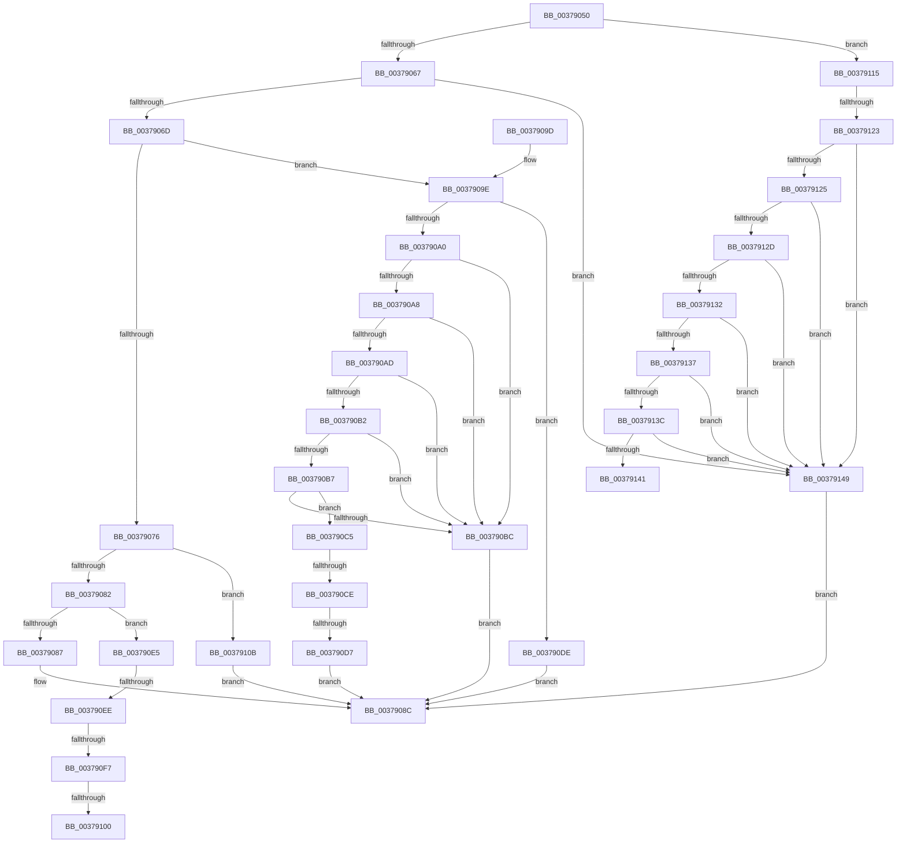

# HvlpGetRegister64

- RVA: `0x00379050`–`0x00379155` (길이 `261` bytes)
- VA: `0x0000000140379050`
- 실행 섹션: `.text`
- PDB 이름 있음: `예`; PDB Function 태그: `예`
- unwind 정보 RVA: `0x0007AF28`
- 디코드: `71`개 명령, `261/261` bytes 표시
- 미해석 바이트: `0` (있으면 어셈블리에 `.byte`로 보존)

> 이 문서는 커널 이미지의 기계어와 PDB 기호를 분석해 생성했습니다. 4번과 5번은 함수 원형과 자료형을 바이너리 사용 방식에서 추정한 C 해석이며 원본 소스 복구 결과는 아닙니다.

## 1. Dependencies

- 직접 호출 지점: **0**; 고유 호출 대상: **0**
- 직접 호출자로 확인된 함수: **14**
- RIP 상대 이미지 참조: **0**

### Outgoing calls
- 직접 디코드된 call 명령이 없습니다.

### Direct callers
- [sub_0020A8E8](../20/Unknown_function_0020A8E8.md) at `0x0020A9A3`
- [sub_0020A8E8](../20/Unknown_function_0020A8E8.md) at `0x0020AB1E`
- [KiStartThreadCycleAccumulationContextSwap](../30/KiStartThreadCycleAccumulationContextSwap_function_00309C10.md) at `0x0030A418`
- [KiStartThreadCycleAccumulationContextSwap](../30/KiStartThreadCycleAccumulationContextSwap_function_00309C10.md) at `0x0030A58B`
- [HalpHvCounterQueryCounter](HalpHvCounterQueryCounter_function_00378F50.md) at `0x0037900E`
- [sub_0037AE18](Unknown_function_0037AE18.md) at `0x0037B17F`
- [sub_0037AE18](Unknown_function_0037AE18.md) at `0x0037B2E6`
- [sub_0037BC17](Unknown_function_0037BC17.md) at `0x0037BD74`
- [sub_0037BC17](Unknown_function_0037BC17.md) at `0x0037BEE8`
- [KiEndThreadCycleAccumulation](KiEndThreadCycleAccumulation_function_0037BFF0.md) at `0x0037C90E`
- [KiEndThreadCycleAccumulation](KiEndThreadCycleAccumulation_function_0037BFF0.md) at `0x0037CA87`
- [sub_0037D3AC](Unknown_function_0037D3AC.md) at `0x0037D510`
- [sub_0037D3AC](Unknown_function_0037D3AC.md) at `0x0037D684`
- [sub_0037EAAA](Unknown_function_0037EAAA.md) at `0x0037EBEC`
- [sub_0037EAAA](Unknown_function_0037EAAA.md) at `0x0037ED5E`
- [HvlEnlightenProcessor](../4D/HvlEnlightenProcessor_function_004DCD9C.md) at `0x004DCDEE`
- [HvlEnlightenProcessor](../4D/HvlEnlightenProcessor_function_004DCD9C.md) at `0x004DCE9B`
- [HvlEnlightenProcessor](../4D/HvlEnlightenProcessor_function_004DCD9C.md) at `0x004DCEEB`
- [HvlLogGuestCrashInformation](../58/HvlLogGuestCrashInformation_function_00583C84.md) at `0x00583CC7`
- [HvlpInitializeBootProcessor](../58/HvlpInitializeBootProcessor_function_00585964.md) at `0x005859EB`
- [HvlpInitializeBootProcessor](../58/HvlpInitializeBootProcessor_function_00585964.md) at `0x00585A28`
- [HvlpDetermineEnlightenments](../58/HvlpDetermineEnlightenments_function_0058CC9C.md) at `0x0058CEA0`
- [HvlpPhase0Enlightenments](../58/HvlpPhase0Enlightenments_function_0058D1B8.md) at `0x0058D1EB`
- [HvlDeleteProcessor](../../page/71/HvlDeleteProcessor_function_00717FA4.md) at `0x00717FD5`

### Static image references
- 디코드된 RIP-relative 메모리 참조가 없습니다.

## 2. Other-region calls and transfers

- 다른 실행 섹션으로 향하는 call: **0**
- call이 아닌 외부 분기/꼬리 이동: **8**
  - `0x003790C8` → [sub_006E436C](../6E/Unknown_function_006E436C.md) (`tail-transfer`)
  - `0x003790D1` → [sub_006E436C + 0x37](../6E/Unknown_function_006E436C.md) (`tail-transfer`)
  - `0x003790E8` → [sub_006E436C + 0x1E](../6E/Unknown_function_006E436C.md) (`tail-transfer`)
  - `0x003790F1` → [sub_006E436C + 0x14](../6E/Unknown_function_006E436C.md) (`tail-transfer`)
  - `0x003790FA` → [sub_006E436C + 0xA](../6E/Unknown_function_006E436C.md) (`tail-transfer`)
  - `0x00379106` → [sub_006E436C + 0x28](../6E/Unknown_function_006E436C.md) (`tail-transfer`)
  - `0x0037911D` → [sub_006E436C + 0x49](../6E/Unknown_function_006E436C.md) (`tail-transfer`)
  - `0x00379144` → [sub_006E436C + 0x28](../6E/Unknown_function_006E436C.md) (`tail-transfer`)

## 3. Assembly (complete function range)

```asm
00379050  48 83 EC 28                     sub rsp, 0x28
00379054  B8 02 00 0A 00                  mov eax, 0xa0002
00379059  4C 8B CA                        mov r9, rdx
0037905C  44 8B C1                        mov r8d, ecx
0037905F  3B C8                           cmp ecx, eax
00379061  0F 8F AE 00 00 00               jg 0x140379115
00379067  0F 84 DC 00 00 00               je 0x140379149
0037906D  B8 02 00 09 00                  mov eax, 0x90002
00379072  3B C8                           cmp ecx, eax
00379074  7E 28                           jle 0x14037909e
00379076  81 E9 03 00 09 00               sub ecx, 0x90003
0037907C  0F 84 89 00 00 00               je 0x14037910b
00379082  83 E9 01                        sub ecx, 1
00379085  75 5E                           jne 0x1403790e5
00379087  B9 20 00 00 40                  mov ecx, 0x40000020
0037908C  0F 32                           rdmsr
0037908E  48 C1 E2 20                     shl rdx, 0x20
00379092  48 0B C2                        or rax, rdx
00379095  49 89 01                        mov qword ptr [r9], rax
00379098  48 83 C4 28                     add rsp, 0x28
0037909C  C3                              ret
0037909D  CC                              int3
0037909E  74 3E                           je 0x1403790de
003790A0  81 E9 10 02 00 00               sub ecx, 0x210
003790A6  74 14                           je 0x1403790bc
003790A8  83 E9 01                        sub ecx, 1
003790AB  74 0F                           je 0x1403790bc
003790AD  83 E9 01                        sub ecx, 1
003790B0  74 0A                           je 0x1403790bc
003790B2  83 E9 01                        sub ecx, 1
003790B5  74 05                           je 0x1403790bc
003790B7  83 E9 01                        sub ecx, 1
003790BA  75 09                           jne 0x1403790c5
003790BC  41 8D 88 F0 FE FF 3F            lea ecx, [r8 + 0x3ffffef0]
003790C3  EB C7                           jmp 0x14037908c
003790C5  83 E9 01                        sub ecx, 1
003790C8  0F 84 9E B2 36 00               je 0x1406e436c
003790CE  83 F9 5B                        cmp ecx, 0x5b
003790D1  0F 85 CC B2 36 00               jne 0x1406e43a3
003790D7  B9 16 01 00 40                  mov ecx, 0x40000116
003790DC  EB AE                           jmp 0x14037908c
003790DE  B9 00 00 00 40                  mov ecx, 0x40000000
003790E3  EB A7                           jmp 0x14037908c
003790E5  83 E9 03                        sub ecx, 3
003790E8  0F 84 9C B2 36 00               je 0x1406e438a
003790EE  83 E9 0C                        sub ecx, 0xc
003790F1  0F 84 89 B2 36 00               je 0x1406e4380
003790F7  83 E9 04                        sub ecx, 4
003790FA  0F 84 76 B2 36 00               je 0x1406e4376
00379100  81 E9 E9 FF 00 00               sub ecx, 0xffe9
00379106  E9 89 B2 36 00                  jmp 0x1406e4394
0037910B  B9 02 00 00 40                  mov ecx, 0x40000002
00379110  E9 77 FF FF FF                  jmp 0x14037908c
00379115  B8 0A 00 0A 00                  mov eax, 0xa000a
0037911A  44 3B C0                        cmp r8d, eax
0037911D  0F 8F 92 B2 36 00               jg 0x1406e43b5
00379123  74 24                           je 0x140379149
00379125  81 E9 03 00 0A 00               sub ecx, 0xa0003
0037912B  74 1C                           je 0x140379149
0037912D  83 E9 01                        sub ecx, 1
00379130  74 17                           je 0x140379149
00379132  83 E9 01                        sub ecx, 1
00379135  74 12                           je 0x140379149
00379137  83 E9 01                        sub ecx, 1
0037913A  74 0D                           je 0x140379149
0037913C  83 E9 01                        sub ecx, 1
0037913F  74 08                           je 0x140379149
00379141  83 E9 01                        sub ecx, 1
00379144  E9 4B B2 36 00                  jmp 0x1406e4394
00379149  41 8D 88 90 00 F6 3F            lea ecx, [r8 + 0x3ff60090]
00379150  E9 37 FF FF FF                  jmp 0x14037908c
```

## 4. C-style interpretation (structured pseudocode)

```c
__int64 __fastcall HvlpGetRegister64(int a1, __int64 a2)
{
    __int64 result;
    __int64 v_rsp;

    v_rsp = (v_rsp) - (40);
    if (a1 > ((unsigned int)((unsigned int)(0xA0002ULL)))) goto loc_00379115;
    if (a1 == ((unsigned int)((unsigned int)(0xA0002ULL)))) goto loc_00379149;
    if (a1 <= ((unsigned int)((unsigned int)(0x90002ULL)))) goto loc_0037909E;
    a1 = (unsigned int)((a1) - (0x90003ULL));
    if (condition_is_equal) goto loc_0037910B;
    a1 = (unsigned int)((a1) - (1));
    if (condition_is_not_equal) goto loc_003790E5;
loc_0037908C:
    a2 = (a2) << (32);
    result = ((unsigned int)(0x90002ULL)) | (a2);
    *(unsigned __int64 *)(a2) = result;
    v_rsp = (v_rsp) + (40);
    return result;
loc_0037909E:
    if (condition_is_equal) goto loc_003790DE;
    a1 = (unsigned int)(((unsigned int)(0x40000020ULL)) - (528));
    if (condition_is_equal) goto loc_003790BC;
    a1 = (unsigned int)((a1) - (1));
    if (condition_is_equal) goto loc_003790BC;
    a1 = (unsigned int)((a1) - (1));
    if (condition_is_equal) goto loc_003790BC;
    a1 = (unsigned int)((a1) - (1));
    if (condition_is_equal) goto loc_003790BC;
    a1 = (unsigned int)((a1) - (1));
    if (condition_is_not_equal) goto loc_003790C5;
loc_003790BC:
    goto loc_0037908C;
loc_003790C5:
    a1 = (unsigned int)(((unsigned int)(a1) + 1073741552) - (1));
    goto loc_0037908C;
loc_003790DE:
    goto loc_0037908C;
loc_003790E5:
    a1 = (unsigned int)(((unsigned int)(0x40000000ULL)) - (3));
    a1 = (unsigned int)((a1) - (12));
    a1 = (unsigned int)((a1) - (4));
    a1 = (unsigned int)((a1) - (0xFFE9ULL));
loc_0037910B:
    goto loc_0037908C;
loc_00379115:
    if (((unsigned int)((unsigned int)(a1))) == ((unsigned int)((unsigned int)(0xA000AULL)))) goto loc_00379149;
    a1 = (unsigned int)(((unsigned int)(0x40000002ULL)) - (0xA0003ULL));
    if (condition_is_equal) goto loc_00379149;
    a1 = (unsigned int)((a1) - (1));
    if (condition_is_equal) goto loc_00379149;
    a1 = (unsigned int)((a1) - (1));
    if (condition_is_equal) goto loc_00379149;
    a1 = (unsigned int)((a1) - (1));
    if (condition_is_equal) goto loc_00379149;
    a1 = (unsigned int)((a1) - (1));
    if (condition_is_equal) goto loc_00379149;
    a1 = (unsigned int)((a1) - (1));
loc_00379149:
    goto loc_0037908C;
}
```

## 5. (Beta) C Style

```c
int64_t HvlpGetRegister64(void *Arg1, void *Arg2)
{
    uint8_t *arg1 = (uint8_t *)Arg1;
    uint8_t *arg2 = (uint8_t *)Arg2;

    int64_t result;
    int64_t local_rsp;

    local_rsp = (local_rsp) - (40);
    if (Arg1 > ((uint32_t)((uint32_t)(0xA0002ULL)))) goto loc_00379115;
    if (Arg1 == ((uint32_t)((uint32_t)(0xA0002ULL)))) goto loc_00379149;
    if (Arg1 <= ((uint32_t)((uint32_t)(0x90002ULL)))) goto loc_0037909E;
    Arg1 = (uint32_t)((Arg1) - (0x90003ULL));
    if (condition_is_equal) goto loc_0037910B;
    Arg1 = (uint32_t)((Arg1) - (1));
    if (condition_is_not_equal) goto loc_003790E5;
loc_0037908C:
    Arg2 = (Arg2) << (32);
    result = ((uint32_t)(0x90002ULL)) | (Arg2);
    *(uint64_t *)(arg2) = result;
    local_rsp = (local_rsp) + (40);
    return result;
loc_0037909E:
    if (condition_is_equal) goto loc_003790DE;
    Arg1 = (uint32_t)(((uint32_t)(0x40000020ULL)) - (528));
    if (condition_is_equal) goto loc_003790BC;
    Arg1 = (uint32_t)((Arg1) - (1));
    if (condition_is_equal) goto loc_003790BC;
    Arg1 = (uint32_t)((Arg1) - (1));
    if (condition_is_equal) goto loc_003790BC;
    Arg1 = (uint32_t)((Arg1) - (1));
    if (condition_is_equal) goto loc_003790BC;
    Arg1 = (uint32_t)((Arg1) - (1));
    if (condition_is_not_equal) goto loc_003790C5;
loc_003790BC:
    goto loc_0037908C;
loc_003790C5:
    Arg1 = (uint32_t)(((uint32_t)(Arg1) + 1073741552) - (1));
    goto loc_0037908C;
loc_003790DE:
    goto loc_0037908C;
loc_003790E5:
    Arg1 = (uint32_t)(((uint32_t)(0x40000000ULL)) - (3));
    Arg1 = (uint32_t)((Arg1) - (12));
    Arg1 = (uint32_t)((Arg1) - (4));
    Arg1 = (uint32_t)((Arg1) - (0xFFE9ULL));
loc_0037910B:
    goto loc_0037908C;
loc_00379115:
    if (((uint32_t)((uint32_t)(Arg1))) == ((uint32_t)((uint32_t)(0xA000AULL)))) goto loc_00379149;
    Arg1 = (uint32_t)(((uint32_t)(0x40000002ULL)) - (0xA0003ULL));
    if (condition_is_equal) goto loc_00379149;
    Arg1 = (uint32_t)((Arg1) - (1));
    if (condition_is_equal) goto loc_00379149;
    Arg1 = (uint32_t)((Arg1) - (1));
    if (condition_is_equal) goto loc_00379149;
    Arg1 = (uint32_t)((Arg1) - (1));
    if (condition_is_equal) goto loc_00379149;
    Arg1 = (uint32_t)((Arg1) - (1));
    if (condition_is_equal) goto loc_00379149;
    Arg1 = (uint32_t)((Arg1) - (1));
loc_00379149:
    goto loc_0037908C;
}
```

### 관측된 메모리 오프셋

구조체 형식이 확인되지 않은 접근은 인자 기준의 오프셋으로만 기록했습니다.

| 기준 인자 | 오프셋 표현 | 폭 (bit) | 접근 |
|---|---:|---:|---|
| `Arg1` | `+ 0x3FFFFEF0` | `32` | `R` |
| `Arg2` | `+ 0x0` | `64` | `W` |

## 6. Execution-region graph

[열기: 2D/3D 그래프와 함수 탐색 컨트롤 패널](../../../control-panel.html?section=text&rva=0x00379050&view=graph)

- 2D 그래프는 위에서 아래로 흐르고, 3D 그래프는 빈 공간을 드래그해 회전합니다. Shift+드래그는 이동, 휠은 확대·축소, 함수 노드 선택은 대상 보고서 이동입니다.

### Static fallback


