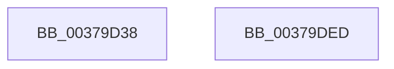

# IoDiskIoAttributionQuery

- RVA: `0x00379D38`–`0x00379DEE` (길이 `182` bytes)
- VA: `0x0000000140379D38`
- 실행 섹션: `.text`
- PDB 이름 있음: `예`; PDB Function 태그: `아니요`
- unwind 정보 RVA: `0x0007AFEC`
- 디코드: `45`개 명령, `182/182` bytes 표시
- 미해석 바이트: `0` (있으면 어셈블리에 `.byte`로 보존)

> 이 문서는 커널 이미지의 기계어와 PDB 기호를 분석해 생성했습니다. 4번과 5번은 함수 원형과 자료형을 바이너리 사용 방식에서 추정한 C 해석이며 원본 소스 복구 결과는 아닙니다.

## 1. Dependencies

- 직접 호출 지점: **4**; 고유 호출 대상: **4**
- 직접 호출자로 확인된 함수: **3**
- RIP 상대 이미지 참조: **0**

### Outgoing calls
- `0x00379D84` → [KeQueryUnbiasedInterruptTimePrecise](KeQueryUnbiasedInterruptTimePrecise_function_0037AC20.md) (function, `0x0037AC20`)
- `0x00379D97` → [KeAcquireInStackQueuedSpinLock](../27/KeAcquireInStackQueuedSpinLock_function_002757A0.md) (function, `0x002757A0`)
- `0x00379DAA` → [IopRecordIoAttribution](../34/IopRecordIoAttribution_function_00349758.md) (function, `0x00349758`)
- `0x00379DD8` → [KeReleaseInStackQueuedSpinLock](../34/KeReleaseInStackQueuedSpinLock_function_00342CE0.md) (function, `0x00342CE0`)

### Direct callers
- [IoGetIoRateControl](../34/IoGetIoRateControl_function_003493F0.md) at `0x00349558`
- [IopIoRateStartRateControl](../42/IopIoRateStartRateControl_function_004286C0.md) at `0x0042873D`
- [PspQueryJobIoAttribution](../../page/9F/PspQueryJobIoAttribution_function_009FC648.md) at `0x009FC68C`

### Static image references
- 디코드된 RIP-relative 메모리 참조가 없습니다.

## 2. Other-region calls and transfers

- 다른 실행 섹션으로 향하는 call: **0**
- 별도 외부 분기/꼬리 이동을 확인하지 못했습니다.

## 3. Assembly (complete function range)

```asm
00379D38  4C 8B DC                        mov r11, rsp
00379D3B  49 89 5B 08                     mov qword ptr [r11 + 8], rbx
00379D3F  49 89 73 10                     mov qword ptr [r11 + 0x10], rsi
00379D43  57                              push rdi
00379D44  48 83 EC 60                     sub rsp, 0x60
00379D48  33 C0                           xor eax, eax
00379D4A  C7 44 24 38 01 00 00 00         mov dword ptr [rsp + 0x38], 1
00379D52  21 44 24 4C                     and dword ptr [rsp + 0x4c], eax
00379D56  0F 57 C9                        xorps xmm1, xmm1
00379D59  0F 57 C0                        xorps xmm0, xmm0
00379D5C  48 8B F9                        mov rdi, rcx
00379D5F  0F 11 44 24 20                  movups xmmword ptr [rsp + 0x20], xmm0
00379D64  49 89 43 C8                     mov qword ptr [r11 - 0x38], rax
00379D68  49 8D 4B E8                     lea rcx, [r11 - 0x18]
00379D6C  66 0F 7E C8                     movd eax, xmm1
00379D70  49 8B F0                        mov rsi, r8
00379D73  F3 0F 7F 4C 24 3C               movdqu xmmword ptr [rsp + 0x3c], xmm1
00379D79  48 8B DA                        mov rbx, rdx
00379D7C  0F BA E8 09                     bts eax, 9
00379D80  89 44 24 3C                     mov dword ptr [rsp + 0x3c], eax
00379D84  E8 97 0E 00 00                  call 0x14037ac20
00379D89  48 8D 4F 28                     lea rcx, [rdi + 0x28]
00379D8D  48 89 44 24 50                  mov qword ptr [rsp + 0x50], rax
00379D92  48 8D 54 24 20                  lea rdx, [rsp + 0x20]
00379D97  E8 04 BA EF FF                  call 0x1402757a0
00379D9C  41 B8 03 00 00 00               mov r8d, 3
00379DA2  48 8D 54 24 38                  lea rdx, [rsp + 0x38]
00379DA7  48 8B CF                        mov rcx, rdi
00379DAA  E8 A9 F9 FC FF                  call 0x140349758
00379DAF  0F 10 47 58                     movups xmm0, xmmword ptr [rdi + 0x58]
00379DB3  48 8D 4C 24 20                  lea rcx, [rsp + 0x20]
00379DB8  0F 10 4F 68                     movups xmm1, xmmword ptr [rdi + 0x68]
00379DBC  0F 11 03                        movups xmmword ptr [rbx], xmm0
00379DBF  0F 10 87 80 00 00 00            movups xmm0, xmmword ptr [rdi + 0x80]
00379DC6  0F 11 4B 10                     movups xmmword ptr [rbx + 0x10], xmm1
00379DCA  0F 10 8F 90 00 00 00            movups xmm1, xmmword ptr [rdi + 0x90]
00379DD1  0F 11 06                        movups xmmword ptr [rsi], xmm0
00379DD4  0F 11 4E 10                     movups xmmword ptr [rsi + 0x10], xmm1
00379DD8  E8 03 8F FC FF                  call 0x140342ce0
00379DDD  48 8B 5C 24 70                  mov rbx, qword ptr [rsp + 0x70]
00379DE2  48 8B 74 24 78                  mov rsi, qword ptr [rsp + 0x78]
00379DE7  48 83 C4 60                     add rsp, 0x60
00379DEB  5F                              pop rdi
00379DEC  C3                              ret
00379DED  CC                              int3
```

## 4. C-style interpretation (structured pseudocode)

```c
__int64 __fastcall IoDiskIoAttributionQuery(__int64 a1, __int64 a2, __int64 a3)
{
    __int64 result;
    __int64 v_rsp;
    unsigned __int64 v_stack_m18;
    unsigned int v_stack_m1C;
    unsigned __int64 v_stack_m2C;
    unsigned int v_stack_m30;
    unsigned __int64 v_stack_m48;
    unsigned __int64 v_stack_p10;
    unsigned __int64 v_stack_p8;

    *(unsigned __int64 *)(v_rsp + 8) = v_rbx;
    *(unsigned __int64 *)(v_rsp + 16) = v_rsi;
    v_rsp = (v_rsp) - (96);
    result = 0;
    v_stack_m30 = 1;
    v_stack_m48 = v_xmm0;
    *(unsigned __int64 *)(v_rsp - 56) = 0;
    v_stack_m2C = v_xmm1;
    v_stack_m2C = 0;
    result = KeQueryUnbiasedInterruptTimePrecise(v_rsp - 24, a2, a3, a4);
    v_stack_m18 = result;
    result = KeAcquireInStackQueuedSpinLock(a1 + 40, v_stack_m48, a3, a4);
    result = IopRecordIoAttribution(a1, v_stack_m30, 3, a4);
    *(unsigned __int64 *)(a2) = v_xmm0;
    *(unsigned __int64 *)(a2 + 16) = v_xmm1;
    *(unsigned __int64 *)(a3) = v_xmm0;
    *(unsigned __int64 *)(a3 + 16) = v_xmm1;
    result = KeReleaseInStackQueuedSpinLock(v_stack_m48, v_stack_m30, 3, a4);
    v_rsp = (v_rsp) + (96);
    return result;
}
```

## 5. (Beta) C Style

```c
int64_t IoDiskIoAttributionQuery(void *Arg1, void *Arg2, void *Arg3)
{
    uint8_t *arg1 = (uint8_t *)Arg1;
    uint8_t *arg2 = (uint8_t *)Arg2;
    uint8_t *arg3 = (uint8_t *)Arg3;

    int64_t result;
    int64_t local_rsp;
    uint64_t v_stack_m18;
    uint32_t v_stack_m1C;
    uint64_t v_stack_m2C;
    uint32_t v_stack_m30;
    uint64_t v_stack_m48;
    uint64_t v_stack_p10;
    uint64_t v_stack_p8;

    *(uint64_t *)(local_rsp + 0x8) = local_rbx;
    *(uint64_t *)(local_rsp + 0x10) = local_rsi;
    local_rsp = (local_rsp) - (96);
    result = 0;
    v_stack_m30 = 1;
    v_stack_m48 = v_xmm0;
    *(uint64_t *)(local_rsp - 0x38) = 0;
    v_stack_m2C = v_xmm1;
    v_stack_m2C = 0;
    result = KeQueryUnbiasedInterruptTimePrecise(local_rsp - 24, Arg2, Arg3, a4);
    v_stack_m18 = result;
    result = KeAcquireInStackQueuedSpinLock(Arg1 + 40, v_stack_m48, Arg3, a4);
    result = IopRecordIoAttribution(Arg1, v_stack_m30, 3, a4);
    *(uint64_t *)(arg2) = v_xmm0;
    *(uint64_t *)(arg2 + 0x10) = v_xmm1;
    *(uint64_t *)(arg3) = v_xmm0;
    *(uint64_t *)(arg3 + 0x10) = v_xmm1;
    result = KeReleaseInStackQueuedSpinLock(v_stack_m48, v_stack_m30, 3, a4);
    local_rsp = (local_rsp) + (96);
    return result;
}
```

### 관측된 메모리 오프셋

구조체 형식이 확인되지 않은 접근은 인자 기준의 오프셋으로만 기록했습니다.

| 기준 인자 | 오프셋 표현 | 폭 (bit) | 접근 |
|---|---:|---:|---|
| `Arg1` | `+ 0x28` | `64` | `R` |
| `Arg1` | `+ 0x58` | `128` | `R` |
| `Arg1` | `+ 0x68` | `128` | `R` |
| `Arg1` | `+ 0x80` | `128` | `R` |
| `Arg1` | `+ 0x90` | `128` | `R` |
| `Arg2` | `+ 0x0` | `128` | `R` |
| `Arg2` | `+ 0x10` | `128` | `R` |
| `Arg3` | `+ 0x0` | `128` | `R` |
| `Arg3` | `+ 0x10` | `128` | `R` |

## 6. Execution-region graph

[열기: 2D/3D 그래프와 함수 탐색 컨트롤 패널](../../../control-panel.html?section=text&rva=0x00379D38&view=graph)

- 2D 그래프는 위에서 아래로 흐르고, 3D 그래프는 빈 공간을 드래그해 회전합니다. Shift+드래그는 이동, 휠은 확대·축소, 함수 노드 선택은 대상 보고서 이동입니다.

### Static fallback


