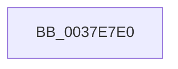

# KeQueryPerformanceCounter

- RVA: `0x0037E7E0`–`0x0037E7EA` (길이 `10` bytes)
- VA: `0x000000014037E7E0`
- 실행 섹션: `.text`
- PDB 이름 있음: `예`; PDB Function 태그: `아니요`
- unwind 정보 RVA: `0x0007B71C`
- 디코드: `4`개 명령, `10/10` bytes 표시
- 미해석 바이트: `0` (있으면 어셈블리에 `.byte`로 보존)

> 이 문서는 커널 이미지의 기계어와 PDB 기호를 분석해 생성했습니다. 4번과 5번은 함수 원형과 자료형을 바이너리 사용 방식에서 추정한 C 해석이며 원본 소스 복구 결과는 아닙니다.

## 1. Dependencies

- 직접 호출 지점: **0**; 고유 호출 대상: **0**
- 직접 호출자로 확인된 함수: **203**
- RIP 상대 이미지 참조: **0**

### Outgoing calls
- 직접 디코드된 call 명령이 없습니다.

### Direct callers
- [PpmIdleSnapConcurrency](../20/PpmIdleSnapConcurrency_function_00204694.md) at `0x002046B0`
- [KiRetireDpcList](../21/KiRetireDpcList_function_0021A0B0.md) at `0x0021A15A`
- [KiRetireDpcList](../21/KiRetireDpcList_function_0021A0B0.md) at `0x0021A622`
- [KiRetireDpcList](../21/KiRetireDpcList_function_0021A0B0.md) at `0x0021A99D`
- [KiProcessExpiredTimerList](../23/KiProcessExpiredTimerList_function_00234200.md) at `0x002344F7`
- [sub_002348D3](../23/Unknown_function_002348D3.md) at `0x00234907`
- [sub_00249C6B](../24/Unknown_function_00249C6B.md) at `0x00249CC8`
- [sub_00249C6B](../24/Unknown_function_00249C6B.md) at `0x00249D71`
- [sub_00256E8A](../25/Unknown_function_00256E8A.md) at `0x00256EB7`
- [sub_00256E8A](../25/Unknown_function_00256E8A.md) at `0x00257201`
- [KiExecuteAllDpcs](../25/KiExecuteAllDpcs_function_0025B740.md) at `0x0025C0FC`
- [MiReassessZeroThreads](../2C/MiReassessZeroThreads_function_002CB0C0.md) at `0x002CB173`
- [PpmPerfApplyDomainState](../2C/PpmPerfApplyDomainState_function_002CD470.md) at `0x002CDB35`
- [PpmPerfSetProcessorIdle](../2C/PpmPerfSetProcessorIdle_function_002CFD7C.md) at `0x002CFE0A`
- [PpmIdleExecuteTransition](../2D/PpmIdleExecuteTransition_function_002D0A1C.md) at `0x002D0BB9`
- [PpmPerfApplyProcessorState](../2D/PpmPerfApplyProcessorState_function_002DA4BC.md) at `0x002DA564`
- [MiScheduleZeroPageThreads](../2D/MiScheduleZeroPageThreads_function_002DB1DC.md) at `0x002DB200`
- [MiScheduleZeroPageThreads](../2D/MiScheduleZeroPageThreads_function_002DB1DC.md) at `0x002DB410`
- [PpmSnapPerformanceAccumulation](../2D/PpmSnapPerformanceAccumulation_function_002DE090.md) at `0x002DE0FB`
- [PpmSnapPerformanceAccumulation](../2D/PpmSnapPerformanceAccumulation_function_002DE090.md) at `0x002DE369`
- [sub_002DF06B](../2D/Unknown_function_002DF06B.md) at `0x002DF073`
- [sub_002F87D4](../2F/Unknown_function_002F87D4.md) at `0x002F87EF`
- [EtwpReserveTraceBuffer](../2F/EtwpReserveTraceBuffer_function_002FC8C0.md) at `0x002FCD09`
- [PopFxUpdateDeviceIRPhaseAccounting](../30/PopFxUpdateDeviceIRPhaseAccounting_function_003041D8.md) at `0x00304218`
- [MiFlushCacheForAttributeChange](../30/MiFlushCacheForAttributeChange_function_00308944.md) at `0x00308A77`
- [MiFlushCacheForAttributeChange](../30/MiFlushCacheForAttributeChange_function_00308944.md) at `0x00308AB3`
- [HvcallFastExtended](../31/HvcallFastExtended_function_003130E0.md) at `0x00313394`
- [HvlpFastFlushAddressSpaceTb](../31/HvlpFastFlushAddressSpaceTb_function_00314AF4.md) at `0x00314C94`
- [MiBackgroundZeroLocalPages](../31/MiBackgroundZeroLocalPages_function_0031EF30.md) at `0x0031F013`
- [MiBackgroundZeroLocalPages](../31/MiBackgroundZeroLocalPages_function_0031EF30.md) at `0x0031F423`
- [MiBackgroundZeroLocalPages](../31/MiBackgroundZeroLocalPages_function_0031EF30.md) at `0x0031F467`
- [MiBackgroundZeroLocalPages](../31/MiBackgroundZeroLocalPages_function_0031EF30.md) at `0x0031F622`
- [CcWriteBehindAsync](../35/CcWriteBehindAsync_function_003549E8.md) at `0x00354AFF`
- [CcWriteBehindInternal](../35/CcWriteBehindInternal_function_00357540.md) at `0x003576F9`
- [CcAsyncCopyRead](../35/CcAsyncCopyRead_function_00358880.md) at `0x003588CA`
- [CcFlushCachePreProcess](../35/CcFlushCachePreProcess_function_0035A9B0.md) at `0x0035AEB9`
- [CcFlushCachePriv](../35/CcFlushCachePriv_function_0035B040.md) at `0x0035B22E`
- [KeQuerySystemTimePrecise](KeQuerySystemTimePrecise_function_0037DA40.md) at `0x0037DABA`
- [sub_0037DB53](Unknown_function_0037DB53.md) at `0x0037DB73`
- [KiUpdateTotalCyclesCurrentThread](KiUpdateTotalCyclesCurrentThread_function_0037DE40.md) at `0x0037DE8E`
- [KiUpdateTotalCyclesCurrentThread](KiUpdateTotalCyclesCurrentThread_function_0037DE40.md) at `0x0037E1E0`
- [sub_0037E6CA](Unknown_function_0037E6CA.md) at `0x0037E74A`
- [sub_0037E7B3](Unknown_function_0037E7B3.md) at `0x0037E7B6`
- [RtlGetSystemTimePrecise](RtlGetSystemTimePrecise_function_0037EDD0.md) at `0x0037EE40`
- [KeQueryTotalCycleTimeThread](KeQueryTotalCycleTimeThread_function_0037EF20.md) at `0x0037EFCC`
- [KeQueryTotalCycleTimeThread](KeQueryTotalCycleTimeThread_function_0037EF20.md) at `0x0037F311`
- [EtwGetKernelTraceTimestampSilo](EtwGetKernelTraceTimestampSilo_function_0037FBD0.md) at `0x0037FCB7`
- [PopDeepSleepResiliencyPhaseAccountingUpdate](../39/PopDeepSleepResiliencyPhaseAccountingUpdate_function_003901D0.md) at `0x00390260`
- [sub_00391A6C](../39/Unknown_function_00391A6C.md) at `0x00391A6E`
- [sub_00391D08](../39/Unknown_function_00391D08.md) at `0x00391D0A`
- [KiUpdateTime](../39/KiUpdateTime_function_0039B530.md) at `0x0039B5D6`
- [KiUpdateTime](../39/KiUpdateTime_function_0039B530.md) at `0x0039B638`
- [KiUpdateTimeAssist](../39/KiUpdateTimeAssist_function_0039E230.md) at `0x0039E286`
- [KiUpdateTimeAssist](../39/KiUpdateTimeAssist_function_0039E230.md) at `0x0039E2F7`
- [EtwGetKernelTraceTimestamp](../39/EtwGetKernelTraceTimestamp_function_0039FC50.md) at `0x0039FD27`
- [sub_003A3E54](../3A/Unknown_function_003A3E54.md) at `0x003A3E87`
- [KiIpiGenericCallTarget](../3A/KiIpiGenericCallTarget_function_003A4000.md) at `0x003A4047`
- [CcCopyWriteEx](../3C/CcCopyWriteEx_function_003CA4F0.md) at `0x003CA750`
- [CcMapAndCopyInToCache](../3C/CcMapAndCopyInToCache_function_003CA7F0.md) at `0x003CAEB8`
- [CcMapAndCopyInToCache](../3C/CcMapAndCopyInToCache_function_003CA7F0.md) at `0x003CAFD0`
- [CcMapAndCopyInToCache](../3C/CcMapAndCopyInToCache_function_003CA7F0.md) at `0x003CB30E`
- [MiAllocateContiguousMemory](../3E/MiAllocateContiguousMemory_function_003E9FDC.md) at `0x003EA049`
- [EtwpGetDurationSince](../3E/EtwpGetDurationSince_function_003EA7D4.md) at `0x003EA7EC`
- [MiAllocatePagesForMdl](../3E/MiAllocatePagesForMdl_function_003EABEC.md) at `0x003EAC46`
- [IopLiveDumpGetMillisecondCounter](../3F/IopLiveDumpGetMillisecondCounter_function_003F5964.md) at `0x003F596E`
- [KeUpdateTotalCyclesCurrentThread](../3F/KeUpdateTotalCyclesCurrentThread_function_003FA2B0.md) at `0x003FA304`
- [KeUpdateTotalCyclesCurrentThread](../3F/KeUpdateTotalCyclesCurrentThread_function_003FA2B0.md) at `0x003FA653`
- [sub_003FAB00](../3F/Unknown_function_003FAB00.md) at `0x003FAB28`
- [PpmParkSnapNodeStatistics](../41/PpmParkSnapNodeStatistics_function_0041419C.md) at `0x004141ED`
- [EtwpFileModeCompress](../42/EtwpFileModeCompress_function_004241B8.md) at `0x004241F5`
- [EtwpFileModeCompress](../42/EtwpFileModeCompress_function_004241B8.md) at `0x00424248`
- [HalSetRealTimeClock](../42/HalSetRealTimeClock_function_0042D310.md) at `0x0042D439`
- [HalpSetVirtualRtc](../42/HalpSetVirtualRtc_function_0042DF30.md) at `0x0042DF83`
- [PopWriteBsdPoInfo](../43/PopWriteBsdPoInfo_function_00430768.md) at `0x004307AB`
- [PopWriteBsdPoInfo](../43/PopWriteBsdPoInfo_function_00430768.md) at `0x00430843`
- [SMKM_STORE_MGR&lt;SM_TRAITS&gt;::SmAsyncReadQueueWorker](../43/SMKM_STORE_MGR_SM_TRAITS_SmAsyncReadQueueWorker_function_004382D0.md) at `0x00438343`
- [SMKM_STORE_MGR&lt;SM_TRAITS&gt;::SmAsyncReadQueueWorker](../43/SMKM_STORE_MGR_SM_TRAITS_SmAsyncReadQueueWorker_function_004382D0.md) at `0x00438361`
- [SMKM_STORE_MGR&lt;SM_TRAITS&gt;::SmAsyncReadQueueWorker](../43/SMKM_STORE_MGR_SM_TRAITS_SmAsyncReadQueueWorker_function_004382D0.md) at `0x004383D3`
- [SMKM_STORE_MGR&lt;SM_TRAITS&gt;::SmAsyncReadQueueWorker](../43/SMKM_STORE_MGR_SM_TRAITS_SmAsyncReadQueueWorker_function_004382D0.md) at `0x0043841E`
- [KiSetClockTickRate](../43/KiSetClockTickRate_function_0043FEA0.md) at `0x0043FFB1`
- [KiSetClockTickRate](../43/KiSetClockTickRate_function_0043FEA0.md) at `0x0043FFF2`
- [HalpScanForProfilingCorruption](../44/HalpScanForProfilingCorruption_function_00445A00.md) at `0x00445A0E`
- [PpmResetIdlePolicy](../44/PpmResetIdlePolicy_function_00447468.md) at `0x0044748D`
- [PpmResetPerformanceAccumulation](../44/PpmResetPerformanceAccumulation_function_0044F9E0.md) at `0x0044FA1B`
- [PpmQueryTime](../45/PpmQueryTime_function_00454604.md) at `0x0045460A`
- [CcCopyReadEx](../45/CcCopyReadEx_function_0045E160.md) at `0x0045E407`
- [CcCompleteAsyncRead](../45/CcCompleteAsyncRead_function_0045E7DC.md) at `0x0045EA6C`
- [MiIssueSegmentDereferenceWork](../46/MiIssueSegmentDereferenceWork_function_00464AB0.md) at `0x00464B6B`
- [MiSaveUnusedSegmentCalibration](../46/MiSaveUnusedSegmentCalibration_function_00465034.md) at `0x0046504F`
- [KiLogClockIncrementUpdate](../46/KiLogClockIncrementUpdate_function_00466C98.md) at `0x00466CD6`
- [ST_STORE&lt;SM_TRAITS&gt;::StDmInitialize](../46/ST_STORE_SM_TRAITS_StDmInitialize_function_004682B4.md) at `0x0046852D`
- [StLcInitialize](../46/StLcInitialize_function_00468AB8.md) at `0x00468ADF`
- [KeInsertSchedulingGroup](../46/KeInsertSchedulingGroup_function_0046D324.md) at `0x0046D376`
- [KiUpdateCpuTargetByRate](../46/KiUpdateCpuTargetByRate_function_0046D7E4.md) at `0x0046DA80`
- [KiUpdateCpuTargetByWeight](../46/KiUpdateCpuTargetByWeight_function_0046E0E0.md) at `0x0046E363`
- [PpmIdleRemoveConcurrency](../48/PpmIdleRemoveConcurrency_function_004853C0.md) at `0x004853F3`
- [PpmIdleInstallConcurrency](../48/PpmIdleInstallConcurrency_function_00485440.md) at `0x0048545F`
- [KeQuerySchedulingGroupHistory](../48/KeQuerySchedulingGroupHistory_function_0048B8B4.md) at `0x0048B935`
- [HalpTimerCaptureCurrentAuxiliaryQpcPair](../48/HalpTimerCaptureCurrentAuxiliaryQpcPair_function_0048E0D4.md) at `0x0048E110`
- [HalpTimerCaptureCurrentAuxiliaryQpcPair](../48/HalpTimerCaptureCurrentAuxiliaryQpcPair_function_0048E0D4.md) at `0x0048E138`
- [StEtaStart](../4A/StEtaStart_function_004A025C.md) at `0x004A0286`
- [PpmIdleSnapConcurrencyIdleTime](../4A/PpmIdleSnapConcurrencyIdleTime_function_004A0BD4.md) at `0x004A0BF8`
- [RtlGetMultiTimePrecise](../4A/RtlGetMultiTimePrecise_function_004A1A30.md) at `0x004A1AF7`
- [RtlGetMultiTimePrecise](../4A/RtlGetMultiTimePrecise_function_004A1A30.md) at `0x004A1B6E`
- [PopDeepSleepResiliencyPhaseAccountingBegin](../4A/PopDeepSleepResiliencyPhaseAccountingBegin_function_004A72B4.md) at `0x004A72F1`
- [HalpTimerRestorePerformanceCounter](../4A/HalpTimerRestorePerformanceCounter_function_004AB768.md) at `0x004AB819`
- [PopDeepSleepResiliencyPhaseAccountingEnd](../4A/PopDeepSleepResiliencyPhaseAccountingEnd_function_004AF6C8.md) at `0x004AF6ED`
- [KiUpdateSystemTime](../4B/KiUpdateSystemTime_function_004B1570.md) at `0x004B15AE`
- [HalpTimerDpcRoutine](../4B/HalpTimerDpcRoutine_function_004B2870.md) at `0x004B2886`
- [ST_STORE&lt;SM_TRAITS&gt;::StDmDeviceIoCompletion](../4B/ST_STORE_SM_TRAITS_StDmDeviceIoCompletion_function_004BBB70.md) at `0x004BBDB2`
- [BgpFwQueryPerformanceCounter](../4C/BgpFwQueryPerformanceCounter_function_004C0614.md) at `0x004C0618`
- [PopUmpoSendFlushSleepStudyLoggerNotification](../4C/PopUmpoSendFlushSleepStudyLoggerNotification_function_004C4314.md) at `0x004C431A`
- [PopUmpoSendFlushSleepStudyLoggerNotification](../4C/PopUmpoSendFlushSleepStudyLoggerNotification_function_004C4314.md) at `0x004C4359`
- [HalpCollectProfileCorruptionStatus](../4C/HalpCollectProfileCorruptionStatus_function_004C9AFC.md) at `0x004C9B91`
- [PpmInstallFeedbackCounters](../4D/PpmInstallFeedbackCounters_function_004D477C.md) at `0x004D4826`
- [KiVpBackingThreadYieldExecution](../4D/KiVpBackingThreadYieldExecution_function_004DF1A4.md) at `0x004DF1EC`
- [KeFreezeExecution](../4D/KeFreezeExecution_function_004DFA40.md) at `0x004DFD1C`
- [HalpCmciLoadThresholdConfiguration](../4E/HalpCmciLoadThresholdConfiguration_function_004E06A0.md) at `0x004E0818`
- [IoCaptureLiveDump](../4E/IoCaptureLiveDump_function_004E085C.md) at `0x004E0916`
- [KeRebaselineInterruptTime](../4E/KeRebaselineInterruptTime_function_004E34CC.md) at `0x004E34D2`
- [KeRebaselineSystemTime](../4E/KeRebaselineSystemTime_function_004E3554.md) at `0x004E355A`
- [KeThawExecution](../4F/KeThawExecution_function_004F5240.md) at `0x004F5284`
- [KiEndDebugAccumulation](../4F/KiEndDebugAccumulation_function_004F5370.md) at `0x004F53B0`
- [HalpTimerCaptureCloestAuxiliaryQpcPair](../53/HalpTimerCaptureCloestAuxiliaryQpcPair_function_0053C428.md) at `0x0053C461`
- [HalpTimerCaptureCloestAuxiliaryQpcPair](../53/HalpTimerCaptureCloestAuxiliaryQpcPair_function_0053C428.md) at `0x0053C486`
- [HalpTimerInitSystem](../53/HalpTimerInitSystem_function_0053CB70.md) at `0x0053CD39`
- [HalpTimerInitSystem](../53/HalpTimerInitSystem_function_0053CB70.md) at `0x0053CD4C`
- [HalpTimerSchedulePeriodicQueries](../53/HalpTimerSchedulePeriodicQueries_function_0053D388.md) at `0x0053D3BF`
- [HalWheaUpdateCmciPolicy](../54/HalWheaUpdateCmciPolicy_function_00540130.md) at `0x00540176`
- [HalpCmciHandler](../54/HalpCmciHandler_function_00545168.md) at `0x005451F2`
- [HalpTimerDetermineValidTimerPairReadLatency](../54/HalpTimerDetermineValidTimerPairReadLatency_function_00549100.md) at `0x00549153`
- [HalpTimerDetermineValidTimerPairReadLatency](../54/HalpTimerDetermineValidTimerPairReadLatency_function_00549100.md) at `0x00549188`
- [HalpTimerReadTimerPairWithLatencyLimit](../54/HalpTimerReadTimerPairWithLatencyLimit_function_00549F28.md) at `0x00549F7D`
- [HalpTimerReadTimerPairWithLatencyLimit](../54/HalpTimerReadTimerPairWithLatencyLimit_function_00549F28.md) at `0x00549FB5`
- [HalpTscFallback](../54/HalpTscFallback_function_0054AC40.md) at `0x0054AC7D`
- [HalpQueryVirtualRtc](../54/HalpQueryVirtualRtc_function_0054C4D0.md) at `0x0054C512`
- [HalpTimerMeasureProcessorsWorker](../54/HalpTimerMeasureProcessorsWorker_function_0054D910.md) at `0x0054D9EE`
- [EmonAllocateCounterInternal](../55/EmonAllocateCounterInternal_function_0055C190.md) at `0x0055C1D3`
- [EmonOverflowHandlerInternalV1Enhanced](../55/EmonOverflowHandlerInternalV1Enhanced_function_0055D88C.md) at `0x0055DAB7`
- [EmonOverflowHandlerInternalV1Enhanced](../55/EmonOverflowHandlerInternalV1Enhanced_function_0055D88C.md) at `0x0055DB60`
- [EmonOverflowHandlerInternalV1Original](../55/EmonOverflowHandlerInternalV1Original_function_0055DCD8.md) at `0x0055DEED`
- [EmonOverflowHandlerInternalV1Original](../55/EmonOverflowHandlerInternalV1Original_function_0055DCD8.md) at `0x0055DF96`
- [EmonOverflowHandlerInternalV2Enhanced](../55/EmonOverflowHandlerInternalV2Enhanced_function_0055E110.md) at `0x0055E39D`
- [EmonOverflowHandlerInternalV2Enhanced](../55/EmonOverflowHandlerInternalV2Enhanced_function_0055E110.md) at `0x0055E442`
- [EmonOverflowHandlerInternalV2Original](../55/EmonOverflowHandlerInternalV2Original_function_0055E5BC.md) at `0x0055E834`
- [EmonOverflowHandlerInternalV2Original](../55/EmonOverflowHandlerInternalV2Original_function_0055E5BC.md) at `0x0055E8D9`
- [HalpTimerAlwaysOnClockInterrupt](../56/HalpTimerAlwaysOnClockInterrupt_function_00560240.md) at `0x00560448`
- [Amd64AllocateCounter](../56/Amd64AllocateCounter_function_0056B92C.md) at `0x0056BB5F`
- [Amd64AllocateCounter](../56/Amd64AllocateCounter_function_0056B92C.md) at `0x0056BBDD`
- [Amd64OverflowHandlerInternal](../56/Amd64OverflowHandlerInternal_function_0056D330.md) at `0x0056D57A`
- [Amd64OverflowHandlerInternal](../56/Amd64OverflowHandlerInternal_function_0056D330.md) at `0x0056D643`
- [Amd64OverflowHandlerInternal](../56/Amd64OverflowHandlerInternal_function_0056D330.md) at `0x0056D674`
- [XmRdtscOp](../57/XmRdtscOp_function_005783D0.md) at `0x005783DB`
- [KiRebaselineProcessorStartCycles](../5B/KiRebaselineProcessorStartCycles_function_005B20EC.md) at `0x005B20F7`
- [KiSetupTimeIncrement](../5B/KiSetupTimeIncrement_function_005B2244.md) at `0x005B22F0`
- [KiComputeDispatchInterruptCostDpcRoutine](../5B/KiComputeDispatchInterruptCostDpcRoutine_function_005B77D0.md) at `0x005B77DB`
- [KeSwitchFrozenProcessor](../5C/KeSwitchFrozenProcessor_function_005C2F40.md) at `0x005C2FCB`
- [KiCheckStall](../5C/KiCheckStall_function_005C3010.md) at `0x005C303B`
- [KiFreezeTargetExecution](../5C/KiFreezeTargetExecution_function_005C30A0.md) at `0x005C31B9`
- [PpmIdleTransitionStall](../5D/PpmIdleTransitionStall_function_005D039C.md) at `0x005D03AD`
- [PpmIdleTransitionStall](../5D/PpmIdleTransitionStall_function_005D039C.md) at `0x005D03DB`
- [PpmTraceExitLatency](../5D/PpmTraceExitLatency_function_005D0A64.md) at `0x005D0AB3`
- [PdcPoCurrentPdcPhase](../5D/PdcPoCurrentPdcPhase_function_005D9E70.md) at `0x005D9EE6`
- [SMKM_STORE_MGR&lt;SM_TRAITS&gt;::SmInitialize](../60/SMKM_STORE_MGR_SM_TRAITS_SmInitialize_function_0060C8CC.md) at `0x0060CA35`
- [ST_STORE&lt;SM_TRAITS&gt;::StDeviceIoIssue](../60/ST_STORE_SM_TRAITS_StDeviceIoIssue_function_0060CFD0.md) at `0x0060D084`
- [StEtaIoComplete](../60/StEtaIoComplete_function_0060EEE0.md) at `0x0060EF07`
- [StEtaIoStart](../60/StEtaIoStart_function_0060EF3C.md) at `0x0060EFA6`
- [StEtaIoStart](../60/StEtaIoStart_function_0060EF3C.md) at `0x0060F001`
- [StEtaIoTimeout](../60/StEtaIoTimeout_function_0060F038.md) at `0x0060F053`
- [StLcBucketsCopy](../60/StLcBucketsCopy_function_0060F110.md) at `0x0060F141`
- [CarInitLogging](../61/CarInitLogging_function_006180B0.md) at `0x006180E8`
- [WmiGetClock](../65/WmiGetClock_function_00651A60.md) at `0x00651ABB`
- [EtwpCompressPendingBuffers](../65/EtwpCompressPendingBuffers_function_00653140.md) at `0x00653192`
- [EtwpCompressPendingBuffers](../65/EtwpCompressPendingBuffers_function_00653140.md) at `0x00653204`
- [MiComputeCacheAttributeSpeeds](../69/MiComputeCacheAttributeSpeeds_function_006999E8.md) at `0x00699C26`
- [MiComputeCacheAttributeSpeeds](../69/MiComputeCacheAttributeSpeeds_function_006999E8.md) at `0x00699CBC`
- [MiStartDpcZeroingRound](../69/MiStartDpcZeroingRound_function_0069A24C.md) at `0x0069A29C`
- [MiZeroPageCalibrateLastDpcProcessorDone](../69/MiZeroPageCalibrateLastDpcProcessorDone_function_0069AC78.md) at `0x0069ACAE`
- [BgpFwDisplayBugCheckProgressUpdate](../6A/BgpFwDisplayBugCheckProgressUpdate_function_006A0E1C.md) at `0x006A0E5E`
- [BgpFwDisplayBugCheckProgressUpdate](../6A/BgpFwDisplayBugCheckProgressUpdate_function_006A0E1C.md) at `0x006A0F0D`
- [BgpFwDisplayBugCheckProgressUpdate](../6A/BgpFwDisplayBugCheckProgressUpdate_function_006A0E1C.md) at `0x006A0F34`
- [BgpFwDisplayBugCheckScreen](../6A/BgpFwDisplayBugCheckScreen_function_006A0FE8.md) at `0x006A129D`
- [BgpFwDisplayBugCheckScreen](../6A/BgpFwDisplayBugCheckScreen_function_006A0FE8.md) at `0x006A12C3`
- [BgpFwDisplayBugCheckScreenModernized](../6A/BgpFwDisplayBugCheckScreenModernized_function_006A1338.md) at `0x006A17A7`
- [BgpFwDisplayBugCheckScreenModernized](../6A/BgpFwDisplayBugCheckScreenModernized_function_006A1338.md) at `0x006A17CD`
- [IpmiLibpGetTimeout](../6A/IpmiLibpGetTimeout_function_006A6E4C.md) at `0x006A6E63`
- [IpmiLibpTimeAfter](../6A/IpmiLibpTimeAfter_function_006A7568.md) at `0x006A7577`
- [CcCopyWriteEx$fin$0](../6D/CcCopyWriteEx_fin_0_function_006D29CE.md) at `0x006D2A0E`
- [CcCopyReadEx$fin$0](../6D/CcCopyReadEx_fin_0_function_006D3230.md) at `0x006D3282`
- [CcCompleteAsyncRead$fin$1](../6D/CcCompleteAsyncRead_fin_1_function_006D3387.md) at `0x006D3425`
- [Phase1Initialization](../../page/70/Phase1Initialization_function_007062C0.md) at `0x007062CF`
- [HalpNotifyActorIfPmuAvailable](../../page/70/HalpNotifyActorIfPmuAvailable_function_00707880.md) at `0x00707A71`
- [HalpPmuArbiterPeriodicWorkItem](../../page/70/HalpPmuArbiterPeriodicWorkItem_function_00707B90.md) at `0x00707C55`
- [HalpPmuArbiterUpdateActiveActorTime](../../page/70/HalpPmuArbiterUpdateActiveActorTime_function_00707DB4.md) at `0x00707DCC`
- [FsRtlpOplockPerfBucketize](../../page/71/FsRtlpOplockPerfBucketize_function_00715120.md) at `0x0071512B`
- [FsRtlpOplockPerfInitializeLatencyInfo](../../page/71/FsRtlpOplockPerfInitializeLatencyInfo_function_0071525C.md) at `0x00715286`
- [FsRtlpOplockTryStartBreakAckTimeout](../../page/71/FsRtlpOplockTryStartBreakAckTimeout_function_007158B4.md) at `0x007158CC`
- [PpmRegisterPerfStates](../../page/75/PpmRegisterPerfStates_function_0075B084.md) at `0x0075B69A`
- [PopExecutePowerAction](../../page/75/PopExecutePowerAction_function_0075E6B4.md) at `0x0075E80E`
- [PopResumeApps](../../page/75/PopResumeApps_function_0075EBFC.md) at `0x0075EC15`
- [PopResumeApps](../../page/75/PopResumeApps_function_0075EBFC.md) at `0x0075EC43`
- [RtlpCapChkTelemetryRunOnce](../../page/79/RtlpCapChkTelemetryRunOnce_function_0079A5E0.md) at `0x0079A5FC`
- [EtwpInitializeSiloState](../../page/7B/EtwpInitializeSiloState_function_007B6A3C.md) at `0x007B6BD1`
- [EtwpInitializeSiloState](../../page/7B/EtwpInitializeSiloState_function_007B6A3C.md) at `0x007B6BEC`
- [CmpRecordShutdownStopTime](../../page/7E/CmpRecordShutdownStopTime_function_007E551C.md) at `0x007E5615`
- [MiNodeZeroConductor](../../page/81/MiNodeZeroConductor_function_00810AC0.md) at `0x00810B74`
- [MiNodeZeroConductor](../../page/81/MiNodeZeroConductor_function_00810AC0.md) at `0x00810BF9`
- [PspNotifyThreadCreation](../../page/8D/PspNotifyThreadCreation_function_008D5D48.md) at `0x008D5DB1`
- [PopResumeServices](../../page/91/PopResumeServices_function_00912410.md) at `0x0091242A`
- [PopResumeServices](../../page/91/PopResumeServices_function_00912410.md) at `0x0091245B`
- [NtPowerInformation](../../page/95/NtPowerInformation_function_00955D80.md) at `0x009577E3`
- [NtQueryInformationProcess](../../page/9A/NtQueryInformationProcess_function_009AA250.md) at `0x009ACD3B`
- [EtwpAddLogHeader](../../page/9C/EtwpAddLogHeader_function_009C0BD0.md) at `0x009C0D96`
- [NtQueryPerformanceCounter](../../page/9F/NtQueryPerformanceCounter_function_009F5530.md) at `0x009F559C`
- [NtQueryPerformanceCounter](../../page/9F/NtQueryPerformanceCounter_function_009F5530.md) at `0x009F55CE`
- [RtlCapabilityCheck](../../page/A2/RtlCapabilityCheck_function_00A20340.md) at `0x00A203CF`
- [RtlCapabilityCheck](../../page/A2/RtlCapabilityCheck_function_00A20340.md) at `0x00A205C7`
- [ExpAllocateUuids](../../page/A9/ExpAllocateUuids_function_00A965F4.md) at `0x00A966D0`
- [PopIssueActionRequest](../../page/A9/PopIssueActionRequest_function_00A9CE54.md) at `0x00A9D07C`
- [PopIssueActionRequest](../../page/A9/PopIssueActionRequest_function_00A9CE54.md) at `0x00A9D27C`
- [HalpDpReplaceControl](../../pagelk/B6/HalpDpReplaceControl_function_00B600B0.md) at `0x00B6017F`
- [HalpDpReplaceControl](../../pagelk/B6/HalpDpReplaceControl_function_00B600B0.md) at `0x00B601C8`
- [HalpDpReplaceControl](../../pagelk/B6/HalpDpReplaceControl_function_00B600B0.md) at `0x00B601FA`
- [PnprGetMillisecondCounter](../../pagelk/B6/PnprGetMillisecondCounter_function_00B63FD4.md) at `0x00B63FEC`
- [KiCompleteKernelInit](../../pagelk/B6/KiCompleteKernelInit_function_00B66090.md) at `0x00B661CA`
- [PopDecompressHiberBlocks](../../pagelk/B6/PopDecompressHiberBlocks_function_00B6D074.md) at `0x00B6D117`
- [PopWriteImageHeader](../../pagelk/B7/PopWriteImageHeader_function_00B70290.md) at `0x00B70322`
- [PoBroadcastSystemState](../../pagelk/B7/PoBroadcastSystemState_function_00B761B0.md) at `0x00B762FD`
- [PoBroadcastSystemState](../../pagelk/B7/PoBroadcastSystemState_function_00B761B0.md) at `0x00B763EB`
- [PopTransitionToSleep](../../pagelk/B7/PopTransitionToSleep_function_00B76970.md) at `0x00B769F1`
- [PopInvokeSystemStateHandler](../../pagelk/B7/PopInvokeSystemStateHandler_function_00B76A6C.md) at `0x00B76D4C`
- [PopInvokeSystemStateHandler](../../pagelk/B7/PopInvokeSystemStateHandler_function_00B76A6C.md) at `0x00B770D7`
- [PopInvokeSystemStateHandler](../../pagelk/B7/PopInvokeSystemStateHandler_function_00B76A6C.md) at `0x00B770E3`
- [PopHandleNextState](../../pagelk/B7/PopHandleNextState_function_00B77350.md) at `0x00B77545`
- [PopSstDiagInitializeResumeTimer](../../pagelk/B7/PopSstDiagInitializeResumeTimer_function_00B776FC.md) at `0x00B7775D`
- [PopHiberCheckForDebugBreak](../../pagelk/B7/PopHiberCheckForDebugBreak_function_00B78258.md) at `0x00B7828A`
- [PopSstDiagQueryResumeTimestamp](../../pagelk/B7/PopSstDiagQueryResumeTimestamp_function_00B7C328.md) at `0x00B7C32E`
- [HalpCmciInit](../../pagelk/B7/HalpCmciInit_function_00B7C348.md) at `0x00B7C392`
- [PopDiagComputeEarlyHiberStats](../../pagelk/B7/PopDiagComputeEarlyHiberStats_function_00B7D920.md) at `0x00B7D931`
- [PopTransitionSystemPowerStateEx](../../pagelk/B7/PopTransitionSystemPowerStateEx_function_00B7E8C0.md) at `0x00B7EE8A`
- [PopTransitionSystemPowerStateEx](../../pagelk/B7/PopTransitionSystemPowerStateEx_function_00B7E8C0.md) at `0x00B7EEEC`
- [PopTransitionSystemPowerStateEx](../../pagelk/B7/PopTransitionSystemPowerStateEx_function_00B7E8C0.md) at `0x00B7F627`
- [PopTransitionSystemPowerStateEx](../../pagelk/B7/PopTransitionSystemPowerStateEx_function_00B7E8C0.md) at `0x00B7FB6D`
- [sub_00B80364](../../pagelk/B8/Unknown_function_00B80364.md) at `0x00B804E4`
- [sub_00B80868](../../pagelk/B8/Unknown_function_00B80868.md) at `0x00B8088A`
- [sub_00B80868](../../pagelk/B8/Unknown_function_00B80868.md) at `0x00B80A00`
- [KdInitSystem](../../pagekd/B8/KdInitSystem_function_00B85E30.md) at `0x00B864E7`
- [KdpSendWaitContinue](../../pagekd/B8/KdpSendWaitContinue_function_00B8A32C.md) at `0x00B8A3E8`
- [VfFillAllocatedMemory](../../pagevrfy/B9/VfFillAllocatedMemory_function_00B9BCF4.md) at `0x00B9BD06`
- [MmVerifierTrimMemory](../../pagevrfy/BB/MmVerifierTrimMemory_function_00BB47E8.md) at `0x00BB4934`
- [MmVerifierTrimMemory](../../pagevrfy/BB/MmVerifierTrimMemory_function_00BB47E8.md) at `0x00BB496A`
- [CcInitializeTelemetry](../../init/BE/CcInitializeTelemetry_function_00BEE848.md) at `0x00BEE870`
- [InitBootProcessor](../../init/C1/InitBootProcessor_function_00C1B1C8.md) at `0x00C1B634`
- [InitBootProcessor](../../init/C1/InitBootProcessor_function_00C1B1C8.md) at `0x00C1B74C`
- [InitBootProcessor](../../init/C1/InitBootProcessor_function_00C1B1C8.md) at `0x00C1B764`
- [Phase1InitializationDiscard](../../init/C1/Phase1InitializationDiscard_function_00C1C728.md) at `0x00C1D03B`
- [Phase1InitializationDiscard](../../init/C1/Phase1InitializationDiscard_function_00C1C728.md) at `0x00C1D04E`
- [Phase1InitializationDiscard](../../init/C1/Phase1InitializationDiscard_function_00C1C728.md) at `0x00C1D37C`
- [Phase1InitializationDiscard](../../init/C1/Phase1InitializationDiscard_function_00C1C728.md) at `0x00C1D394`
- [Phase1InitializationDiscard](../../init/C1/Phase1InitializationDiscard_function_00C1C728.md) at `0x00C1D44F`
- [Phase1InitializationDiscard](../../init/C1/Phase1InitializationDiscard_function_00C1C728.md) at `0x00C1D525`
- [KiComputeDispatchInterruptCost](../../init/C3/KiComputeDispatchInterruptCost_function_00C377C0.md) at `0x00C3792F`
- [KiComputeDispatchInterruptCost](../../init/C3/KiComputeDispatchInterruptCost_function_00C377C0.md) at `0x00C37980`
- [ViInitSystemPhase0](../../init/C4/ViInitSystemPhase0_function_00C4C1B0.md) at `0x00C4C40D`
- [EtwpFixBootSystemTime](../../init/C4/EtwpFixBootSystemTime_function_00C4DAF8.md) at `0x00C4DB66`
- [EtwpInitializeBootTimeStamps](../../init/C4/EtwpInitializeBootTimeStamps_function_00C4E23C.md) at `0x00C4E2D2`
- [EtwpInitializeBootTimeStamps](../../init/C4/EtwpInitializeBootTimeStamps_function_00C4E23C.md) at `0x00C4E313`
- [MiInitSystem](../../init/C5/MiInitSystem_function_00C5E6C0.md) at `0x00C5E8A3`
- [MiInitSystem](../../init/C5/MiInitSystem_function_00C5E6C0.md) at `0x00C5E94E`
- [MiInitSystem](../../init/C5/MiInitSystem_function_00C5E6C0.md) at `0x00C5E981`
- [MiInitSystem](../../init/C5/MiInitSystem_function_00C5E6C0.md) at `0x00C5EA7B`
- [MiInitSystem](../../init/C5/MiInitSystem_function_00C5E6C0.md) at `0x00C5EAC6`
- [MiInitNucleus](../../init/C5/MiInitNucleus_function_00C5FD38.md) at `0x00C5FD96`
- [MiInitNucleus](../../init/C5/MiInitNucleus_function_00C5FD38.md) at `0x00C5FEF7`
- [MiInitNucleus](../../init/C5/MiInitNucleus_function_00C5FD38.md) at `0x00C5FF0D`
- [MiInitNucleus](../../init/C5/MiInitNucleus_function_00C5FD38.md) at `0x00C6007C`
- [MiInitNucleus](../../init/C5/MiInitNucleus_function_00C5FD38.md) at `0x00C60092`
- [MiInitNucleus](../../init/C5/MiInitNucleus_function_00C5FD38.md) at `0x00C600A8`
- [MiInitNucleus](../../init/C5/MiInitNucleus_function_00C5FD38.md) at `0x00C600BE`
- [MiInitNucleus](../../init/C5/MiInitNucleus_function_00C5FD38.md) at `0x00C601AB`
- [MiInitNucleus](../../init/C5/MiInitNucleus_function_00C5FD38.md) at `0x00C603F5`
- [MiInitNucleus](../../init/C5/MiInitNucleus_function_00C5FD38.md) at `0x00C6040A`
- [MiInitializePhysicalMemoryBlocks](../../init/C6/MiInitializePhysicalMemoryBlocks_function_00C60920.md) at `0x00C609DF`
- [MiInitializePhysicalMemoryBlocks](../../init/C6/MiInitializePhysicalMemoryBlocks_function_00C60920.md) at `0x00C60A10`
- [MiInitializePhysicalMemoryBlocks](../../init/C6/MiInitializePhysicalMemoryBlocks_function_00C60920.md) at `0x00C60A26`
- [MiInitializeCacheFlushing](../../init/C6/MiInitializeCacheFlushing_function_00C6ACF8.md) at `0x00C6AF2B`
- [MiInitializeCacheFlushing](../../init/C6/MiInitializeCacheFlushing_function_00C6ACF8.md) at `0x00C6AF6B`
- [MiReloadBootLoadedDrivers](../../init/C6/MiReloadBootLoadedDrivers_function_00C6C3F8.md) at `0x00C6C529`
- [KeInitializeClock](../../init/C7/KeInitializeClock_function_00C70C30.md) at `0x00C70E5B`
- [PoInitSystem](../../init/C7/PoInitSystem_function_00C72358.md) at `0x00C7239B`

### Static image references
- 디코드된 RIP-relative 메모리 참조가 없습니다.

## 2. Other-region calls and transfers

- 다른 실행 섹션으로 향하는 call: **0**
- 별도 외부 분기/꼬리 이동을 확인하지 못했습니다.

## 3. Assembly (complete function range)

```asm
0037E7E0  40 53                           push rbx
0037E7E2  41 54                           push r12
0037E7E4  41 56                           push r14
0037E7E6  48 83 EC 30                     sub rsp, 0x30
```

## 4. C-style interpretation (structured pseudocode)

```c
void __fastcall KeQueryPerformanceCounter(void)
{
    __int64 v_rsp;

    v_rsp = (v_rsp) - (48);
    return;
}
```

## 5. (Beta) C Style

```c
void KeQueryPerformanceCounter(void)
{
    int64_t local_rsp;

    local_rsp = (local_rsp) - (48);
    return;
}
```

## 6. Execution-region graph

[열기: 2D/3D 그래프와 함수 탐색 컨트롤 패널](../../../control-panel.html?section=text&rva=0x0037E7E0&view=graph)

- 2D 그래프는 위에서 아래로 흐르고, 3D 그래프는 빈 공간을 드래그해 회전합니다. Shift+드래그는 이동, 휠은 확대·축소, 함수 노드 선택은 대상 보고서 이동입니다.

### Static fallback


