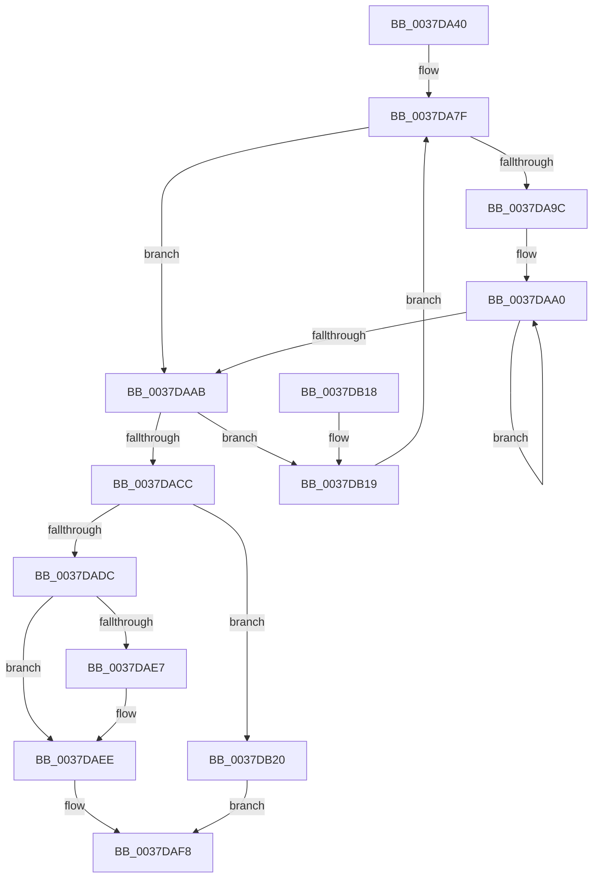

# KeQuerySystemTimePrecise

- RVA: `0x0037DA40`–`0x0037DB28` (길이 `232` bytes)
- VA: `0x000000014037DA40`
- 실행 섹션: `.text`
- PDB 이름 있음: `예`; PDB Function 태그: `아니요`
- unwind 정보 RVA: `0x0007B4E8`
- 디코드: `64`개 명령, `232/232` bytes 표시
- 미해석 바이트: `0` (있으면 어셈블리에 `.byte`로 보존)

> 이 문서는 커널 이미지의 기계어와 PDB 기호를 분석해 생성했습니다. 4번과 5번은 함수 원형과 자료형을 바이너리 사용 방식에서 추정한 C 해석이며 원본 소스 복구 결과는 아닙니다.

## 1. Dependencies

- 직접 호출 지점: **1**; 고유 호출 대상: **1**
- 직접 호출자로 확인된 함수: **11**
- RIP 상대 이미지 참조: **0**

### Outgoing calls
- `0x0037DABA` → [KeQueryPerformanceCounter](KeQueryPerformanceCounter_function_0037E7E0.md) (function, `0x0037E7E0`)

### Direct callers
- [EtwpTraceSystemShutdown](../../page/7B/EtwpTraceSystemShutdown_function_007B8A18.md) at `0x007B8A3D`
- [PspNotifyThreadCreation](../../page/8D/PspNotifyThreadCreation_function_008D5D48.md) at `0x008D5DA1`
- [PspExitLastThread](../../page/90/PspExitLastThread_function_00904184.md) at `0x00904435`
- [PspExitThread](../../page/90/PspExitThread_function_00905F60.md) at `0x00906432`
- [NtQueryInformationProcess](../../page/9A/NtQueryInformationProcess_function_009AA250.md) at `0x009ACD2B`
- [EtwpFinalizeHeader](../../page/9C/EtwpFinalizeHeader_function_009C1EF0.md) at `0x009C2040`
- [PspAllocateThread](../../page/9E/PspAllocateThread_function_009EF72C.md) at `0x009EFBEB`
- [EtwTraceLpacAccessFailure](../../page/9F/EtwTraceLpacAccessFailure_function_009FEF40.md) at `0x009FEF6D`
- [PspAllocateProcess](../../page/A1/PspAllocateProcess_function_00A13B3C.md) at `0x00A1630B`
- [EtwpInitLoggerContext](../../page/A7/EtwpInitLoggerContext_function_00A7154C.md) at `0x00A716CD`
- [EtwpInitializeTimeStamp](../../page/A8/EtwpInitializeTimeStamp_function_00A8F750.md) at `0x00A8F88A`
- [EtwpInitializeTimeStamp](../../page/A8/EtwpInitializeTimeStamp_function_00A8F750.md) at `0x00A8F8A3`

### Static image references
- 디코드된 RIP-relative 메모리 참조가 없습니다.

## 2. Other-region calls and transfers

- 다른 실행 섹션으로 향하는 call: **0**
- 별도 외부 분기/꼬리 이동을 확인하지 못했습니다.

## 3. Assembly (complete function range)

```asm
0037DA40  48 89 5C 24 10                  mov qword ptr [rsp + 0x10], rbx
0037DA45  48 89 6C 24 18                  mov qword ptr [rsp + 0x18], rbp
0037DA4A  48 89 74 24 20                  mov qword ptr [rsp + 0x20], rsi
0037DA4F  48 89 4C 24 08                  mov qword ptr [rsp + 8], rcx
0037DA54  57                              push rdi
0037DA55  41 54                           push r12
0037DA57  41 55                           push r13
0037DA59  41 56                           push r14
0037DA5B  41 57                           push r15
0037DA5D  48 83 EC 20                     sub rsp, 0x20
0037DA61  49 BC 40 03 00 00 80 F7 FF FF   movabs r12, 0xfffff78000000340
0037DA6B  49 BD 48 03 00 00 80 F7 FF FF   movabs r13, 0xfffff78000000348
0037DA75  49 BF 58 03 00 00 80 F7 FF FF   movabs r15, 0xfffff78000000358
0037DA7F  49 8B 1C 24                     mov rbx, qword ptr [r12]
0037DA83  48 B9 14 00 00 00 80 F7 FF FF   movabs rcx, 0xfffff78000000014
0037DA8D  48 B8 68 03 00 00 80 F7 FF FF   movabs rax, 0xfffff78000000368
0037DA97  F6 C3 01                        test bl, 1
0037DA9A  74 0F                           je 0x14037daab
0037DA9C  0F 1F 40 00                     nop dword ptr [rax]
0037DAA0  F3 90                           pause
0037DAA2  49 8B 1C 24                     mov rbx, qword ptr [r12]
0037DAA6  F6 C3 01                        test bl, 1
0037DAA9  75 F5                           jne 0x14037daa0
0037DAAB  48 8B 29                        mov rbp, qword ptr [rcx]
0037DAAE  33 C9                           xor ecx, ecx
0037DAB0  49 8B 75 00                     mov rsi, qword ptr [r13]
0037DAB4  4D 8B 37                        mov r14, qword ptr [r15]
0037DAB7  0F B6 38                        movzx edi, byte ptr [rax]
0037DABA  E8 21 0D 00 00                  call 0x14037e7e0
0037DABF  48 8B D0                        mov rdx, rax
0037DAC2  90                              nop
0037DAC3  49 8B 04 24                     mov rax, qword ptr [r12]
0037DAC7  48 3B C3                        cmp rax, rbx
0037DACA  75 4D                           jne 0x14037db19
0037DACC  4C 8B 7C 24 50                  mov r15, qword ptr [rsp + 0x50]
0037DAD1  41 BD 00 00 00 00               mov r13d, 0
0037DAD7  48 3B D6                        cmp rdx, rsi
0037DADA  76 44                           jbe 0x14037db20
0037DADC  48 2B D6                        sub rdx, rsi
0037DADF  48 FF CA                        dec rdx
0037DAE2  40 84 FF                        test dil, dil
0037DAE5  74 07                           je 0x14037daee
0037DAE7  40 0F B6 CF                     movzx ecx, dil
0037DAEB  48 D3 E2                        shl rdx, cl
0037DAEE  49 8B C6                        mov rax, r14
0037DAF1  48 F7 E2                        mul rdx
0037DAF4  48 8D 04 2A                     lea rax, [rdx + rbp]
0037DAF8  48 8B 5C 24 58                  mov rbx, qword ptr [rsp + 0x58]
0037DAFD  48 8B 6C 24 60                  mov rbp, qword ptr [rsp + 0x60]
0037DB02  48 8B 74 24 68                  mov rsi, qword ptr [rsp + 0x68]
0037DB07  49 89 07                        mov qword ptr [r15], rax
0037DB0A  48 83 C4 20                     add rsp, 0x20
0037DB0E  41 5F                           pop r15
0037DB10  41 5E                           pop r14
0037DB12  41 5D                           pop r13
0037DB14  41 5C                           pop r12
0037DB16  5F                              pop rdi
0037DB17  C3                              ret
0037DB18  CC                              int3
0037DB19  F3 90                           pause
0037DB1B  E9 5F FF FF FF                  jmp 0x14037da7f
0037DB20  48 8B C5                        mov rax, rbp
0037DB23  49 03 C5                        add rax, r13
0037DB26  EB D0                           jmp 0x14037daf8
```

## 4. C-style interpretation (structured pseudocode)

```c
__int64 __fastcall KeQuerySystemTimePrecise(__int64 a1)
{
    __int64 result;
    __int64 v_rsp;
    unsigned __int64 v_stack_p10;
    unsigned __int64 v_stack_p18;
    unsigned __int64 v_stack_p20;
    unsigned __int64 v_stack_p8;

    v_stack_p10 = v_rbx;
    v_stack_p18 = v_rbp;
    v_stack_p20 = v_rsi;
    v_stack_p8 = a1;
    v_rsp = (v_rsp) - (32);
loc_0037DA7F:
    if ((((unsigned __int8)(*(unsigned __int64 *)(v_r12))) & (1)) == 0) goto loc_0037DAAB;
loc_0037DAA0:
    if ((((unsigned __int8)(*(unsigned __int64 *)(v_r12))) & (1)) != 0) goto loc_0037DAA0;
loc_0037DAAB:
    a1 = 0;
    result = KeQueryPerformanceCounter(a1, a2, a3, a4);
    if ((*(unsigned __int64 *)(v_r12)) != (*(unsigned __int64 *)(v_r12))) goto loc_0037DB19;
    if (result <= (*(unsigned __int64 *)(v_r13))) goto loc_0037DB20;
    a2 = (result) - (*(unsigned __int64 *)(v_r13));
    a2 = (a2) - 1;
    if ((unsigned __int8)(*(unsigned __int8 *)(result)) != 0) {
        a1 = (unsigned __int8)(*(unsigned __int8 *)(result));
        a2 = (a2) << ((unsigned __int8)(a1));
    }
loc_0037DAF8:
    *(unsigned __int64 *)(v_stack_p8) = a2 + *(unsigned __int64 *)(a1) * 1;
    v_rsp = (v_rsp) + (32);
    return a2 + *(unsigned __int64 *)(a1) * 1;
loc_0037DB19:
    goto loc_0037DA7F;
loc_0037DB20:
    result = (v_stack_p18) + (0);
    goto loc_0037DAF8;
}
```

## 5. (Beta) C Style

```c
int64_t KeQuerySystemTimePrecise(int64_t Arg1)
{
    int64_t result;
    int64_t local_rsp;
    uint64_t v_stack_p10;
    uint64_t v_stack_p18;
    uint64_t v_stack_p20;
    uint64_t v_stack_p8;

    v_stack_p10 = local_rbx;
    v_stack_p18 = local_rbp;
    v_stack_p20 = local_rsi;
    v_stack_p8 = Arg1;
    local_rsp = (local_rsp) - (32);
loc_0037DA7F:
    if ((((uint8_t)(*(uint64_t *)(local_r12))) & (1)) == 0) goto loc_0037DAAB;
loc_0037DAA0:
    if ((((uint8_t)(*(uint64_t *)(local_r12))) & (1)) != 0) goto loc_0037DAA0;
loc_0037DAAB:
    Arg1 = 0;
    result = KeQueryPerformanceCounter(Arg1, a2, a3, a4);
    if ((*(uint64_t *)(local_r12)) != (*(uint64_t *)(local_r12))) goto loc_0037DB19;
    if (result <= (*(uint64_t *)(local_r13))) goto loc_0037DB20;
    a2 = (result) - (*(uint64_t *)(local_r13));
    a2 = (a2) - 1;
    if ((uint8_t)(*(uint8_t *)(result)) != 0) {
        Arg1 = (uint8_t)(*(uint8_t *)(result));
        a2 = (a2) << ((uint8_t)(Arg1));
    }
loc_0037DAF8:
    *(uint64_t *)(v_stack_p8) = a2 + *(uint64_t *)(Arg1) * 1;
    local_rsp = (local_rsp) + (32);
    return a2 + *(uint64_t *)(Arg1) * 1;
loc_0037DB19:
    goto loc_0037DA7F;
loc_0037DB20:
    result = (v_stack_p18) + (0);
    goto loc_0037DAF8;
}
```

## 6. Execution-region graph

[열기: 2D/3D 그래프와 함수 탐색 컨트롤 패널](../../../control-panel.html?section=text&rva=0x0037DA40&view=graph)

- 2D 그래프는 위에서 아래로 흐르고, 3D 그래프는 빈 공간을 드래그해 회전합니다. Shift+드래그는 이동, 휠은 확대·축소, 함수 노드 선택은 대상 보고서 이동입니다.

### Static fallback


