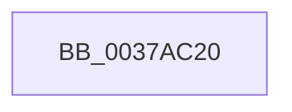

# KeQueryUnbiasedInterruptTimePrecise

- RVA: `0x0037AC20`–`0x0037AC2F` (길이 `15` bytes)
- VA: `0x000000014037AC20`
- 실행 섹션: `.text`
- PDB 이름 있음: `예`; PDB Function 태그: `아니요`
- unwind 정보 RVA: `0x0007B08C`
- 디코드: `4`개 명령, `15/15` bytes 표시
- 미해석 바이트: `0` (있으면 어셈블리에 `.byte`로 보존)

> 이 문서는 커널 이미지의 기계어와 PDB 기호를 분석해 생성했습니다. 4번과 5번은 함수 원형과 자료형을 바이너리 사용 방식에서 추정한 C 해석이며 원본 소스 복구 결과는 아닙니다.

## 1. Dependencies

- 직접 호출 지점: **0**; 고유 호출 대상: **0**
- 직접 호출자로 확인된 함수: **10**
- RIP 상대 이미지 참조: **0**

### Outgoing calls
- 직접 디코드된 call 명령이 없습니다.

### Direct callers
- [MiDelayFaultingThread](../2A/MiDelayFaultingThread_function_002A3054.md) at `0x002A3107`
- [MiDelayFaultingThread](../2A/MiDelayFaultingThread_function_002A3054.md) at `0x002A3119`
- [MiPerformOnDemandLargePageCoalesce](MiPerformOnDemandLargePageCoalesce_function_00379678.md) at `0x003797F8`
- [MiPerformOnDemandLargePageCoalesce](MiPerformOnDemandLargePageCoalesce_function_00379678.md) at `0x00379850`
- [IoDiskIoAttributionQuery](IoDiskIoAttributionQuery_function_00379D38.md) at `0x00379D84`
- [MiProcessLargeCoalesceBitmapCandidates](MiProcessLargeCoalesceBitmapCandidates_function_0037A3F0.md) at `0x0037A5A1`
- [VmpProcessInvalidateList](../42/VmpProcessInvalidateList_function_00428A54.md) at `0x00428B95`
- [VmpProcessInvalidateList](../42/VmpProcessInvalidateList_function_00428A54.md) at `0x00428BA7`
- [VmpQueryAccessedState](../42/VmpQueryAccessedState_function_004290A8.md) at `0x00429265`
- [MiAccumulateTimeBoundTime](../4D/MiAccumulateTimeBoundTime_function_004D5FAC.md) at `0x004D5FC0`
- [sub_006EDFF2](../6E/Unknown_function_006EDFF2.md) at `0x006EE059`
- [VmAccessFault](../../page/A1/VmAccessFault_function_00A18BF0.md) at `0x00A18E38`
- [VmAccessFault](../../page/A1/VmAccessFault_function_00A18BF0.md) at `0x00A18FA2`
- [MiMeasureDemandCoalesceTimeBounds](../../init/C6/MiMeasureDemandCoalesceTimeBounds_function_00C6A4FC.md) at `0x00C6A5DC`
- [MiMeasureDemandCoalesceTimeBounds](../../init/C6/MiMeasureDemandCoalesceTimeBounds_function_00C6A4FC.md) at `0x00C6A61B`

### Static image references
- 디코드된 RIP-relative 메모리 참조가 없습니다.

## 2. Other-region calls and transfers

- 다른 실행 섹션으로 향하는 call: **0**
- 별도 외부 분기/꼬리 이동을 확인하지 못했습니다.

## 3. Assembly (complete function range)

```asm
0037AC20  48 8B C4                        mov rax, rsp
0037AC23  48 89 48 08                     mov qword ptr [rax + 8], rcx
0037AC27  57                              push rdi
0037AC28  48 81 EC 90 00 00 00            sub rsp, 0x90
```

## 4. C-style interpretation (structured pseudocode)

```c
__int64 __fastcall KeQueryUnbiasedInterruptTimePrecise(__int64 a1)
{
    __int64 v_rsp;

    *(unsigned __int64 *)(v_rsp + 8) = a1;
    v_rsp = (v_rsp) - (144);
    return v_rsp;
}
```

## 5. (Beta) C Style

```c
int64_t KeQueryUnbiasedInterruptTimePrecise(int64_t Arg1)
{
    int64_t local_rsp;

    *(uint64_t *)(local_rsp + 0x8) = Arg1;
    local_rsp = (local_rsp) - (144);
    return local_rsp;
}
```

## 6. Execution-region graph

[열기: 2D/3D 그래프와 함수 탐색 컨트롤 패널](../../../control-panel.html?section=text&rva=0x0037AC20&view=graph)

- 2D 그래프는 위에서 아래로 흐르고, 3D 그래프는 빈 공간을 드래그해 회전합니다. Shift+드래그는 이동, 휠은 확대·축소, 함수 노드 선택은 대상 보고서 이동입니다.

### Static fallback


