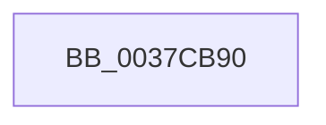

# KiCaptureTotalCyclesCurrentThread

- RVA: `0x0037CB90`–`0x0037CBA3` (길이 `19` bytes)
- VA: `0x000000014037CB90`
- 실행 섹션: `.text`
- PDB 이름 있음: `예`; PDB Function 태그: `아니요`
- unwind 정보 RVA: `0x0007B1FC`
- 디코드: `5`개 명령, `19/19` bytes 표시
- 미해석 바이트: `0` (있으면 어셈블리에 `.byte`로 보존)

> 이 문서는 커널 이미지의 기계어와 PDB 기호를 분석해 생성했습니다. 4번과 5번은 함수 원형과 자료형을 바이너리 사용 방식에서 추정한 C 해석이며 원본 소스 복구 결과는 아닙니다.

## 1. Dependencies

- 직접 호출 지점: **0**; 고유 호출 대상: **0**
- 직접 호출자로 확인된 함수: **10**
- RIP 상대 이미지 참조: **0**

### Outgoing calls
- 직접 디코드된 call 명령이 없습니다.

### Direct callers
- [KiHandleDeferredPreemption](../20/KiHandleDeferredPreemption_function_00202ECC.md) at `0x0020311D`
- [KeYieldExecution](../20/KeYieldExecution_function_00209FA0.md) at `0x0020A189`
- [sub_0021B896](../21/Unknown_function_0021B896.md) at `0x0021B89E`
- [sub_0021C5F2](../21/Unknown_function_0021C5F2.md) at `0x0021C615`
- [KiCheckForThreadDispatch](../25/KiCheckForThreadDispatch_function_00250648.md) at `0x0025071F`
- [sub_00251E24](../25/Unknown_function_00251E24.md) at `0x00251E64`
- [KiGroupSchedulingGenerationEnd](../30/KiGroupSchedulingGenerationEnd_function_0030A9B4.md) at `0x0030A9F8`
- [KiIdleSchedule](../35/KiIdleSchedule_function_00355000.md) at `0x003550EB`
- [KiSwapThread](../35/KiSwapThread_function_00355640.md) at `0x00355680`
- [KiExecuteSmtIsolationThread](../5C/KiExecuteSmtIsolationThread_function_005C4070.md) at `0x005C40FD`

### Static image references
- 디코드된 RIP-relative 메모리 참조가 없습니다.

## 2. Other-region calls and transfers

- 다른 실행 섹션으로 향하는 call: **0**
- 별도 외부 분기/꼬리 이동을 확인하지 못했습니다.

## 3. Assembly (complete function range)

```asm
0037CB90  48 8B C4                        mov rax, rsp
0037CB93  48 89 50 10                     mov qword ptr [rax + 0x10], rdx
0037CB97  55                              push rbp
0037CB98  48 8D 68 A1                     lea rbp, [rax - 0x5f]
0037CB9C  48 81 EC 90 00 00 00            sub rsp, 0x90
```

## 4. C-style interpretation (structured pseudocode)

```c
__int64 __fastcall KiCaptureTotalCyclesCurrentThread(__int64 a1, __int64 a2)
{
    __int64 v_rsp;

    *(unsigned __int64 *)(v_rsp + 16) = a2;
    v_rsp = (v_rsp) - (144);
    return v_rsp;
}
```

## 5. (Beta) C Style

```c
int64_t KiCaptureTotalCyclesCurrentThread(int64_t Arg1, int64_t Arg2)
{
    int64_t local_rsp;

    *(uint64_t *)(local_rsp + 0x10) = Arg2;
    local_rsp = (local_rsp) - (144);
    return local_rsp;
}
```

## 6. Execution-region graph

[열기: 2D/3D 그래프와 함수 탐색 컨트롤 패널](../../../control-panel.html?section=text&rva=0x0037CB90&view=graph)

- 2D 그래프는 위에서 아래로 흐르고, 3D 그래프는 빈 공간을 드래그해 회전합니다. Shift+드래그는 이동, 휠은 확대·축소, 함수 노드 선택은 대상 보고서 이동입니다.

### Static fallback


