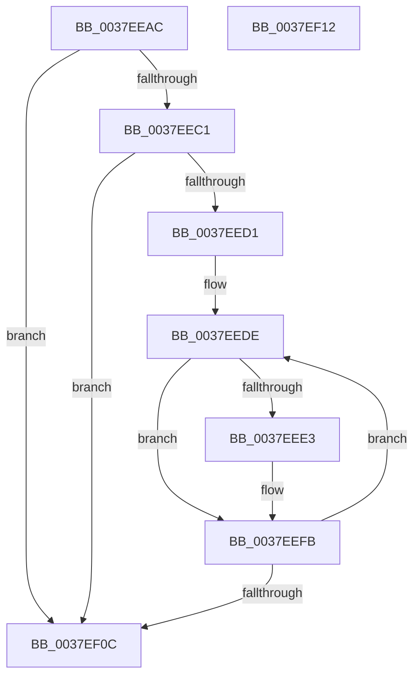

# KiEndCounterAccumulation

- RVA: `0x0037EEAC`–`0x0037EF13` (길이 `103` bytes)
- VA: `0x000000014037EEAC`
- 실행 섹션: `.text`
- PDB 이름 있음: `예`; PDB Function 태그: `아니요`
- unwind 정보 RVA: `0x00071750`
- 디코드: `30`개 명령, `103/103` bytes 표시
- 미해석 바이트: `0` (있으면 어셈블리에 `.byte`로 보존)

> 이 문서는 커널 이미지의 기계어와 PDB 기호를 분석해 생성했습니다. 4번과 5번은 함수 원형과 자료형을 바이너리 사용 방식에서 추정한 C 해석이며 원본 소스 복구 결과는 아닙니다.

## 1. Dependencies

- 직접 호출 지점: **0**; 고유 호출 대상: **0**
- 직접 호출자로 확인된 함수: **9**
- RIP 상대 이미지 참조: **2**

### Outgoing calls
- 직접 디코드된 call 명령이 없습니다.

### Direct callers
- [KiRetireDpcList](../21/KiRetireDpcList_function_0021A0B0.md) at `0x0021A8B8`
- [sub_002573DE](../25/Unknown_function_002573DE.md) at `0x00257422`
- [sub_0037B54F](Unknown_function_0037B54F.md) at `0x0037B8B1`
- [KiEndThreadCycleAccumulation](KiEndThreadCycleAccumulation_function_0037BFF0.md) at `0x0037C443`
- [sub_0037CFDC](Unknown_function_0037CFDC.md) at `0x0037D022`
- [KiUpdateTotalCyclesCurrentThread](KiUpdateTotalCyclesCurrentThread_function_0037DE40.md) at `0x0037E3AD`
- [KeQueryTotalCycleTimeThread](KeQueryTotalCycleTimeThread_function_0037EF20.md) at `0x0037F514`
- [KiEndThreadAccountingPeriodEx](KiEndThreadAccountingPeriodEx_function_0037FD00.md) at `0x0037FF44`
- [KeUpdateTotalCyclesCurrentThread](../3F/KeUpdateTotalCyclesCurrentThread_function_003FA2B0.md) at `0x003FA83D`

### Static image references
- `0x0037EEC1` → RVA `0x00E66908` (`.data`; read)
- `0x0037EED1` → RVA `0x00F10E80` (`.data`; read)

## 2. Other-region calls and transfers

- 다른 실행 섹션으로 향하는 call: **0**
- 별도 외부 분기/꼬리 이동을 확인하지 못했습니다.

## 3. Assembly (complete function range)

```asm
0037EEAC  48 89 5C 24 08                  mov qword ptr [rsp + 8], rbx
0037EEB1  4C 8B 81 68 01 00 00            mov r8, qword ptr [rcx + 0x168]
0037EEB8  4D 8B 58 20                     mov r11, qword ptr [r8 + 0x20]
0037EEBC  4D 85 DB                        test r11, r11
0037EEBF  74 4B                           je 0x14037ef0c
0037EEC1  8B 05 41 7A AE 00               mov eax, dword ptr [rip + 0xae7a41]
0037EEC7  41 B9 01 00 00 00               mov r9d, 1
0037EECD  85 C0                           test eax, eax
0037EECF  74 3B                           je 0x14037ef0c
0037EED1  4C 8D 15 A8 1F B9 00            lea r10, [rip + 0xb91fa8]
0037EED8  49 83 C0 30                     add r8, 0x30
0037EEDC  8B D8                           mov ebx, eax
0037EEDE  4D 85 D9                        test r9, r11
0037EEE1  74 18                           je 0x14037eefb
0037EEE3  41 8B 0A                        mov ecx, dword ptr [r10]
0037EEE6  0F 33                           rdpmc
0037EEE8  48 C1 E2 20                     shl rdx, 0x20
0037EEEC  48 0B C2                        or rax, rdx
0037EEEF  8B C8                           mov ecx, eax
0037EEF1  41 2B 08                        sub ecx, dword ptr [r8]
0037EEF4  49 01 48 08                     add qword ptr [r8 + 8], rcx
0037EEF8  49 89 00                        mov qword ptr [r8], rax
0037EEFB  4D 03 C9                        add r9, r9
0037EEFE  49 83 C2 04                     add r10, 4
0037EF02  49 83 C0 18                     add r8, 0x18
0037EF06  48 83 EB 01                     sub rbx, 1
0037EF0A  75 D2                           jne 0x14037eede
0037EF0C  48 8B 5C 24 08                  mov rbx, qword ptr [rsp + 8]
0037EF11  C3                              ret
0037EF12  CC                              int3
```

## 4. C-style interpretation (structured pseudocode)

```c
__int64 __fastcall KiEndCounterAccumulation(__int64 a1, __int64 a2)
{
    __int64 result;
    __int64 v_r10;
    __int64 v_rbx;
    unsigned __int64 v_stack_p8;

    v_stack_p8 = v_rbx;
    if (*(unsigned __int64 *)(*(unsigned __int64 *)(a1 + 360) + 32) == 0) goto loc_0037EF0C;
    if ((unsigned int)((unsigned int)(*(unsigned int *)(v_rip + 11434561))) == 0) goto loc_0037EF0C;
    a3 = (*(unsigned __int64 *)(a1 + 360)) + (48);
loc_0037EEDE:
    result = (unsigned int)(*(unsigned int *)(v_rip + 11434561));
    if (((1) & (*(unsigned __int64 *)(*(unsigned __int64 *)(a1 + 360) + 32))) != 0) {
        a1 = *(unsigned int *)(v_rip + 12132264);
        a2 = (a2) << (32);
        result = ((unsigned int)(*(unsigned int *)(v_rip + 11434561))) | (a2);
        a1 = (unsigned int)(result);
        a1 = (unsigned int)((a1) - (*(unsigned int *)(a3)));
        *(unsigned __int64 *)(a3) = result;
    }
    a4 = (1) + (1);
    v_r10 = (v_rip + 12132264) + (4);
    a3 = (a3) + (24);
    v_rbx = ((unsigned int)((unsigned int)((unsigned int)(*(unsigned int *)(v_rip + 11434561))))) - (1);
    if (condition_is_not_equal) goto loc_0037EEDE;
loc_0037EF0C:
    return result;
}
```

## 5. (Beta) C Style

```c
int64_t KiEndCounterAccumulation(void *Arg1, int64_t Arg2)
{
    uint8_t *arg1 = (uint8_t *)Arg1;

    int64_t result;
    int64_t local_r10;
    int64_t local_rbx;
    uint64_t v_stack_p8;

    v_stack_p8 = local_rbx;
    if (*(uint64_t *)(*(uint64_t *)(arg1 + 0x168) + 0x20) == 0) goto loc_0037EF0C;
    if ((uint32_t)((uint32_t)(*(uint32_t *)(v_rip + 0xAE7A41))) == 0) goto loc_0037EF0C;
    a3 = (*(uint64_t *)(arg1 + 0x168)) + (48);
loc_0037EEDE:
    result = (uint32_t)(*(uint32_t *)(v_rip + 0xAE7A41));
    if (((1) & (*(uint64_t *)(*(uint64_t *)(arg1 + 0x168) + 0x20))) != 0) {
        Arg1 = *(uint32_t *)(v_rip + 0xB91FA8);
        Arg2 = (Arg2) << (32);
        result = ((uint32_t)(*(uint32_t *)(v_rip + 0xAE7A41))) | (Arg2);
        Arg1 = (uint32_t)(result);
        Arg1 = (uint32_t)((Arg1) - (*(uint32_t *)(a3)));
        *(uint64_t *)(a3) = result;
    }
    a4 = (1) + (1);
    local_r10 = (v_rip + 12132264) + (4);
    a3 = (a3) + (24);
    local_rbx = ((uint32_t)((uint32_t)((uint32_t)(*(uint32_t *)(v_rip + 0xAE7A41))))) - (1);
    if (condition_is_not_equal) goto loc_0037EEDE;
loc_0037EF0C:
    return result;
}
```

### 관측된 메모리 오프셋

구조체 형식이 확인되지 않은 접근은 인자 기준의 오프셋으로만 기록했습니다.

| 기준 인자 | 오프셋 표현 | 폭 (bit) | 접근 |
|---|---:|---:|---|
| `Arg1` | `+ 0x168` | `64` | `R` |

## 6. Execution-region graph

[열기: 2D/3D 그래프와 함수 탐색 컨트롤 패널](../../../control-panel.html?section=text&rva=0x0037EEAC&view=graph)

- 2D 그래프는 위에서 아래로 흐르고, 3D 그래프는 빈 공간을 드래그해 회전합니다. Shift+드래그는 이동, 휠은 확대·축소, 함수 노드 선택은 대상 보고서 이동입니다.

### Static fallback


