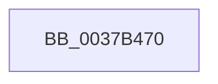

# KiEndIdleCycleAccumulation

- RVA: `0x0037B470`–`0x0037B4AE` (길이 `62` bytes)
- VA: `0x000000014037B470`
- 실행 섹션: `.text`
- PDB 이름 있음: `예`; PDB Function 태그: `아니요`
- unwind 정보 RVA: `0x0007B114`
- 디코드: `21`개 명령, `62/62` bytes 표시
- 미해석 바이트: `0` (있으면 어셈블리에 `.byte`로 보존)

> 이 문서는 커널 이미지의 기계어와 PDB 기호를 분석해 생성했습니다. 4번과 5번은 함수 원형과 자료형을 바이너리 사용 방식에서 추정한 C 해석이며 원본 소스 복구 결과는 아닙니다.

## 1. Dependencies

- 직접 호출 지점: **0**; 고유 호출 대상: **0**
- 직접 호출자로 확인된 함수: **1**
- RIP 상대 이미지 참조: **0**

### Outgoing calls
- 직접 디코드된 call 명령이 없습니다.

### Direct callers
- [KiIdleLoop](../6B/KiIdleLoop_function_006B2910.md) at `0x006B29FB`

### Static image references
- 디코드된 RIP-relative 메모리 참조가 없습니다.

## 2. Other-region calls and transfers

- 다른 실행 섹션으로 향하는 call: **0**
- call이 아닌 외부 분기/꼬리 이동: **1**
  - `0x0037B4A8` → [sub_0037B54F + 0xCF](Unknown_function_0037B54F.md) (`tail-transfer`)

## 3. Assembly (complete function range)

```asm
0037B470  48 89 54 24 10                  mov qword ptr [rsp + 0x10], rdx
0037B475  55                              push rbp
0037B476  53                              push rbx
0037B477  56                              push rsi
0037B478  57                              push rdi
0037B479  41 54                           push r12
0037B47B  41 56                           push r14
0037B47D  41 57                           push r15
0037B47F  48 8B EC                        mov rbp, rsp
0037B482  48 83 EC 60                     sub rsp, 0x60
0037B486  45 33 FF                        xor r15d, r15d
0037B489  C6 41 20 01                     mov byte ptr [rcx + 0x20], 1
0037B48D  90                              nop
0037B48E  4C 8B F2                        mov r14, rdx
0037B491  48 8B F1                        mov rsi, rcx
0037B494  45 8B DF                        mov r11d, r15d
0037B497  41 8B DF                        mov ebx, r15d
0037B49A  41 8B FF                        mov edi, r15d
0037B49D  45 8D 67 01                     lea r12d, [r15 + 1]
0037B4A1  44 38 B9 DC 86 00 00            cmp byte ptr [rcx + 0x86dc], r15b
0037B4A8  0F 84 70 01 00 00               je 0x14037b61e
```

## 4. C-style interpretation (structured pseudocode)

```c
void __fastcall KiEndIdleCycleAccumulation(__int64 a1, __int64 a2)
{
    __int64 v_r15;
    __int64 v_rsp;
    unsigned __int64 v_stack_p10;

    v_stack_p10 = a2;
    v_rsp = (v_rsp) - (96);
    v_r15 = 0;
    *(unsigned __int8 *)(a1 + 32) = 1;
}
```

## 5. (Beta) C Style

```c
void KiEndIdleCycleAccumulation(void *Arg1, int64_t Arg2)
{
    uint8_t *arg1 = (uint8_t *)Arg1;

    int64_t local_r15;
    int64_t local_rsp;
    uint64_t v_stack_p10;

    v_stack_p10 = Arg2;
    local_rsp = (local_rsp) - (96);
    local_r15 = 0;
    *(uint8_t *)(arg1 + 0x20) = 1;
}
```

### 관측된 메모리 오프셋

구조체 형식이 확인되지 않은 접근은 인자 기준의 오프셋으로만 기록했습니다.

| 기준 인자 | 오프셋 표현 | 폭 (bit) | 접근 |
|---|---:|---:|---|
| `Arg1` | `+ 0x20` | `8` | `W` |
| `Arg1` | `+ 0x86DC` | `8` | `R` |

## 6. Execution-region graph

[열기: 2D/3D 그래프와 함수 탐색 컨트롤 패널](../../../control-panel.html?section=text&rva=0x0037B470&view=graph)

- 2D 그래프는 위에서 아래로 흐르고, 3D 그래프는 빈 공간을 드래그해 회전합니다. Shift+드래그는 이동, 휠은 확대·축소, 함수 노드 선택은 대상 보고서 이동입니다.

### Static fallback


