# KiEndThreadAccountingPeriodEx

- RVA: `0x0037FD00`–`0x0038006C` (길이 `876` bytes)
- VA: `0x000000014037FD00`
- 실행 섹션: `.text`
- PDB 이름 있음: `예`; PDB Function 태그: `아니요`
- unwind 정보 RVA: `0x0007B820`
- 디코드: `213`개 명령, `876/876` bytes 표시
- 미해석 바이트: `0` (있으면 어셈블리에 `.byte`로 보존)

> 이 문서는 커널 이미지의 기계어와 PDB 기호를 분석해 생성했습니다. 4번과 5번은 함수 원형과 자료형을 바이너리 사용 방식에서 추정한 C 해석이며 원본 소스 복구 결과는 아닙니다.

## 1. Dependencies

- 직접 호출 지점: **2**; 고유 호출 대상: **2**
- 직접 호출자로 확인된 함수: **1**
- RIP 상대 이미지 참조: **6**

### Outgoing calls
- `0x0037FEC9` → [KiUpdateThreadHgsFeedback](KiUpdateThreadHgsFeedback_function_0037D790.md) (function, `0x0037D790`)
- `0x0037FF44` → [KiEndCounterAccumulation](KiEndCounterAccumulation_function_0037EEAC.md) (function, `0x0037EEAC`)

### Direct callers
- [KiEndThreadAccountingPeriod](../5C/KiEndThreadAccountingPeriod_function_005C4050.md) at `0x005C4057`

### Static image references
- `0x0037FE1C` → RVA `0x00F10A44` (`.data`; read)
- `0x0037FE48` → RVA `0x00FC6D60` (`ALMOSTRO`; read)
- `0x0037FEB3` → RVA `0x00FC6ADE` (`ALMOSTRO`; read)
- `0x0037FECE` → RVA `0x00FCFF00` (`CACHEALI`; read)
- `0x0037FFF9` → RVA `0x00FC537C` (`ALMOSTRO`; read)
- `0x0038000C` → RVA `0x00FC53E0` (`ALMOSTRO`; read)

## 2. Other-region calls and transfers

- 다른 실행 섹션으로 향하는 call: **0**
- 별도 외부 분기/꼬리 이동을 확인하지 못했습니다.

## 3. Assembly (complete function range)

```asm
0037FD00  48 89 5C 24 18                  mov qword ptr [rsp + 0x18], rbx
0037FD05  55                              push rbp
0037FD06  56                              push rsi
0037FD07  57                              push rdi
0037FD08  41 56                           push r14
0037FD0A  41 57                           push r15
0037FD0C  48 83 EC 20                     sub rsp, 0x20
0037FD10  0F B6 7A 02                     movzx edi, byte ptr [rdx + 2]
0037FD14  33 ED                           xor ebp, ebp
0037FD16  45 0F B6 F9                     movzx r15d, r9b
0037FD1A  4D 8B F0                        mov r14, r8
0037FD1D  48 8B DA                        mov rbx, rdx
0037FD20  48 8B F1                        mov rsi, rcx
0037FD23  44 8D 5D 01                     lea r11d, [rbp + 1]
0037FD27  40 84 FF                        test dil, dil
0037FD2A  79 54                           jns 0x14037fd80
0037FD2C  48 8B 82 20 02 00 00            mov rax, qword ptr [rdx + 0x220]
0037FD33  41 8B D3                        mov edx, r11d
0037FD36  4C 8B 81 B0 8B 00 00            mov r8, qword ptr [rcx + 0x8bb0]
0037FD3D  44 8B 90 90 01 00 00            mov r10d, dword ptr [rax + 0x190]
0037FD44  41 8B C2                        mov eax, r10d
0037FD47  C1 E8 0D                        shr eax, 0xd
0037FD4A  25 FF FF 03 00                  and eax, 0x3ffff
0037FD4F  49 C1 EA 04                     shr r10, 4
0037FD53  0F BD C8                        bsr ecx, eax
0037FD56  41 81 E2 FF 01 00 00            and r10d, 0x1ff
0037FD5D  D3 E2                           shl edx, cl
0037FD5F  83 C1 FE                        add ecx, -2
0037FD62  33 D0                           xor edx, eax
0037FD64  89 4C 24 50                     mov dword ptr [rsp + 0x50], ecx
0037FD68  49 8B 0C C8                     mov rcx, qword ptr [r8 + rcx*8]
0037FD6C  48 8B 54 D1 08                  mov rdx, qword ptr [rcx + rdx*8 + 8]
0037FD71  4A 8B 04 D2                     mov rax, qword ptr [rdx + r10*8]
0037FD75  49 03 C6                        add rax, r14
0037FD78  4A 89 04 D2                     mov qword ptr [rdx + r10*8], rax
0037FD7C  40 80 E7 7F                     and dil, 0x7f
0037FD80  40 F6 C7 10                     test dil, 0x10
0037FD84  0F 85 D9 01 00 00               jne 0x14037ff63
0037FD8A  40 F6 C7 20                     test dil, 0x20
0037FD8E  0F 84 15 01 00 00               je 0x14037fea9
0037FD94  4C 8B 83 88 06 00 00            mov r8, qword ptr [rbx + 0x688]
0037FD9B  4D 85 C0                        test r8, r8
0037FD9E  0F 84 01 01 00 00               je 0x14037fea5
0037FDA4  48 8B 86 B0 89 00 00            mov rax, qword ptr [rsi + 0x89b0]
0037FDAB  48 8B 96 B8 89 00 00            mov rdx, qword ptr [rsi + 0x89b8]
0037FDB2  48 85 C0                        test rax, rax
0037FDB5  0F 84 A7 02 00 00               je 0x140380062
0037FDBB  48 85 D2                        test rdx, rdx
0037FDBE  0F 84 9E 02 00 00               je 0x140380062
0037FDC4  40 38 6A 70                     cmp byte ptr [rdx + 0x70], bpl
0037FDC8  75 11                           jne 0x14037fddb
0037FDCA  8B 52 50                        mov edx, dword ptr [rdx + 0x50]
0037FDCD  8B 88 10 02 00 00               mov ecx, dword ptr [rax + 0x210]
0037FDD3  3B D1                           cmp edx, ecx
0037FDD5  72 0A                           jb 0x14037fde1
0037FDD7  8B D1                           mov edx, ecx
0037FDD9  EB 06                           jmp 0x14037fde1
0037FDDB  8B 92 84 00 00 00               mov edx, dword ptr [rdx + 0x84]
0037FDE1  44 8B CD                        mov r9d, ebp
0037FDE4  48 8D 8E 6A 8A 00 00            lea rcx, [rsi + 0x8a6a]
0037FDEB  0F B7 01                        movzx eax, word ptr [rcx]
0037FDEE  3B D0                           cmp edx, eax
0037FDF0  76 0D                           jbe 0x14037fdff
0037FDF2  41 FF C1                        inc r9d
0037FDF5  48 83 C1 02                     add rcx, 2
0037FDF9  41 83 F9 03                     cmp r9d, 3
0037FDFD  72 EC                           jb 0x14037fdeb
0037FDFF  40 38 AE 08 8A 00 00            cmp byte ptr [rsi + 0x8a08], bpl
0037FE06  45 8B D1                        mov r10d, r9d
0037FE09  4C 8B CD                        mov r9, rbp
0037FE0C  41 0F 95 C1                     setne r9b
0037FE10  4B 8D 04 51                     lea rax, [r9 + r10*2]
0037FE14  49 8B 0C C0                     mov rcx, qword ptr [r8 + rax*8]
0037FE18  49 8D 14 C0                     lea rdx, [r8 + rax*8]
0037FE1C  8B 05 22 0C B9 00               mov eax, dword ptr [rip + 0xb90c22]
0037FE22  49 03 CE                        add rcx, r14
0037FE25  48 89 0A                        mov qword ptr [rdx], rcx
0037FE28  41 8B 88 C0 00 00 00            mov ecx, dword ptr [r8 + 0xc0]
0037FE2F  3B C1                           cmp eax, ecx
0037FE31  0F 87 67 01 00 00               ja 0x14037ff9e
0037FE37  2B C8                           sub ecx, eax
0037FE39  83 F9 20                        cmp ecx, 0x20
0037FE3C  73 0A                           jae 0x14037fe48
0037FE3E  41 D3 E3                        shl r11d, cl
0037FE41  45 09 98 C4 00 00 00            or dword ptr [r8 + 0xc4], r11d
0037FE48  39 2D 12 6F C4 00               cmp dword ptr [rip + 0xc46f12], ebp
0037FE4E  75 1E                           jne 0x14037fe6e
0037FE50  0F B6 8B 04 02 00 00            movzx ecx, byte ptr [rbx + 0x204]
0037FE57  8D 41 FE                        lea eax, [rcx - 2]
0037FE5A  A9 FB FF FF FF                  test eax, 0xfffffffb
0037FE5F  0F 84 E6 00 00 00               je 0x14037ff4b
0037FE65  80 F9 05                        cmp cl, 5
0037FE68  0F 84 DD 00 00 00               je 0x14037ff4b
0037FE6E  48 39 AB 50 06 00 00            cmp qword ptr [rbx + 0x650], rbp
0037FE75  74 2E                           je 0x14037fea5
0037FE77  49 8D 41 10                     lea rax, [r9 + 0x10]
0037FE7B  4A 8D 04 50                     lea rax, [rax + r10*2]
0037FE7F  49 8B 0C C0                     mov rcx, qword ptr [r8 + rax*8]
0037FE83  49 8D 14 C0                     lea rdx, [r8 + rax*8]
0037FE87  49 03 CE                        add rcx, r14
0037FE8A  48 89 0A                        mov qword ptr [rdx], rcx
0037FE8D  4B 8D 0C 51                     lea rcx, [r9 + r10*2]
0037FE91  48 8B 83 50 06 00 00            mov rax, qword ptr [rbx + 0x650]
0037FE98  48 8B 80 88 06 00 00            mov rax, qword ptr [rax + 0x688]
0037FE9F  F0 4C 01 74 C8 40               lock add qword ptr [rax + rcx*8 + 0x40], r14
0037FEA5  40 80 E7 DF                     and dil, 0xdf
0037FEA9  40 F6 C7 40                     test dil, 0x40
0037FEAD  0F 85 D2 00 00 00               jne 0x14037ff85
0037FEB3  40 38 2D 24 6C C4 00            cmp byte ptr [rip + 0xc46c24], bpl
0037FEBA  74 12                           je 0x14037fece
0037FEBC  45 0F B6 CF                     movzx r9d, r15b
0037FEC0  4D 8B C6                        mov r8, r14
0037FEC3  48 8B D3                        mov rdx, rbx
0037FEC6  48 8B CE                        mov rcx, rsi
0037FEC9  E8 C2 D8 FF FF                  call 0x14037d790
0037FECE  4C 8D 05 2B 00 C5 00            lea r8, [rip + 0xc5002b]
0037FED5  48 39 AE B0 86 00 00            cmp qword ptr [rsi + 0x86b0], rbp
0037FEDC  74 0D                           je 0x14037feeb
0037FEDE  4C 39 83 20 02 00 00            cmp qword ptr [rbx + 0x220], r8
0037FEE5  0F 85 EA 00 00 00               jne 0x14037ffd5
0037FEEB  40 F6 C7 BE                     test dil, 0xbe
0037FEEF  75 12                           jne 0x14037ff03
0037FEF1  48 8B 5C 24 60                  mov rbx, qword ptr [rsp + 0x60]
0037FEF6  48 83 C4 20                     add rsp, 0x20
0037FEFA  41 5F                           pop r15
0037FEFC  41 5E                           pop r14
0037FEFE  5F                              pop rdi
0037FEFF  5E                              pop rsi
0037FF00  5D                              pop rbp
0037FF01  C3                              ret
0037FF02  CC                              int3
0037FF03  48 8B 4B 68                     mov rcx, qword ptr [rbx + 0x68]
0037FF07  48 85 C9                        test rcx, rcx
0037FF0A  74 18                           je 0x14037ff24
0037FF0C  8B 86 D8 00 00 00               mov eax, dword ptr [rsi + 0xd8]
0037FF12  48 03 C1                        add rax, rcx
0037FF15  4C 01 30                        add qword ptr [rax], r14
0037FF18  48 8B 80 A0 01 00 00            mov rax, qword ptr [rax + 0x1a0]
0037FF1F  48 85 C0                        test rax, rax
0037FF22  75 F1                           jne 0x14037ff15
0037FF24  F6 43 02 08                     test byte ptr [rbx + 2], 8
0037FF28  74 0D                           je 0x14037ff37
0037FF2A  4C 39 83 20 02 00 00            cmp qword ptr [rbx + 0x220], r8
0037FF31  0F 85 EE 00 00 00               jne 0x140380025
0037FF37  48 83 BB 68 01 00 00 00         cmp qword ptr [rbx + 0x168], 0
0037FF3F  74 B0                           je 0x14037fef1
0037FF41  48 8B CB                        mov rcx, rbx
0037FF44  E8 63 EF FF FF                  call 0x14037eeac
0037FF49  EB A6                           jmp 0x14037fef1
0037FF4B  49 8B D2                        mov rdx, r10
0037FF4E  48 03 D2                        add rdx, rdx
0037FF51  49 8B 4C D0 08                  mov rcx, qword ptr [r8 + rdx*8 + 8]
0037FF56  49 03 CE                        add rcx, r14
0037FF59  49 89 4C D0 08                  mov qword ptr [r8 + rdx*8 + 8], rcx
0037FF5E  E9 0B FF FF FF                  jmp 0x14037fe6e
0037FF63  0F B6 43 7C                     movzx eax, byte ptr [rbx + 0x7c]
0037FF67  48 8D 14 C6                     lea rdx, [rsi + rax*8]
0037FF6B  48 8B 8A 88 86 00 00            mov rcx, qword ptr [rdx + 0x8688]
0037FF72  49 03 CE                        add rcx, r14
0037FF75  48 89 8A 88 86 00 00            mov qword ptr [rdx + 0x8688], rcx
0037FF7C  40 80 E7 EF                     and dil, 0xef
0037FF80  E9 05 FE FF FF                  jmp 0x14037fd8a
0037FF85  48 8B 83 C8 03 00 00            mov rax, qword ptr [rbx + 0x3c8]
0037FF8C  48 85 C0                        test rax, rax
0037FF8F  0F 84 1E FF FF FF               je 0x14037feb3
0037FF95  40 88 68 40                     mov byte ptr [rax + 0x40], bpl
0037FF99  E9 15 FF FF FF                  jmp 0x14037feb3
0037FF9E  8B D0                           mov edx, eax
0037FFA0  89 44 24 58                     mov dword ptr [rsp + 0x58], eax
0037FFA4  2B D1                           sub edx, ecx
0037FFA6  83 FA 20                        cmp edx, 0x20
0037FFA9  73 23                           jae 0x14037ffce
0037FFAB  41 8B 80 C4 00 00 00            mov eax, dword ptr [r8 + 0xc4]
0037FFB2  8B CA                           mov ecx, edx
0037FFB4  D3 E0                           shl eax, cl
0037FFB6  41 0B C3                        or eax, r11d
0037FFB9  89 44 24 5C                     mov dword ptr [rsp + 0x5c], eax
0037FFBD  48 8B 44 24 58                  mov rax, qword ptr [rsp + 0x58]
0037FFC2  49 89 80 C0 00 00 00            mov qword ptr [r8 + 0xc0], rax
0037FFC9  E9 7A FE FF FF                  jmp 0x14037fe48
0037FFCE  44 89 5C 24 5C                  mov dword ptr [rsp + 0x5c], r11d
0037FFD3  EB E8                           jmp 0x14037ffbd
0037FFD5  0F B6 83 04 02 00 00            movzx eax, byte ptr [rbx + 0x204]
0037FFDC  8B D0                           mov edx, eax
0037FFDE  83 F8 07                        cmp eax, 7
0037FFE1  0F 83 04 FF FF FF               jae 0x14037feeb
0037FFE7  8B 43 54                        mov eax, dword ptr [rbx + 0x54]
0037FFEA  8B 4B 50                        mov ecx, dword ptr [rbx + 0x50]
0037FFED  3B C8                           cmp ecx, eax
0037FFEF  0F 46 C8                        cmovbe ecx, eax
0037FFF2  0F B6 83 05 02 00 00            movzx eax, byte ptr [rbx + 0x205]
0037FFF9  3B 0D 7D 53 C4 00               cmp ecx, dword ptr [rip + 0xc4537d]
0037FFFF  8D 0C 55 00 00 00 00            lea ecx, [rdx*2]
00380006  40 0F 93 C5                     setae bpl
0038000A  03 CD                           add ecx, ebp
0038000C  0F AF 0D CD 53 C4 00            imul ecx, dword ptr [rip + 0xc453cd]
00380013  03 C8                           add ecx, eax
00380015  48 8B 86 B0 86 00 00            mov rax, qword ptr [rsi + 0x86b0]
0038001C  4C 01 34 C8                     add qword ptr [rax + rcx*8], r14
00380020  E9 C6 FE FF FF                  jmp 0x14037feeb
00380025  4C 8B 86 C0 00 00 00            mov r8, qword ptr [rsi + 0xc0]
0038002C  48 8B 83 40 02 00 00            mov rax, qword ptr [rbx + 0x240]
00380033  41 0F B7 88 88 00 00 00         movzx ecx, word ptr [r8 + 0x88]
0038003B  48 8B 54 C8 08                  mov rdx, qword ptr [rax + rcx*8 + 8]
00380040  49 8B 88 80 00 00 00            mov rcx, qword ptr [r8 + 0x80]
00380047  48 8B C1                        mov rax, rcx
0038004A  48 23 C2                        and rax, rdx
0038004D  48 3B C1                        cmp rax, rcx
00380050  0F 84 E1 FE FF FF               je 0x14037ff37
00380056  4C 01 B6 A8 86 00 00            add qword ptr [rsi + 0x86a8], r14
0038005D  E9 D5 FE FF FF                  jmp 0x14037ff37
00380062  BA 64 00 00 00                  mov edx, 0x64
00380067  E9 75 FD FF FF                  jmp 0x14037fde1
```

## 4. C-style interpretation (structured pseudocode)

```c
__int64 __fastcall KiEndThreadAccountingPeriodEx(__int64 a1, __int64 a2, __int64 a3, unsigned __int8 a4)
{
    __int64 result;
    __int64 v_r10;
    __int64 v_r11;
    __int64 v_rbp;
    __int64 v_rdi;
    __int64 v_rsp;
    unsigned __int64 v_stack_p18;
    unsigned int v_stack_p58;
    unsigned int v_stack_p5C;
    unsigned int v_stack_p8;

    v_stack_p18 = v_rbx;
    v_rsp = (v_rsp) - (32);
    v_rbp = 0;
    v_rdi = *(unsigned __int8 *)(a2 + 2);
    if (sign_flag) {
        result = *(unsigned __int64 *)(a2 + 544);
        a2 = (unsigned int)(v_rbp + 1);
        a3 = *(unsigned __int64 *)(a1 + 35760);
        v_r10 = *(unsigned int *)(result + 400);
        result = (unsigned int)(v_r10);
        result = (unsigned int)((result) >> (13));
        result = (unsigned int)((result) & (0x3FFFFULL));
        v_r10 = (v_r10) >> (4);
        v_r10 = (unsigned int)((v_r10) & (511));
        a2 = (unsigned int)((a2) << ((unsigned __int8)(a1)));
        a1 = (unsigned int)((a1) + (-2));
        a2 = (unsigned int)((a2) ^ ((unsigned int)(result)));
        v_stack_p8 = (unsigned int)(a1);
        a1 = *(unsigned __int64 *)(a3 + a1 * 8);
        a2 = *(unsigned __int64 *)(a1 + a2 * 8 + 8);
        result = *(unsigned __int64 *)(a2 + v_r10 * 8);
        result = (result) + (a3);
        *(unsigned __int64 *)(a2 + v_r10 * 8) = result;
        v_rdi = (unsigned __int8)((*(unsigned __int8 *)(a2 + 2)) & (127));
    }
    if ((((unsigned __int8)(v_rdi)) & (16)) != 0) goto loc_0037FF63;
loc_0037FD8A:
    if ((((unsigned __int8)(v_rdi)) & (32)) == 0) goto loc_0037FEA9;
    if (*(unsigned __int64 *)(a2 + 1672) == 0) goto loc_0037FEA5;
    if (*(unsigned __int64 *)(a1 + 35248) == 0) goto loc_00380062;
    if (*(unsigned __int64 *)(a1 + 35256) == 0) goto loc_00380062;
    if ((*(unsigned __int8 *)(*(unsigned __int64 *)(a1 + 35256) + 112)) != 0) goto loc_0037FDDB;
    if (((unsigned int)((unsigned int)(*(unsigned int *)(*(unsigned __int64 *)(a1 + 35256) + 80)))) < ((unsigned int)((unsigned int)(*(unsigned int *)(*(unsigned __int64 *)(a1 + 35248) + 528))))) goto loc_0037FDE1;
    goto loc_0037FDE1;
loc_0037FDDB:
loc_0037FDE1:
loc_0037FDEB:
    if (((unsigned int)((unsigned int)(*(unsigned int *)((unsigned int)((unsigned int)((unsigned int)(*(unsigned int *)(*(unsigned __int64 *)(a1 + 35248) + 528)))) + 132)))) <= ((unsigned int)(*(unsigned __int16 *)(a1 + 35434)))) goto loc_0037FDFF;
    a4 = (unsigned int)((0) + 1);
    a1 = (a1 + 35434) + (2);
    if (a4 < 3) goto loc_0037FDEB;
loc_0037FDFF:
    a4 = ((*(unsigned __int8 *)(a1 + 35336)) != 0) ? 1 : 0;
    a1 = (*(unsigned __int64 *)(*(unsigned __int64 *)(a2 + 1672) + a4 + (unsigned int)(a4) * 2 * 8)) + (a3);
    *(unsigned __int64 *)(*(unsigned __int64 *)(a2 + 1672) + a4 + (unsigned int)(a4) * 2 * 8) = a1;
    if (((unsigned int)((unsigned int)(*(unsigned int *)(v_rip + 12127266)))) > ((unsigned int)((unsigned int)(*(unsigned int *)(*(unsigned __int64 *)(a2 + 1672) + 192))))) goto loc_0037FF9E;
    a1 = (unsigned int)(((unsigned int)(*(unsigned int *)(*(unsigned __int64 *)(a2 + 1672) + 192))) - ((unsigned int)((unsigned int)(*(unsigned int *)(v_rip + 12127266)))));
    v_r11 = v_rbp + 1;
    if (((unsigned int)(a1)) < 32) {
        v_r11 = (unsigned int)((v_rbp + 1) << ((unsigned __int8)(a1)));
    }
    if ((*(unsigned int *)(v_rip + 12873490)) != 0) goto loc_0037FE6E;
    if ((((unsigned int)(*(unsigned __int8 *)(a2 + 516) - 2)) & (0xFFFFFFFBULL)) == 0) goto loc_0037FF4B;
    if (((unsigned __int8)(*(unsigned __int8 *)(a2 + 516))) == 5) goto loc_0037FF4B;
loc_0037FE6E:
    result = *(unsigned __int8 *)(a2 + 516) - 2;
    if ((*(unsigned __int64 *)(a2 + 1616)) != 0) {
        result = a4 + 16;
        result = result + (unsigned int)(a4) * 2;
        a1 = *(unsigned __int64 *)(*(unsigned __int64 *)(a2 + 1672) + result * 8);
        a2 = *(unsigned __int64 *)(a2 + 1672) + result * 8;
        a1 = (a1) + (a3);
        *(unsigned __int64 *)(a2) = a1;
        a1 = a4 + (unsigned int)(a4) * 2;
        result = *(unsigned __int64 *)(a2 + 1616);
        result = *(unsigned __int64 *)(result + 1672);
    }
    v_rdi = (unsigned __int8)((v_rdi) & (223));
loc_0037FEA9:
    if ((((unsigned __int8)(v_rdi)) & (64)) != 0) goto loc_0037FF85;
loc_0037FEB3:
    if ((*(unsigned __int8 *)(v_rip + 12872740)) != 0) {
        a4 = a4;
        a3 = a3;
        a2 = a2;
        a1 = a1;
        result = KiUpdateThreadHgsFeedback(a1, a2, a3, a4);
    }
    if ((*(unsigned __int64 *)(a1 + 34480)) == 0) goto loc_0037FEEB;
    if ((*(unsigned __int64 *)(a2 + 544)) != (v_rip + 12910635)) goto loc_0037FFD5;
loc_0037FEEB:
    if ((((unsigned __int8)(v_rdi)) & (190)) != 0) goto loc_0037FF03;
loc_0037FEF1:
    v_rsp = (v_rsp) + (32);
    return result;
loc_0037FF03:
    if (*(unsigned __int64 *)(v_stack_p18 + 104) == 0) goto loc_0037FF24;
    result = ((unsigned int)(*(unsigned int *)(a1 + 216))) + (*(unsigned __int64 *)(v_stack_p18 + 104));
loc_0037FF15:
    if (*(unsigned __int64 *)(result + 416) != 0) goto loc_0037FF15;
loc_0037FF24:
    if (((*(unsigned __int8 *)(v_stack_p18 + 2)) & (8)) == 0) goto loc_0037FF37;
    if ((*(unsigned __int64 *)(v_stack_p18 + 544)) != (v_rip + 12910635)) goto loc_00380025;
loc_0037FF37:
    if ((*(unsigned __int64 *)(v_stack_p18 + 360)) == 0) goto loc_0037FEF1;
    result = KiEndCounterAccumulation(v_stack_p18, a2, v_rip + 12910635, a4);
    goto loc_0037FEF1;
loc_0037FF4B:
    a2 = ((unsigned int)(a4)) + ((unsigned int)(a4));
    a1 = (*(unsigned __int64 *)(v_rip + 12910635 + a2 * 8 + 8)) + (a3);
    *(unsigned __int64 *)(v_rip + 12910635 + a2 * 8 + 8) = a1;
    goto loc_0037FE6E;
loc_0037FF63:
    a1 = (*(unsigned __int64 *)(a1 + *(unsigned __int8 *)(v_stack_p18 + 124) * 8 + 34440)) + (a3);
    *(unsigned __int64 *)(a1 + *(unsigned __int8 *)(v_stack_p18 + 124) * 8 + 34440) = a1;
    v_rdi = (unsigned __int8)((v_rdi) & (239));
    goto loc_0037FD8A;
loc_0037FF85:
    if (*(unsigned __int64 *)(v_stack_p18 + 968) == 0) goto loc_0037FEB3;
    *(unsigned __int8 *)(*(unsigned __int64 *)(v_stack_p18 + 968) + 64) = 0;
    goto loc_0037FEB3;
loc_0037FF9E:
    v_stack_p58 = (unsigned int)(*(unsigned __int64 *)(v_stack_p18 + 968));
    a2 = (unsigned int)(((unsigned int)((unsigned int)(*(unsigned __int64 *)(v_stack_p18 + 968)))) - ((unsigned int)(a1)));
    if (((unsigned int)(a2)) >= 32) goto loc_0037FFCE;
    result = (unsigned int)(((unsigned int)(*(unsigned int *)(v_rip + 12910635 + 196))) << ((unsigned __int8)((unsigned int)((unsigned int)(a2)))));
    result = (unsigned int)((result) | ((unsigned int)(v_r11)));
    v_stack_p5C = (unsigned int)(result);
loc_0037FFBD:
    *(unsigned __int64 *)(v_rip + 12910635 + 192) = v_stack_p58;
    goto loc_0037FE48;
loc_0037FFCE:
    v_stack_p5C = (unsigned int)(v_r11);
    goto loc_0037FFBD;
loc_0037FFD5:
    if (((unsigned int)(*(unsigned __int8 *)(v_stack_p18 + 516))) >= 7) goto loc_0037FEEB;
    a1 = (unsigned int)(*(unsigned int *)(v_stack_p18 + 80));
    if (((unsigned int)((unsigned int)(*(unsigned int *)(v_stack_p18 + 80)))) <= ((unsigned int)((unsigned int)(*(unsigned int *)(v_stack_p18 + 84))))) { a1 = (unsigned int)((unsigned int)(*(unsigned int *)(v_stack_p18 + 84))); }
    v_rbp = (((unsigned int)(a1)) >= (*(unsigned int *)(v_rip + 12866429))) ? 1 : 0;
    a1 = (unsigned int)(((unsigned int)((unsigned int)(*(unsigned __int8 *)(v_stack_p18 + 516))) * 2) + ((unsigned int)(v_rbp)));
    a1 = (unsigned int)((a1) * (*(unsigned int *)(v_rip + 12866509)));
    a1 = (unsigned int)((a1) + ((unsigned int)(*(unsigned __int8 *)(v_stack_p18 + 517))));
    goto loc_0037FEEB;
loc_00380025:
    result = (*(unsigned __int64 *)(*(unsigned __int64 *)(a1 + 192) + 128)) & (*(unsigned __int64 *)(*(unsigned __int64 *)(v_stack_p18 + 576) + *(unsigned __int16 *)(*(unsigned __int64 *)(a1 + 192) + 136) * 8 + 8));
    if (result == (*(unsigned __int64 *)(*(unsigned __int64 *)(a1 + 192) + 128))) goto loc_0037FF37;
    goto loc_0037FF37;
loc_00380062:
    goto loc_0037FDE1;
}
```

## 5. (Beta) C Style

```c
int64_t KiEndThreadAccountingPeriodEx(void *Arg1, void *Arg2, int64_t Arg3, uint8_t Arg4)
{
    uint8_t *arg1 = (uint8_t *)Arg1;
    uint8_t *arg2 = (uint8_t *)Arg2;

    int64_t result;
    int64_t local_r10;
    int64_t local_r11;
    int64_t local_rbp;
    int64_t local_rdi;
    int64_t local_rsp;
    uint64_t v_stack_p18;
    uint32_t v_stack_p58;
    uint32_t v_stack_p5C;
    uint32_t v_stack_p8;

    v_stack_p18 = local_rbx;
    local_rsp = (local_rsp) - (32);
    local_rbp = 0;
    local_rdi = *(uint8_t *)(arg2 + 0x2);
    if (sign_flag) {
        result = *(uint64_t *)(arg2 + 0x220);
        Arg2 = (uint32_t)(local_rbp + 1);
        Arg3 = *(uint64_t *)(arg1 + 0x8BB0);
        local_r10 = *(uint32_t *)(result + 0x190);
        result = (uint32_t)(local_r10);
        result = (uint32_t)((result) >> (13));
        result = (uint32_t)((result) & (0x3FFFFULL));
        local_r10 = (local_r10) >> (4);
        local_r10 = (uint32_t)((local_r10) & (511));
        Arg2 = (uint32_t)((Arg2) << ((uint8_t)(Arg1)));
        Arg1 = (uint32_t)((Arg1) + (-2));
        Arg2 = (uint32_t)((Arg2) ^ ((uint32_t)(result)));
        v_stack_p8 = (uint32_t)(Arg1);
        Arg1 = *(uint64_t *)(Arg3 + arg1 * 8);
        Arg2 = *(uint64_t *)(arg1 + arg2 * 8 + 0x8);
        result = *(uint64_t *)(arg2 + local_r10 * 8);
        result = (result) + (Arg3);
        *(uint64_t *)(arg2 + local_r10 * 8) = result;
        local_rdi = (uint8_t)((*(uint8_t *)(arg2 + 0x2)) & (127));
    }
    if ((((uint8_t)(local_rdi)) & (16)) != 0) goto loc_0037FF63;
loc_0037FD8A:
    if ((((uint8_t)(local_rdi)) & (32)) == 0) goto loc_0037FEA9;
    if (*(uint64_t *)(arg2 + 0x688) == 0) goto loc_0037FEA5;
    if (*(uint64_t *)(arg1 + 0x89B0) == 0) goto loc_00380062;
    if (*(uint64_t *)(arg1 + 0x89B8) == 0) goto loc_00380062;
    if ((*(uint8_t *)(*(uint64_t *)(arg1 + 0x89B8) + 0x70)) != 0) goto loc_0037FDDB;
    if (((uint32_t)((uint32_t)(*(uint32_t *)(*(uint64_t *)(arg1 + 0x89B8) + 0x50)))) < ((uint32_t)((uint32_t)(*(uint32_t *)(*(uint64_t *)(arg1 + 0x89B0) + 0x210))))) goto loc_0037FDE1;
    goto loc_0037FDE1;
loc_0037FDDB:
loc_0037FDE1:
loc_0037FDEB:
    if (((uint32_t)((uint32_t)(*(uint32_t *)((uint32_t)((uint32_t)((uint32_t)(*(uint32_t *)(*(uint64_t *)(arg1 + 0x89B0) + 0x210)))) + 0x84)))) <= ((uint32_t)(*(uint16_t *)(arg1 + 0x8A6A)))) goto loc_0037FDFF;
    Arg4 = (uint32_t)((0) + 1);
    Arg1 = (Arg1 + 35434) + (2);
    if (Arg4 < 3) goto loc_0037FDEB;
loc_0037FDFF:
    Arg4 = ((*(uint8_t *)(arg1 + 0x8A08)) != 0) ? 1 : 0;
    Arg1 = (*(uint64_t *)(*(uint64_t *)(arg2 + 0x688) + Arg4 + (uint32_t)(Arg4) * 2 * 8)) + (Arg3);
    *(void **)(*(uint64_t *)(arg2 + 0x688) + Arg4 + (uint32_t)(Arg4) * 2 * 8) = Arg1;
    if (((uint32_t)((uint32_t)(*(uint32_t *)(v_rip + 0xB90C22)))) > ((uint32_t)((uint32_t)(*(uint32_t *)(*(uint64_t *)(arg2 + 0x688) + 0xC0))))) goto loc_0037FF9E;
    Arg1 = (uint32_t)(((uint32_t)(*(uint32_t *)(*(uint64_t *)(arg2 + 0x688) + 0xC0))) - ((uint32_t)((uint32_t)(*(uint32_t *)(v_rip + 0xB90C22)))));
    local_r11 = local_rbp + 1;
    if (((uint32_t)(Arg1)) < 32) {
        local_r11 = (uint32_t)((local_rbp + 1) << ((uint8_t)(Arg1)));
    }
    if ((*(uint32_t *)(v_rip + 0xC46F12)) != 0) goto loc_0037FE6E;
    if ((((uint32_t)(*(uint8_t *)(arg2 + 0x204) - 2)) & (0xFFFFFFFBULL)) == 0) goto loc_0037FF4B;
    if (((uint8_t)(*(uint8_t *)(arg2 + 0x204))) == 5) goto loc_0037FF4B;
loc_0037FE6E:
    result = *(uint8_t *)(arg2 + 0x204) - 2;
    if ((*(uint64_t *)(arg2 + 0x650)) != 0) {
        result = Arg4 + 16;
        result = result + (uint32_t)(Arg4) * 2;
        Arg1 = *(uint64_t *)(*(uint64_t *)(arg2 + 0x688) + result * 8);
        Arg2 = *(uint64_t *)(arg2 + 0x688) + result * 8;
        Arg1 = (Arg1) + (Arg3);
        *(void **)(arg2) = Arg1;
        Arg1 = Arg4 + (uint32_t)(Arg4) * 2;
        result = *(uint64_t *)(arg2 + 0x650);
        result = *(uint64_t *)(result + 0x688);
    }
    local_rdi = (uint8_t)((local_rdi) & (223));
loc_0037FEA9:
    if ((((uint8_t)(local_rdi)) & (64)) != 0) goto loc_0037FF85;
loc_0037FEB3:
    if ((*(uint8_t *)(v_rip + 0xC46C24)) != 0) {
        Arg4 = Arg4;
        Arg3 = Arg3;
        Arg2 = Arg2;
        Arg1 = Arg1;
        result = KiUpdateThreadHgsFeedback(Arg1, Arg2, Arg3, Arg4);
    }
    if ((*(uint64_t *)(arg1 + 0x86B0)) == 0) goto loc_0037FEEB;
    if ((*(uint64_t *)(arg2 + 0x220)) != (v_rip + 12910635)) goto loc_0037FFD5;
loc_0037FEEB:
    if ((((uint8_t)(local_rdi)) & (190)) != 0) goto loc_0037FF03;
loc_0037FEF1:
    local_rsp = (local_rsp) + (32);
    return result;
loc_0037FF03:
    if (*(uint64_t *)(v_stack_p18 + 0x68) == 0) goto loc_0037FF24;
    result = ((uint32_t)(*(uint32_t *)(arg1 + 0xD8))) + (*(uint64_t *)(v_stack_p18 + 0x68));
loc_0037FF15:
    if (*(uint64_t *)(result + 0x1A0) != 0) goto loc_0037FF15;
loc_0037FF24:
    if (((*(uint8_t *)(v_stack_p18 + 0x2)) & (8)) == 0) goto loc_0037FF37;
    if ((*(uint64_t *)(v_stack_p18 + 0x220)) != (v_rip + 12910635)) goto loc_00380025;
loc_0037FF37:
    if ((*(uint64_t *)(v_stack_p18 + 0x168)) == 0) goto loc_0037FEF1;
    result = KiEndCounterAccumulation(v_stack_p18, Arg2, v_rip + 12910635, Arg4);
    goto loc_0037FEF1;
loc_0037FF4B:
    Arg2 = ((uint32_t)(Arg4)) + ((uint32_t)(Arg4));
    Arg1 = (*(uint64_t *)(v_rip + 0xC5002B + arg2 * 8 + 0x8)) + (Arg3);
    *(void **)(v_rip + 0xC5002B + arg2 * 8 + 0x8) = Arg1;
    goto loc_0037FE6E;
loc_0037FF63:
    Arg1 = (*(uint64_t *)(arg1 + *(uint8_t *)(v_stack_p18 + 0x7C) * 8 + 0x8688)) + (Arg3);
    *(void **)(arg1 + *(uint8_t *)(v_stack_p18 + 0x7C) * 8 + 0x8688) = Arg1;
    local_rdi = (uint8_t)((local_rdi) & (239));
    goto loc_0037FD8A;
loc_0037FF85:
    if (*(uint64_t *)(v_stack_p18 + 0x3C8) == 0) goto loc_0037FEB3;
    *(uint8_t *)(*(uint64_t *)(v_stack_p18 + 0x3C8) + 0x40) = 0;
    goto loc_0037FEB3;
loc_0037FF9E:
    v_stack_p58 = (uint32_t)(*(uint64_t *)(v_stack_p18 + 0x3C8));
    Arg2 = (uint32_t)(((uint32_t)((uint32_t)(*(uint64_t *)(v_stack_p18 + 0x3C8)))) - ((uint32_t)(Arg1)));
    if (((uint32_t)(Arg2)) >= 32) goto loc_0037FFCE;
    result = (uint32_t)(((uint32_t)(*(uint32_t *)(v_rip + 0xC5002B + 0xC4))) << ((uint8_t)((uint32_t)((uint32_t)(Arg2)))));
    result = (uint32_t)((result) | ((uint32_t)(local_r11)));
    v_stack_p5C = (uint32_t)(result);
loc_0037FFBD:
    *(uint64_t *)(v_rip + 0xC5002B + 0xC0) = v_stack_p58;
    goto loc_0037FE48;
loc_0037FFCE:
    v_stack_p5C = (uint32_t)(local_r11);
    goto loc_0037FFBD;
loc_0037FFD5:
    if (((uint32_t)(*(uint8_t *)(v_stack_p18 + 0x204))) >= 7) goto loc_0037FEEB;
    Arg1 = (uint32_t)(*(uint32_t *)(v_stack_p18 + 0x50));
    if (((uint32_t)((uint32_t)(*(uint32_t *)(v_stack_p18 + 0x50)))) <= ((uint32_t)((uint32_t)(*(uint32_t *)(v_stack_p18 + 0x54))))) { Arg1 = (uint32_t)((uint32_t)(*(uint32_t *)(v_stack_p18 + 0x54))); }
    local_rbp = (((uint32_t)(Arg1)) >= (*(uint32_t *)(v_rip + 0xC4537D))) ? 1 : 0;
    Arg1 = (uint32_t)(((uint32_t)((uint32_t)(*(uint8_t *)(v_stack_p18 + 0x204))) * 2) + ((uint32_t)(local_rbp)));
    Arg1 = (uint32_t)((Arg1) * (*(uint32_t *)(v_rip + 0xC453CD)));
    Arg1 = (uint32_t)((Arg1) + ((uint32_t)(*(uint8_t *)(v_stack_p18 + 0x205))));
    goto loc_0037FEEB;
loc_00380025:
    result = (*(uint64_t *)(*(uint64_t *)(arg1 + 0xC0) + 0x80)) & (*(uint64_t *)(*(uint64_t *)(v_stack_p18 + 0x240) + *(uint16_t *)(*(uint64_t *)(arg1 + 0xC0) + 0x88) * 8 + 0x8));
    if (result == (*(uint64_t *)(*(uint64_t *)(arg1 + 0xC0) + 0x80))) goto loc_0037FF37;
    goto loc_0037FF37;
loc_00380062:
    goto loc_0037FDE1;
}
```

### 관측된 메모리 오프셋

구조체 형식이 확인되지 않은 접근은 인자 기준의 오프셋으로만 기록했습니다.

| 기준 인자 | 오프셋 표현 | 폭 (bit) | 접근 |
|---|---:|---:|---|
| `Arg1` | `+ 0x0` | `16` | `R` |
| `Arg1` | `+ 0x0 + rax*8` | `64` | `R` |
| `Arg1` | `+ 0xC0` | `64` | `R` |
| `Arg1` | `+ 0xD8` | `32` | `R` |
| `Arg1` | `+ 0x8688` | `64` | `R` |
| `Arg1` | `+ 0x8688` | `64` | `W` |
| `Arg1` | `+ 0x86A8` | `64` | `R/W` |
| `Arg1` | `+ 0x86B0` | `64` | `R` |
| `Arg1` | `+ 0x89B0` | `64` | `R` |
| `Arg1` | `+ 0x89B8` | `64` | `R` |
| `Arg1` | `+ 0x8A08` | `8` | `R` |
| `Arg1` | `+ 0x8A6A` | `64` | `R` |
| `Arg1` | `+ 0x8BB0` | `64` | `R` |
| `Arg2` | `+ 0x2` | `8` | `R` |
| `Arg2` | `+ 0x50` | `32` | `R` |
| `Arg2` | `+ 0x54` | `32` | `R` |
| `Arg2` | `+ 0x68` | `64` | `R` |
| `Arg2` | `+ 0x7C` | `8` | `R` |
| `Arg2` | `+ 0x168` | `64` | `R` |
| `Arg2` | `+ 0x204` | `8` | `R` |
| `Arg2` | `+ 0x205` | `8` | `R` |
| `Arg2` | `+ 0x220` | `64` | `R` |
| `Arg2` | `+ 0x240` | `64` | `R` |
| `Arg2` | `+ 0x3C8` | `64` | `R` |
| `Arg2` | `+ 0x650` | `64` | `R` |
| `Arg2` | `+ 0x688` | `64` | `R` |

## 6. Execution-region graph

[열기: 2D/3D 그래프와 함수 탐색 컨트롤 패널](../../../control-panel.html?section=text&rva=0x0037FD00&view=graph)

- 2D 그래프는 위에서 아래로 흐르고, 3D 그래프는 빈 공간을 드래그해 회전합니다. Shift+드래그는 이동, 휠은 확대·축소, 함수 노드 선택은 대상 보고서 이동입니다.

### Static fallback

```mermaid
flowchart TD
  bb_0037FD00[BB_0037FD00]
  bb_0037FD2C[BB_0037FD2C]
  bb_0037FD80[BB_0037FD80]
  bb_0037FD8A[BB_0037FD8A]
  bb_0037FD94[BB_0037FD94]
  bb_0037FDA4[BB_0037FDA4]
  bb_0037FDBB[BB_0037FDBB]
  bb_0037FDC4[BB_0037FDC4]
  bb_0037FDCA[BB_0037FDCA]
  bb_0037FDD7[BB_0037FDD7]
  bb_0037FDDB[BB_0037FDDB]
  bb_0037FDE1[BB_0037FDE1]
  bb_0037FDEB[BB_0037FDEB]
  bb_0037FDF2[BB_0037FDF2]
  bb_0037FDFF[BB_0037FDFF]
  bb_0037FE37[BB_0037FE37]
  bb_0037FE3E[BB_0037FE3E]
  bb_0037FE48[BB_0037FE48]
  bb_0037FE50[BB_0037FE50]
  bb_0037FE65[BB_0037FE65]
  bb_0037FE6E[BB_0037FE6E]
  bb_0037FE77[BB_0037FE77]
  bb_0037FEA5[BB_0037FEA5]
  bb_0037FEA9[BB_0037FEA9]
  bb_0037FEB3[BB_0037FEB3]
  bb_0037FEBC[BB_0037FEBC]
  bb_0037FECE[BB_0037FECE]
  bb_0037FEDE[BB_0037FEDE]
  bb_0037FEEB[BB_0037FEEB]
  bb_0037FEF1[BB_0037FEF1]
  bb_0037FF02[BB_0037FF02]
  bb_0037FF03[BB_0037FF03]
  bb_0037FF0C[BB_0037FF0C]
  bb_0037FF15[BB_0037FF15]
  bb_0037FF24[BB_0037FF24]
  bb_0037FF2A[BB_0037FF2A]
  bb_0037FF37[BB_0037FF37]
  bb_0037FF41[BB_0037FF41]
  bb_0037FF4B[BB_0037FF4B]
  bb_0037FF63[BB_0037FF63]
  bb_0037FF85[BB_0037FF85]
  bb_0037FF95[BB_0037FF95]
  bb_0037FF9E[BB_0037FF9E]
  bb_0037FFAB[BB_0037FFAB]
  bb_0037FFBD[BB_0037FFBD]
  bb_0037FFCE[BB_0037FFCE]
  bb_0037FFD5[BB_0037FFD5]
  bb_0037FFE7[BB_0037FFE7]
  bb_00380025[BB_00380025]
  bb_00380056[BB_00380056]
  bb_00380062[BB_00380062]
  bb_0037FD00 -->|branch| bb_0037FD80
  bb_0037FD00 -->|fallthrough| bb_0037FD2C
  bb_0037FD2C -->|flow| bb_0037FD80
  bb_0037FD80 -->|branch| bb_0037FF63
  bb_0037FD80 -->|fallthrough| bb_0037FD8A
  bb_0037FD8A -->|branch| bb_0037FEA9
  bb_0037FD8A -->|fallthrough| bb_0037FD94
  bb_0037FD94 -->|branch| bb_0037FEA5
  bb_0037FD94 -->|fallthrough| bb_0037FDA4
  bb_0037FDA4 -->|branch| bb_00380062
  bb_0037FDA4 -->|fallthrough| bb_0037FDBB
  bb_0037FDBB -->|branch| bb_00380062
  bb_0037FDBB -->|fallthrough| bb_0037FDC4
  bb_0037FDC4 -->|branch| bb_0037FDDB
  bb_0037FDC4 -->|fallthrough| bb_0037FDCA
  bb_0037FDCA -->|branch| bb_0037FDE1
  bb_0037FDCA -->|fallthrough| bb_0037FDD7
  bb_0037FDD7 -->|branch| bb_0037FDE1
  bb_0037FDDB -->|flow| bb_0037FDE1
  bb_0037FDE1 -->|flow| bb_0037FDEB
  bb_0037FDEB -->|branch| bb_0037FDFF
  bb_0037FDEB -->|fallthrough| bb_0037FDF2
  bb_0037FDF2 -->|branch| bb_0037FDEB
  bb_0037FDF2 -->|fallthrough| bb_0037FDFF
  bb_0037FDFF -->|branch| bb_0037FF9E
  bb_0037FDFF -->|fallthrough| bb_0037FE37
  bb_0037FE37 -->|branch| bb_0037FE48
  bb_0037FE37 -->|fallthrough| bb_0037FE3E
  bb_0037FE3E -->|flow| bb_0037FE48
  bb_0037FE48 -->|branch| bb_0037FE6E
  bb_0037FE48 -->|fallthrough| bb_0037FE50
  bb_0037FE50 -->|branch| bb_0037FF4B
  bb_0037FE50 -->|fallthrough| bb_0037FE65
  bb_0037FE65 -->|branch| bb_0037FF4B
  bb_0037FE65 -->|fallthrough| bb_0037FE6E
  bb_0037FE6E -->|branch| bb_0037FEA5
  bb_0037FE6E -->|fallthrough| bb_0037FE77
  bb_0037FE77 -->|flow| bb_0037FEA5
  bb_0037FEA5 -->|flow| bb_0037FEA9
  bb_0037FEA9 -->|branch| bb_0037FF85
  bb_0037FEA9 -->|fallthrough| bb_0037FEB3
  bb_0037FEB3 -->|branch| bb_0037FECE
  bb_0037FEB3 -->|fallthrough| bb_0037FEBC
  bb_0037FEBC -->|flow| bb_0037FECE
  bb_0037FECE -->|branch| bb_0037FEEB
  bb_0037FECE -->|fallthrough| bb_0037FEDE
  bb_0037FEDE -->|branch| bb_0037FFD5
  bb_0037FEDE -->|fallthrough| bb_0037FEEB
  bb_0037FEEB -->|branch| bb_0037FF03
  bb_0037FEEB -->|fallthrough| bb_0037FEF1
  bb_0037FF02 -->|flow| bb_0037FF03
  bb_0037FF03 -->|branch| bb_0037FF24
  bb_0037FF03 -->|fallthrough| bb_0037FF0C
  bb_0037FF0C -->|flow| bb_0037FF15
  bb_0037FF15 -->|branch| bb_0037FF15
  bb_0037FF15 -->|fallthrough| bb_0037FF24
  bb_0037FF24 -->|branch| bb_0037FF37
  bb_0037FF24 -->|fallthrough| bb_0037FF2A
  bb_0037FF2A -->|branch| bb_00380025
  bb_0037FF2A -->|fallthrough| bb_0037FF37
  bb_0037FF37 -->|branch| bb_0037FEF1
  bb_0037FF37 -->|fallthrough| bb_0037FF41
  bb_0037FF41 -->|branch| bb_0037FEF1
  bb_0037FF4B -->|branch| bb_0037FE6E
  bb_0037FF63 -->|branch| bb_0037FD8A
  bb_0037FF85 -->|branch| bb_0037FEB3
  bb_0037FF85 -->|fallthrough| bb_0037FF95
  bb_0037FF95 -->|branch| bb_0037FEB3
  bb_0037FF9E -->|branch| bb_0037FFCE
  bb_0037FF9E -->|fallthrough| bb_0037FFAB
  bb_0037FFAB -->|flow| bb_0037FFBD
  bb_0037FFBD -->|branch| bb_0037FE48
  bb_0037FFCE -->|branch| bb_0037FFBD
  bb_0037FFD5 -->|branch| bb_0037FEEB
  bb_0037FFD5 -->|fallthrough| bb_0037FFE7
  bb_0037FFE7 -->|branch| bb_0037FEEB
  bb_00380025 -->|branch| bb_0037FF37
  bb_00380025 -->|fallthrough| bb_00380056
  bb_00380056 -->|branch| bb_0037FF37
  bb_00380062 -->|branch| bb_0037FDE1
```


