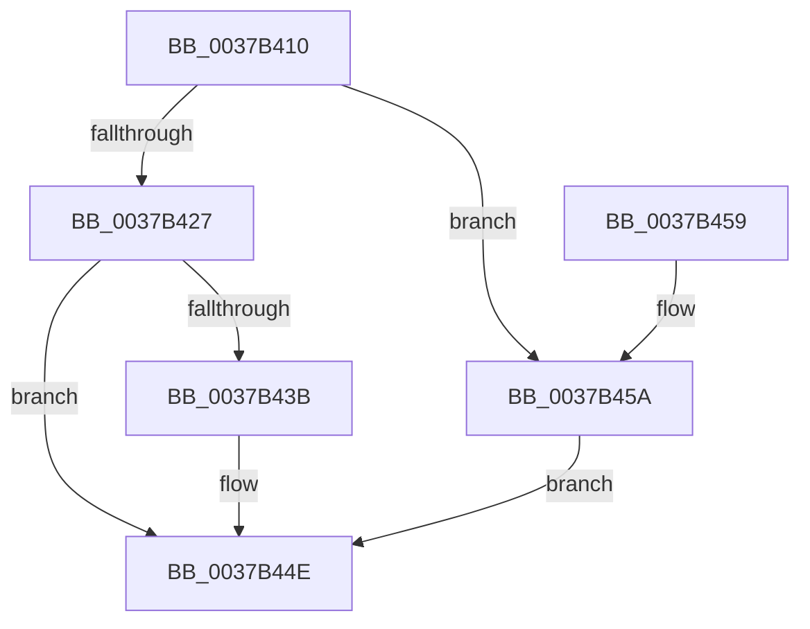

# KiStartInterruptCycleAccumulation

- RVA: `0x0037B410`–`0x0037B462` (길이 `82` bytes)
- VA: `0x000000014037B410`
- 실행 섹션: `.text`
- PDB 이름 있음: `예`; PDB Function 태그: `아니요`
- unwind 정보 RVA: `0x0007B104`
- 디코드: `26`개 명령, `82/82` bytes 표시
- 미해석 바이트: `0` (있으면 어셈블리에 `.byte`로 보존)

> 이 문서는 커널 이미지의 기계어와 PDB 기호를 분석해 생성했습니다. 4번과 5번은 함수 원형과 자료형을 바이너리 사용 방식에서 추정한 C 해석이며 원본 소스 복구 결과는 아닙니다.

## 1. Dependencies

- 직접 호출 지점: **2**; 고유 호출 대상: **2**
- 직접 호출자로 확인된 함수: **10**
- RIP 상대 이미지 참조: **1**

### Outgoing calls
- `0x0037B431` → [KiEndThreadCycleAccumulation](KiEndThreadCycleAccumulation_function_0037BFF0.md) (function, `0x0037BFF0`)
- `0x0037B442` → `symcryptk.dll!SymCryptEntropyAccumulatorAccumulateSample` (import, 간접 대상; import `symcryptk.dll!SymCryptEntropyAccumulatorAccumulateSample`)

### Direct callers
- [KiScanInterruptObjectList](../6B/KiScanInterruptObjectList_function_006B3860.md) at `0x006B3897`
- [KiInterruptSubDispatch](../6B/KiInterruptSubDispatch_function_006B3990.md) at `0x006B39C3`
- [KiInterruptSubDispatchNoLock](../6B/KiInterruptSubDispatchNoLock_function_006B3A30.md) at `0x006B3A63`
- [KiInterruptSubDispatchNoLockNoEtw](../6B/KiInterruptSubDispatchNoLockNoEtw_function_006B3AD0.md) at `0x006B3B03`
- [KiSpuriousDispatchNoEOI](../6B/KiSpuriousDispatchNoEOI_function_006B4AA0.md) at `0x006B4ACB`
- [KxIsrLinkage](../6B/KxIsrLinkage_function_006B5680.md) at `0x006B5A35`
- [KiHvInterruptSubDispatch](../6B/KiHvInterruptSubDispatch_function_006B7F10.md) at `0x006B7F44`
- [KiVmbusInterruptSubDispatch](../6B/KiVmbusInterruptSubDispatch_function_006B7FC0.md) at `0x006B7FF4`
- [KiSwInterrupt](../6B/KiSwInterrupt_function_006B8070.md) at `0x006B8405`
- [KiIpiInterruptSubDispatch](../6B/KiIpiInterruptSubDispatch_function_006B9660.md) at `0x006B968F`

### Static image references
- `0x0037B442` → RVA `0x00151738` (`symcryptk.dll!SymCryptEntropyAccumulatorAccumulateSample (IAT)`; read)

## 2. Other-region calls and transfers

- 다른 실행 섹션으로 향하는 call: **0**
- 별도 외부 분기/꼬리 이동을 확인하지 못했습니다.

## 3. Assembly (complete function range)

```asm
0037B410  48 89 5C 24 08                  mov qword ptr [rsp + 8], rbx
0037B415  57                              push rdi
0037B416  48 83 EC 20                     sub rsp, 0x20
0037B41A  8A 41 20                        mov al, byte ptr [rcx + 0x20]
0037B41D  40 8A FA                        mov dil, dl
0037B420  48 8B D9                        mov rbx, rcx
0037B423  84 C0                           test al, al
0037B425  75 33                           jne 0x14037b45a
0037B427  48 8B 51 08                     mov rdx, qword ptr [rcx + 8]
0037B42B  45 33 C9                        xor r9d, r9d
0037B42E  45 33 C0                        xor r8d, r8d
0037B431  E8 BA 0B 00 00                  call 0x14037bff0
0037B436  40 84 FF                        test dil, dil
0037B439  74 13                           je 0x14037b44e
0037B43B  48 8D 8B C0 91 00 00            lea rcx, [rbx + 0x91c0]
0037B442  48 FF 15 EF 62 DD FF            call qword ptr [rip - 0x229d11]
0037B449  0F 1F 44 00 00                  nop dword ptr [rax + rax]
0037B44E  48 8B 5C 24 30                  mov rbx, qword ptr [rsp + 0x30]
0037B453  48 83 C4 20                     add rsp, 0x20
0037B457  5F                              pop rdi
0037B458  C3                              ret
0037B459  CC                              int3
0037B45A  FE C0                           inc al
0037B45C  88 41 20                        mov byte ptr [rcx + 0x20], al
0037B45F  90                              nop
0037B460  EB EC                           jmp 0x14037b44e
```

## 4. C-style interpretation (structured pseudocode)

```c
__int64 __fastcall KiStartInterruptCycleAccumulation(__int64 a1, unsigned __int8 a2, int a3, int a4)
{
    __int64 result;
    __int64 v_rsp;
    unsigned __int64 v_stack_p8;

    v_stack_p8 = v_rbx;
    v_rsp = (v_rsp) - (32);
    if ((unsigned __int8)(*(unsigned __int8 *)(a1 + 32)) != 0) goto loc_0037B45A;
    a4 = 0;
    a3 = 0;
    result = KiEndThreadCycleAccumulation(a1, *(unsigned __int64 *)(a1 + 8), a3, a4);
    if (a2 != 0) {
        a1 = a1 + 37312;
        result = symcryptk_dll_SymCryptEntropyAccumulatorAccumulateSample(a1, *(unsigned __int64 *)(a1 + 8), a3, a4);
    }
    v_rsp = (v_rsp) + (32);
    return result;
loc_0037B45A:
    result = (unsigned __int8)((result) + 1);
    *(unsigned __int8 *)(a1 + 32) = (unsigned __int8)(result);
    goto loc_0037B44E;
}
```

## 5. (Beta) C Style

```c
int64_t KiStartInterruptCycleAccumulation(void *Arg1, uint8_t Arg2, int32_t Arg3, int32_t Arg4)
{
    uint8_t *arg1 = (uint8_t *)Arg1;

    int64_t result;
    int64_t local_rsp;
    uint64_t v_stack_p8;

    v_stack_p8 = local_rbx;
    local_rsp = (local_rsp) - (32);
    if ((uint8_t)(*(uint8_t *)(arg1 + 0x20)) != 0) goto loc_0037B45A;
    Arg4 = 0;
    Arg3 = 0;
    result = KiEndThreadCycleAccumulation(Arg1, *(uint64_t *)(arg1 + 0x8), Arg3, Arg4);
    if (Arg2 != 0) {
        Arg1 = Arg1 + 37312;
        result = kernel_indirect_call(Arg1, *(uint64_t *)(arg1 + 0x8), Arg3, Arg4);
    }
    local_rsp = (local_rsp) + (32);
    return result;
loc_0037B45A:
    result = (uint8_t)((result) + 1);
    *(uint8_t *)(arg1 + 0x20) = (uint8_t)(result);
    goto loc_0037B44E;
}
```

### 관측된 메모리 오프셋

구조체 형식이 확인되지 않은 접근은 인자 기준의 오프셋으로만 기록했습니다.

| 기준 인자 | 오프셋 표현 | 폭 (bit) | 접근 |
|---|---:|---:|---|
| `Arg1` | `+ 0x8` | `64` | `R` |
| `Arg1` | `+ 0x20` | `8` | `R` |
| `Arg1` | `+ 0x20` | `8` | `W` |
| `Arg1` | `+ 0x91C0` | `64` | `R` |

## 6. Execution-region graph

[열기: 2D/3D 그래프와 함수 탐색 컨트롤 패널](../../../control-panel.html?section=text&rva=0x0037B410&view=graph)

- 2D 그래프는 위에서 아래로 흐르고, 3D 그래프는 빈 공간을 드래그해 회전합니다. Shift+드래그는 이동, 휠은 확대·축소, 함수 노드 선택은 대상 보고서 이동입니다.

### Static fallback


