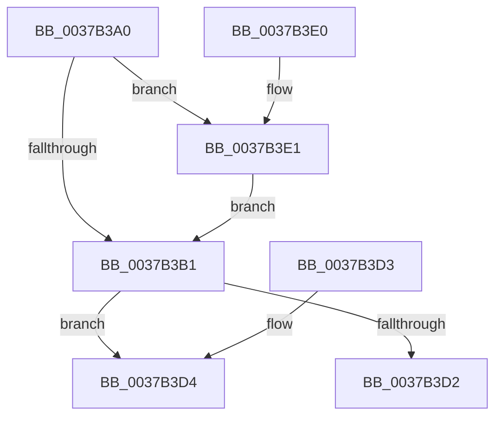

# KiUpdatePriorityMatrixForRunningTransition

- RVA: `0x0037B3A0`–`0x0037B3FB` (길이 `91` bytes)
- VA: `0x000000014037B3A0`
- 실행 섹션: `.text`
- PDB 이름 있음: `예`; PDB Function 태그: `아니요`
- unwind 정보 RVA: `0x000DB714`
- 디코드: `22`개 명령, `91/91` bytes 표시
- 미해석 바이트: `0` (있으면 어셈블리에 `.byte`로 보존)

> 이 문서는 커널 이미지의 기계어와 PDB 기호를 분석해 생성했습니다. 4번과 5번은 함수 원형과 자료형을 바이너리 사용 방식에서 추정한 C 해석이며 원본 소스 복구 결과는 아닙니다.

## 1. Dependencies

- 직접 호출 지점: **0**; 고유 호출 대상: **0**
- 직접 호출자로 확인된 함수: **8**
- RIP 상대 이미지 참조: **0**

### Outgoing calls
- 직접 디코드된 call 명령이 없습니다.

### Direct callers
- [KiHandleDeferredPreemption](../20/KiHandleDeferredPreemption_function_00202ECC.md) at `0x00203128`
- [KeYieldExecution](../20/KeYieldExecution_function_00209FA0.md) at `0x0020A194`
- [sub_0021C5F2](../21/Unknown_function_0021C5F2.md) at `0x0021C620`
- [KiCheckForThreadDispatch](../25/KiCheckForThreadDispatch_function_00250648.md) at `0x0025072A`
- [sub_00251E24](../25/Unknown_function_00251E24.md) at `0x00251E6F`
- [KiIdleSchedule](../35/KiIdleSchedule_function_00355000.md) at `0x003550FB`
- [KiExecuteSmtIsolationThread](../5C/KiExecuteSmtIsolationThread_function_005C4070.md) at `0x005C4133`
- [KiIdleLoop](../6B/KiIdleLoop_function_006B2910.md) at `0x006B2A07`

### Static image references
- 디코드된 RIP-relative 메모리 참조가 없습니다.

## 2. Other-region calls and transfers

- 다른 실행 섹션으로 향하는 call: **0**
- 별도 외부 분기/꼬리 이동을 확인하지 못했습니다.

## 3. Assembly (complete function range)

```asm
0037B3A0  4C 8B C1                        mov r8, rcx
0037B3A3  48 89 51 08                     mov qword ptr [rcx + 8], rdx
0037B3A7  8A 82 84 01 00 00               mov al, byte ptr [rdx + 0x184]
0037B3AD  3C 01                           cmp al, 1
0037B3AF  74 30                           je 0x14037b3e1
0037B3B1  C6 82 84 01 00 00 02            mov byte ptr [rdx + 0x184], 2
0037B3B8  49 8B 90 C0 00 00 00            mov rdx, qword ptr [r8 + 0xc0]
0037B3BF  48 8B 89 C8 00 00 00            mov rcx, qword ptr [rcx + 0xc8]
0037B3C6  48 8B 82 90 01 00 00            mov rax, qword ptr [rdx + 0x190]
0037B3CD  48 85 C1                        test rcx, rax
0037B3D0  75 02                           jne 0x14037b3d4
0037B3D2  C3                              ret
0037B3D3  CC                              int3
0037B3D4  48 F7 D1                        not rcx
0037B3D7  F0 48 21 8A 90 01 00 00         lock and qword ptr [rdx + 0x190], rcx
0037B3DF  C3                              ret
0037B3E0  CC                              int3
0037B3E1  48 B8 20 03 00 00 80 F7 FF FF   movabs rax, 0xfffff78000000320
0037B3EB  8B 00                           mov eax, dword ptr [rax]
0037B3ED  2B 82 B4 01 00 00               sub eax, dword ptr [rdx + 0x1b4]
0037B3F3  01 82 84 00 00 00               add dword ptr [rdx + 0x84], eax
0037B3F9  EB B6                           jmp 0x14037b3b1
```

## 4. C-style interpretation (structured pseudocode)

```c
__int64 __fastcall KiUpdatePriorityMatrixForRunningTransition(__int64 a1, __int64 a2)
{
    __int64 result;

    *(unsigned __int64 *)(a1 + 8) = a2;
    if (((unsigned __int8)(*(unsigned __int8 *)(a2 + 388))) == 1) goto loc_0037B3E1;
loc_0037B3B1:
    *(unsigned __int8 *)(a2 + 388) = 2;
    if (((*(unsigned __int64 *)(a1 + 200)) & (*(unsigned __int64 *)(*(unsigned __int64 *)(a1 + 192) + 400))) != 0) goto loc_0037B3D4;
    return *(unsigned __int64 *)(*(unsigned __int64 *)(a1 + 192) + 400);
loc_0037B3D4:
    a1 = ~(*(unsigned __int64 *)(a1 + 200));
    return *(unsigned __int64 *)(*(unsigned __int64 *)(a1 + 192) + 400);
loc_0037B3E1:
    result = (unsigned int)(((unsigned int)(*(unsigned int *)(*(unsigned __int64 *)(*(unsigned __int64 *)(a1 + 192) + 400)))) - (*(unsigned int *)(*(unsigned __int64 *)(a1 + 192) + 436)));
    goto loc_0037B3B1;
}
```

## 5. (Beta) C Style

```c
int64_t KiUpdatePriorityMatrixForRunningTransition(void *Arg1, void *Arg2)
{
    uint8_t *arg1 = (uint8_t *)Arg1;
    uint8_t *arg2 = (uint8_t *)Arg2;

    int64_t result;

    *(void **)(arg1 + 0x8) = Arg2;
    if (((uint8_t)(*(uint8_t *)(arg2 + 0x184))) == 1) goto loc_0037B3E1;
loc_0037B3B1:
    *(uint8_t *)(arg2 + 0x184) = 2;
    if (((*(uint64_t *)(arg1 + 0xC8)) & (*(uint64_t *)(*(uint64_t *)(arg1 + 0xC0) + 0x190))) != 0) goto loc_0037B3D4;
    return *(uint64_t *)(*(uint64_t *)(arg1 + 0xC0) + 0x190);
loc_0037B3D4:
    Arg1 = ~(*(uint64_t *)(arg1 + 0xC8));
    return *(uint64_t *)(*(uint64_t *)(arg1 + 0xC0) + 0x190);
loc_0037B3E1:
    result = (uint32_t)(((uint32_t)(*(uint32_t *)(*(uint64_t *)(*(uint64_t *)(arg1 + 0xC0) + 0x190)))) - (*(uint32_t *)(*(uint64_t *)(arg1 + 0xC0) + 0x1B4)));
    goto loc_0037B3B1;
}
```

### 관측된 메모리 오프셋

구조체 형식이 확인되지 않은 접근은 인자 기준의 오프셋으로만 기록했습니다.

| 기준 인자 | 오프셋 표현 | 폭 (bit) | 접근 |
|---|---:|---:|---|
| `Arg1` | `+ 0x8` | `64` | `W` |
| `Arg1` | `+ 0xC0` | `64` | `R` |
| `Arg1` | `+ 0xC8` | `64` | `R` |
| `Arg2` | `+ 0x84` | `32` | `R/W` |
| `Arg2` | `+ 0x184` | `8` | `R` |
| `Arg2` | `+ 0x184` | `8` | `W` |
| `Arg2` | `+ 0x1B4` | `32` | `R` |

## 6. Execution-region graph

[열기: 2D/3D 그래프와 함수 탐색 컨트롤 패널](../../../control-panel.html?section=text&rva=0x0037B3A0&view=graph)

- 2D 그래프는 위에서 아래로 흐르고, 3D 그래프는 빈 공간을 드래그해 회전합니다. Shift+드래그는 이동, 휠은 확대·축소, 함수 노드 선택은 대상 보고서 이동입니다.

### Static fallback


