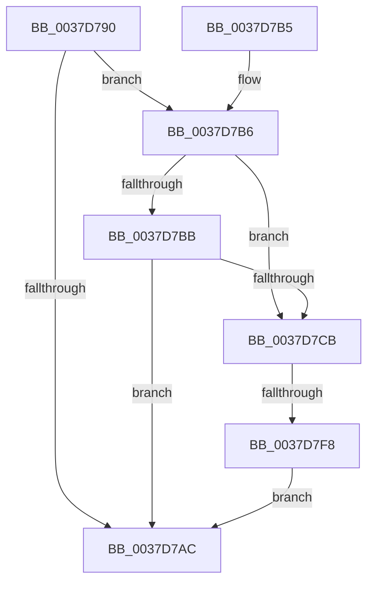

# KiUpdateThreadHgsFeedback

- RVA: `0x0037D790`–`0x0037D7FD` (길이 `109` bytes)
- VA: `0x000000014037D790`
- 실행 섹션: `.text`
- PDB 이름 있음: `예`; PDB Function 태그: `예`
- unwind 정보 RVA: `0x0007B418`
- 디코드: `32`개 명령, `109/109` bytes 표시
- 미해석 바이트: `0` (있으면 어셈블리에 `.byte`로 보존)

> 이 문서는 커널 이미지의 기계어와 PDB 기호를 분석해 생성했습니다. 4번과 5번은 함수 원형과 자료형을 바이너리 사용 방식에서 추정한 C 해석이며 원본 소스 복구 결과는 아닙니다.

## 1. Dependencies

- 직접 호출 지점: **0**; 고유 호출 대상: **0**
- 직접 호출자로 확인된 함수: **9**
- RIP 상대 이미지 참조: **3**

### Outgoing calls
- 직접 디코드된 call 명령이 없습니다.

### Direct callers
- [KiRetireDpcList](../21/KiRetireDpcList_function_0021A0B0.md) at `0x0021A47E`
- [sub_00256E8A](../25/Unknown_function_00256E8A.md) at `0x002571BE`
- [sub_0037B54F](Unknown_function_0037B54F.md) at `0x0037B838`
- [KiEndThreadCycleAccumulation](KiEndThreadCycleAccumulation_function_0037BFF0.md) at `0x0037C3B9`
- [sub_0037CC84](Unknown_function_0037CC84.md) at `0x0037CF6D`
- [KiUpdateTotalCyclesCurrentThread](KiUpdateTotalCyclesCurrentThread_function_0037DE40.md) at `0x0037E18D`
- [KeQueryTotalCycleTimeThread](KeQueryTotalCycleTimeThread_function_0037EF20.md) at `0x0037F2C2`
- [KiEndThreadAccountingPeriodEx](KiEndThreadAccountingPeriodEx_function_0037FD00.md) at `0x0037FEC9`
- [KeUpdateTotalCyclesCurrentThread](../3F/KeUpdateTotalCyclesCurrentThread_function_003FA2B0.md) at `0x003FA600`

### Static image references
- `0x0037D799` → RVA `0x00FC6ADE` (`ALMOSTRO`; read)
- `0x0037D7BB` → RVA `0x00FCFF00` (`CACHEALI`; read)
- `0x0037D7EF` → RVA `0x00FC53E8` (`ALMOSTRO`; read)

## 2. Other-region calls and transfers

- 다른 실행 섹션으로 향하는 call: **0**
- call이 아닌 외부 분기/꼬리 이동: **1**
  - `0x0037D7F6` → [sub_0037D7FD](Unknown_function_0037D7FD.md) (`tail-transfer`)

## 3. Assembly (complete function range)

```asm
0037D790  40 53                           push rbx
0037D792  55                              push rbp
0037D793  41 56                           push r14
0037D795  48 83 EC 20                     sub rsp, 0x20
0037D799  80 3D 3E 93 C4 00 00            cmp byte ptr [rip + 0xc4933e], 0
0037D7A0  41 0F B6 E9                     movzx ebp, r9b
0037D7A4  48 8B DA                        mov rbx, rdx
0037D7A7  4C 8B F1                        mov r14, rcx
0037D7AA  75 0A                           jne 0x14037d7b6
0037D7AC  48 83 C4 20                     add rsp, 0x20
0037D7B0  41 5E                           pop r14
0037D7B2  5D                              pop rbp
0037D7B3  5B                              pop rbx
0037D7B4  C3                              ret
0037D7B5  CC                              int3
0037D7B6  48 85 DB                        test rbx, rbx
0037D7B9  74 10                           je 0x14037d7cb
0037D7BB  48 8D 05 3E 27 C5 00            lea rax, [rip + 0xc5273e]
0037D7C2  48 39 82 20 02 00 00            cmp qword ptr [rdx + 0x220], rax
0037D7C9  74 E1                           je 0x14037d7ac
0037D7CB  4C 8B 8A 38 04 00 00            mov r9, qword ptr [rdx + 0x438]
0037D7D2  4D 03 C8                        add r9, r8
0037D7D5  4C 89 8A 38 04 00 00            mov qword ptr [rdx + 0x438], r9
0037D7DC  0F 31                           rdtsc
0037D7DE  48 C1 E2 20                     shl rdx, 0x20
0037D7E2  48 0B C2                        or rax, rdx
0037D7E5  48 8B C8                        mov rcx, rax
0037D7E8  48 2B 8B 30 04 00 00            sub rcx, qword ptr [rbx + 0x430]
0037D7EF  48 3B 0D F2 7B C4 00            cmp rcx, qword ptr [rip + 0xc47bf2]
0037D7F6  77 05                           ja 0x14037d7fd
0037D7F8  40 84 ED                        test bpl, bpl
0037D7FB  74 AF                           je 0x14037d7ac
```

## 4. C-style interpretation (structured pseudocode)

```c
__int64 __fastcall KiUpdateThreadHgsFeedback(__int64 a1, __int64 a2, __int64 a3, unsigned __int8 a4)
{
    __int64 result;
    __int64 v_rsp;

    v_rsp = (v_rsp) - (32);
    if ((*(unsigned __int8 *)(v_rip + 12882750)) != 0) goto loc_0037D7B6;
loc_0037D7AC:
    v_rsp = (v_rsp) + (32);
    return result;
loc_0037D7B6:
    if (a2 == 0) goto loc_0037D7CB;
    if ((*(unsigned __int64 *)(a2 + 544)) == (v_rip + 12920638)) goto loc_0037D7AC;
loc_0037D7CB:
    a4 = (*(unsigned __int64 *)(a2 + 1080)) + (a3);
    *(unsigned __int64 *)(a2 + 1080) = a4;
    a2 = (a2) << (32);
    result = (v_rip + 12920638) | (a2);
    a1 = (result) - (*(unsigned __int64 *)(a2 + 1072));
    if (a4 == 0) goto loc_0037D7AC;
}
```

## 5. (Beta) C Style

```c
int64_t KiUpdateThreadHgsFeedback(int64_t Arg1, void *Arg2, int64_t Arg3, uint8_t Arg4)
{
    uint8_t *arg2 = (uint8_t *)Arg2;

    int64_t result;
    int64_t local_rsp;

    local_rsp = (local_rsp) - (32);
    if ((*(uint8_t *)(v_rip + 0xC4933E)) != 0) goto loc_0037D7B6;
loc_0037D7AC:
    local_rsp = (local_rsp) + (32);
    return result;
loc_0037D7B6:
    if (Arg2 == NULL) goto loc_0037D7CB;
    if ((*(uint64_t *)(arg2 + 0x220)) == (v_rip + 12920638)) goto loc_0037D7AC;
loc_0037D7CB:
    Arg4 = (*(uint64_t *)(arg2 + 0x438)) + (Arg3);
    *(uint64_t *)(arg2 + 0x438) = Arg4;
    Arg2 = (Arg2) << (32);
    result = (v_rip + 12920638) | (Arg2);
    Arg1 = (result) - (*(uint64_t *)(arg2 + 0x430));
    if (Arg4 == 0) goto loc_0037D7AC;
}
```

### 관측된 메모리 오프셋

구조체 형식이 확인되지 않은 접근은 인자 기준의 오프셋으로만 기록했습니다.

| 기준 인자 | 오프셋 표현 | 폭 (bit) | 접근 |
|---|---:|---:|---|
| `Arg2` | `+ 0x220` | `64` | `R` |
| `Arg2` | `+ 0x438` | `64` | `R` |
| `Arg2` | `+ 0x438` | `64` | `W` |

## 6. Execution-region graph

[열기: 2D/3D 그래프와 함수 탐색 컨트롤 패널](../../../control-panel.html?section=text&rva=0x0037D790&view=graph)

- 2D 그래프는 위에서 아래로 흐르고, 3D 그래프는 빈 공간을 드래그해 회전합니다. Shift+드래그는 이동, 휠은 확대·축소, 함수 노드 선택은 대상 보고서 이동입니다.

### Static fallback


