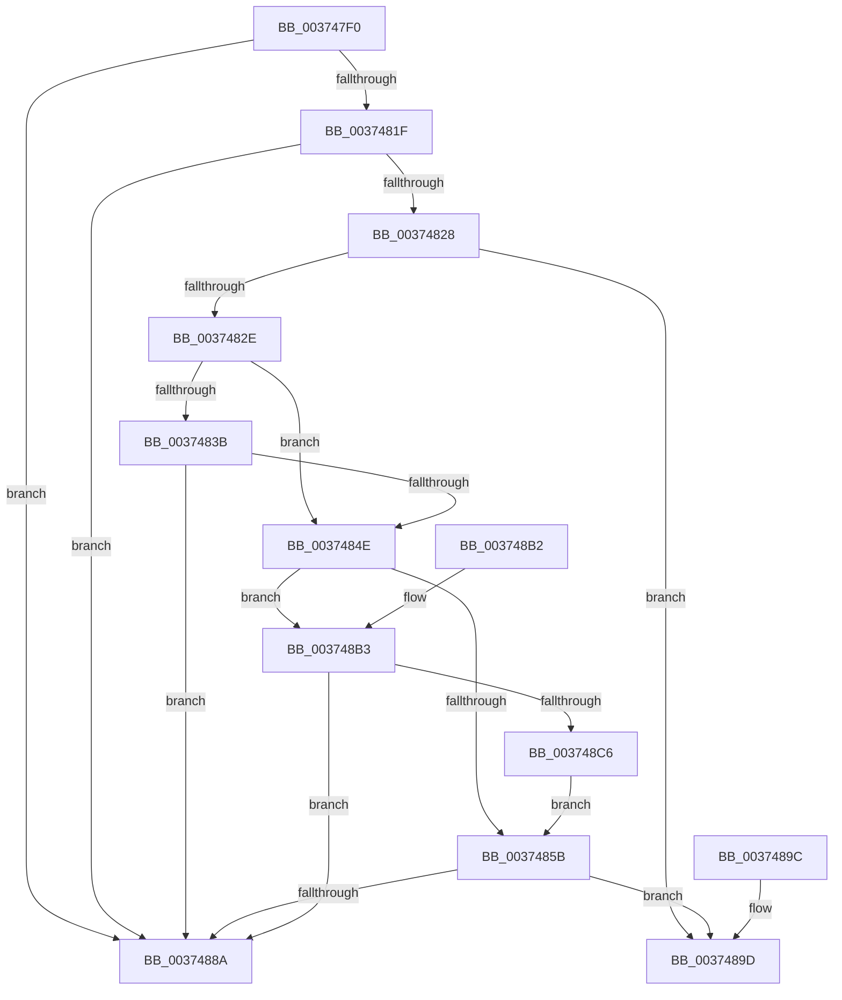

# MiActivePageTradeable

- RVA: `0x003747F0`–`0x003748C8` (길이 `216` bytes)
- VA: `0x00000001403747F0`
- 실행 섹션: `.text`
- PDB 이름 있음: `예`; PDB Function 태그: `아니요`
- unwind 정보 RVA: `0x0007AB04`
- 디코드: `59`개 명령, `216/216` bytes 표시
- 미해석 바이트: `0` (있으면 어셈블리에 `.byte`로 보존)

> 이 문서는 커널 이미지의 기계어와 PDB 기호를 분석해 생성했습니다. 4번과 5번은 함수 원형과 자료형을 바이너리 사용 방식에서 추정한 C 해석이며 원본 소스 복구 결과는 아닙니다.

## 1. Dependencies

- 직접 호출 지점: **2**; 고유 호출 대상: **1**
- 직접 호출자로 확인된 함수: **1**
- RIP 상대 이미지 참조: **1**

### Outgoing calls
- `0x00374845` → [MiGetPagePrivilege](../28/MiGetPagePrivilege_function_00285420.md) (function, `0x00285420`)
- `0x003748BD` → [MiGetPagePrivilege](../28/MiGetPagePrivilege_function_00285420.md) (function, `0x00285420`)

### Direct callers
- [MiTradeActivePage](MiTradeActivePage_function_00374424.md) at `0x0037445E`

### Static image references
- `0x0037482E` → RVA `0x00FC6A88` (`ALMOSTRO`; read)

## 2. Other-region calls and transfers

- 다른 실행 섹션으로 향하는 call: **0**
- 별도 외부 분기/꼬리 이동을 확인하지 못했습니다.

## 3. Assembly (complete function range)

```asm
003747F0  48 89 5C 24 08                  mov qword ptr [rsp + 8], rbx
003747F5  48 89 74 24 10                  mov qword ptr [rsp + 0x10], rsi
003747FA  57                              push rdi
003747FB  48 83 EC 20                     sub rsp, 0x20
003747FF  48 8B 41 18                     mov rax, qword ptr [rcx + 0x18]
00374803  48 8B D9                        mov rbx, rcx
00374806  48 B9 FF FF FF FF FF FF FF 3F   movabs rcx, 0x3fffffffffffffff
00374810  41 8B F1                        mov esi, r9d
00374813  48 23 C1                        and rax, rcx
00374816  48 8B FA                        mov rdi, rdx
00374819  48 83 F8 01                     cmp rax, 1
0037481D  75 6B                           jne 0x14037488a
0037481F  8B 43 20                        mov eax, dword ptr [rbx + 0x20]
00374822  66 83 F8 01                     cmp ax, 1
00374826  75 62                           jne 0x14037488a
00374828  41 83 F8 01                     cmp r8d, 1
0037482C  7C 6F                           jl 0x14037489d
0037482E  48 F7 05 4F 22 C5 00 00 40 00 00  test qword ptr [rip + 0xc5224f], 0x4000
00374839  74 13                           je 0x14037484e
0037483B  45 33 C0                        xor r8d, r8d
0037483E  48 8B CB                        mov rcx, rbx
00374841  41 8D 50 02                     lea edx, [r8 + 2]
00374845  E8 D6 0B F1 FF                  call 0x140285420
0037484A  85 C0                           test eax, eax
0037484C  75 3C                           jne 0x14037488a
0037484E  48 F7 05 2F 22 C5 00 00 00 02 00  test qword ptr [rip + 0xc5222f], 0x20000
00374859  75 58                           jne 0x1403748b3
0037485B  48 C1 EF 09                     shr rdi, 9
0037485F  48 B8 F8 FF FF FF 7F 00 00 00   movabs rax, 0x7ffffffff8
00374869  48 23 F8                        and rdi, rax
0037486C  48 B8 00 00 00 00 80 F6 FF FF   movabs rax, 0xfffff68000000000
00374876  48 8B 04 07                     mov rax, qword ptr [rdi + rax]
0037487A  A8 42                           test al, 0x42
0037487C  0F 95 C1                        setne cl
0037487F  40 F6 C6 02                     test sil, 2
00374883  0F 94 C0                        sete al
00374886  84 C8                           test al, cl
00374888  74 13                           je 0x14037489d
0037488A  33 C0                           xor eax, eax
0037488C  48 8B 5C 24 30                  mov rbx, qword ptr [rsp + 0x30]
00374891  48 8B 74 24 38                  mov rsi, qword ptr [rsp + 0x38]
00374896  48 83 C4 20                     add rsp, 0x20
0037489A  5F                              pop rdi
0037489B  C3                              ret
0037489C  CC                              int3
0037489D  48 8B 5C 24 30                  mov rbx, qword ptr [rsp + 0x30]
003748A2  B8 01 00 00 00                  mov eax, 1
003748A7  48 8B 74 24 38                  mov rsi, qword ptr [rsp + 0x38]
003748AC  48 83 C4 20                     add rsp, 0x20
003748B0  5F                              pop rdi
003748B1  C3                              ret
003748B2  CC                              int3
003748B3  45 33 C0                        xor r8d, r8d
003748B6  48 8B CB                        mov rcx, rbx
003748B9  41 8D 50 02                     lea edx, [r8 + 2]
003748BD  E8 5E 0B F1 FF                  call 0x140285420
003748C2  85 C0                           test eax, eax
003748C4  75 C4                           jne 0x14037488a
003748C6  EB 93                           jmp 0x14037485b
```

## 4. C-style interpretation (structured pseudocode)

```c
__int64 __fastcall MiActivePageTradeable(__int64 a1, __int64 a2, int a3, int a4)
{
    __int64 result;
    __int64 v_rdi;
    __int64 v_rsp;
    unsigned __int64 v_stack_p10;
    unsigned __int64 v_stack_p30;
    unsigned __int64 v_stack_p38;
    unsigned __int64 v_stack_p8;

    v_stack_p8 = v_rbx;
    v_stack_p10 = v_rsi;
    v_rsp = (v_rsp) - (32);
    result = (*(unsigned __int64 *)(a1 + 24)) & (a1);
    if (result != 1) goto loc_0037488A;
    if (((unsigned __int16)((unsigned int)(*(unsigned int *)(a1 + 32)))) != 1) goto loc_0037488A;
    if (a3 < 1) goto loc_0037489D;
    if (((*(unsigned __int64 *)(v_rip + 12919375)) & (0x4000ULL)) == 0) goto loc_0037484E;
    a3 = 0;
    result = MiGetPagePrivilege(a1, a3 + 2, a3, a4);
    if ((unsigned int)(result) != 0) goto loc_0037488A;
loc_0037484E:
    if (((*(unsigned __int64 *)(v_rip + 12919343)) & (0x20000ULL)) != 0) goto loc_003748B3;
loc_0037485B:
    v_rdi = (a2) >> (9);
    v_rdi = (v_rdi) & (result);
    a1 = ((((unsigned __int8)(*(unsigned __int64 *)(v_rdi + result * 1))) & (66)) != 0) ? 1 : 0;
    result = ((((unsigned __int8)((unsigned int)(a4))) & (2)) == 0) ? 1 : 0;
    if ((((unsigned __int8)(result)) & ((unsigned __int8)(a1))) == 0) goto loc_0037489D;
loc_0037488A:
    result = 0;
    v_rsp = (v_rsp) + (32);
    return result;
loc_0037489D:
    v_rsp = (v_rsp) + (32);
    return 1;
loc_003748B3:
    a3 = 0;
    result = MiGetPagePrivilege(v_stack_p30, a3 + 2, a3, a4);
    if ((unsigned int)(result) != 0) goto loc_0037488A;
    goto loc_0037485B;
}
```

## 5. (Beta) C Style

```c
int64_t MiActivePageTradeable(void *Arg1, int64_t Arg2, int32_t Arg3, int32_t Arg4)
{
    uint8_t *arg1 = (uint8_t *)Arg1;

    int64_t result;
    int64_t local_rdi;
    int64_t local_rsp;
    uint64_t v_stack_p10;
    uint64_t v_stack_p30;
    uint64_t v_stack_p38;
    uint64_t v_stack_p8;

    v_stack_p8 = local_rbx;
    v_stack_p10 = local_rsi;
    local_rsp = (local_rsp) - (32);
    result = (*(uint64_t *)(arg1 + 0x18)) & (Arg1);
    if (result != 1) goto loc_0037488A;
    if (((uint16_t)((uint32_t)(*(uint32_t *)(arg1 + 0x20)))) != 1) goto loc_0037488A;
    if (Arg3 < 1) goto loc_0037489D;
    if (((*(uint64_t *)(v_rip + 0xC5224F)) & (0x4000ULL)) == 0) goto loc_0037484E;
    Arg3 = 0;
    result = MiGetPagePrivilege(Arg1, Arg3 + 2, Arg3, Arg4);
    if ((uint32_t)(result) != 0) goto loc_0037488A;
loc_0037484E:
    if (((*(uint64_t *)(v_rip + 0xC5222F)) & (0x20000ULL)) != 0) goto loc_003748B3;
loc_0037485B:
    local_rdi = (Arg2) >> (9);
    local_rdi = (local_rdi) & (result);
    Arg1 = ((((uint8_t)(*(uint64_t *)(local_rdi + result * 1))) & (66)) != 0) ? 1 : 0;
    result = ((((uint8_t)((uint32_t)(Arg4))) & (2)) == 0) ? 1 : 0;
    if ((((uint8_t)(result)) & ((uint8_t)(Arg1))) == 0) goto loc_0037489D;
loc_0037488A:
    result = 0;
    local_rsp = (local_rsp) + (32);
    return result;
loc_0037489D:
    local_rsp = (local_rsp) + (32);
    return 1;
loc_003748B3:
    Arg3 = 0;
    result = MiGetPagePrivilege(v_stack_p30, Arg3 + 2, Arg3, Arg4);
    if ((uint32_t)(result) != 0) goto loc_0037488A;
    goto loc_0037485B;
}
```

### 관측된 메모리 오프셋

구조체 형식이 확인되지 않은 접근은 인자 기준의 오프셋으로만 기록했습니다.

| 기준 인자 | 오프셋 표현 | 폭 (bit) | 접근 |
|---|---:|---:|---|
| `Arg1` | `+ 0x18` | `64` | `R` |
| `Arg1` | `+ 0x20` | `32` | `R` |

## 6. Execution-region graph

[열기: 2D/3D 그래프와 함수 탐색 컨트롤 패널](../../../control-panel.html?section=text&rva=0x003747F0&view=graph)

- 2D 그래프는 위에서 아래로 흐르고, 3D 그래프는 빈 공간을 드래그해 회전합니다. Shift+드래그는 이동, 휠은 확대·축소, 함수 노드 선택은 대상 보고서 이동입니다.

### Static fallback


