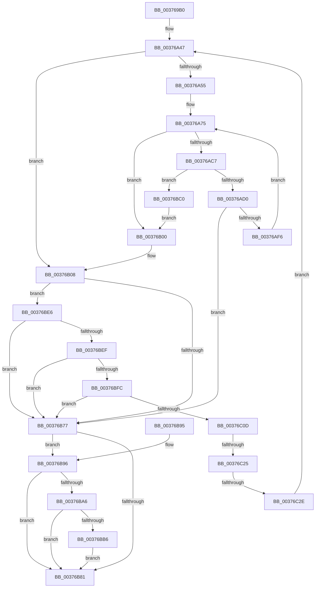

# MiAllocateMostlyContiguousPagesForMdl

- RVA: `0x003769B0`–`0x00376C36` (길이 `646` bytes)
- VA: `0x00000001403769B0`
- 실행 섹션: `.text`
- PDB 이름 있음: `예`; PDB Function 태그: `예`
- unwind 정보 RVA: `0x0007ACA0`
- 디코드: `155`개 명령, `646/646` bytes 표시
- 미해석 바이트: `0` (있으면 어셈블리에 `.byte`로 보존)

> 이 문서는 커널 이미지의 기계어와 PDB 기호를 분석해 생성했습니다. 4번과 5번은 함수 원형과 자료형을 바이너리 사용 방식에서 추정한 C 해석이며 원본 소스 복구 결과는 아닙니다.

## 1. Dependencies

- 직접 호출 지점: **4**; 고유 호출 대상: **4**
- 직접 호출자로 확인된 함수: **1**
- RIP 상대 이미지 참조: **2**

### Outgoing calls
- `0x00376A27` → [MiInitializePageColorBase](../32/MiInitializePageColorBase_function_00320410.md) (function, `0x00320410`)
- `0x00376ABC` → [MiAllocateSlabPageForMdl](MiAllocateSlabPageForMdl_function_00376EC8.md) (function, `0x00376EC8`)
- `0x00376B62` → [MiFindContiguousPagesEx](../28/MiFindContiguousPagesEx_function_0028BDE0.md) (function, `0x0028BDE0`)
- `0x00376BD5` → [MiReleaseFreshPage](../33/MiReleaseFreshPage_function_00334AE0.md) (function, `0x00334AE0`)

### Direct callers
- [MiFindPagesForMdl](../3B/MiFindPagesForMdl_function_003B770C.md) at `0x003B782E`

### Static image references
- `0x003769CA` → RVA `0x00E3D548` (`.data`; read)
- `0x00376A59` → RVA `0x00E2DCC0` (`.data`; read)

## 2. Other-region calls and transfers

- 다른 실행 섹션으로 향하는 call: **0**
- call이 아닌 외부 분기/꼬리 이동: **2**
  - `0x00376C1F` → [sub_006E3F84](../6E/Unknown_function_006E3F84.md) (`tail-transfer`)
  - `0x00376C28` → [sub_006E3F84](../6E/Unknown_function_006E3F84.md) (`tail-transfer`)

## 3. Assembly (complete function range)

```asm
003769B0  4C 8B DC                        mov r11, rsp
003769B3  45 89 43 18                     mov dword ptr [r11 + 0x18], r8d
003769B7  53                              push rbx
003769B8  55                              push rbp
003769B9  56                              push rsi
003769BA  57                              push rdi
003769BB  41 54                           push r12
003769BD  41 55                           push r13
003769BF  41 56                           push r14
003769C1  41 57                           push r15
003769C3  48 81 EC A8 00 00 00            sub rsp, 0xa8
003769CA  48 8B 05 77 6B AC 00            mov rax, qword ptr [rip + 0xac6b77]
003769D1  44 8D 42 01                     lea r8d, [rdx + 1]
003769D5  4C 8B 61 08                     mov r12, qword ptr [rcx + 8]
003769D9  4D 8D 4B A8                     lea r9, [r11 - 0x58]
003769DD  4C 8B 69 40                     mov r13, qword ptr [rcx + 0x40]
003769E1  45 33 FF                        xor r15d, r15d
003769E4  48 8B 69 10                     mov rbp, qword ptr [rcx + 0x10]
003769E8  8B DA                           mov ebx, edx
003769EA  49 83 4B 90 FF                  or qword ptr [r11 - 0x70], 0xffffffffffffffff
003769EF  48 8B F9                        mov rdi, rcx
003769F2  45 21 7B 10                     and dword ptr [r11 + 0x10], r15d
003769F6  0F 57 C0                        xorps xmm0, xmm0
003769F9  48 89 84 24 80 00 00 00         mov qword ptr [rsp + 0x80], rax
00376A01  41 8D 57 03                     lea edx, [r15 + 3]
00376A05  8B 81 94 00 00 00               mov eax, dword ptr [rcx + 0x94]
00376A0B  33 C9                           xor ecx, ecx
00376A0D  C1 E8 02                        shr eax, 2
00376A10  83 E0 01                        and eax, 1
00376A13  4C 89 A4 24 08 01 00 00         mov qword ptr [rsp + 0x108], r12
00376A1B  89 84 24 F0 00 00 00            mov dword ptr [rsp + 0xf0], eax
00376A22  41 0F 11 43 A8                  movups xmmword ptr [r11 - 0x58], xmm0
00376A27  E8 E4 99 FA FF                  call 0x140320410
00376A2C  41 8B 45 28                     mov eax, dword ptr [r13 + 0x28]
00376A30  4C 8B B4 24 98 00 00 00         mov r14, qword ptr [rsp + 0x98]
00376A38  48 C1 E8 0C                     shr rax, 0xc
00376A3C  48 89 84 24 88 00 00 00         mov qword ptr [rsp + 0x88], rax
00376A44  48 8B F0                        mov rsi, rax
00376A47  8B 87 94 00 00 00               mov eax, dword ptr [rdi + 0x94]
00376A4D  A8 02                           test al, 2
00376A4F  0F 85 B3 00 00 00               jne 0x140376b08
00376A55  49 C1 EE 10                     shr r14, 0x10
00376A59  48 8D 05 60 72 AB 00            lea rax, [rip + 0xab7260]
00376A60  41 83 E6 03                     and r14d, 3
00376A64  4D 8D 65 30                     lea r12, [r13 + 0x30]
00376A68  4D 8D 24 F4                     lea r12, [r12 + rsi*8]
00376A6C  4E 8D 04 B0                     lea r8, [rax + r14*4]
00376A70  4C 89 44 24 70                  mov qword ptr [rsp + 0x70], r8
00376A75  48 8B 8C 24 90 00 00 00         mov rcx, qword ptr [rsp + 0x90]
00376A7D  B8 01 00 00 00                  mov eax, 1
00376A82  F0 0F C1 01                     lock xadd dword ptr [rcx], eax
00376A86  4C 8B B4 24 98 00 00 00         mov r14, qword ptr [rsp + 0x98]
00376A8E  33 D2                           xor edx, edx
00376A90  41 F7 30                        div dword ptr [r8]
00376A93  44 8B 8C 24 F0 00 00 00         mov r9d, dword ptr [rsp + 0xf0]
00376A9B  48 8D 84 24 F8 00 00 00         lea rax, [rsp + 0xf8]
00376AA3  44 8B 84 24 00 01 00 00         mov r8d, dword ptr [rsp + 0x100]
00376AAB  41 33 D6                        xor edx, r14d
00376AAE  48 8B 0F                        mov rcx, qword ptr [rdi]
00376AB1  0F B6 D2                        movzx edx, dl
00376AB4  41 33 D6                        xor edx, r14d
00376AB7  48 89 44 24 20                  mov qword ptr [rsp + 0x20], rax
00376ABC  E8 07 04 00 00                  call 0x140376ec8
00376AC1  48 83 F8 FF                     cmp rax, -1
00376AC5  74 39                           je 0x140376b00
00376AC7  48 3B C5                        cmp rax, rbp
00376ACA  0F 87 F0 00 00 00               ja 0x140376bc0
00376AD0  49 89 04 24                     mov qword ptr [r12], rax
00376AD4  49 FF C7                        inc r15
00376AD7  41 8B 55 28                     mov edx, dword ptr [r13 + 0x28]
00376ADB  49 83 C4 08                     add r12, 8
00376ADF  81 C2 00 10 00 00               add edx, 0x1000
00376AE5  48 FF C6                        inc rsi
00376AE8  41 89 55 28                     mov dword ptr [r13 + 0x28], edx
00376AEC  48 3B 77 20                     cmp rsi, qword ptr [rdi + 0x20]
00376AF0  0F 84 81 00 00 00               je 0x140376b77
00376AF6  4C 8B 44 24 70                  mov r8, qword ptr [rsp + 0x70]
00376AFB  E9 75 FF FF FF                  jmp 0x140376a75
00376B00  4C 8B A4 24 08 01 00 00         mov r12, qword ptr [rsp + 0x108]
00376B08  8B 84 24 00 01 00 00            mov eax, dword ptr [rsp + 0x100]
00376B0F  48 8D 54 24 78                  lea rdx, [rsp + 0x78]
00376B14  48 8B 4F 20                     mov rcx, qword ptr [rdi + 0x20]
00376B18  0D 00 20 00 60                  or eax, 0x60002000
00376B1D  48 89 54 24 68                  mov qword ptr [rsp + 0x68], rdx
00376B22  48 2B CE                        sub rcx, rsi
00376B25  33 D2                           xor edx, edx
00376B27  45 33 C9                        xor r9d, r9d
00376B2A  48 89 54 24 60                  mov qword ptr [rsp + 0x60], rdx
00376B2F  4C 8B C5                        mov r8, rbp
00376B32  4C 89 6C 24 58                  mov qword ptr [rsp + 0x58], r13
00376B37  89 54 24 50                     mov dword ptr [rsp + 0x50], edx
00376B3B  89 44 24 48                     mov dword ptr [rsp + 0x48], eax
00376B3F  8B 87 90 00 00 00               mov eax, dword ptr [rdi + 0x90]
00376B45  C6 44 24 40 FF                  mov byte ptr [rsp + 0x40], 0xff
00376B4A  89 5C 24 38                     mov dword ptr [rsp + 0x38], ebx
00376B4E  89 44 24 30                     mov dword ptr [rsp + 0x30], eax
00376B52  48 89 4C 24 28                  mov qword ptr [rsp + 0x28], rcx
00376B57  48 8B 0F                        mov rcx, qword ptr [rdi]
00376B5A  48 89 54 24 20                  mov qword ptr [rsp + 0x20], rdx
00376B5F  49 8B D4                        mov rdx, r12
00376B62  E8 79 52 F1 FF                  call 0x14028bde0
00376B67  41 8B 75 28                     mov esi, dword ptr [r13 + 0x28]
00376B6B  8B D6                           mov edx, esi
00376B6D  48 C1 EE 0C                     shr rsi, 0xc
00376B71  48 3B 77 20                     cmp rsi, qword ptr [rdi + 0x20]
00376B75  75 6F                           jne 0x140376be6
00376B77  8B 87 94 00 00 00               mov eax, dword ptr [rdi + 0x94]
00376B7D  A8 02                           test al, 2
00376B7F  74 15                           je 0x140376b96
00376B81  48 81 C4 A8 00 00 00            add rsp, 0xa8
00376B88  41 5F                           pop r15
00376B8A  41 5E                           pop r14
00376B8C  41 5D                           pop r13
00376B8E  41 5C                           pop r12
00376B90  5F                              pop rdi
00376B91  5E                              pop rsi
00376B92  5D                              pop rbp
00376B93  5B                              pop rbx
00376B94  C3                              ret
00376B95  CC                              int3
00376B96  8B C2                           mov eax, edx
00376B98  48 C1 E8 0C                     shr rax, 0xc
00376B9C  48 2B 84 24 88 00 00 00         sub rax, qword ptr [rsp + 0x88]
00376BA4  74 DB                           je 0x140376b81
00376BA6  48 8B 0F                        mov rcx, qword ptr [rdi]
00376BA9  F0 48 01 81 58 41 00 00         lock add qword ptr [rcx + 0x4158], rax
00376BB1  4D 85 FF                        test r15, r15
00376BB4  74 CB                           je 0x140376b81
00376BB6  F0 4C 01 B9 60 41 00 00         lock add qword ptr [rcx + 0x4160], r15
00376BBE  EB C1                           jmp 0x140376b81
00376BC0  48 8D 0C 40                     lea rcx, [rax + rax*2]
00376BC4  48 C1 E1 04                     shl rcx, 4
00376BC8  48 B8 00 00 00 00 00 DE FF FF   movabs rax, 0xffffde0000000000
00376BD2  48 03 C8                        add rcx, rax
00376BD5  E8 06 DF FB FF                  call 0x140334ae0
00376BDA  83 8F 94 00 00 00 02            or dword ptr [rdi + 0x94], 2
00376BE1  E9 1A FF FF FF                  jmp 0x140376b00
00376BE6  48 8B 4F 18                     mov rcx, qword ptr [rdi + 0x18]
00376BEA  48 85 C9                        test rcx, rcx
00376BED  74 88                           je 0x140376b77
00376BEF  4A 8D 04 21                     lea rax, [rcx + r12]
00376BF3  49 3B C4                        cmp rax, r12
00376BF6  0F 86 7B FF FF FF               jbe 0x140376b77
00376BFC  4C 8B 84 24 80 00 00 00         mov r8, qword ptr [rsp + 0x80]
00376C04  49 3B C0                        cmp rax, r8
00376C07  0F 87 6A FF FF FF               ja 0x140376b77
00376C0D  4C 8B E0                        mov r12, rax
00376C10  48 89 84 24 08 01 00 00         mov qword ptr [rsp + 0x108], rax
00376C18  48 8D 04 29                     lea rax, [rcx + rbp]
00376C1C  48 3B C5                        cmp rax, rbp
00376C1F  0F 86 5F D3 36 00               jbe 0x1406e3f84
00376C25  49 3B C0                        cmp rax, r8
00376C28  0F 87 56 D3 36 00               ja 0x1406e3f84
00376C2E  48 8B E8                        mov rbp, rax
00376C31  E9 11 FE FF FF                  jmp 0x140376a47
```

## 4. C-style interpretation (structured pseudocode)

```c
__int64 __fastcall MiAllocateMostlyContiguousPagesForMdl(__int64 a1, __int64 a2, int a3)
{
    __int64 result;
    __int64 v_r12;
    __int64 v_r14;
    __int64 v_r15;
    __int64 v_rsi;
    __int64 v_rsp;
    unsigned __int64 v_stack_m50;
    unsigned __int64 v_stack_m58;
    unsigned __int64 v_stack_m60;
    unsigned __int64 v_stack_m68;
    unsigned __int64 v_stack_m70;
    unsigned __int64 v_stack_m78;
    unsigned __int64 v_stack_m80;
    unsigned __int64 v_stack_m88;
    unsigned __int64 v_stack_m90;
    unsigned int v_stack_m98;
    unsigned int v_stack_mA0;
    unsigned __int8 v_stack_mA8;
    unsigned int v_stack_mB0;
    unsigned int v_stack_mB8;
    unsigned __int64 v_stack_mC0;
    unsigned __int64 v_stack_mC8;
    unsigned __int64 v_stack_p10;
    unsigned __int64 v_stack_p108;
    unsigned int v_stack_p18;
    unsigned __int64 v_stack_p20;
    unsigned int v_stack_p8;
    unsigned __int64 v_stack_p80;
    unsigned __int64 v_stack_p88;

    *(unsigned int *)(v_rsp + 24) = a3;
    v_rsp = (v_rsp) - (168);
    v_r15 = 0;
    v_stack_m68 = *(unsigned __int64 *)(v_rip + 11299703);
    a1 = 0;
    result = (unsigned int)(((unsigned int)(*(unsigned int *)(a1 + 148))) >> (2));
    result = (unsigned int)((result) & (1));
    v_stack_p20 = *(unsigned __int64 *)(a1 + 8);
    v_stack_p8 = (unsigned int)(result);
    *(unsigned __int64 *)(v_rsp - 88) = v_xmm0;
    result = MiInitializePageColorBase(a1, v_r15 + 3, a2 + 1, v_rsp - 88);
    result = ((unsigned int)(*(unsigned int *)(*(unsigned __int64 *)(a1 + 64) + 40))) >> (12);
    v_stack_m60 = result;
loc_00376A47:
    if ((((unsigned __int8)((unsigned int)(*(unsigned int *)(a1 + 148)))) & (2)) != 0) goto loc_00376B08;
    v_r14 = (v_stack_m50) >> (16);
    v_r14 = (unsigned int)((v_r14) & (3));
    v_stack_m78 = v_rip + 11235936 + v_r14 * 4;
loc_00376A75:
    a2 = 0;
    a2 = (unsigned int)((a2) ^ ((unsigned int)(v_stack_m50)));
    a2 = (unsigned int)(((unsigned __int8)(a2)) ^ ((unsigned int)(v_stack_m50)));
    v_stack_mC8 = v_stack_p10;
    result = MiAllocateSlabPageForMdl(*(unsigned __int64 *)(a1), a2, (unsigned int)(v_stack_p18), (unsigned int)(v_stack_p8));
    if (result == -1) goto loc_00376B00;
    if (result > (*(unsigned __int64 *)(a1 + 16))) goto loc_00376BC0;
    *(unsigned __int64 *)(*(unsigned __int64 *)(a1 + 64) + 48 + result * 8) = result;
    v_r15 = (v_r15) + 1;
    v_r12 = (*(unsigned __int64 *)(a1 + 64) + 48 + result * 8) + (8);
    a2 = (unsigned int)(((unsigned int)(*(unsigned int *)(*(unsigned __int64 *)(a1 + 64) + 40))) + (0x1000ULL));
    v_rsi = (result) + 1;
    *(unsigned int *)(*(unsigned __int64 *)(a1 + 64) + 40) = (unsigned int)(a2);
    if (v_rsi == (*(unsigned __int64 *)(a1 + 32))) goto loc_00376B77;
    goto loc_00376A75;
loc_00376B00:
loc_00376B08:
    result = (unsigned int)(((unsigned int)(v_stack_p18)) | (0x60002000ULL));
    v_stack_m80 = v_stack_m70;
    a1 = (*(unsigned __int64 *)(a1 + 32)) - (v_rsi);
    a2 = 0;
    a4 = 0;
    v_stack_m88 = 0;
    v_stack_m90 = *(unsigned __int64 *)(a1 + 64);
    v_stack_m98 = 0;
    v_stack_mA0 = (unsigned int)(result);
    v_stack_mA8 = 255;
    v_stack_mB0 = (unsigned int)((unsigned int)((unsigned int)(a2)));
    v_stack_mB8 = (unsigned int)((unsigned int)(*(unsigned int *)(a1 + 144)));
    v_stack_mC0 = a1;
    v_stack_mC8 = 0;
    result = MiFindContiguousPagesEx(*(unsigned __int64 *)(a1), v_stack_p20, *(unsigned __int64 *)(a1 + 16), a4);
    v_rsi = ((unsigned int)(*(unsigned int *)(*(unsigned __int64 *)(a1 + 64) + 40))) >> (12);
    if (v_rsi != (*(unsigned __int64 *)(a1 + 32))) goto loc_00376BE6;
loc_00376B77:
    if ((((unsigned __int8)((unsigned int)(*(unsigned int *)(a1 + 148)))) & (2)) == 0) goto loc_00376B96;
loc_00376B81:
    v_rsp = (v_rsp) + (168);
    return (unsigned int)(*(unsigned int *)(a1 + 148));
loc_00376B96:
    result = ((unsigned int)((unsigned int)((unsigned int)((unsigned int)((unsigned int)(*(unsigned int *)(*(unsigned __int64 *)(a1 + 64) + 40))))))) >> (12);
    result = (result) - (v_stack_p88);
    if (condition_is_equal) goto loc_00376B81;
    if (v_r15 == 0) goto loc_00376B81;
    goto loc_00376B81;
loc_00376BC0:
    a1 = (result + result * 2) << (4);
    a1 = (a1) + (result);
    result = MiReleaseFreshPage(a1, (unsigned int)((unsigned int)((unsigned int)(*(unsigned int *)(*(unsigned __int64 *)(a1 + 64) + 40)))), *(unsigned __int64 *)(a1 + 16), a4);
    goto loc_00376B00;
loc_00376BE6:
    if (*(unsigned __int64 *)(a1 + 24) == 0) goto loc_00376B77;
    if ((*(unsigned __int64 *)(a1 + 24) + v_stack_p20 * 1) <= v_stack_p20) goto loc_00376B77;
    if ((*(unsigned __int64 *)(a1 + 24) + v_stack_p20 * 1) > v_stack_p80) goto loc_00376B77;
    v_stack_p108 = *(unsigned __int64 *)(a1 + 24) + v_stack_p20 * 1;
    goto loc_00376A47;
}
```

## 5. (Beta) C Style

```c
int64_t MiAllocateMostlyContiguousPagesForMdl(void *Arg1, void *Arg2, int32_t Arg3)
{
    uint8_t *arg1 = (uint8_t *)Arg1;
    uint8_t *arg2 = (uint8_t *)Arg2;

    int64_t result;
    int64_t local_r12;
    int64_t local_r14;
    int64_t local_r15;
    int64_t local_rsi;
    int64_t local_rsp;
    uint64_t v_stack_m50;
    uint64_t v_stack_m58;
    uint64_t v_stack_m60;
    uint64_t v_stack_m68;
    uint64_t v_stack_m70;
    uint64_t v_stack_m78;
    uint64_t v_stack_m80;
    uint64_t v_stack_m88;
    uint64_t v_stack_m90;
    uint32_t v_stack_m98;
    uint32_t v_stack_mA0;
    uint8_t v_stack_mA8;
    uint32_t v_stack_mB0;
    uint32_t v_stack_mB8;
    uint64_t v_stack_mC0;
    uint64_t v_stack_mC8;
    uint64_t v_stack_p10;
    uint64_t v_stack_p108;
    uint32_t v_stack_p18;
    uint64_t v_stack_p20;
    uint32_t v_stack_p8;
    uint64_t v_stack_p80;
    uint64_t v_stack_p88;

    *(uint32_t *)(local_rsp + 0x18) = Arg3;
    local_rsp = (local_rsp) - (168);
    local_r15 = 0;
    v_stack_m68 = *(uint64_t *)(v_rip + 0xAC6B77);
    Arg1 = 0;
    result = (uint32_t)(((uint32_t)(*(uint32_t *)(arg1 + 0x94))) >> (2));
    result = (uint32_t)((result) & (1));
    v_stack_p20 = *(uint64_t *)(arg1 + 0x8);
    v_stack_p8 = (uint32_t)(result);
    *(uint64_t *)(local_rsp - 0x58) = v_xmm0;
    result = MiInitializePageColorBase(Arg1, local_r15 + 3, Arg2 + 1, local_rsp - 88);
    result = ((uint32_t)(*(uint32_t *)(*(uint64_t *)(arg1 + 0x40) + 0x28))) >> (12);
    v_stack_m60 = result;
loc_00376A47:
    if ((((uint8_t)((uint32_t)(*(uint32_t *)(arg1 + 0x94)))) & (2)) != 0) goto loc_00376B08;
    local_r14 = (v_stack_m50) >> (16);
    local_r14 = (uint32_t)((local_r14) & (3));
    v_stack_m78 = v_rip + 11235936 + local_r14 * 4;
loc_00376A75:
    Arg2 = 0;
    Arg2 = (uint32_t)((Arg2) ^ ((uint32_t)(v_stack_m50)));
    Arg2 = (uint32_t)(((uint8_t)(Arg2)) ^ ((uint32_t)(v_stack_m50)));
    v_stack_mC8 = v_stack_p10;
    result = MiAllocateSlabPageForMdl(*(uint64_t *)(arg1), Arg2, (uint32_t)(v_stack_p18), (uint32_t)(v_stack_p8));
    if (result == -1) goto loc_00376B00;
    if (result > (*(uint64_t *)(arg1 + 0x10))) goto loc_00376BC0;
    *(uint64_t *)(*(uint64_t *)(arg1 + 0x40) + 0x30 + result * 8) = result;
    local_r15 = (local_r15) + 1;
    local_r12 = (*(uint64_t *)(arg1 + 0x40) + 48 + result * 8) + (8);
    Arg2 = (uint32_t)(((uint32_t)(*(uint32_t *)(*(uint64_t *)(arg1 + 0x40) + 0x28))) + (0x1000ULL));
    local_rsi = (result) + 1;
    *(uint32_t *)(*(uint64_t *)(arg1 + 0x40) + 0x28) = (uint32_t)(Arg2);
    if (local_rsi == (*(uint64_t *)(arg1 + 0x20))) goto loc_00376B77;
    goto loc_00376A75;
loc_00376B00:
loc_00376B08:
    result = (uint32_t)(((uint32_t)(v_stack_p18)) | (0x60002000ULL));
    v_stack_m80 = v_stack_m70;
    Arg1 = (*(uint64_t *)(arg1 + 0x20)) - (local_rsi);
    Arg2 = 0;
    a4 = 0;
    v_stack_m88 = 0;
    v_stack_m90 = *(uint64_t *)(arg1 + 0x40);
    v_stack_m98 = 0;
    v_stack_mA0 = (uint32_t)(result);
    v_stack_mA8 = 255;
    v_stack_mB0 = (uint32_t)((uint32_t)((uint32_t)(Arg2)));
    v_stack_mB8 = (uint32_t)((uint32_t)(*(uint32_t *)(arg1 + 0x90)));
    v_stack_mC0 = Arg1;
    v_stack_mC8 = 0;
    result = MiFindContiguousPagesEx(*(uint64_t *)(arg1), v_stack_p20, *(uint64_t *)(arg1 + 0x10), a4);
    local_rsi = ((uint32_t)(*(uint32_t *)(*(uint64_t *)(arg1 + 0x40) + 0x28))) >> (12);
    if (local_rsi != (*(uint64_t *)(arg1 + 0x20))) goto loc_00376BE6;
loc_00376B77:
    if ((((uint8_t)((uint32_t)(*(uint32_t *)(arg1 + 0x94)))) & (2)) == 0) goto loc_00376B96;
loc_00376B81:
    local_rsp = (local_rsp) + (168);
    return (uint32_t)(*(uint32_t *)(arg1 + 0x94));
loc_00376B96:
    result = ((uint32_t)((uint32_t)((uint32_t)((uint32_t)((uint32_t)(*(uint32_t *)(*(uint64_t *)(arg1 + 0x40) + 0x28))))))) >> (12);
    result = (result) - (v_stack_p88);
    if (condition_is_equal) goto loc_00376B81;
    if (local_r15 == 0) goto loc_00376B81;
    goto loc_00376B81;
loc_00376BC0:
    Arg1 = (result + result * 2) << (4);
    Arg1 = (Arg1) + (result);
    result = MiReleaseFreshPage(Arg1, (uint32_t)((uint32_t)((uint32_t)(*(uint32_t *)(*(uint64_t *)(arg1 + 0x40) + 0x28)))), *(uint64_t *)(arg1 + 0x10), a4);
    goto loc_00376B00;
loc_00376BE6:
    if (*(uint64_t *)(arg1 + 0x18) == 0) goto loc_00376B77;
    if ((*(uint64_t *)(arg1 + 0x18) + v_stack_p20 * 1) <= v_stack_p20) goto loc_00376B77;
    if ((*(uint64_t *)(arg1 + 0x18) + v_stack_p20 * 1) > v_stack_p80) goto loc_00376B77;
    v_stack_p108 = *(uint64_t *)(arg1 + 0x18) + v_stack_p20 * 1;
    goto loc_00376A47;
}
```

### 관측된 메모리 오프셋

구조체 형식이 확인되지 않은 접근은 인자 기준의 오프셋으로만 기록했습니다.

| 기준 인자 | 오프셋 표현 | 폭 (bit) | 접근 |
|---|---:|---:|---|
| `Arg1` | `+ 0x0` | `64` | `R` |
| `Arg1` | `+ 0x8` | `64` | `R` |
| `Arg1` | `+ 0x10` | `64` | `R` |
| `Arg1` | `+ 0x18` | `64` | `R` |
| `Arg1` | `+ 0x20` | `64` | `R` |
| `Arg1` | `+ 0x40` | `64` | `R` |
| `Arg1` | `+ 0x90` | `32` | `R` |
| `Arg1` | `+ 0x94` | `32` | `R` |
| `Arg1` | `+ 0x94` | `32` | `R/W` |
| `Arg2` | `+ 0x1` | `32` | `R` |

## 6. Execution-region graph

[열기: 2D/3D 그래프와 함수 탐색 컨트롤 패널](../../../control-panel.html?section=text&rva=0x003769B0&view=graph)

- 2D 그래프는 위에서 아래로 흐르고, 3D 그래프는 빈 공간을 드래그해 회전합니다. Shift+드래그는 이동, 휠은 확대·축소, 함수 노드 선택은 대상 보고서 이동입니다.

### Static fallback


