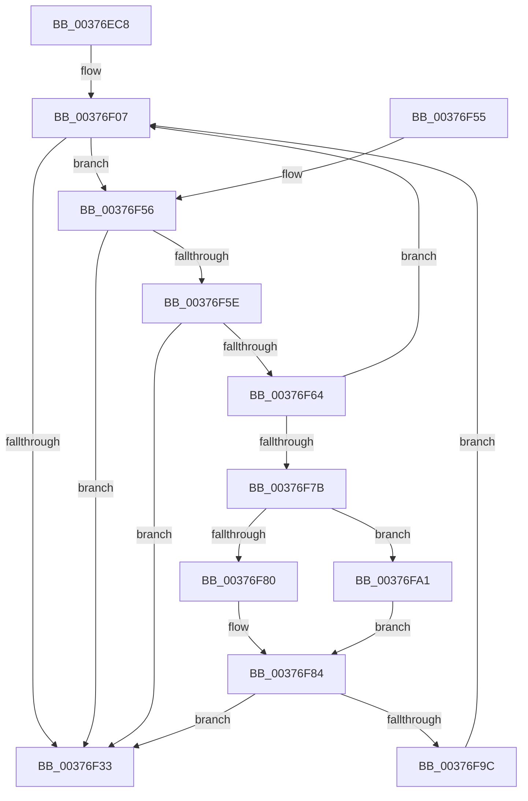

# MiAllocateSlabPageForMdl

- RVA: `0x00376EC8`–`0x00376FB4` (길이 `236` bytes)
- VA: `0x0000000140376EC8`
- 실행 섹션: `.text`
- PDB 이름 있음: `예`; PDB Function 태그: `아니요`
- unwind 정보 RVA: `0x0007ACE8`
- 디코드: `66`개 명령, `236/236` bytes 표시
- 미해석 바이트: `0` (있으면 어셈블리에 `.byte`로 보존)

> 이 문서는 커널 이미지의 기계어와 PDB 기호를 분석해 생성했습니다. 4번과 5번은 함수 원형과 자료형을 바이너리 사용 방식에서 추정한 C 해석이며 원본 소스 복구 결과는 아닙니다.

## 1. Dependencies

- 직접 호출 지점: **3**; 고유 호출 대상: **3**
- 직접 호출자로 확인된 함수: **2**
- RIP 상대 이미지 참조: **1**

### Outgoing calls
- `0x00376F25` → [MiGetSlabPage](MiGetSlabPage_function_00376FBC.md) (function, `0x00376FBC`)
- `0x00376F72` → [MiReplenishSlabAllocator](MiReplenishSlabAllocator_function_003788E4.md) (function, `0x003788E4`)
- `0x00376F90` → [MiAsyncSlabReplenish](../4A/MiAsyncSlabReplenish_function_004AA54C.md) (function, `0x004AA54C`)

### Direct callers
- [MiAllocateMostlyContiguousPagesForMdl](MiAllocateMostlyContiguousPagesForMdl_function_003769B0.md) at `0x00376ABC`
- [MiAllocateMdlPagesByLists](../3B/MiAllocateMdlPagesByLists_function_003B7898.md) at `0x003B7A24`

### Static image references
- `0x00376F89` → RVA `0x00010780` (`.rdata`; read)

## 2. Other-region calls and transfers

- 다른 실행 섹션으로 향하는 call: **0**
- 별도 외부 분기/꼬리 이동을 확인하지 못했습니다.

## 3. Assembly (complete function range)

```asm
00376EC8  4C 8B DC                        mov r11, rsp
00376ECB  49 89 5B 08                     mov qword ptr [r11 + 8], rbx
00376ECF  49 89 6B 10                     mov qword ptr [r11 + 0x10], rbp
00376ED3  49 89 7B 18                     mov qword ptr [r11 + 0x18], rdi
00376ED7  4D 89 63 20                     mov qword ptr [r11 + 0x20], r12
00376EDB  41 55                           push r13
00376EDD  41 56                           push r14
00376EDF  41 57                           push r15
00376EE1  48 83 EC 40                     sub rsp, 0x40
00376EE5  4C 8B BC 24 80 00 00 00         mov r15, qword ptr [rsp + 0x80]
00376EED  41 8B C1                        mov eax, r9d
00376EF0  F7 D8                           neg eax
00376EF2  45 8B F1                        mov r14d, r9d
00376EF5  45 8B E0                        mov r12d, r8d
00376EF8  8B DA                           mov ebx, edx
00376EFA  1B FF                           sbb edi, edi
00376EFC  4C 8B E9                        mov r13, rcx
00376EFF  83 E7 10                        and edi, 0x10
00376F02  49 83 63 D8 00                  and qword ptr [r11 - 0x28], 0
00376F07  83 64 24 28 00                  and dword ptr [rsp + 0x28], 0
00376F0C  48 8D 44 24 30                  lea rax, [rsp + 0x30]
00376F11  44 8D 4F 01                     lea r9d, [rdi + 1]
00376F15  48 89 44 24 20                  mov qword ptr [rsp + 0x20], rax
00376F1A  44 8B C3                        mov r8d, ebx
00376F1D  BA 07 00 00 00                  mov edx, 7
00376F22  49 8B CD                        mov rcx, r13
00376F25  E8 92 00 00 00                  call 0x140376fbc
00376F2A  48 8B E8                        mov rbp, rax
00376F2D  48 83 F8 FF                     cmp rax, -1
00376F31  74 23                           je 0x140376f56
00376F33  48 8B 5C 24 60                  mov rbx, qword ptr [rsp + 0x60]
00376F38  48 8B C5                        mov rax, rbp
00376F3B  48 8B 6C 24 68                  mov rbp, qword ptr [rsp + 0x68]
00376F40  48 8B 7C 24 70                  mov rdi, qword ptr [rsp + 0x70]
00376F45  4C 8B 64 24 78                  mov r12, qword ptr [rsp + 0x78]
00376F4A  48 83 C4 40                     add rsp, 0x40
00376F4E  41 5F                           pop r15
00376F50  41 5E                           pop r14
00376F52  41 5D                           pop r13
00376F54  C3                              ret
00376F55  CC                              int3
00376F56  48 83 7C 24 30 00               cmp qword ptr [rsp + 0x30], 0
00376F5C  74 D5                           je 0x140376f33
00376F5E  41 83 3F 00                     cmp dword ptr [r15], 0
00376F62  75 CF                           jne 0x140376f33
00376F64  48 8B 4C 24 30                  mov rcx, qword ptr [rsp + 0x30]
00376F69  BA 01 00 00 00                  mov edx, 1
00376F6E  44 8D 42 3F                     lea r8d, [rdx + 0x3f]
00376F72  E8 6D 19 00 00                  call 0x1403788e4
00376F77  85 C0                           test eax, eax
00376F79  75 8C                           jne 0x140376f07
00376F7B  45 85 F6                        test r14d, r14d
00376F7E  74 21                           je 0x140376fa1
00376F80  44 8D 40 05                     lea r8d, [rax + 5]
00376F84  48 8B 4C 24 30                  mov rcx, qword ptr [rsp + 0x30]
00376F89  48 8D 15 F0 97 C9 FF            lea rdx, [rip - 0x366810]
00376F90  E8 B7 35 13 00                  call 0x1404aa54c
00376F95  41 89 07                        mov dword ptr [r15], eax
00376F98  85 C0                           test eax, eax
00376F9A  75 97                           jne 0x140376f33
00376F9C  E9 66 FF FF FF                  jmp 0x140376f07
00376FA1  B8 01 00 00 00                  mov eax, 1
00376FA6  41 F6 C4 08                     test r12b, 8
00376FAA  44 8D 40 FF                     lea r8d, [rax - 1]
00376FAE  44 0F 45 C0                     cmovne r8d, eax
00376FB2  EB D0                           jmp 0x140376f84
```

## 4. C-style interpretation (structured pseudocode)

```c
__int64 __fastcall MiAllocateSlabPageForMdl(__int64 a1, int a2, int a3, int a4, __int64 a5)
{
    __int64 result;
    __int64 v_rdi;
    __int64 v_rsp;
    unsigned __int64 v_stack_m28;
    unsigned int v_stack_m30;
    unsigned __int64 v_stack_m38;
    unsigned __int64 v_stack_p10;
    unsigned __int64 v_stack_p18;
    unsigned __int64 v_stack_p20;
    unsigned __int64 v_stack_p30;
    unsigned __int64 v_stack_p8;

    *(unsigned __int64 *)(v_rsp + 8) = v_rbx;
    *(unsigned __int64 *)(v_rsp + 16) = v_rbp;
    *(unsigned __int64 *)(v_rsp + 24) = v_rdi;
    *(unsigned __int64 *)(v_rsp + 32) = v_r12;
    v_rsp = (v_rsp) - (64);
    result = (unsigned int)(-((unsigned int)(a4)));
    v_rdi = (unsigned int)((v_rdi) & (16));
loc_00376F07:
    v_stack_m38 = v_stack_m28;
    result = MiGetSlabPage(a1, 7, (unsigned int)((unsigned int)((unsigned int)(a2))), v_rdi + 1);
    if (result == -1) goto loc_00376F56;
loc_00376F33:
    v_rsp = (v_rsp) + (64);
    return result;
loc_00376F56:
    if (v_stack_p30 == 0) goto loc_00376F33;
    if ((*(unsigned int *)(a5)) != 0) goto loc_00376F33;
    result = MiReplenishSlabAllocator(v_stack_p30, 1, 1 + 63, v_rdi + 1);
    if ((unsigned int)(result) != 0) goto loc_00376F07;
    if ((unsigned int)((unsigned int)(a4)) == 0) goto loc_00376FA1;
loc_00376F84:
    result = MiAsyncSlabReplenish(v_stack_p30, v_rip - 3565584, result + 5, v_rdi + 1);
    *(unsigned int *)(a5) = (unsigned int)(result);
    if ((unsigned int)(result) != 0) goto loc_00376F33;
    goto loc_00376F07;
loc_00376FA1:
    a3 = 1 - 1;
    if ((((unsigned __int8)(v_stack_p20)) & (8)) != 0) { a3 = 1; }
    goto loc_00376F84;
}
```

## 5. (Beta) C Style

```c
int64_t MiAllocateSlabPageForMdl(int64_t Arg1, int32_t Arg2, int32_t Arg3, int32_t Arg4, void *Arg5)
{
    uint8_t *arg5 = (uint8_t *)Arg5;

    int64_t result;
    int64_t local_rdi;
    int64_t local_rsp;
    uint64_t v_stack_m28;
    uint32_t v_stack_m30;
    uint64_t v_stack_m38;
    uint64_t v_stack_p10;
    uint64_t v_stack_p18;
    uint64_t v_stack_p20;
    uint64_t v_stack_p30;
    uint64_t v_stack_p8;

    *(uint64_t *)(local_rsp + 0x8) = local_rbx;
    *(uint64_t *)(local_rsp + 0x10) = local_rbp;
    *(uint64_t *)(local_rsp + 0x18) = local_rdi;
    *(uint64_t *)(local_rsp + 0x20) = local_r12;
    local_rsp = (local_rsp) - (64);
    result = (uint32_t)(-((uint32_t)(Arg4)));
    local_rdi = (uint32_t)((local_rdi) & (16));
loc_00376F07:
    v_stack_m38 = v_stack_m28;
    result = MiGetSlabPage(Arg1, 7, (uint32_t)((uint32_t)((uint32_t)(Arg2))), local_rdi + 1);
    if (result == -1) goto loc_00376F56;
loc_00376F33:
    local_rsp = (local_rsp) + (64);
    return result;
loc_00376F56:
    if (v_stack_p30 == 0) goto loc_00376F33;
    if ((*(uint32_t *)(arg5)) != 0) goto loc_00376F33;
    result = MiReplenishSlabAllocator(v_stack_p30, 1, 1 + 63, local_rdi + 1);
    if ((uint32_t)(result) != 0) goto loc_00376F07;
    if ((uint32_t)((uint32_t)(Arg4)) == 0) goto loc_00376FA1;
loc_00376F84:
    result = MiAsyncSlabReplenish(v_stack_p30, v_rip - 3565584, result + 5, local_rdi + 1);
    *(uint32_t *)(arg5) = (uint32_t)(result);
    if ((uint32_t)(result) != 0) goto loc_00376F33;
    goto loc_00376F07;
loc_00376FA1:
    Arg3 = 1 - 1;
    if ((((uint8_t)(v_stack_p20)) & (8)) != 0) { Arg3 = 1; }
    goto loc_00376F84;
}
```

### 관측된 메모리 오프셋

구조체 형식이 확인되지 않은 접근은 인자 기준의 오프셋으로만 기록했습니다.

| 기준 인자 | 오프셋 표현 | 폭 (bit) | 접근 |
|---|---:|---:|---|
| `Arg5` | `+ 0x0` | `32` | `R` |
| `Arg5` | `+ 0x0` | `32` | `W` |

## 6. Execution-region graph

[열기: 2D/3D 그래프와 함수 탐색 컨트롤 패널](../../../control-panel.html?section=text&rva=0x00376EC8&view=graph)

- 2D 그래프는 위에서 아래로 흐르고, 3D 그래프는 빈 공간을 드래그해 회전합니다. Shift+드래그는 이동, 휠은 확대·축소, 함수 노드 선택은 대상 보고서 이동입니다.

### Static fallback


