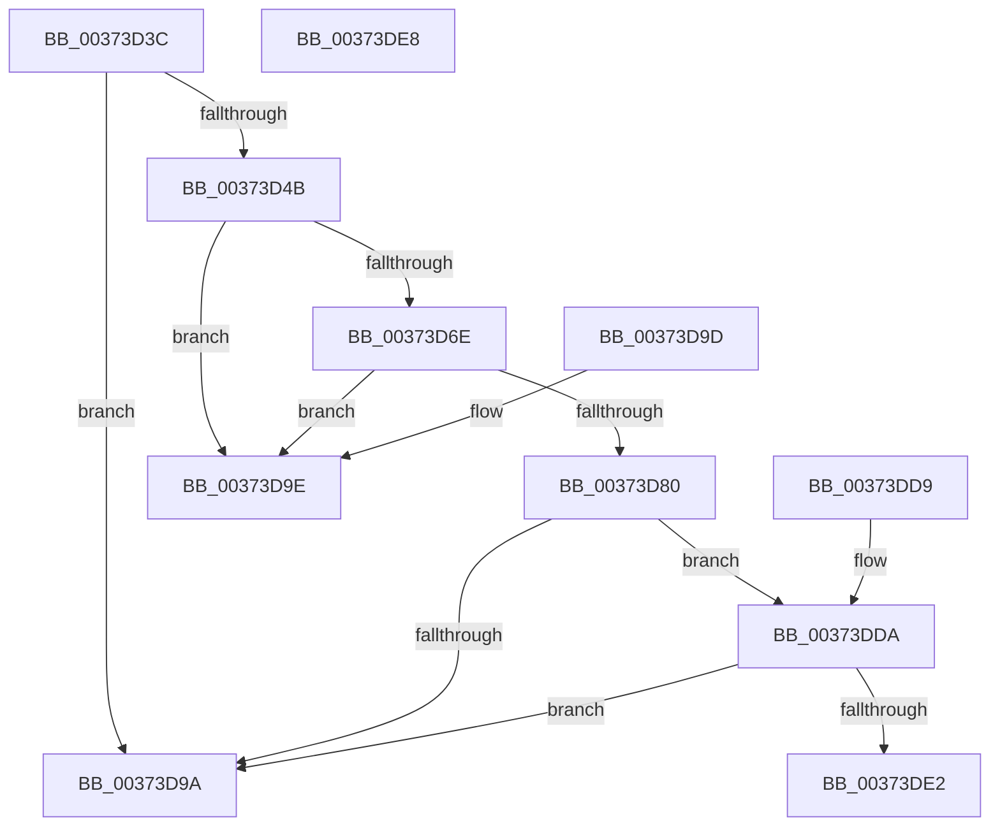

# MiCanPfnOriginalPteBeLost

- RVA: `0x00373D3C`–`0x00373DE9` (길이 `173` bytes)
- VA: `0x0000000140373D3C`
- 실행 섹션: `.text`
- PDB 이름 있음: `예`; PDB Function 태그: `아니요`
- unwind 정보 RVA: `0x000DB714`
- 디코드: `46`개 명령, `173/173` bytes 표시
- 미해석 바이트: `0` (있으면 어셈블리에 `.byte`로 보존)

> 이 문서는 커널 이미지의 기계어와 PDB 기호를 분석해 생성했습니다. 4번과 5번은 함수 원형과 자료형을 바이너리 사용 방식에서 추정한 C 해석이며 원본 소스 복구 결과는 아닙니다.

## 1. Dependencies

- 직접 호출 지점: **0**; 고유 호출 대상: **0**
- 직접 호출자로 확인된 함수: **18**
- RIP 상대 이미지 참조: **0**

### Outgoing calls
- 직접 디코드된 call 명령이 없습니다.

### Direct callers
- [MiProbeUnlockPage](../24/MiProbeUnlockPage_function_00243860.md) at `0x00243B54`
- [MiActOnPte](../24/MiActOnPte_function_00244C90.md) at `0x00245717`
- [MiActOnPte](../24/MiActOnPte_function_00244C90.md) at `0x00245819`
- [MiAddPageToInsertList](../24/MiAddPageToInsertList_function_0024A950.md) at `0x0024AD30`
- [MiResolveTransitionFault](../28/MiResolveTransitionFault_function_00282940.md) at `0x002836DA`
- [MiLockPageAndSetDirty](../28/MiLockPageAndSetDirty_function_002857A0.md) at `0x0028591B`
- [MiAddPageToFlushMdl](../28/MiAddPageToFlushMdl_function_00286930.md) at `0x00286C1E`
- [MiUnlinkStandbyPfn](../2C/MiUnlinkStandbyPfn_function_002C3510.md) at `0x002C3701`
- [MiConvertLargeActivePageToChain](../31/MiConvertLargeActivePageToChain_function_0031D980.md) at `0x0031DC47`
- [MiInitializePfn](../33/MiInitializePfn_function_00331E60.md) at `0x003324CB`
- [MiConvertLockedSmallPageToLarge](../34/MiConvertLockedSmallPageToLarge_function_00347110.md) at `0x003473C0`
- [MiSetPfnModified](../36/MiSetPfnModified_function_00362960.md) at `0x003629A5`
- [sub_00370E3F](Unknown_function_00370E3F.md) at `0x00370E5F`
- [MiIsPfnOriginalPteLost](MiIsPfnOriginalPteLost_function_00373B5C.md) at `0x00373B6E`
- [sub_003FE849](../3F/Unknown_function_003FE849.md) at `0x003FE8E8`
- [sub_003FE849](../3F/Unknown_function_003FE849.md) at `0x003FE91B`
- [MiReferencePageForModifiedWrite](../40/MiReferencePageForModifiedWrite_function_00405DAC.md) at `0x00405EDF`
- [MiConvertLargePfnToSmall](../42/MiConvertLargePfnToSmall_function_00420CA0.md) at `0x00420DD7`
- [MiInsertDemotedPages](../43/MiInsertDemotedPages_function_004354B8.md) at `0x004357F2`
- [sub_00439107](../43/Unknown_function_00439107.md) at `0x00439126`

### Static image references
- 디코드된 RIP-relative 메모리 참조가 없습니다.

## 2. Other-region calls and transfers

- 다른 실행 섹션으로 향하는 call: **0**
- 별도 외부 분기/꼬리 이동을 확인하지 못했습니다.

## 3. Assembly (complete function range)

```asm
00373D3C  48 8B 41 28                     mov rax, qword ptr [rcx + 0x28]
00373D40  45 33 C9                        xor r9d, r9d
00373D43  4C 8B C1                        mov r8, rcx
00373D46  48 85 C0                        test rax, rax
00373D49  78 4F                           js 0x140373d9a
00373D4B  48 8B 51 08                     mov rdx, qword ptr [rcx + 8]
00373D4F  48 B8 00 00 00 00 00 00 00 80   movabs rax, 0x8000000000000000
00373D59  48 0B D0                        or rdx, rax
00373D5C  49 BA 00 00 00 00 80 F6 FF FF   movabs r10, 0xfffff68000000000
00373D66  49 8B C2                        mov rax, r10
00373D69  48 3B D0                        cmp rdx, rax
00373D6C  72 30                           jb 0x140373d9e
00373D6E  48 B9 FF FF FF FF FF F6 FF FF   movabs rcx, 0xfffff6ffffffffff
00373D78  48 8B C1                        mov rax, rcx
00373D7B  48 3B D0                        cmp rdx, rax
00373D7E  77 1E                           ja 0x140373d9e
00373D80  48 C1 E2 19                     shl rdx, 0x19
00373D84  49 8B C2                        mov rax, r10
00373D87  48 C1 E0 19                     shl rax, 0x19
00373D8B  48 2B D0                        sub rdx, rax
00373D8E  48 C1 FA 10                     sar rdx, 0x10
00373D92  49 8B C2                        mov rax, r10
00373D95  48 3B D0                        cmp rdx, rax
00373D98  73 40                           jae 0x140373dda
00373D9A  33 C0                           xor eax, eax
00373D9C  C3                              ret
00373D9D  CC                              int3
00373D9E  49 8B 48 28                     mov rcx, qword ptr [r8 + 0x28]
00373DA2  48 B8 00 00 00 00 00 DE FF FF   movabs rax, 0xffffde0000000000
00373DAC  4C 2B C0                        sub r8, rax
00373DAF  48 B8 AB AA AA AA AA AA AA AA   movabs rax, 0xaaaaaaaaaaaaaaab
00373DB9  49 C1 F8 04                     sar r8, 4
00373DBD  4C 0F AF C0                     imul r8, rax
00373DC1  48 B8 FF FF FF FF FF 00 00 00   movabs rax, 0xffffffffff
00373DCB  48 23 C8                        and rcx, rax
00373DCE  49 3B C8                        cmp rcx, r8
00373DD1  41 0F 94 C1                     sete r9b
00373DD5  41 8B C1                        mov eax, r9d
00373DD8  C3                              ret
00373DD9  CC                              int3
00373DDA  48 8B C1                        mov rax, rcx
00373DDD  48 3B D0                        cmp rdx, rax
00373DE0  77 B8                           ja 0x140373d9a
00373DE2  B8 01 00 00 00                  mov eax, 1
00373DE7  C3                              ret
00373DE8  CC                              int3
```

## 4. C-style interpretation (structured pseudocode)

```c
__int64 __fastcall MiCanPfnOriginalPteBeLost(__int64 a1, __int64 a2, __int64 a3, int a4)
{
    __int64 result;

    a4 = 0;
    if (sign_flag) goto loc_00373D9A;
    a2 = (*(unsigned __int64 *)(a1 + 8)) | (*(unsigned __int64 *)(a1 + 40));
    if (a2 < v_r10) goto loc_00373D9E;
    if (a2 > a1) goto loc_00373D9E;
    a2 = (a2) << (25);
    result = (v_r10) << (25);
    a2 = (a2) - (result);
    a2 = (a2) >> (16);
    if (a2 >= v_r10) goto loc_00373DDA;
loc_00373D9A:
    result = 0;
    return result;
loc_00373D9E:
    a3 = (a1) - (0);
    a3 = (a3) >> (4);
    a3 = (a3) * (0);
    a1 = (*(unsigned __int64 *)(a1 + 40)) & (0);
    a4 = (a1 == a3) ? 1 : 0;
    return (unsigned int)(a4);
loc_00373DDA:
    if (a2 > a1) goto loc_00373D9A;
    return 1;
}
```

## 5. (Beta) C Style

```c
int64_t MiCanPfnOriginalPteBeLost(void *Arg1, int64_t Arg2, int64_t Arg3, int32_t Arg4)
{
    uint8_t *arg1 = (uint8_t *)Arg1;

    int64_t result;

    Arg4 = 0;
    if (sign_flag) goto loc_00373D9A;
    Arg2 = (*(uint64_t *)(arg1 + 0x8)) | (*(uint64_t *)(arg1 + 0x28));
    if (Arg2 < local_r10) goto loc_00373D9E;
    if (Arg2 > Arg1) goto loc_00373D9E;
    Arg2 = (Arg2) << (25);
    result = (local_r10) << (25);
    Arg2 = (Arg2) - (result);
    Arg2 = (Arg2) >> (16);
    if (Arg2 >= local_r10) goto loc_00373DDA;
loc_00373D9A:
    result = 0;
    return result;
loc_00373D9E:
    Arg3 = (Arg1) - (0);
    Arg3 = (Arg3) >> (4);
    Arg3 = (Arg3) * (0);
    Arg1 = (*(uint64_t *)(arg1 + 0x28)) & (0);
    Arg4 = (Arg1 == Arg3) ? 1 : 0;
    return (uint32_t)(Arg4);
loc_00373DDA:
    if (Arg2 > Arg1) goto loc_00373D9A;
    return 1;
}
```

### 관측된 메모리 오프셋

구조체 형식이 확인되지 않은 접근은 인자 기준의 오프셋으로만 기록했습니다.

| 기준 인자 | 오프셋 표현 | 폭 (bit) | 접근 |
|---|---:|---:|---|
| `Arg1` | `+ 0x8` | `64` | `R` |
| `Arg1` | `+ 0x28` | `64` | `R` |

## 6. Execution-region graph

[열기: 2D/3D 그래프와 함수 탐색 컨트롤 패널](../../../control-panel.html?section=text&rva=0x00373D3C&view=graph)

- 2D 그래프는 위에서 아래로 흐르고, 3D 그래프는 빈 공간을 드래그해 회전합니다. Shift+드래그는 이동, 휠은 확대·축소, 함수 노드 선택은 대상 보고서 이동입니다.

### Static fallback


