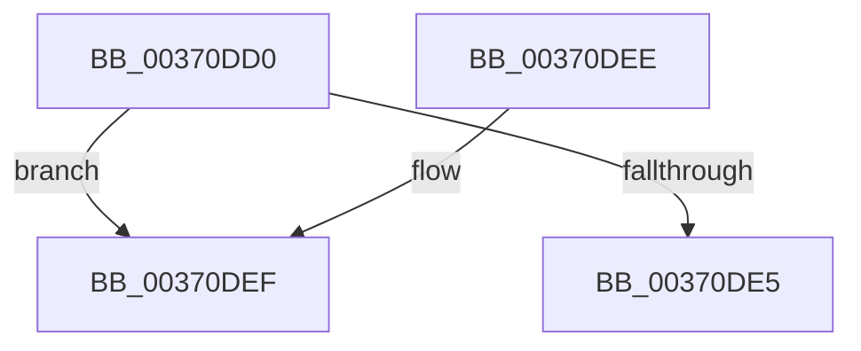

# MiCaptureDirtyBitToPfn

- RVA: `0x00370DD0`–`0x00370DF2` (길이 `34` bytes)
- VA: `0x0000000140370DD0`
- 실행 섹션: `.text`
- PDB 이름 있음: `예`; PDB Function 태그: `아니요`
- unwind 정보 RVA: `0x0007A788`
- 디코드: `13`개 명령, `34/34` bytes 표시
- 미해석 바이트: `0` (있으면 어셈블리에 `.byte`로 보존)

> 이 문서는 커널 이미지의 기계어와 PDB 기호를 분석해 생성했습니다. 4번과 5번은 함수 원형과 자료형을 바이너리 사용 방식에서 추정한 C 해석이며 원본 소스 복구 결과는 아닙니다.

## 1. Dependencies

- 직접 호출 지점: **0**; 고유 호출 대상: **0**
- 직접 호출자로 확인된 함수: **26**
- RIP 상대 이미지 참조: **0**

### Outgoing calls
- 직접 디코드된 call 명령이 없습니다.

### Direct callers
- [MiResolveProtoCombine](../22/MiResolveProtoCombine_function_0022CD00.md) at `0x0022D077`
- [MiBuildForkPte](../22/MiBuildForkPte_function_0022E32C.md) at `0x0022E5F8`
- [MmSetAddressRangeModifiedEx](../23/MmSetAddressRangeModifiedEx_function_00236F20.md) at `0x00237233`
- [sub_0023E278](../23/Unknown_function_0023E278.md) at `0x0023E359`
- [MmProtectPool](../26/MmProtectPool_function_002697AC.md) at `0x00269CB4`
- [MiResolveTransitionFault](../28/MiResolveTransitionFault_function_00282940.md) at `0x0028320E`
- [MiWsleFree](../28/MiWsleFree_function_00284600.md) at `0x00284F6E`
- [MiStealPage](../2B/MiStealPage_function_002B28D0.md) at `0x002B38B8`
- [MiStealPage](../2B/MiStealPage_function_002B28D0.md) at `0x002B38DF`
- [MiMakeFaultPfnActive](../36/MiMakeFaultPfnActive_function_00361D00.md) at `0x00361DA4`
- [MiWalkEntireImage](../36/MiWalkEntireImage_function_00365D70.md) at `0x00366629`
- [MiZeroCfgSystemWideBitmapWorker](../36/MiZeroCfgSystemWideBitmapWorker_function_00367060.md) at `0x0036742C`
- [MiZeroCfgSystemWideBitmapWorker](../36/MiZeroCfgSystemWideBitmapWorker_function_00367060.md) at `0x00367669`
- [MiDecommitPrivatePageTail](../36/MiDecommitPrivatePageTail_function_0036F564.md) at `0x0036F667`
- [MiDecommitPrivatePageTail](../36/MiDecommitPrivatePageTail_function_0036F564.md) at `0x0036F851`
- [MiLockCode](../36/MiLockCode_function_0036F91C.md) at `0x0036FB3A`
- [MiDecommitSharedPageTail](MiDecommitSharedPageTail_function_00370240.md) at `0x003703F1`
- [MiOutSwapWorkingSetPte](MiOutSwapWorkingSetPte_function_00372190.md) at `0x003722DE`
- [MiSetSystemCodeProtection](../38/MiSetSystemCodeProtection_function_00384420.md) at `0x003846BB`
- [MiMakeOutswappedPageResident](../43/MiMakeOutswappedPageResident_function_00431AD0.md) at `0x00431BF7`
- [MiUpdateImportRelocationsOnDriverPrivatePages](../44/MiUpdateImportRelocationsOnDriverPrivatePages_function_00449BCC.md) at `0x00449E2F`
- [MiCompleteSecureProcessFault](../46/MiCompleteSecureProcessFault_function_0046710C.md) at `0x004671E0`
- [MiLockPagedAddress](../48/MiLockPagedAddress_function_00484CDC.md) at `0x00484DBB`
- [MmUpdateUserShadowStackValue](../49/MmUpdateUserShadowStackValue_function_004935D8.md) at `0x004936E0`
- [MiTrimSystemImagePages](../4B/MiTrimSystemImagePages_function_004B18FC.md) at `0x004B1B45`
- [MiLockDriverPageRange](../67/MiLockDriverPageRange_function_00670160.md) at `0x00670416`
- [MiReplaceImportEntry](../67/MiReplaceImportEntry_function_00671440.md) at `0x0067168F`
- [MmDbgMarkPfnModifiedWorker](../68/MmDbgMarkPfnModifiedWorker_function_00686298.md) at `0x006862E1`
- [MiScanPagefileSpace](../../page/80/MiScanPagefileSpace_function_00800440.md) at `0x008005D1`

### Static image references
- 디코드된 RIP-relative 메모리 참조가 없습니다.

## 2. Other-region calls and transfers

- 다른 실행 섹션으로 향하는 call: **0**
- 별도 외부 분기/꼬리 이동을 확인하지 못했습니다.

## 3. Assembly (complete function range)

```asm
00370DD0  40 53                           push rbx
00370DD2  48 83 EC 20                     sub rsp, 0x20
00370DD6  48 8B D9                        mov rbx, rcx
00370DD9  45 33 DB                        xor r11d, r11d
00370DDC  0F B6 49 22                     movzx ecx, byte ptr [rcx + 0x22]
00370DE0  F6 C1 10                        test cl, 0x10
00370DE3  74 0A                           je 0x140370def
00370DE5  49 8B C3                        mov rax, r11
00370DE8  48 83 C4 20                     add rsp, 0x20
00370DEC  5B                              pop rbx
00370DED  C3                              ret
00370DEE  CC                              int3
00370DEF  8B 43 10                        mov eax, dword ptr [rbx + 0x10]
```

## 4. C-style interpretation (structured pseudocode)

```c
__int64 __fastcall MiCaptureDirtyBitToPfn(__int64 a1)
{
    __int64 v_r11;
    __int64 v_rsp;

    v_rsp = (v_rsp) - (32);
    v_r11 = 0;
    if ((((unsigned __int8)(*(unsigned __int8 *)(a1 + 34))) & (16)) == 0) goto loc_00370DEF;
    v_rsp = (v_rsp) + (32);
    return 0;
loc_00370DEF:
    return (unsigned int)(*(unsigned int *)(a1 + 16));
}
```

## 5. (Beta) C Style

```c
int64_t MiCaptureDirtyBitToPfn(void *Arg1)
{
    uint8_t *arg1 = (uint8_t *)Arg1;

    int64_t local_r11;
    int64_t local_rsp;

    local_rsp = (local_rsp) - (32);
    local_r11 = 0;
    if ((((uint8_t)(*(uint8_t *)(arg1 + 0x22))) & (16)) == 0) goto loc_00370DEF;
    local_rsp = (local_rsp) + (32);
    return 0;
loc_00370DEF:
    return (uint32_t)(*(uint32_t *)(arg1 + 0x10));
}
```

### 관측된 메모리 오프셋

구조체 형식이 확인되지 않은 접근은 인자 기준의 오프셋으로만 기록했습니다.

| 기준 인자 | 오프셋 표현 | 폭 (bit) | 접근 |
|---|---:|---:|---|
| `Arg1` | `+ 0x10` | `32` | `R` |
| `Arg1` | `+ 0x22` | `8` | `R` |

## 6. Execution-region graph

[열기: 2D/3D 그래프와 함수 탐색 컨트롤 패널](../../../control-panel.html?section=text&rva=0x00370DD0&view=graph)

- 2D 그래프는 위에서 아래로 흐르고, 3D 그래프는 빈 공간을 드래그해 회전합니다. Shift+드래그는 이동, 휠은 확대·축소, 함수 노드 선택은 대상 보고서 이동입니다.

### Static fallback


