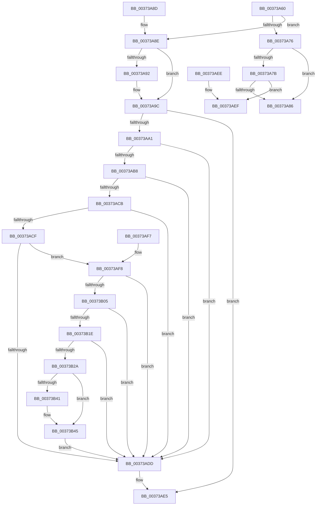

# MiCapturePageFileInfoInline

- RVA: `0x00373A60`–`0x00373B55` (길이 `245` bytes)
- VA: `0x0000000140373A60`
- 실행 섹션: `.text`
- PDB 이름 있음: `예`; PDB Function 태그: `아니요`
- unwind 정보 RVA: `0x0007AA98`
- 디코드: `72`개 명령, `245/245` bytes 표시
- 미해석 바이트: `0` (있으면 어셈블리에 `.byte`로 보존)

> 이 문서는 커널 이미지의 기계어와 PDB 기호를 분석해 생성했습니다. 4번과 5번은 함수 원형과 자료형을 바이너리 사용 방식에서 추정한 C 해석이며 원본 소스 복구 결과는 아닙니다.

## 1. Dependencies

- 직접 호출 지점: **0**; 고유 호출 대상: **0**
- 직접 호출자로 확인된 함수: **2**
- RIP 상대 이미지 참조: **1**

### Outgoing calls
- 직접 디코드된 call 명령이 없습니다.

### Direct callers
- [MiActOnPte](../24/MiActOnPte_function_00244C90.md) at `0x0024544D`
- [MiWriteCompletePfn](MiWriteCompletePfn_function_003737C4.md) at `0x00373875`
- [MiWriteCompletePfn](MiWriteCompletePfn_function_003737C4.md) at `0x00373993`

### Static image references
- `0x00373AF8` → RVA `0x00FC6A88` (`ALMOSTRO`; read)

## 2. Other-region calls and transfers

- 다른 실행 섹션으로 향하는 call: **0**
- 별도 외부 분기/꼬리 이동을 확인하지 못했습니다.

## 3. Assembly (complete function range)

```asm
00373A60  48 83 EC 18                     sub rsp, 0x18
00373A64  4C 8B 09                        mov r9, qword ptr [rcx]
00373A67  41 0F B6 C1                     movzx eax, r9b
00373A6B  4C 89 0C 24                     mov qword ptr [rsp], r9
00373A6F  C0 E8 02                        shr al, 2
00373A72  A8 01                           test al, 1
00373A74  75 18                           jne 0x140373a8e
00373A76  45 85 C0                        test r8d, r8d
00373A79  74 0B                           je 0x140373a86
00373A7B  41 0F B6 C9                     movzx ecx, r9b
00373A7F  D0 E9                           shr cl, 1
00373A81  F6 C1 01                        test cl, 1
00373A84  75 69                           jne 0x140373aef
00373A86  33 C0                           xor eax, eax
00373A88  48 83 C4 18                     add rsp, 0x18
00373A8C  C3                              ret
00373A8D  CC                              int3
00373A8E  85 D2                           test edx, edx
00373A90  74 0A                           je 0x140373a9c
00373A92  48 8B 01                        mov rax, qword ptr [rcx]
00373A95  48 83 E0 FB                     and rax, 0xfffffffffffffffb
00373A99  48 89 01                        mov qword ptr [rcx], rax
00373A9C  45 85 C0                        test r8d, r8d
00373A9F  75 44                           jne 0x140373ae5
00373AA1  48 8B 04 24                     mov rax, qword ptr [rsp]
00373AA5  48 BA 00 D0 BE 7D FB F6 FF FF   movabs rdx, 0xfffff6fb7dbed000
00373AAF  48 8D 0C 24                     lea rcx, [rsp]
00373AB3  48 3B CA                        cmp rcx, rdx
00373AB6  72 25                           jb 0x140373add
00373AB8  48 BA F8 D7 BE 7D FB F6 FF FF   movabs rdx, 0xfffff6fb7dbed7f8
00373AC2  48 8D 0C 24                     lea rcx, [rsp]
00373AC6  48 3B CA                        cmp rcx, rdx
00373AC9  77 12                           ja 0x140373add
00373ACB  A8 01                           test al, 1
00373ACD  74 0E                           je 0x140373add
00373ACF  A8 42                           test al, 0x42
00373AD1  0F 95 C2                        setne dl
00373AD4  A8 20                           test al, 0x20
00373AD6  0F 95 C1                        setne cl
00373AD9  84 D1                           test cl, dl
00373ADB  74 1B                           je 0x140373af8
00373ADD  48 83 E0 FD                     and rax, 0xfffffffffffffffd
00373AE1  48 89 04 24                     mov qword ptr [rsp], rax
00373AE5  48 8B 04 24                     mov rax, qword ptr [rsp]
00373AE9  48 83 C4 18                     add rsp, 0x18
00373AED  C3                              ret
00373AEE  CC                              int3
00373AEF  49 8B C1                        mov rax, r9
00373AF2  48 83 C4 18                     add rsp, 0x18
00373AF6  C3                              ret
00373AF7  CC                              int3
00373AF8  48 F7 05 85 2F C5 00 00 00 60 00  test qword ptr [rip + 0xc52f85], 0x600000
00373B03  74 D8                           je 0x140373add
00373B05  65 48 8B 0C 25 88 01 00 00      mov rcx, qword ptr gs:[0x188]
00373B0E  48 8B 91 B8 00 00 00            mov rdx, qword ptr [rcx + 0xb8]
00373B15  80 BA 60 01 00 00 01            cmp byte ptr [rdx + 0x160], 1
00373B1C  74 BF                           je 0x140373add
00373B1E  4C 8B 82 08 05 00 00            mov r8, qword ptr [rdx + 0x508]
00373B25  4D 85 C0                        test r8, r8
00373B28  74 B3                           je 0x140373add
00373B2A  48 8D 0C 24                     lea rcx, [rsp]
00373B2E  48 C1 E9 03                     shr rcx, 3
00373B32  81 E1 FF 01 00 00               and ecx, 0x1ff
00373B38  49 8B 0C C8                     mov rcx, qword ptr [r8 + rcx*8]
00373B3C  F6 C1 20                        test cl, 0x20
00373B3F  74 04                           je 0x140373b45
00373B41  48 83 C8 20                     or rax, 0x20
00373B45  48 8B D0                        mov rdx, rax
00373B48  48 83 C8 42                     or rax, 0x42
00373B4C  F6 C1 42                        test cl, 0x42
00373B4F  48 0F 44 C2                     cmove rax, rdx
00373B53  EB 88                           jmp 0x140373add
```

## 4. C-style interpretation (structured pseudocode)

```c
__int64 __fastcall MiCapturePageFileInfoInline(__int64 a1, int a2, int a3)
{
    __int64 result;
    __int64 v_rsp;
    unsigned __int64 v_stack_m18;
    unsigned __int64 v_stack_p0;
    unsigned __int64 v_stack_p30;

    v_rsp = (v_rsp) - (24);
    v_stack_m18 = *(unsigned __int64 *)(a1);
    result = (unsigned __int8)(((unsigned __int8)(*(unsigned __int64 *)(a1))) >> (2));
    if ((((unsigned __int8)(result)) & (1)) != 0) goto loc_00373A8E;
    if (a3 == 0) goto loc_00373A86;
    a1 = (unsigned __int8)(((unsigned __int8)(*(unsigned __int64 *)(a1))) >> (1));
    if ((((unsigned __int8)(a1)) & (1)) != 0) goto loc_00373AEF;
loc_00373A86:
    result = 0;
    v_rsp = (v_rsp) + (24);
    return result;
loc_00373A8E:
    if (a2 != 0) {
        result = *(unsigned __int64 *)(a1);
        result = (result) & (-5);
        *(unsigned __int64 *)(a1) = result;
    }
    if (a3 != 0) goto loc_00373AE5;
    if (v_stack_p0 < a2) goto loc_00373ADD;
    if (v_stack_p0 > a2) goto loc_00373ADD;
    if ((((unsigned __int8)(v_stack_p0)) & (1)) == 0) goto loc_00373ADD;
    a2 = ((((unsigned __int8)(v_stack_p0)) & (66)) != 0) ? 1 : 0;
    a1 = ((((unsigned __int8)(v_stack_p0)) & (32)) != 0) ? 1 : 0;
    if ((((unsigned __int8)(a1)) & ((unsigned __int8)(a2))) == 0) goto loc_00373AF8;
loc_00373ADD:
    result = (v_stack_p0) & (-3);
    v_stack_p0 = result;
loc_00373AE5:
    v_rsp = (v_rsp) + (24);
    return v_stack_p0;
loc_00373AEF:
    v_rsp = (v_rsp) + (24);
    return *(unsigned __int64 *)(a1);
loc_00373AF8:
    if (((*(unsigned __int64 *)(v_rip + 12922757)) & (0x600000ULL)) == 0) goto loc_00373ADD;
    if ((*(unsigned __int8 *)(*(unsigned __int64 *)(*(unsigned __int64 *)(gs_base + (0 + 392)) + 184) + 352)) == 1) goto loc_00373ADD;
    if (*(unsigned __int64 *)(*(unsigned __int64 *)(*(unsigned __int64 *)(gs_base + (0 + 392)) + 184) + 1288) == 0) goto loc_00373ADD;
    a1 = (v_stack_p30) >> (3);
    a1 = (unsigned int)((a1) & (511));
    result = *(unsigned __int64 *)(a1);
    if ((((unsigned __int8)(*(unsigned __int64 *)(*(unsigned __int64 *)(*(unsigned __int64 *)(*(unsigned __int64 *)(gs_base + (0 + 392)) + 184) + 1288) + a1 * 8))) & (32)) != 0) {
        result = (*(unsigned __int64 *)(a1)) | (32);
    }
    result = (result) | (66);
    if ((((unsigned __int8)(*(unsigned __int64 *)(*(unsigned __int64 *)(*(unsigned __int64 *)(*(unsigned __int64 *)(gs_base + (0 + 392)) + 184) + 1288) + a1 * 8))) & (66)) == 0) { result = result; }
    goto loc_00373ADD;
}
```

## 5. (Beta) C Style

```c
int64_t MiCapturePageFileInfoInline(void *Arg1, int32_t Arg2, int32_t Arg3)
{
    uint8_t *arg1 = (uint8_t *)Arg1;

    int64_t result;
    int64_t local_rsp;
    uint64_t v_stack_m18;
    uint64_t v_stack_p0;
    uint64_t v_stack_p30;

    local_rsp = (local_rsp) - (24);
    v_stack_m18 = *(uint64_t *)(arg1);
    result = (uint8_t)(((uint8_t)(*(uint64_t *)(arg1))) >> (2));
    if ((((uint8_t)(result)) & (1)) != 0) goto loc_00373A8E;
    if (Arg3 == 0) goto loc_00373A86;
    Arg1 = (uint8_t)(((uint8_t)(*(uint64_t *)(arg1))) >> (1));
    if ((((uint8_t)(Arg1)) & (1)) != 0) goto loc_00373AEF;
loc_00373A86:
    result = 0;
    local_rsp = (local_rsp) + (24);
    return result;
loc_00373A8E:
    if (Arg2 != 0) {
        result = *(uint64_t *)(arg1);
        result = (result) & (-5);
        *(uint64_t *)(arg1) = result;
    }
    if (Arg3 != 0) goto loc_00373AE5;
    if (v_stack_p0 < Arg2) goto loc_00373ADD;
    if (v_stack_p0 > Arg2) goto loc_00373ADD;
    if ((((uint8_t)(v_stack_p0)) & (1)) == 0) goto loc_00373ADD;
    Arg2 = ((((uint8_t)(v_stack_p0)) & (66)) != 0) ? 1 : 0;
    Arg1 = ((((uint8_t)(v_stack_p0)) & (32)) != 0) ? 1 : 0;
    if ((((uint8_t)(Arg1)) & ((uint8_t)(Arg2))) == 0) goto loc_00373AF8;
loc_00373ADD:
    result = (v_stack_p0) & (-3);
    v_stack_p0 = result;
loc_00373AE5:
    local_rsp = (local_rsp) + (24);
    return v_stack_p0;
loc_00373AEF:
    local_rsp = (local_rsp) + (24);
    return *(uint64_t *)(arg1);
loc_00373AF8:
    if (((*(uint64_t *)(v_rip + 0xC52F85)) & (0x600000ULL)) == 0) goto loc_00373ADD;
    if ((*(uint8_t *)(*(uint64_t *)(*(uint64_t *)(gs_base + (0 + 0x188)) + 0xB8) + 0x160)) == 1) goto loc_00373ADD;
    if (*(uint64_t *)(*(uint64_t *)(*(uint64_t *)(gs_base + (0 + 0x188)) + 0xB8) + 0x508) == 0) goto loc_00373ADD;
    Arg1 = (v_stack_p30) >> (3);
    Arg1 = (uint32_t)((Arg1) & (511));
    result = *(uint64_t *)(arg1);
    if ((((uint8_t)(*(uint64_t *)(*(uint64_t *)(*(uint64_t *)(*(uint64_t *)(gs_base + (0 + 0x188)) + 0xB8) + 0x508) + arg1 * 8))) & (32)) != 0) {
        result = (*(uint64_t *)(arg1)) | (32);
    }
    result = (result) | (66);
    if ((((uint8_t)(*(uint64_t *)(*(uint64_t *)(*(uint64_t *)(*(uint64_t *)(gs_base + (0 + 0x188)) + 0xB8) + 0x508) + arg1 * 8))) & (66)) == 0) { result = result; }
    goto loc_00373ADD;
}
```

### 관측된 메모리 오프셋

구조체 형식이 확인되지 않은 접근은 인자 기준의 오프셋으로만 기록했습니다.

| 기준 인자 | 오프셋 표현 | 폭 (bit) | 접근 |
|---|---:|---:|---|
| `Arg1` | `+ 0x0` | `64` | `R` |
| `Arg1` | `+ 0x0` | `64` | `W` |

## 6. Execution-region graph

[열기: 2D/3D 그래프와 함수 탐색 컨트롤 패널](../../../control-panel.html?section=text&rva=0x00373A60&view=graph)

- 2D 그래프는 위에서 아래로 흐르고, 3D 그래프는 빈 공간을 드래그해 회전합니다. Shift+드래그는 이동, 휠은 확대·축소, 함수 노드 선택은 대상 보고서 이동입니다.

### Static fallback


