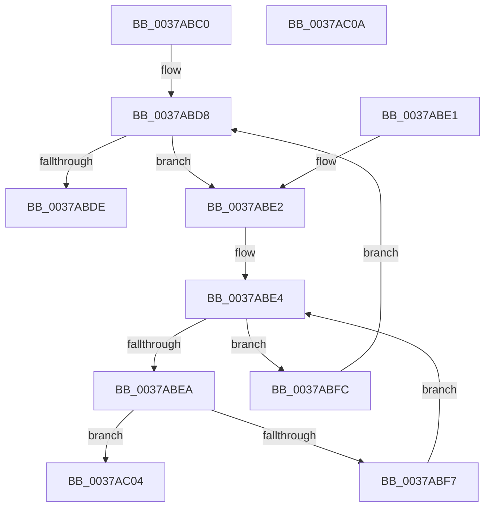

# MiCheckLargePagesExist

- RVA: `0x0037ABC0`–`0x0037AC0B` (길이 `75` bytes)
- VA: `0x000000014037ABC0`
- 실행 섹션: `.text`
- PDB 이름 있음: `예`; PDB Function 태그: `아니요`
- unwind 정보 RVA: `0x000DB714`
- 디코드: `27`개 명령, `75/75` bytes 표시
- 미해석 바이트: `0` (있으면 어셈블리에 `.byte`로 보존)

> 이 문서는 커널 이미지의 기계어와 PDB 기호를 분석해 생성했습니다. 4번과 5번은 함수 원형과 자료형을 바이너리 사용 방식에서 추정한 C 해석이며 원본 소스 복구 결과는 아닙니다.

## 1. Dependencies

- 직접 호출 지점: **0**; 고유 호출 대상: **0**
- 직접 호출자로 확인된 함수: **3**
- RIP 상대 이미지 참조: **0**

### Outgoing calls
- 직접 디코드된 call 명령이 없습니다.

### Direct callers
- [MiPerformOnDemandLargePageCoalesce](MiPerformOnDemandLargePageCoalesce_function_00379678.md) at `0x003797BD`
- [MiProcessLargeCoalesceBitmapCandidates](MiProcessLargeCoalesceBitmapCandidates_function_0037A3F0.md) at `0x0037A58E`
- [sub_006E4446](../6E/Unknown_function_006E4446.md) at `0x006E450B`

### Static image references
- 디코드된 RIP-relative 메모리 참조가 없습니다.

## 2. Other-region calls and transfers

- 다른 실행 섹션으로 향하는 call: **0**
- 별도 외부 분기/꼬리 이동을 확인하지 못했습니다.

## 3. Assembly (complete function range)

```asm
0037ABC0  8B 41 08                        mov eax, dword ptr [rcx + 8]
0037ABC3  4C 8B D1                        mov r10, rcx
0037ABC6  4C 8D 0C 80                     lea r9, [rax + rax*4]
0037ABCA  49 C1 E1 08                     shl r9, 8
0037ABCE  4C 03 49 18                     add r9, qword ptr [rcx + 0x18]
0037ABD2  33 D2                           xor edx, edx
0037ABD4  44 8D 42 70                     lea r8d, [rdx + 0x70]
0037ABD8  41 3B 52 10                     cmp edx, dword ptr [r10 + 0x10]
0037ABDC  7E 04                           jle 0x14037abe2
0037ABDE  33 C0                           xor eax, eax
0037ABE0  C3                              ret
0037ABE1  CC                              int3
0037ABE2  33 C9                           xor ecx, ecx
0037ABE4  48 83 F9 01                     cmp rcx, 1
0037ABE8  7D 12                           jge 0x14037abfc
0037ABEA  49 8D 04 08                     lea rax, [r8 + rcx]
0037ABEE  49 8B 04 C1                     mov rax, qword ptr [r9 + rax*8]
0037ABF2  48 85 C0                        test rax, rax
0037ABF5  75 0D                           jne 0x14037ac04
0037ABF7  48 FF C1                        inc rcx
0037ABFA  EB E8                           jmp 0x14037abe4
0037ABFC  FF C2                           inc edx
0037ABFE  49 83 C0 02                     add r8, 2
0037AC02  EB D4                           jmp 0x14037abd8
0037AC04  B8 01 00 00 00                  mov eax, 1
0037AC09  C3                              ret
0037AC0A  CC                              int3
```

## 4. C-style interpretation (structured pseudocode)

```c
__int64 __fastcall MiCheckLargePagesExist(__int64 a1, int a2)
{
    __int64 result;

    a4 = ((unsigned int)(*(unsigned int *)(a1 + 8)) + (unsigned int)(*(unsigned int *)(a1 + 8)) * 4) << (8);
    a4 = (a4) + (*(unsigned __int64 *)(a1 + 24));
    a2 = 0;
loc_0037ABD8:
    if (0 <= (*(unsigned int *)(a1 + 16))) goto loc_0037ABE2;
    result = 0;
    return result;
loc_0037ABE2:
    a1 = 0;
loc_0037ABE4:
    if (0 >= 1) goto loc_0037ABFC;
    if (*(unsigned __int64 *)(a4 + a2 + 112 + a1 * 1 * 8) != 0) goto loc_0037AC04;
    a1 = (a1) + 1;
    goto loc_0037ABE4;
loc_0037ABFC:
    a2 = (unsigned int)((a2) + 1);
    a3 = (a2 + 112) + (2);
    goto loc_0037ABD8;
loc_0037AC04:
    return 1;
}
```

## 5. (Beta) C Style

```c
int64_t MiCheckLargePagesExist(void *Arg1, int32_t Arg2)
{
    uint8_t *arg1 = (uint8_t *)Arg1;

    int64_t result;

    a4 = ((uint32_t)(*(uint32_t *)(arg1 + 0x8)) + (uint32_t)(*(uint32_t *)(arg1 + 0x8)) * 4) << (8);
    a4 = (a4) + (*(uint64_t *)(arg1 + 0x18));
    Arg2 = 0;
loc_0037ABD8:
    if (0 <= (*(uint32_t *)(arg1 + 0x10))) goto loc_0037ABE2;
    result = 0;
    return result;
loc_0037ABE2:
    Arg1 = 0;
loc_0037ABE4:
    if (0 >= 1) goto loc_0037ABFC;
    if (*(uint64_t *)(a4 + Arg2 + 0x70 + arg1 * 1 * 8) != 0) goto loc_0037AC04;
    Arg1 = (Arg1) + 1;
    goto loc_0037ABE4;
loc_0037ABFC:
    Arg2 = (uint32_t)((Arg2) + 1);
    a3 = (Arg2 + 112) + (2);
    goto loc_0037ABD8;
loc_0037AC04:
    return 1;
}
```

### 관측된 메모리 오프셋

구조체 형식이 확인되지 않은 접근은 인자 기준의 오프셋으로만 기록했습니다.

| 기준 인자 | 오프셋 표현 | 폭 (bit) | 접근 |
|---|---:|---:|---|
| `Arg1` | `+ 0x8` | `32` | `R` |
| `Arg1` | `+ 0x10` | `32` | `R` |
| `Arg1` | `+ 0x18` | `64` | `R` |

## 6. Execution-region graph

[열기: 2D/3D 그래프와 함수 탐색 컨트롤 패널](../../../control-panel.html?section=text&rva=0x0037ABC0&view=graph)

- 2D 그래프는 위에서 아래로 흐르고, 3D 그래프는 빈 공간을 드래그해 회전합니다. Shift+드래그는 이동, 휠은 확대·축소, 함수 노드 선택은 대상 보고서 이동입니다.

### Static fallback


