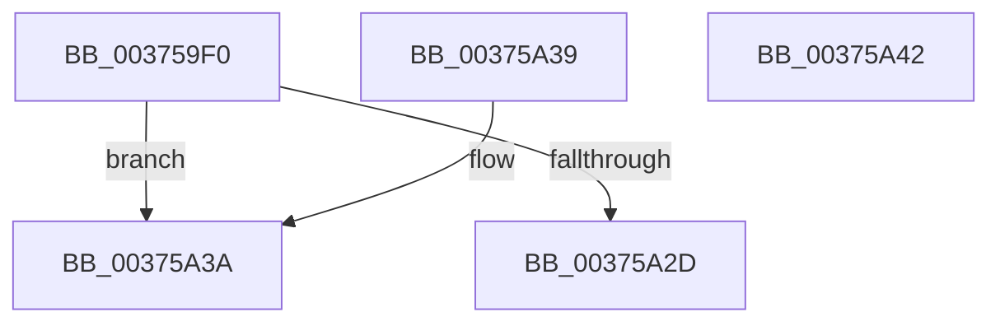

# MiClearPfnReuseFields

- RVA: `0x003759F0`–`0x00375A43` (길이 `83` bytes)
- VA: `0x00000001403759F0`
- 실행 섹션: `.text`
- PDB 이름 있음: `예`; PDB Function 태그: `아니요`
- unwind 정보 RVA: `0x000DB714`
- 디코드: `23`개 명령, `83/83` bytes 표시
- 미해석 바이트: `0` (있으면 어셈블리에 `.byte`로 보존)

> 이 문서는 커널 이미지의 기계어와 PDB 기호를 분석해 생성했습니다. 4번과 5번은 함수 원형과 자료형을 바이너리 사용 방식에서 추정한 C 해석이며 원본 소스 복구 결과는 아닙니다.

## 1. Dependencies

- 직접 호출 지점: **0**; 고유 호출 대상: **0**
- 직접 호출자로 확인된 함수: **16**
- RIP 상대 이미지 참조: **0**

### Outgoing calls
- 직접 디코드된 call 명령이 없습니다.

### Direct callers
- [MiSwapStackPageNoDpc](../2A/MiSwapStackPageNoDpc_function_002A0270.md) at `0x002A03DD`
- [MiReplaceTransitionPage](../2B/MiReplaceTransitionPage_function_002B1120.md) at `0x002B176F`
- [MiStealPage](../2B/MiStealPage_function_002B28D0.md) at `0x002B2FC2`
- [MiRelinkStandbyPage](../2B/MiRelinkStandbyPage_function_002B9D30.md) at `0x002B9DCA`
- [sub_002F6E32](../2F/Unknown_function_002F6E32.md) at `0x002F73B6`
- [MiRemoveLowestPriorityStandbyPage](../33/MiRemoveLowestPriorityStandbyPage_function_00334600.md) at `0x0033489A`
- [MiDeleteSectionCluster](MiDeleteSectionCluster_function_00373DF0.md) at `0x00374049`
- [MiTradeActivePage](MiTradeActivePage_function_00374424.md) at `0x003745C4`
- [MiZeroAndReleasePages](MiZeroAndReleasePages_function_003748D0.md) at `0x00374A87`
- [MiDiscardTransitionPteEx](MiDiscardTransitionPteEx_function_00375954.md) at `0x003759A9`
- [MiSwapNumaStandbyPage](../38/MiSwapNumaStandbyPage_function_00385144.md) at `0x003854D2`
- [MiReuseStandbyPage](../44/MiReuseStandbyPage_function_0044CA90.md) at `0x0044CAD5`
- [MiPreInitializeSystemImagePage](../4D/MiPreInitializeSystemImagePage_function_004D621C.md) at `0x004D6289`
- [MiStackCopyHighLevel](../67/MiStackCopyHighLevel_function_0067B204.md) at `0x0067B25B`
- [MiAddExpansionNonPagedPool](../68/MiAddExpansionNonPagedPool_function_00682B4C.md) at `0x00682BD9`
- [sub_006DAAE6](../6D/Unknown_function_006DAAE6.md) at `0x006DAB97`

### Static image references
- 디코드된 RIP-relative 메모리 참조가 없습니다.

## 2. Other-region calls and transfers

- 다른 실행 섹션으로 향하는 call: **0**
- 별도 외부 분기/꼬리 이동을 확인하지 못했습니다.

## 3. Assembly (complete function range)

```asm
003759F0  8B 51 20                        mov edx, dword ptr [rcx + 0x20]
003759F3  49 B8 FF FF FF FF FF FF FF 7F   movabs r8, 0x7fffffffffffffff
003759FD  48 8B 41 28                     mov rax, qword ptr [rcx + 0x28]
00375A01  89 54 24 08                     mov dword ptr [rsp + 8], edx
00375A05  49 23 C0                        and rax, r8
00375A08  80 64 24 0B D7                  and byte ptr [rsp + 0xb], 0xd7
00375A0D  48 89 41 28                     mov qword ptr [rcx + 0x28], rax
00375A11  C1 EA 10                        shr edx, 0x10
00375A14  80 E2 C7                        and dl, 0xc7
00375A17  88 54 24 0A                     mov byte ptr [rsp + 0xa], dl
00375A1B  8B 44 24 08                     mov eax, dword ptr [rsp + 8]
00375A1F  89 41 20                        mov dword ptr [rcx + 0x20], eax
00375A22  48 8B 41 28                     mov rax, qword ptr [rcx + 0x28]
00375A26  48 0F BA E0 28                  bt rax, 0x28
00375A2B  73 0D                           jae 0x140375a3a
00375A2D  8B 41 24                        mov eax, dword ptr [rcx + 0x24]
00375A30  25 00 00 00 18                  and eax, 0x18000000
00375A35  89 41 24                        mov dword ptr [rcx + 0x24], eax
00375A38  C3                              ret
00375A39  CC                              int3
00375A3A  C7 41 24 00 00 00 00            mov dword ptr [rcx + 0x24], 0
00375A41  C3                              ret
00375A42  CC                              int3
```

## 4. C-style interpretation (structured pseudocode)

```c
__int64 __fastcall MiClearPfnReuseFields(__int64 a1)
{
    __int64 result;
    unsigned int v_stack_p8;
    unsigned __int8 v_stack_pA;
    unsigned __int8 v_stack_pB;

    v_stack_p8 = (unsigned int)((unsigned int)(*(unsigned int *)(a1 + 32)));
    result = (*(unsigned __int64 *)(a1 + 40)) & (a3);
    *(unsigned __int64 *)(a1 + 40) = result;
    a2 = (unsigned int)(((unsigned int)(*(unsigned int *)(a1 + 32))) >> (16));
    a2 = (unsigned __int8)((a2) & (199));
    v_stack_pA = (unsigned __int8)(a2);
    *(unsigned int *)(a1 + 32) = (unsigned int)((unsigned int)(v_stack_p8));
    if (condition_is_above_or_equal) goto loc_00375A3A;
    result = (unsigned int)(((unsigned int)(*(unsigned int *)(a1 + 36))) & (0x18000000ULL));
    *(unsigned int *)(a1 + 36) = (unsigned int)(result);
    return result;
loc_00375A3A:
    *(unsigned int *)(a1 + 36) = 0;
    return result;
}
```

## 5. (Beta) C Style

```c
int64_t MiClearPfnReuseFields(void *Arg1)
{
    uint8_t *arg1 = (uint8_t *)Arg1;

    int64_t result;
    uint32_t v_stack_p8;
    uint8_t v_stack_pA;
    uint8_t v_stack_pB;

    v_stack_p8 = (uint32_t)((uint32_t)(*(uint32_t *)(arg1 + 0x20)));
    result = (*(uint64_t *)(arg1 + 0x28)) & (a3);
    *(uint64_t *)(arg1 + 0x28) = result;
    a2 = (uint32_t)(((uint32_t)(*(uint32_t *)(arg1 + 0x20))) >> (16));
    a2 = (uint8_t)((a2) & (199));
    v_stack_pA = (uint8_t)(a2);
    *(uint32_t *)(arg1 + 0x20) = (uint32_t)((uint32_t)(v_stack_p8));
    if (condition_is_above_or_equal) goto loc_00375A3A;
    result = (uint32_t)(((uint32_t)(*(uint32_t *)(arg1 + 0x24))) & (0x18000000ULL));
    *(uint32_t *)(arg1 + 0x24) = (uint32_t)(result);
    return result;
loc_00375A3A:
    *(uint32_t *)(arg1 + 0x24) = 0;
    return result;
}
```

### 관측된 메모리 오프셋

구조체 형식이 확인되지 않은 접근은 인자 기준의 오프셋으로만 기록했습니다.

| 기준 인자 | 오프셋 표현 | 폭 (bit) | 접근 |
|---|---:|---:|---|
| `Arg1` | `+ 0x20` | `32` | `R` |
| `Arg1` | `+ 0x20` | `32` | `W` |
| `Arg1` | `+ 0x24` | `32` | `R` |
| `Arg1` | `+ 0x24` | `32` | `W` |
| `Arg1` | `+ 0x28` | `64` | `R` |
| `Arg1` | `+ 0x28` | `64` | `W` |

## 6. Execution-region graph

[열기: 2D/3D 그래프와 함수 탐색 컨트롤 패널](../../../control-panel.html?section=text&rva=0x003759F0&view=graph)

- 2D 그래프는 위에서 아래로 흐르고, 3D 그래프는 빈 공간을 드래그해 회전합니다. Shift+드래그는 이동, 휠은 확대·축소, 함수 노드 선택은 대상 보고서 이동입니다.

### Static fallback


